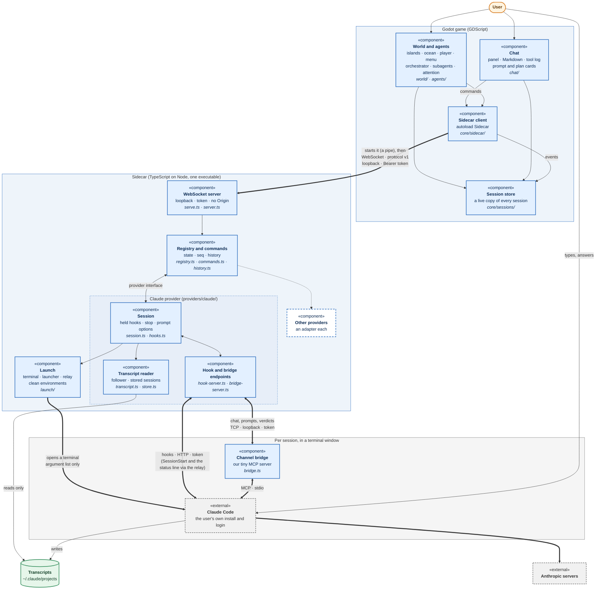

# The Beach: developer notes

Read this first every session. It is the single source of truth for the
design; keep it current and short.

- `NOTES.md` (this file): what the project is, where it's going, how it works.
- `docs/GUIDE.md`: user's guide for built features. Must always match this file.
- `docs/devlog/`: long history, decisions, rejected alternatives, bugs. Look up by feature ID.
- `docs/flows.md`: index of the step-by-step sequence diagrams, one file
  each in `docs/diagrams/sequence/` (create a session, chat, permission,
  question, subagent, stop, failure, ...). Derived from this file; update
  together. The component diagram is in Architecture.
- `CLAUDE.md`: working rules. `README.md`: pitch and setup.
- `assets/CREDITS.md`: source and license of every asset.

## Concept

A 3D working environment in Godot 4 that shows AI coding sessions as a
world you walk around in. It is a place to **work**, not a passive monitor:
you create sessions, resume old ones and chat with the orchestrator, all
from inside the world.

**World.** A beach and ocean world. Each session is an **island**: a new
session rises out of the ocean and an ended one sinks. Islands from the same
repository form a **cluster** joined by walkable bridges, and unrelated
projects get their own stretch of ocean. Bridges are for
exploration and feel; a **teleport menu** is for getting work done quickly.
Other biomes (forests, mountains and more, W10) were planned from the start, so region connection is a
general system, not a beach-specific one.

**Agents.** The **orchestrator** sits at the centre of its island (a bigger
model at a beach desk or under an umbrella). Walking up to it opens the
chat panel. **Subagents** are small models at little PCs on the sand.
They spawn when the orchestrator spawns them and, when they finish,
throw their report to whoever called them and disappear. They show working,
waiting on you, done or error (A03). An agent waiting on a permission
prompt or a question should visibly draw your attention. The agents'
look was planned as the AI tool's logo; they get custom models by the
user instead (open question 7, decided 2026-10-12).

**Terminal and world together.** Each session is a normal `claude` running
in a terminal window, and the world is a second window onto it: you can
chat, answer prompts and questions, or stop it in either place, and switch
at any time (S02).

**Downtime.** You spend a lot of time waiting on agents, so the world should
eventually give you something to do: fishing and bug catching as the main
ways to pass the time, filling a collection, and parkour courses for
movement (user's direction, 2026-10-12). Together with a good UI they are
what the public release waits for. Not designed yet (see Known issues and
next steps → Deferred ideas).

**Principles (user's).**
- **A pretty interface over the real thing, nothing more.** We touch as
  little of what the AI tool provides as possible: we launch it, watch it
  through its documented extension points and pass the user's own input to
  it. We never modify, bundle or re-implement it, never handle its logins,
  and never rely on undocumented behaviour when a documented way exists.
- **Never harm the user through poor quality.** No vulnerabilities, no
  silent actions on the user's behalf, no data leaving the machine. When
  our side fails, the tool must fall back to its own normal behaviour (e.g.
  the terminal asks the question), never to "allowed". See Architecture →
  Security rules.
- **Public release** is the goal (user's plan, 2026-10-02): free and open
  source on GitHub, paid on Steam (Watch items → Anthropic's terms,
  Steam). Everything must hold up on other people's machines, not just
  the developer's.
- **Windows, macOS and Linux are all first-class.** Every feature is
  designed for all three from the start; nothing may assume one OS's
  terminal, paths, shell or installed tools. See Architecture → Platforms.

**Art direction.** Low-poly. Assets are made by the user or come from CC0 packs
such as Kenney, **never AI-generated**. Kenney packs are the likely source
for terrain and environment, which leaves custom modelling effort for the
agent models (custom ones by the user, open question 7).

## Feature index

Prefixes: **W** world (islands, ocean, bridges, travel, player movement),
**A** agents (orchestrator, subagents, states, placement), **C** chat panel
and in-world UI, **S** sidecar and session management. v1 = part of the
v1 slice.

| ID  | Feature                                   | Status  | Guide section | Main code |
|-----|-------------------------------------------|---------|---------------|-----------|
| W01 | Beach island (v1)                         | built   | W01, W02, W04 | `world/island/`, `world/session_islands.gd` |
| W02 | Ocean (v1)                                | built   | W01, W02, W04 | `world/ocean/` |
| W03 | Player movement (v1)                      | built   | W03           | `world/player/` |
| W04 | Island rise / sink                        | built (UI placeholder) | W01, W02, W04 | `world/session_islands.gd`, `world/session_clusters.gd`, `world/new_island_pointers.gd` |
| W05 | Clusters (project clustering)             | built   | W05, S03      | `world/session_clusters.gd`, `sidecar/src/repo.ts` |
| W06 | Bridges (region connection)               | built (UI placeholder) | W06 | `world/bridges/`, `world/session_clusters.gd`, `world/session_islands.gd`, `world/minimap.gd`, `world/world_map.gd` |
| W07 | Teleport menu                             | built (icons placeholder) | S03 | `world/sessions_menu/session_ring.gd`, `world/sessions_menu/ring_icons.gd`, `world/sessions_menu/sessions_menu.gd` |
| W08 | Swimming and seabed                       | built   | W08           | `world/seabed/`, `world/ocean/`, `world/player/player.gd`, `world/island/island_generator.gd` |
| W09 | Day/night cycle and weather               | built   | W09           | `world/sky/`, `world/world.gd`, `world/ocean/`, `world/island/island.gd`, `agents/orchestrator/orchestrator.gd` |
| W10 | Island biomes                             | built   | W10           | `world/island/`, `world/session_islands.gd`, `world/bridges/bridge.gd`, `world/sessions_menu/`, `agents/island_agents.gd`, `world/minimap.gd`, `world/world_map.gd`, `world/player/player.gd` |
| W11 | Crouch and slide                          | built   | W11           | `world/player/player.gd` |
| A01 | Orchestrator (v1)                         | placeholder built | C01 | `agents/orchestrator/` |
| A02 | Subagents spawn / despawn (v1)            | placeholder built | A02 | `agents/subagent/`, `agents/island_agents.gd`, `agents/orchestrator/orchestrator.gd` |
| A03 | Agent state indicators                    | minimal built | A02 | `agents/state_marker.gd` |
| A04 | Procedural agent placement (v1)           | built   | A02           | `agents/agent_placement.gd` |
| A05 | Permission attention cue                  | built   | A05           | `agents/attention_beacon.gd`, `world/attention.gd` |
| C01 | Walk up to chat (v1)                      | built   | C01           | `chat/` |
| C02 | Chat panel and streaming (v1)             | built   | C02           | `chat/` |
| C03 | Markdown rendering                        | built   | C03           | `chat/markdown/` |
| C04 | Tool-call log                             | built (UI placeholder) | C04 | `chat/tool_fold.gd`, `sidecar/src/history.ts` |
| C05 | Permission approve / deny (v1)            | built   | C05           | `chat/pending_card.gd`, `sidecar/src/providers/claude/prompt-options.ts` |
| C06 | Permission mode control                   | built   | C06, C07      | `chat/permission_modes.gd`, `chat/chat_panel.gd`, `sidecar/src/providers/claude/hooks.ts` |
| C07 | Plan approval                             | built   | C06, C07      | `chat/pending_card.gd`, `sidecar/src/providers/claude/session.ts` |
| C08 | Token usage                               | built (UI placeholder) | C08 | `chat/usage_text.gd`, `chat/chat_panel.gd`, `world/usage_limits.gd`, `sidecar/src/providers/claude/usage.ts`, `sidecar/src/providers/claude/statusline.ts`, `sidecar/src/launch/shell-command.ts` |
| C09 | Debug commands                            | built   | C09           | `world/debug/`, `world/sky/weather.gd`, `world/world.gd` |
| C10 | Settings menu                             | built (UI placeholder) | C10 | `world/settings/`, `world/world.gd`, `world/player/player.gd` |
| C11 | Crosshair                                 | built (UI placeholder) | C11 | `world/crosshair.gd`, `world/interactable.gd`, `world/world.gd` |
| S01 | Sidecar and WebSocket server (v1)         | built   | S01           | `sidecar/src/`, `core/sidecar/` |
| S02 | Claude provider (v1)                      | built   | S02           | `sidecar/src/providers/claude/`, `sidecar/src/launch/` |
| S03 | Create session from the world             | built (UI placeholder) | S03 | `world/sessions_menu/sessions_menu.gd`, `world/sessions_menu/session_launcher.gd` |
| S04 | List and resume stored sessions           | built   | S03           | `sidecar/src/providers/claude/store.ts`, `sidecar/src/providers/claude/running.ts`, `world/sessions_menu/` |
| S05 | End session                               | quit warning built | S05 | `world/quit_guard.gd` |
| S06 | Sign-in needed                            | built   | S06           | `sidecar/src/providers/claude/hooks.ts`, `chat/chat_panel.gd` |
| S07 | Reattach to running sessions              | planned | —             | — |

## When a feature lands

- [ ] Update its `### <ID>` section in Systems (planned intent → how it works),
      including its provider scope.
- [ ] Update its index row: status, guide section, main code.
- [ ] Add or update its `<ID>` section in `docs/GUIDE.md` in plain language,
      and add it to the guide's table of contents.
- [ ] Reread the guide section against this file.
- [ ] Update Architecture / Protocol / Conventions if it touched them, and
      the matching file in `docs/diagrams/sequence/` (listed in
      `docs/flows.md`) if it changed how the pieces talk.
- [ ] Record any new assets in `assets/CREDITS.md`, and any shader or
      code-generated visual Claude wrote.
- [ ] Write a dev-log entry and add it to `docs/devlog/README.md`.
- [ ] Update "Current focus".

## Architecture

Component diagram (GitHub draws this Mermaid block as a diagram).
Everything runs on the user's machine; only Claude Code itself talks to
Anthropic. Step-by-step flows are listed in `docs/flows.md`, one file
each in `docs/diagrams/sequence/`.



**Legend:** orange = the user · blue = built, ours · blue dashed = planned · grey dashed =
external (the user's Claude Code, Anthropic) · green = data on disk
(Claude Code's, read only). Thick arrows cross a process boundary; the three into the sidecar
are loopback only and need a token (Security rules). Dashed arrows lead
to planned parts.

- **Godot** (GDScript): the world, player movement, island and bridge
  generation, agent models and state visuals, in-world chat UI.
- **Sidecar** (TypeScript on Node, open question 6): runs sessions and
  forwards their activity to Godot as generic events. It owns the session
  registry. Shipped as one self-contained executable per platform, so users
  don't need Node; Godot starts it (see Platforms).
- **Provider**: translates one AI tool's native events into the generic
  vocabulary. Only the **Claude provider** exists. It launches the user's
  own, unmodified `claude` CLI in a terminal window, receives its hook
  events over local HTTP, talks to it through our channel bridge, and
  reads its transcript under `~/.claude/projects/` (live, for what hooks
  don't report, and for history and resuming). See S02.
- **One session ID = one island.** It is the core unit in both the sidecar's
  data model and Godot's scene tree.

**Security rules.** Our local entry points (the WebSocket server, the hook
endpoint, the bridge connection) can approve tool use and send messages
into a session, so they are as sensitive as the user's keyboard. Every
feature that touches them follows these rules, and each is tested:
- **Loopback only.** Every server binds to `127.0.0.1`, never `0.0.0.0`.
- **Authenticate every connection.** The sidecar makes random secret
  tokens at start: one for Godot's WebSocket, and per launched session one
  for its hooks (sent as a header) and one for its bridge. Requests
  without the right token are rejected. Loopback alone isn't enough: any
  local program could connect.
- **Reject browsers.** Web pages can open connections to `localhost`, and
  browsers always send an `Origin` header. Godot's WebSocket client never
  sends one (its source, and a live Godot 4.7.2, checked in S01), so the
  WebSocket server refuses any request that has an `Origin` header, even
  with the right token, and any `Host` other than `127.0.0.1:<port>`
  (DNS rebinding). A malicious site can't drive a session.
- **Nothing is approved without the user.** Permissions, questions and
  messages go to the session only as the direct result of the user's
  action in the world. No auto-approve rules, no permissive permission
  modes chosen for the user, no "allow always" without an explicit choice.
- **Fail safe.** If the sidecar or Godot is down, slow or crashes, the
  session must fall back to Claude Code's own terminal prompts, never to
  allowing. (Verified for hanging, erroring and offline hooks: S02.)
- **No shell strings.** Processes are launched with argument arrays, never
  by building a shell command from text, so a project path or session name
  can't inject commands. This includes terminal windows: a terminal is only
  ever given the fixed path of our launcher and the path of a session file,
  never a command line with session data in it (see Platforms). Likewise
  the command hook Claude Code runs (S02): exec form, our executable's
  path and a relay file's, no shell. **The one exception** (user's
  decision, 2026-10-03): Claude Code runs a status line only through a
  shell, so C08's status line relay is a command string. It holds only
  our executable's path, the mode word and the relay file's path (never
  session data), in a form that means the same in every shell Claude
  Code uses, and is not set when a path can't be made safe (C08 → The
  command string). On Windows a short name Windows hashes is asked of
  Windows itself (a fixed script for Windows PowerShell by its System32
  path, the path in an environment variable, the answer checked to be
  the same file; C08 → Short names
  on Windows). Tested with hostile paths. Replaced by exec form as
  soon as Claude Code offers one (Watch items → A status line without a
  shell).
- **Clean child environments.** Launched processes get the user's normal
  environment minus the variables Claude Code sets inside its own sessions
  (e.g. `CLAUDECODE`, `CLAUDE_CODE_CHILD_SESSION`, session IDs and tokens),
  which could carry another session's values. Remove a named list of
  those markers plus a few **narrow families** by prefix (user's decision,
  S02), only where every documented variable in the family is one Claude
  Code sets itself: `CLAUDE_CODE_SESSION_`, `CLAUDE_CODE_CHILD_`,
  `CLAUDE_CODE_MESSAGING_`, `CLAUDE_CODE_BRIDGE_` (checked against the
  env-vars docs, 2026-09-29). Never everything starting with `CLAUDE`: user
  configuration such as `CLAUDE_CONFIG_DIR`, `CLAUDE_CODE_EFFORT_LEVEL` and
  `CLAUDE_CODE_SKIP_PROMPT_HISTORY` (transcripts off) must pass through,
  or we'd silently undo the user's choices. (The S02 spike stripped every
  `CLAUDE*` variable; don't copy that.) The same goes for anything a store client
  injects into the game (e.g. Steam's `LD_PRELOAD` overlay hooks and its
  `Steam*` variables). The lists are in `sidecar/src/providers/claude/env.ts`
  and `sidecar/src/launch/env.ts`, with a test that user settings survive.
  This includes our own helpers, like C08's short-name lookup.
- **Treat all session content as untrusted.** Model output, tool output and
  file content can contain anything: escape it before it becomes BBCode (no
  injected `[url]` or `[img]`), never open links or run anything from it
  without a user click, and never pass it back into the session as if the
  user typed it.
- **Private by default.** Transcripts and events stay on the machine: no
  telemetry, no network calls except those Claude Code makes itself. We
  only read the user's Claude files, never write them, and never edit the
  user's settings (per-session `--settings` instead). We never save our
  own copy of a session's conversation to disk, so a user who turned
  Claude Code's transcripts off keeps nothing on disk because of us.
- **Few, pinned dependencies.** Every sidecar dependency is justified,
  version-pinned with a lockfile, updated deliberately, and under a license
  that allows redistribution in an MIT project.

**Multi-provider rules.** Only Claude is built, and near-term effort goes into
making it good, including Claude-only features (e.g. model choice, usage,
context window). Adding another tool (Codex, Cursor, ...) must still only need a
new adapter plus, optionally, its own extension UI. Every feature has one of
three **provider scopes**:
- **Core:** every provider must support it (sessions, agents, messages,
  permissions). Generic events; each provider translates into them.
- **Capability:** a generic concept that not every provider has (e.g. model
  choice, token usage, context-window fill). Generic events, gated by a
  capability the provider declares for the session; Godot shows the UI only
  when it's declared. Prefer this over an extension whenever the concept
  plausibly exists elsewhere.
- **Extension:** truly unique to one provider. Namespaced by provider in the
  protocol, and handled in Godot by that provider's own UI module, so that
  removing a provider means deleting its folders and nothing else.

Naming: Claude-specific names appear only in the sidecar's Claude provider
module, the Claude extension namespace of the protocol, and Godot's Claude UI
module. Everything else is named generically. Don't build a second provider;
just don't assume there will only be one. The exact capability and extension
format is in Protocol → Capabilities and Extensions.

**Platforms (user's decision, 2026-09-29).** Windows, macOS and Linux, all
first-class (dev log 2026-09-29-multi-platform). Claude Code itself runs on
all three (macOS 13+, Windows 10 1809+, common Linux distributions), with
the same `~/.claude` layout. What differs, and how we handle it:
- **Terminal windows.** A generic **terminal launcher** in the sidecar
  (not Claude-specific: any CLI provider runs in a terminal) opens the
  user's terminal on a per-OS default, with fallbacks and a setting to pick
  another: Windows Terminal, then the classic console (started through
  `conhost.exe`, so the program gets a real console) on Windows;
  Terminal.app (iTerm2 selectable) on macOS; the first installed of the
  common ones (GNOME Terminal, Konsole, xfce4-terminal, kitty, Alacritty,
  WezTerm, …) on Linux. The terminal runs our **launcher** (a mode of the
  sidecar executable) with only a session file's path; the launcher reads
  the arguments from that file and starts the provider's CLI with an
  argument array in the same terminal. So no terminal ever gets a command
  line built from text, even where the terminal only accepts a script
  (macOS). If no terminal can be opened, the world says so. The launcher
  also writes its process id to `launcher.pid` next to the session file,
  so the provider can tell when it has exited (S02 → Starting up).
  **Tabs, not a window each** (user's decisions, 2026-10-02; dev log
  2026-10-02-terminal-tabs): sessions open as tabs in **one window of
  their own**, never in the user's other terminal windows, where the
  terminal offers a clean way to do it; elsewhere, a window each. Windows
  Terminal: `wt -w agent-sessions new-tab` (`WT_WINDOW`): wt opens the
  window by that name the first time and adds tabs to it after; once
  it's closed, the next session opens it again. The classic console has
  no tabs. macOS and Linux: still a window each; how far tabs can go
  there is open (Open questions). *Live check passed (2026-10-02)* with
  the user and the real `claude`: the first session opened its own
  window, the second a tab in it, `/exit` in one left the other going,
  and after closing the window the next session opened a new one.
- **Node runtime.** The sidecar is built into one self-contained
  executable per platform and shipped with each Godot export. The same
  executable runs as the channel bridge (Claude Code starts it by absolute
  path) and as the launcher, so nothing needs Node installed.
- **Starting and stopping.** Godot starts the sidecar with an argument
  array and a pipe; the sidecar exits when that pipe closes, which covers
  Godot quitting or crashing on every OS (Windows has no graceful stop
  signal). Launched `claude` sessions keep running on their own; closing
  the game's window while some run asks first (S05).
- **Finding `claude`.** Apps started from the macOS Dock or a Linux menu
  don't get the user's shell PATH. Look in PATH, then the documented
  install locations (native installer `~/.local/bin`, Homebrew, WinGet,
  apt/dnf, npm global), with a setting to point at it by hand, and a clear
  message when it isn't found. On Windows, start `claude.exe` directly: an
  npm `claude.cmd` wrapper needs a shell, so find the real executable
  behind it instead.
- **Paths.** Build them with the platform's path functions, never by
  joining strings with `/` or `\`. Never decode the transcript folder
  names under `~/.claude/projects` (the encoding loses information, and
  case sensitivity differs by OS): use `transcript_path` from hooks, and
  read a stored session's working directory from inside its transcript.
- **Watching files.** Follow transcripts by polling their size, not with
  OS file-watch events, which behave differently on each platform.
- **Fonts.** Don't rely on system fonts being present; ship the fonts the
  UI needs (the Markdown spike's monospace list is a stand-in). Which
  fonts is open: most good monospace fonts are under the OFL, not CC0, so
  ask before adding one.
- **WSL.** Only native Windows Claude Code in v1 (see Deliberate
  limitations).
- **Testing.** Only Windows is available to test on for now; see Watch
  items → Untested on macOS and Linux.

The game (Godot) follows the same rule:
- **Rendering (user's decision).** Built for the **Mobile renderer**
  (since 2026-10-12; Forward+ before: the second optimization pass
  measured 35-50 % less GPU time under Mobile on the user's integrated
  GPU, looking the same; Architecture → Performance), with Godot's
  default drivers: Vulkan on Windows and Linux, Metal on macOS. Given
  up by leaving Forward+: SSAO, SSR, SDFGI and volumetric fog (none
  used) and more than 8 lights on one mesh. Mobile keeps the 3D picture at 10 bits
  a channel, coarse in the dark: the sky shader dithers it there
  (W09), and `use_debanding` is on. No
  graphics API is required: when the first choice fails, Godot falls back
  to Direct3D 12 and then to the **Compatibility renderer** (OpenGL 3.3)
  on its own (`fallback_to_d3d12`, `fallback_to_opengl3`, both on by
  default; checked in 4.7.2). The world must stay usable under
  Compatibility: every effect we use needs a plain fallback there (e.g.
  simpler water and lighting), and both renderers get checked. No
  renderer setting (C10's settings menu has none): selection is automatic only; for driver trouble, Godot's
  `--rendering-driver` / `--rendering-method` command-line flags are the
  escape hatch (goes in the guide once there's something to run). If the
  game ships on Steam, those become Steam launch options (e.g. "Play
  (OpenGL)") that Steam offers at start (Watch items → Steam).
- **Shaders** are written in Godot's shading language only, never
  API-specific code, so they work under every driver.
- **Input.** Movement uses physical key positions (WASD works on AZERTY
  and other layouts); shortcuts use Godot's Ctrl/Cmd auto-remap so they
  follow each OS's convention.
- **Paths.** `res://` paths must match the file's exact case (Windows
  forgives a wrong case, Linux and exported games don't); settings and
  saves go under `user://`, which Godot maps to each OS's usual place.
- **Display.** HiDPI stays on (`allow_hidpi`, the default); UI scales
  with the screen rather than assuming a size. Linux runs on X11 and
  Wayland.
- **Exports and plugins.** Export presets for Windows, macOS and Linux.
  No GDExtension or native plugin in the game unless it ships builds for
  all three (the Godot AI addon is an editor-only dev tool).

**Layout.** The Godot project is the repo root (`project.godot`). Other
top-level folders sit beside it:

| Path | Role |
|------|------|
| `project.godot`, `icon.svg` | Godot project (4.7, GDScript, no .NET). Version pinned in `.godotrc`. |
| `assets/` | Art and audio, plus `CREDITS.md`. |
| `sidecar/` | Sidecar, TypeScript on Node 22.21.0, built into one executable per platform that also runs as the channel bridge, the terminal launcher, a hook relay (S02) and a status line relay (C08). Has a `.gdignore` so Godot doesn't scan it. Files below. |
| `core/`, `tests/` | Godot code (by domain) and headless tests; see the folder table below. |
| `protocol/` | Shared event schema, `events.schema.json` (see Protocol). Has a `.gdignore`. |
| `docs/` | User's guide, flow diagrams (`flows.md`, the index, and `diagrams/sequence/`) and dev log. |
| `spikes/` | Throwaway prototypes (M0), each with a dev-log entry, kept as references and deleted once their feature is built. `claude-cli/` (Node, for S02) has a `.gdignore`; `markdown/` (Godot, for C03) is visible to Godot so its demo scene runs. |
| `addons/godot_ai/` | Dev tool, not a feature: third-party editor plugin (godot-ai, MIT) that lets Claude Code drive the Godot editor over MCP. See Running it. Don't edit it by hand; it self-updates and checks its files against a signed manifest. It adds the `_mcp_game_helper` autoload to `project.godot` (game-side screenshots and logs over Godot's debugger channel only; inert in the editor, stripped from exports). |

**Godot folders (user's decision: by domain).** Scenes and scripts for a
thing sit together; a provider's UI lives only under `providers/<id>/`, so
removing a provider means deleting its folders.

| Path | Role |
|------|------|
| `core/` | Generic, provider-neutral code. `core/sidecar/`: the sidecar client (autoload `Sidecar`). `core/sessions/`: `SessionStore`, Godot's copy of every live session, kept up to date from the events. |
| `world/` | The world scene (`world.tscn`, the main scene) and its parts: `island/` (W01; biomes and props, W10), `session_islands.gd` (an island per session), `ocean/` (W02; its `underwater.gd`, W08), `seabed/` (W08), `sky/` (W09: day and night, the weather, night lights), `debug/` (C09: the debug commands and their console, debug builds only), `player/` (W03), `platform/` (the spawn platform), `sessions_menu/` (the sessions menu: S03, S04, W07), `settings/` (C10: the settings and their menu), `crosshair.gd` and `interactable.gd` (C11), `attention.gd` (A05's count, flash and chime), `draw_distance.gd` (Architecture → Performance), `session_clusters.gd` (W05), `new_island_pointers.gd` (W04's edge arrows), `bridges/`, `minimap.gd` and `world_map.gd` (W06). |
| `agents/` | Agent scenes and scripts: `orchestrator/` (A01). |
| `chat/` | Chat scenes and scripts: `ChatController`, walking up to chat (C01); `ChatPanel` and `MessageBubble` (C02). |
| `providers/<id>/` | One provider's own UI module (extensions). |
| `tests/` | Headless test scripts, mirroring the folders above, and `error_watch.gd`, which every suite uses (Running it). Not shipped. |

**Sidecar files** (`sidecar/`):

| Path | Role |
|------|------|
| `src/main.ts` | Entry point: picks the executable's mode. |
| `src/serve.ts` | Server mode: handshake, stdin lifetime. |
| `src/server.ts` | WebSocket server and its security checks. |
| `src/registry.ts` | Session registry: state, `seq`, event checks. |
| `src/commands.ts` | Runs commands from Godot. |
| `src/protocol.ts` | Protocol types and schema validation. |
| `src/provider.ts` | The provider interface. |
| `src/launch/` | Generic: terminal launcher, `launch` mode, `relay` mode (command hooks) and `statusline` mode (C08), the status line's command string (`shell-command.ts`), clean environments. |
| `src/providers/` | One folder per provider. `claude/`: finding `claude` and launching it (`index.ts`), a running session (`session.ts`), the channel bridge, the hook endpoint and translation, the transcript follower (S02), stored sessions and which run elsewhere (`store.ts`, `running.ts`; S04), token counting and the status line (`usage.ts`, `statusline.ts`; C08). |
| `test/` | `node:test` suites, the fake provider, `dev-fake.ts` and `try-claude.ts`. Not shipped. |
| `scripts/` | Build and packaging. |
| `licenses/` | Node's license text, for the shipped notices. |

**Performance** (user's decisions, 2026-10-07 and 2026-10-12; dev logs
2026-10-08-perf-pass, 2026-10-12-perf-pass-2). Scope: core. The game is **GPU-bound**: the CPU's share of a
frame is about 1 ms, physics 0.3-0.5 ms.
- *Budget, measured* with the layout demo (W06: 64 sessions in 20
  clusters, 56 bridges; 52 since W05's unbounded layout, 2026-10-09, not
  measured again) at 1920x1080 with vsync off, on an integrated
  AMD Radeon, other programs sharing it (so absolute numbers are
  pessimistic; compare changes). Median GPU time per frame over 180
  frames at four fixed viewpoints (the platform looking out two ways, an
  island, a bridge's middle):

  | | GPU per frame | Triangles per frame |
  |---|---|---|
  | Before (2026-10-07) | 23-29 ms | 1.2-1.8 million, over half in the sun's shadows |
  | After this pass (2026-10-08) | 15-18 ms | 0.33-0.45 million |
  | Second pass, Forward+ (2026-10-12) | 15.6-31.5 ms | 0.24-0.38 million |
  | Mobile renderer (2026-10-12) | 10.1-16.0 ms | the same |
  | Mobile with SMAA, the default since | 12.6-20.3 ms | the same |

  The second pass's bridge view stands above the deck (the first's was
  under the water, inside the bridge's box), so it costs more than
  before: 31.5 ms under Forward+, 16.0 under Mobile. Per view, Forward+
  → Mobile: platform out 18.5 → 10.1, back 21.1 → 12.7, island 15.6 →
  10.3, bridge 31.5 → 16.0.

  The segments cost some CPU: draw calls went from about 240 to
  210-330, CPU rendering from 0.8 to 1.2 ms.

  What's left (each measured by hiding it): the sun's shadows about
  4.5 ms; bridges' near versions about 4-5 ms close to the platform,
  where 16 bridges start (their far versions about 0.3 ms); islands
  2-9 ms by view; the ocean 4-7 ms (measured before). Making an island
  stalled a frame for 140-170 ms before, about 54-64 ms of it generating
  the mesh, now 25 ms; loading the demo's 64 sessions took 9-11 s.

  W09's share (2026-10-08, interleaved A/B pairs, median of 5): the
  sky about 0 ms once its uniforms are set only when a change would
  show (1.6-1.9 ms a frame when they were set every frame, at the
  default 256 px reflection map under Forward+; since 2026-10-12 they
  change every frame on a 64 px map, below); clouds
  0.2-1.6 ms by view; the night lights 0-1.6 ms, near an island; rain
  about 0 (its rings drawn only within 60 m). Also measured then: the
  ocean about 3 ms (W08's, unchanged), the sea floor 0.6-1.3 ms. The
  platform view took 25.4 ms of GPU against 24.4 ms on `main`, within
  the runs' spread (the user's Godot editor was open, sharing the GPU).

  W10's props (2026-10-08, the same way, hiding them all; the demo's 64
  islands of random biomes): 0.25 ms looking out from the platform,
  0.5 ms looking back over it, 1.1 ms standing in a forest. Measured
  before the beach's props and the tall mountains (2026-10-09), not
  measured since; the performance test still passes.
- *How to measure:* a throwaway script (not in the repo) that loads
  `tests/world/layout_demo.tscn` (or its 311-session crowd, `--crowd`)
  in a 1920x1080 window with vsync off,
  freezes the player (`set_physics_process(false)`: hiding collision would
  drop it in the sea) at fixed viewpoints, and reads
  `RenderingServer.viewport_set_measure_render_time` /
  `viewport_get_measured_render_time_gpu` and `get_rendering_info`
  (primitives, draw calls), 180 frames each after a warm-up. Close other
  Godot windows first. Measure each change between two fresh baselines;
  runs vary by 1-3 ms. Hiding one part at a time shows what it costs.
  For a change smaller than that spread, alternate the two versions in
  pairs (A, B, A, B...) in one run and take the median of 5 pairs.
- **Rules.** Every generated mesh gets a far version or a visibility
  range tied to the fog:
  - *Nothing the fog hides fully is drawn.* `SessionIslands.draw_distance`
    is the fog's end (`world.gd` → `fit_draw_distance` reads
    `fog_depth_end` from the WorldEnvironment, 390 m: one source); 0 is no
    limit (fog off, like the demo's view from above, which calls it
    again). Every `GeometryInstance3D` under `SessionIslands`, islands,
    orchestrators, agents and bridges, those that come later included
    (`SceneTree.node_added`), gets `visibility_range_end` = draw distance
    + its own box's half diagonal (`DrawDistance`,
    `world/draw_distance.gd`), measured from its middle, so only what is
    fully fogged goes. Geometry with a range of its own keeps it, and
    A05's beacons, which ignore the fog, are marked to show at any
    distance (`DrawDistance.UNLIMITED`).
  - *Long things come in segments,* each with its up-close look and a
    simple far version that swap at a distance (`visibility_range_end` /
    `visibility_range_begin` with the same margin), so a long one's near
    part isn't judged by its middle. Bridges (W06): 24 m segments, far
    past 70 m. This stays when art replaces the generated look.
  - *Detail that matters less is coarse:* an island's drop-off, below
    its shelf, is on an 8 m grid instead of 2 m (W01), and the open sea
    floor is on a 4 m grid in chunks kept only out to the fog (W08).
  - *In-world UI drawn through a SubViewport only redraws when it
    changes* (`UPDATE_ONCE` on a change, `UPDATE_DISABLED` while hidden)
    and hides once too far to read: the message bubble (C02).
  - *The sky's reflection map is small:* every change to a sky uniform
    redraws it, and the sun's direction and the sky's colours change
    every frame, so the sun and moon move smoothly (W09; in 1/255 steps,
    as first built, their discs jumped about once a second; user's,
    2026-10-12). At 64 px (`Sky.radiance_size`, Godot's default 256)
    that cost 0-0.3 ms a frame, at 256 px about 4 ms (Mobile,
    2026-10-12), and screenshots by day, at sunset and by night looked
    the same. `DayNight._set_sky` sends a value only when it changed, so
    a stopped clock (`/time speed 0`) redraws nothing.
- *Not done* (user's, 2026-10-07): islands keep casting shadows, the sun
  keeps 4 shadow splits (C10 can lower them, the render scale and
  MSAA); no threaded island generation, mesh merging, or
  collision off far away (collision and per-frame scripts measured no
  cost). The clouds (W09) have no draw distance: they wrap round an 800 m
  square, so the far corners are past the fog. Tried and reverted (W09): drawing only the ocean's visible side
  (a `cull_back` / `cull_front` split) measured -0.6 ms on one view and
  +0.7 ms on another.
- *Anti-aliasing* (2026-10-12, under Mobile, ms added per frame by
  view): FXAA +0.5-2.3, SMAA +1.6-3.7 (C10's default), MSAA 2x +3.7-5.5,
  4x +7.2-11.4. Under Forward+: FXAA +1.5-2, SMAA +3.5-4, MSAA 2x +5-8,
  4x +10-15.
- *Second pass* (2026-10-12; dev log 2026-10-12-perf-pass-2), each
  measured under Forward+ by turning one thing off or down: the sun's
  shadows 4-9 ms (Low 2-5 ms; hard filtering, a 60 m shadow distance:
  within the spread); the ocean 3-7 ms; the island ground 4-12 ms (most
  on the bridge view, where cliffs overlap); props, clouds, the sea
  floor, bridges and agents about 1 ms or less each; night's lamps and
  torches 0-3 ms. A 75 % render scale saves about a third: the cost is
  in filling pixels, not triangles. Per-vertex shading on the islands
  saved nothing. The depth pre-pass would save 3-17 ms but still breaks
  in 4.7.2 (Watch items). So the renderer changed instead
  (Architecture → Rendering; rejected: a Forward+/Mobile choice in the
  settings, which needs a restart and goes against C10's "no renderer
  setting"; staying on Forward+). The sky's dither (W09) costs about
  0.1 ms; the sun's direction set every frame on a 64 px reflection map
  (W09), 0-0.3 ms.

## Protocol

The contract between Godot and the sidecar, over a local WebSocket. It has
a generic core, capability-gated optional features and provider-namespaced
extensions (see Multi-provider rules), and must not assume a maximum number of agents
per session. The full schema is `protocol/events.schema.json` (JSON Schema,
so the sidecar and tests can validate against it); this section is the
overview. **Version 1.**

**Messages.** One JSON object per WebSocket message, with a `type`:
- Types are `noun.verb`. Events (sidecar → Godot) are past tense
  (`session.created`); commands (Godot → sidecar) are imperative
  (`session.create`).
- Every command has an `id`. The sidecar answers `ok` (with an optional
  `result`) or `error` (`code`, `message`) carrying the same `id`. An `error`
  without `id` is a protocol-level error. Error codes are listed in the
  schema (`error.code`).
- **Replies come first.** Events a command causes (e.g. `session.created`
  after `session.create`, `session.ended` after `session.end`) are sent
  after its reply, never before.
- Every session-scoped event has `session` and `seq`, a per-session counter.
  A gap in `seq` means Godot missed something and sends
  `session.get_snapshot`.

**Starting.** Godot starts the sidecar with a pipe. The sidecar's stdout
carries exactly one line, `{"type":"ready","protocol":1,"port":…,"token":…}`;
Godot connects to `ws://127.0.0.1:<port>/` with `Authorization: Bearer
<token>`. One client at a time: a new connection replaces the old one
(close code 4000). Messages from Godot are limited to 4 MiB.

**Connecting.** The sidecar sends `hello` (protocol version, providers), one
`session.snapshot` per live session, then `sync.completed`. Godot refuses a
protocol version it doesn't know. A snapshot is a session's full state
(agents, states, pending permissions, capabilities); after it, only changes
follow. This covers Godot restarting in v1 and attaching to outside
sessions later (open question 5): both are "send a snapshot, then changes".
Chat history isn't in the snapshot; Godot asks for it with
`session.get_history` (its result: `messages` and `tools`, each oldest
first; a `history_tool` is a tool call with its `status`, `result`,
`after` and `within`, C04), and again after `session.updated` changes
`native_id` (the session switched conversations), replacing its chat
with the answer. An event whose `seq` is not above the last one Godot
has for that session (e.g. from a snapshot) is stale and ignored.

**IDs.** The sidecar makes an opaque `session` ID. The provider's own ID
(e.g. Claude's session UUID) is `native_id`, null until assigned. `origin` is
`app` (started here) or `external` (attached; not in v1). Agents are keyed by
`agent` within their session.

**Project.** A session's `project` has `path` (absolute) and `name` (the
folder's name unless given). On sessions the sidecar adds `repo`: the git
repository's main folder, the same for all its worktrees, absent outside
git (W05). Godot groups islands by it; a `repo` sent in a command is
ignored. Added 2026-10-02 without a version change (optional and
additive).

**Agents** form a tree: `role` is `orchestrator` or `subagent`, and `parent`
is the agent that spawned it (null for the orchestrator). Agents stay in the
session after finishing; Godot decides what to show. **States:**

| State | Orchestrator | Subagent | Meaning |
|---|---|---|---|
| `working` | ✓ | ✓ | thinking or running tools |
| `waiting` | ✓ | ✓ | needs the user; `reason` says why (`permission`, `question`, `input`, `plan`, `sign_in`, ...) |
| `idle` | ✓ | | turn finished, the user's move |
| `done` | | ✓ | result returned; may be resumed (back to `working`) |
| `error` | ✓ | ✓ | failed or interrupted; `reason` says why (`interrupted`, or what stopped the turn: `rate_limit`, `overloaded`, `server_error`, `invalid_request`, `model_not_found`, `max_output_tokens`, `unknown`) |

The orchestrator never becomes `done`: the session ending is `session.ended`.

**Core vocabulary.**

| Sidecar → Godot | Godot → sidecar |
|---|---|
| `hello`, `sync.completed`, `ok`, `error` | `session.create`, `session.resume`, `session.list_stored` |
| `session.snapshot`, `session.created`, `session.updated`, `session.ended`, `session.notice`, `session.notice_cleared` | `session.end`, `session.get_snapshot`, `session.get_history` |
| `agent.spawned`, `agent.state_changed` | `message.send` |
| `message.started`, `message.delta`, `message.completed` | `permission.respond` (`allow` / `deny`, optional `note`, optional `option`) |
| `tool.started`, `tool.finished` | |
| `permission.requested`, `permission.resolved` | |

- `session.snapshot` places an island as is; `session.created` plays the rise
  animation.
- `session.updated` carries only the session's own fields that changed:
  `native_id` (the provider started a new conversation in the same
  session and project, e.g. Claude Code's `/clear`; user's decision,
  2026-10-01) and `title` (the session's name changed, or `null`: it has
  none yet; S02 → Titles, 2026-10-02). On a new `native_id` the session
  and its island stay; the world reloads the chat with
  `session.get_history`, which now holds the new conversation's (empty
  after `/clear`). A new `title` relabels it wherever it's listed. `mode`
  belongs to the `permission_modes` capability (below).
- Messages stream as `started` → `delta`s → `completed`, whose `text` is the
  full Markdown and replaces the deltas. User messages are events too, so
  text typed in the terminal shows up in the world. A message may have a
  `kind` (on `message.started` and in the history) when it isn't plain
  chat: `plan` is a plan presented for approval (the `plans` capability,
  only sent when declared), shown full width (C07). Added 2026-10-03
  without a version change (optional and additive).
- `tool.started` has an optional `within`: for a subagent's call, the
  tool call that started that subagent (e.g. Claude's Agent call), so
  the log can show it inside (C04). Added 2026-10-02 without a version
  change (optional and additive), like `tools` in the history's result.
- `permission.resolved` has `by`: `app` or `external` (answered in the
  terminal).
- A permission may carry `options`: its other ways to allow, beyond a
  plain allow, each `{option, label}` (an id, and what choosing it does
  in the provider's own words, which Godot shows as they are), in the
  order the provider's own interface lists them (e.g. Claude Code's
  "Yes, and don't ask again for: npm test \*", "Yes, and switch to auto
  mode"). `permission.respond` then takes an optional `option`: allow
  only, one of those ids; the sidecar refuses anything else. Core (C05):
  any tool's prompt can have them. Changed 2026-10-03: these replaced
  C06's `modes` and `mode` (the switch to auto mode is one option among
  them), without a version change, since Godot and the sidecar ship
  together.
- Permissions and questions carry `asked_at`: when the sidecar first saw
  them, set by the registry for every provider (a provider's own value
  is replaced). Kept in the snapshot, so a reconnect doesn't restart the
  clock. Nothing shows it yet; it's there to time waits (W07, user's
  decision, 2026-10-02).
- `session.notice` tells the user something about a session that isn't an
  agent's state: a `code` (Godot shows its own text for codes it knows)
  and an English fallback `message`. One per code (a new one replaces
  it); the snapshot lists them in `notices`. Codes: `transcripts_off`,
  `hooks_unavailable`, `conversation_cleared` (a new conversation started
  in the session; it remembers nothing of the chat before),
  `conversation_resumed` (the session switched to an earlier
  conversation; the chat is now that conversation's),
  `conversation_moved` (the conversation went on somewhere the world
  can't reach; continue it in the provider's own window),
  `sign_in_needed` (the provider can't use the user's account; sort it
  out in its own window; Godot shows the provider's `message` as is,
  S06). *(Shape accepted by the user, 2026-09-29, to be revisited if the
  world needs more.)*
- `session.notice_cleared` (`code`): that notice no longer applies (e.g.
  `sign_in_needed` once the user signed in again); it leaves the
  snapshot's `notices` too. Added 2026-10-08 (S06) without a version
  change (additive; Godot and the sidecar ship together).

**Capabilities.** A session declares `capabilities`, keyed by name, each with
its own config object (e.g. `"usage": {}`). A capability's events use its
name as the noun (e.g. `usage.updated`) and are only sent when declared.
Each one is added to the schema and listed here:
- **`questions`**: an agent asks the user clarifying questions, a set of
  1+ items, each with options and optional multi-select (Claude's
  AskUserQuestion). `question.asked` / `question.resolved` (`by`: `app` or
  `external`) and the command `question.answer` (per-item chosen labels or
  typed text, or one free `response` instead). A pending question may also
  show in the provider's own interface (the terminal); whichever side
  answers first wins. Pending ones are in the
  snapshot's `questions`; the agent is `waiting` with reason `question`.
- **`interrupt`**: the user can stop what the session is doing; the session
  stays open. Command `interrupt.request`. Config
  `{ "immediate": true | false }`: `false` means the stop happens at the
  session's next step (e.g. before its next tool call), not mid-reply, so
  Godot can say "stopping after this step".
- **`permission_modes`** (C06): the session's approval mode, the
  provider's own id (e.g. Claude Code's `default`, `acceptEdits`, `plan`,
  `auto`; Godot shows its own names for ids it knows). The session has
  `mode` (null until known); changes come as `session.updated` with
  `mode`, including one a permission's option made (an option that
  switches modes is core, above).
- **`plans`** (C07): an agent presents a plan for approval. `plan.asked`
  (`plan`, `agent`, `text`, `modes`: what approving can switch to, in the
  provider's own order, `asked_at`), `plan.resolved` (`decision`:
  `approved` or `rejected`; `by`: `app` or `external`), and the command
  `plan.answer` (`approve: true` with a `mode` from the plan's `modes`, or
  `approve: false` with an optional `note`: what to change). Pending ones
  are in the snapshot's `plans`; the agent is `waiting` with reason
  `plan`. The plan's text also comes as a chat message of kind `plan`.
  Whichever side answers first wins, as for questions.
- **`usage`** (C08): how many tokens the session uses. `usage.updated
  { usage }` with the whole current figures: `tokens` (`input`,
  `output`, `cache_read`, `cache_write`), `context` (`tokens`, and
  `percent` and `window` or null; null until known), `turn` (`message`:
  the user message that started it, or null; `output_tokens`) and
  `limits`: the account's limits, a list in the provider's order of
  `{id, label, used_percent, resets_at}` (`id` stable per provider, e.g.
  `five_hour`; `label` the provider's own words, e.g. "5-hour", 1–40
  characters with no control or bidi characters, shown as plain text;
  each id once; empty while none are known). The
  snapshot's `usage` is null until there is
  something to count: an API call, a user message (its new turn, at 0)
  or the status line's figures; history user messages may have
  `turn_tokens`.

**Extensions.** A session lists its `extensions` (e.g. `["claude"]`).
Extension messages are `ext.<provider>.<name>` in either direction, carry
`session`/`seq` or `id` like core messages, and are routed in Godot by
prefix to that provider's UI module. Their payload schemas go in
`protocol/ext/<provider>.schema.json`.

## Systems

### W01 Beach island
*Built (v1). Scope: core.* A beach island, one per session. Islands come
and go with their sessions (see Islands for sessions below), rising out of
the sea and sinking back (W04).

*Decided (user's, 2026-09-30):* a low-poly mesh generated in code, with
an element of randomness so islands differ. Props (Kenney kits) are
decided later. *Since W10* this is the beach biome, one of five, and
props are made in code (W10).

**How it works.** `IslandGenerator` (`world/island/island_generator.gd`)
turns a seed into a height field; `Island` (`island.gd`, a
`StaticBody3D`) builds its mesh and a matching `ConcavePolygonShape3D`.
The water level is y = 0.
- *Shape.* A flat middle (radius 7 m, 2 m above the water) for the
  orchestrator, sloping down to a shoreline about 30 m out, then to a
  shallow shelf (-4 m, `sea_floor`) from 1.25 to 1.4 shoreline radii, and
  a drop-off to -36 m (`skirt_floor`, below the deepest sea floor, W08)
  by 1.75. Perlin noise (`FastNoiseLite`), sampled around a
  circle so the outline closes, moves the shoreline by up to about ±30 %.
  A second Perlin noise adds dunes between the middle and the beach; they
  fade out before the beach so the shoreline stays clean (no holes or
  stray islets).
- *Low-poly look.* A 2 m grid with jittered vertices and alternating
  diagonals, one normal per triangle (flat shading), and one colour per
  triangle by height: under the water the sea floor's (`Seabed.colour`,
  W08), then wet sand, sand, grass on dune tops. The
  colours are sRGB (`vertex_color_is_srgb`).
- *Torches* (W09): four night lights round the beach (`Island.torches`).
- *Coarse drop-off* (user's decision, 2026-10-07, for the seabed under
  the then opaque water; Architecture → Performance). The grid (about
  80 m out from the middle, to cover the drop-off) is cut into blocks of
  4 x 4 cells, and a block whose vertices are all below -5 m
  (`coarse_below`, under the shelf, so the shelf seen through the clear
  water keeps its 2 m detail; W08) is two triangles, 8 m across. Where a
  2 m cell meets such a block, its vertices on the shared edge move onto
  that edge, so there are no cracks. Under half the triangles of the 2 m
  grid everywhere. The collision uses the same faces; `height_at`
  (placing agents, the orchestrator, bridges' ends) is unchanged.
- *Seed.* `island_seed` 0 (the default) picks a new island every run and
  prints its seed; any other value pins it. Later the seed can come from
  the session so its island stays the same.

**Islands for sessions** (user's direction, 2026-09-30).
`SessionIslands` (`world/session_islands.gd`) listens to `SessionStore`:
each live session gets a new random island with an orchestrator (A01)
bound to it; when the session ends, the orchestrator and agents go and
the island sinks (W04). An island only comes once its session is up
(`session.snapshot` or `session.created`), never while it is still
starting. Islands are placed by cluster (W05), the first 8 clusters
each in its own wedge from the spawn platform and later ones far out,
joined by bridges (W06). A session you started or resumed
from the sessions menu (S03, S04) takes you to its island once it has
risen, 6 m in front of the orchestrator (`world.gd` → `teleport`), and
so does choosing a running one there (W07); sessions already running
when the world connects don't move you.

### W02 Ocean
*Built (v1). Scope: core.* The ocean surrounding the islands. Unrelated
projects get their own area of it (W05: each cluster has its own spot).

*Decided (user's, 2026-09-30):* a flat-shaded low-poly water shader with
gentle waves.

**How it works.** `world/ocean/`: an 800 m plane cut into 4 m cells.
The shader (`ocean.gdshader`) moves the vertices with three sine waves in
world space (about ±0.35 m, 14 m long) and lights each triangle flat from
screen-space derivatives; wave crests are lighter. The plane follows the
camera in whole cells (`ocean.gd`), so the waves don't jump when it
moves. Its edge is hidden by depth fog (`world/world.tscn`) that is
complete at 390 m, in the same colour as the sky's horizon, so the
horizon is seamless (since W09 that colour follows the hour and the
weather). Since W08 the water is see-through, tinted by depth (see W08);
since W09 wind makes the waves faster and a little higher, and rain
draws rings on the water (see W09). Plain enough for the Compatibility renderer.

### W03 Player movement
*Built (v1). Scope: core.* On-foot movement for walking up to agents. Keep
it capable enough to support parkour later; don't make it so plain that it
rules parkour out.

*Decided (user's, 2026-09-30):* first-person camera. A `CharacterBody3D`
with walk, sprint and jump from the start, plus coyote time and jump
buffering.

**How it works.** `Player` (`world/player/`): a capsule 1.8 m tall with
the camera at 1.6 m (FOV 80). No body is drawn.
- *Controls.* WASD (physical keys, so they sit in the same place on
  AZERTY), Shift to sprint, Space to jump, Ctrl to crouch and slide
  (W11), mouse to look (pitch clamped
  just short of straight up and down). The mouse is captured at start; Esc
  opens the settings menu, which frees it (C10), and a click captures it
  again. The input actions are in
  `project.godot`, written by hand: godot-ai can't bind physical keys (dev
  log 2026-09-30-island-ocean-movement).
- *Feel.* Walk 5 m/s, sprint 8.5 m/s, reached quickly on the ground
  (acceleration 50 m/s²) and slowly in the air (12 m/s²). A jump is
  5.5 m/s up, about 1.5 m high.
- *Coyote time and jump buffering* (`JumpAssist`, `jump_assist.gd`):
  a jump still counts if pressed up to 0.12 s before landing or after
  walking off an edge. Each press and each ledge gives one jump only.
- *The sea.* The player wades into the shallows and swims where it's
  deeper (W08); the sessions ring's ⌂ and the big map take it
  back to the spawn platform.

The world scene (`world/world.tscn`, the main scene) puts the spawn
platform, the islands for sessions, ocean, sun, sky, chat, sessions menu
and player together. The **spawn platform** (`world/platform/`, user's
direction, 2026-09-30) is a 12 m wooden square at the world's centre, its
deck 1 m above the water; the player starts on it, 3 m from its centre.
(Its "New session" post was removed for the sessions menu, S03.)
`world.gd` creates the `SessionStore` and connects the parts: the islands
hear of a new session first, so its island exists when the menu's
launcher reports it started.

### W04 Island rise / sink
*Built (2026-10-07); the beacon and edge arrow are placeholders. Scope:
core.* A new session makes an island rise out
of the ocean; this doubles as the "new session" feedback. An ended
session makes its island sink, and the island is then removed.

*Decided (user's, 2026-10-07):*
- **Arriving:** the island rises first, then you're taken there (rejected:
  watching it rise from a viewpoint offshore; riding it up from under the
  water).
- **Sessions already running when the world connects** (snapshots) are
  just there, no rise, and so will sessions reattached after a restart
  be (user's decision, 2026-10-12, S07: the rise keeps meaning a new
  session; many rising at once each time the game starts would say
  nothing).
- **Ending:** the orchestrator and its agents go at once; the empty
  island stays while you're on it, then sinks. Its bridges count as "on
  it" (built with W06).
- **Motion only** for now: no splash, foam or sound.
- **Finding a new island** (after trying it: the rise was easy to miss,
  and there is to be an option to turn off being taken there, C10's
  Game tab since 2026-10-12): a
  **beacon** over a new session's island, rising with it, until you've
  been on it, and an **arrow at the screen's edge** pointing to it while
  it's off-screen (rejected: a beacon only, which is missed when behind
  you or far out; a line of text with the direction; waiting for W06's
  minimap). Built with W04. Both are **placeholders**, like all UI.

**How it works** (`SessionIslands`; timings and depth my picks).
- *Rise.* An island for `session.created` starts at y = -34 m (`SUNK_Y`,
  4 m under the deepest sea floor, so all of it is under the seabed, W08;
  deeper for an island whose top is higher, W10's `sunk_y`)
  and rises to 0 in 3 s
  (`rise_time`, cubic ease-out), with its orchestrator on it. `is_rising`
  says so, and `island_risen` fires when it's up (at once for a
  snapshot). `world.gd` → `teleport` waits for it: it notes the session
  and goes on `island_risen`; a later teleport replaces the wait.
- *Sink.* On `session.ended` the orchestrator and `IslandAgents` are
  freed (the chat forgets the orchestrator as it leaves the tree) and the
  island moves to the left islands (`left_islands`). Each frame, one the
  player isn't over (within twice its shoreline radius, as in
  `session_at`), nor on one of its bridges (W06), sinks to the same depth (`sunk_y`) in 4 s (`sink_time`, cubic ease-in) and
  is freed. You leave by swimming away (W08), by going to another
  session or to the platform, or over a bridge (W06). A session ending mid-rise sinks from where
  it got to (nobody can be on it yet). A sinking island can't be stood on
  again: there's no way back to it.
- *Its spot.* `SessionClusters.hold` takes the ended session out of its
  cluster but keeps its island's spot until the island is freed
  (`remove` with the hold). A cluster with only held islands isn't listed
  (`ids`) but keeps its place, and its repository's next session still
  joins it, beside the empty island.
- The tweens belong to the island, so they stop if it is freed.
- *New-island beacon* (my picks): A05's `AttentionBeacon` in green
  (`NEW_COLOUR`; orange means waiting), from the island's middle, so it
  rises with it (on from the first frame, fading in over 0.6 s). Only for
  `session.created`. `unvisited` lists those sessions; each frame, one
  whose island the player is over is cleared (its beacon fades out), and
  so is one that ends. Being taken there by the teleport counts.
- *Edge arrow* (`NewIslandPointers`, `world/new_island_pointers.gd`, a
  `CanvasLayer` made by `world.gd`): for each unvisited session, when a
  point 20 m above its island's middle is behind the camera or outside the
  screen less a 56 px margin, a green arrow on that inset edge points
  toward it, with "<project> · <distance> m" on the screen's side of it.
  On screen, no arrow: the beacon shows it. The margin shrinks to a
  quarter of a tiny window's smaller side.

*Live check passed (2026-10-07)* with the user, the fake and the real
`claude`: the rise before being taken there, a second island rising
nearby, going to a running one at once, the beacon and the edge arrow
(and both clearing on arrival), `/exit` taking the orchestrator while
the empty island stays under you, sinking once you've left, and sinking
at once with you away.

### W05 Clusters
*Built (2026-10-02). Scope: core.* Islands of the same repository sit
together in a **cluster** (called archipelagos until the user renamed
them, 2026-10-02). Open question 2.

*Direction (user's, 2026-09-30):* both kinds of grouping. Clusters are
chosen when creating a session (join a running one or make a new one),
and sessions in the same repository are grouped automatically.

*Decided (user's, 2026-10-02):*
- **Same repository** means the same git repository, worktrees included
  (e.g. this repo and its `.claude/worktrees/*`). A folder outside git is
  its own cluster.
- A session **joins its repository's cluster automatically**; the first
  session of a repository makes a new cluster named after the
  repository's folder. Instead, the sessions menu's **cluster selector**
  picks another running cluster or "New cluster" (rejected: an extra step
  after choosing the folder).
- Clusters exist **only while they have sessions**, nothing is
  remembered: when a cluster's last session ends, the cluster and its
  spot are freed. (W04: it leaves the menu at once, but its spot is kept
  until its last island has sunk.)
- **Layout until bridges (W06):** each cluster takes a spot on rings
  around the spawn platform; its islands sit close together around it.
  *Replaced by W06's wedges (2026-10-07).*
- **Clusters grow without limit** (user's, 2026-10-09: "a cluster [should]
  be able to expand outwards basically infinitely, with its cone
  expanding more and more outwards ... Once the maximum amount of
  clusters near the main island are reached, only then is the new
  cluster sent far off"). Replaces W06's 16 wedges and far spots:
  - **8 near clusters**, each in its 45° wedge from the platform, now
    with no limit on islands. The outer ring of 8 wedges is dropped, so
    near clusters go from 16 to 8 ("most users won't be running more
    than 8 repos at a time"). Rejected: keeping the outer ring, which is
    what capped the inner wedges at 10 islands.
  - **A 9th and later cluster goes far**: it starts with a single island
    far away and grows by bridging out from that one, a real cluster
    with bridges within itself but no bridge to the platform (teleport
    by the sessions menu or the big map, as before). Rejected: W06's lone
    far spots with no bridges, for a 17th cluster or an inner cluster's
    11th island.
  - **A near wedge growing into a far cluster's area** is left alone for
    now and the near future: it takes a huge number of sessions (W06 →
    Known limits; Watch items).
  - *Mine (2026-10-09), confirmed by the user the same day:* a far
    cluster's first island goes on rings from 2000 m, about 1200 m
    apart, so far
    clusters' areas only touch at about 70 islands each; its later
    islands take the nearest free spots of a grid 100 m apart round its
    first one, on the side away from the platform.
- The **sidecar** works out the repository and sends it in the protocol
  (`project.repo`); the game doesn't read `.git`.
- **Shown** by name: a cluster is named after its repository's folder (a
  manual "New cluster" after the session's own folder), and the Running
  list groups sessions under cluster headings. Nothing in the world shows
  it yet (a sign comes with props, open question 8). Placeholder UI, like
  all UI.

**How it works.**
- *Sidecar* (`sidecar/src/repo.ts`, generic, any provider). `findRepo`
  walks up from the project folder to the first `.git`. A `.git` folder:
  that folder is the repository. A `.git` file (a worktree or a
  submodule) says `gitdir: <its git folder>`; a worktree's git folder has
  a `commondir` pointing to the main repository's `.git`, whose parent is
  the repository; a submodule's has none, so its own git folder is its
  repository. No git command is run, and anything unreadable means "not
  in git". The registry sets `project.repo` when a session is announced
  (`withRepo`), so `session.created` and snapshots carry it.
- *Godot* (`SessionClusters`, `world/session_clusters.gd`, owned by
  `SessionIslands`). When a session comes up, `add` puts it in a cluster:
  the one chosen for it, if still running; a new one if "New cluster" was
  chosen; else the cluster made automatically for its repository
  (`repo`, or `path` outside git), else a new one. A session moved to
  another cluster by hand doesn't take its repository's later sessions
  along (user's, 2026-10-02). Names repeat with a
  number ("game 2"). `remove` frees the island's spot and, with the last
  session, the cluster's; `hold` keeps an ended session's spot until its
  island has sunk (W04). The choice reaches it through
  `SessionLauncher.create` / `resume`, which call `clusters.choose` with
  the session id when the reply comes (before `session.created`).
- *Layout:* since W06, clusters in wedges from the platform; since
  2026-10-09, 8 near wedges without limit, then far clusters (see W06).
  An island's land reaches at most about 44 m from its centre, its sea
  floor 68 m. `SessionIslands.session_at` picks the nearest island,
  since a cluster's islands are close.
- *Sessions menu* (S03): a "Cluster:" row on the Add session and Resume
  pages with "Automatic (by repository)", each running cluster and "New
  cluster"; back to Automatic each time the create panel opens, hidden with the
  lists while the folder picker is open, and used by both New session and
  Resume.
  The sessions ring (W07) puts each cluster's sessions together as one
  arc, its name outside the rim (until 2026-10-12, "▸ <cluster>"
  headings in the Running list, searched by cluster name too).

*Known limits.* Nothing in the world shows a cluster's name yet. (The
rings' limit, a big cluster reaching its neighbouring clusters, went
with W06's wedges: a wedge never grows into the next wedge.) A near cluster's wedge reaches the far clusters' first ring at
about 160 islands (about 1970 m out), and two far clusters' areas touch
at about 70 islands each; nothing stops either yet (user's, 2026-10-09;
W06 → Known limits; Watch items).

*Live check passed (2026-10-02)* with the user and the real `claude`: a
repository and its worktree in one cluster, close together; a folder
outside git in its own cluster far away; "New cluster" ("notes-app 2")
and a chosen running cluster; the Running list grouped and searched by
cluster name; the selector back to Automatic on opening; a cluster gone
with its last session, and a new one taking a free spot.

### W06 Bridges
*Built (2026-10-07); the bridges' look and the maps are placeholders.
Scope: core (world only).* Walkable bridges connect islands within a
cluster, and each near cluster to the spawn platform (since 2026-10-09,
not a far one: W05), for physical movement
and the feel of the world. Built as a general "connect regions" system,
not beach-specific, so that future biomes (W10: forests, mountains, at
different heights) plug into it. With it, a minimap for travel on foot
and the real layout (user's, 2026-10-02; W07).

*Decided (user's, 2026-10-07):*
- **Which islands:** one path, a tree: just enough bridges to connect a
  cluster, each new island to its nearest one (rejected: every pair of
  neighbouring spots plus links to keep it whole; a star to the middle
  island).
- **Re-linking** when a sinking island cuts the tree: patch the gap.
  Every bridge still standing stays; only the shortest new bridges that
  join the cut pieces appear, so nothing moves under you (rejected:
  rebuilding the whole tree each time; an empty hub left where the island
  was).
- **Look:** made in code, like the islands: low-poly wooden planks on
  posts, generated to any length and slope (so W10's different heights
  work later). A placeholder that art can replace.
- **Coming and going:** for now bridges just appear once an island is up
  and vanish when one starts sinking; how they show up and leave is
  designed later (rejected for now: rising after the island and sinking
  first; tilting with the island).
- **Rails** you can't walk through, so you don't fall in the sea (since
  W08 you'd have to swim to a beach: no climbing back on).
- **Minimap now:** a small map of the cluster (islands, bridges, you).
  Placeholder UI, like all UI. A square in the top left (the top right
  has A05's count), north-up, fitted to the cluster you're in or nearest
  to, with you as an arrow; always on (rejected: the
  whole world, where islands become dots; a radar turning with you).
  *Changed after trying it (user's, 2026-10-07):* M no longer toggles
  it; it stays on, and M opens the big map instead.
- **Big map** (user's feedback, 2026-10-07: "a big map view where you can
  see the world, not necessarily all of it at once", with a way to scroll
  through it). M opens it, M or Esc closes it. It fills the window and
  opens centred on you, fitted to your cluster; drag with the mouse or
  use WASD or the arrow keys to move it, the mouse wheel zooms (toward
  the pointer). It shows the whole world: islands (far clusters too),
  bridges, the platform, you, each cluster's name, and, zoomed in
  enough, each island's session title and state. Clicking a session's
  island takes you there, like the sessions ring (W07),
  and clicking the platform takes you to it (W08).
  While it's open you don't move and the mouse is free, but the world
  doesn't pause, so the map stays live (rejected: the small map with its
  own toggle key, or no small map; keyboard-only moving; opening zoomed
  out to the whole world; outlines of the wedges; a view-only map;
  pausing the world). Placeholder UI, like all UI.
- **A bridge from the spawn platform** out to each cluster. The platform
  is part of each cluster's tree, so its bridge goes to the cluster's
  first island (the nearest when it comes) and re-links like any other.
  *Since 2026-10-09 (user's), a near cluster's only:* a far cluster's
  tree leaves the platform out (W05 → Clusters grow without limit).
- **Layout: clusters in wedges** (the user's idea, replacing W05's rings
  360 m out): each cluster owns a 45° wedge from the platform; its first
  island is the wedge's spot nearest the platform, later ones fill spots
  inside the wedge, nearest first, so a cluster grows outward and never
  into a neighbour. 8 inner wedges, each up to 10 islands (out to about
  520 m), then 8 outer ones centred on the corridors between them,
  starting further out and growing without limit: 16 clusters, every
  bridge straight. Past that (a 17th cluster at once, or an inner
  cluster's 11th island) the island goes to a far spot with no bridge,
  reached by teleport only: a known limit (rejected: 24 with bridges
  that bend at junction decks; 8 inner wedges only).
  *Changed (user's, 2026-10-09; W05 → Clusters grow without limit):*
  the 8 inner wedges only, each growing without limit; a 9th and later
  cluster is a far cluster, bridged within but not to the platform. No
  far spots any more.
- **A demo** (user's request): a dev scene filling the world with 64
  fake sessions in many clusters, to see how it all looks.
- An empty island (W04) counts as "on it" while you're on one of its
  bridges.

**How it works** (sizes and timings my picks).
- *Layout* (`SessionClusters`, `world/session_clusters.gd`; unbounded
  since 2026-10-09). A cluster's spot (`slot`) is the lowest free
  number: 0-7 the near wedges (slot 0 along +x; `WEDGES`), 8 and up far
  clusters (`is_far`). Island spots in a wedge are worked out once and
  extended as needed (`_wedge_spots`, the same for every wedge, turned):
  scanning outward in rows 2 m apart, then from the middle sideways, each
  spot is the first point at least 100 m (`ISLAND_SPACING`) from the
  earlier ones and 50 m (`EDGE_MARGIN`) inside the wedge's edges, which
  keeps the land (at most about 44 m) clear of the next wedge's. A
  wedge's first island is 133 m out, its 10th about 530 m, its 50th
  about 1120 m and its 100th about 1560 m. A far cluster's first island
  is `far_spot(slot - 8)`: on rings from 2000 m (`FAR_RADIUS`), 1200 m
  apart (`FAR_SPACING`), as many on a ring as fit about 1200 m apart (10
  on the first, 16 on the second). Its later islands (`_far_spots`, the
  same for every far cluster, turned) are the points of a triangular
  grid 100 m apart through its first island, on the side away from the
  platform, nearest first (then the furthest out, then one side before
  the other). `spot(slot, index)` gives a spot; an island takes its
  cluster's lowest free index, as before, and a held island (W04) keeps
  its index, so its spot.
- *Bridges* (`Bridge`, `world/bridges/bridge.gd`, a `StaticBody3D`):
  from one point to another, each the deck's top at that end (since W10,
  level steps where it's steeper than 0.2 m a metre; see W10). The deck is
  2.4 m wide and runs on 1.5 m past each end (`OVERRUN`, into the sand, or
  up to the platform's edge); away from its ends it stays 1.2 m above the water
  (`CLEARANCE`), ramping up at most 0.15 m per metre (`RAMP`), and ends
  higher than that are joined straight (`deck_height`). Planks 0.45 m
  across with gaps, a little jitter in height, width and shade; posts at
  most 4 m apart on both sides, from 0.5 m into the sea floor (W08's
  `Seabed.height_at` under each post, `POST_SINK`) to rails 1 m up, with
  a mid rail. The rails start 1 m from each end. Collision: the deck as
  one strip, and on both sides a wall 2.2 m high (higher than a jump) so
  you can't run or jump off. Flat-shaded, vertex colours like the islands.
- *Far version* (user's decision, 2026-10-07; Architecture →
  Performance). A bridge is drawn in segments: its deck's run, overrun
  included, cut evenly into pieces of at most 24 m (`SEGMENT`,
  `segment_bounds`), each a `Segment<k>` node with two meshes. `Near` is
  the planks, posts and rails starting in it, hidden past 70 m
  (`NEAR_DISTANCE`, measured to its middle); `Far` shows from there: the
  deck as one slab (top and sides), one top rail a side and plain posts
  down to the water, in the same colours, about a fifth of the
  triangles. Both use a 4 m margin, so a segment swaps at 74 m going away
  and at 66 m coming back, never flickering. Only what each version is
  made of is the placeholder; the segments stay when bridges become art.
  The collision is unchanged (one shape for the whole bridge). Far
  versions are hidden past the fog, like the islands.
- *The tree* (`BridgeNetwork`, `world/bridges/bridge_network.gd`, a node
  under `SessionIslands`): regions are keys with a centre, a reach and an
  edge (a Callable giving where a bridge heading for a point meets the
  region), in groups (clusters). Hubs (the platform, `add_hub`) are in
  every group's tree but a hubless one's (a far cluster's: `add` with
  `with_hubs` false; its first region gets no bridge). `add` bridges a new region to its group's nearest
  one, preferring a line that keeps clear of every other region's reach
  (`is_clear`); `remove` frees its bridges and, while the group is in
  pieces, adds the shortest clear bridge between two pieces.
- *Islands* (`SessionIslands`): an island joins its cluster's tree once
  it has risen (at once for a snapshot), a far cluster's without the
  platform (`is_far`), and leaves it when it starts sinking. Its reach is 1.45
  times the generator's radius; a bridge meets it at the outermost point
  at its edge height (0.5 m on a beach; W10's `Island.edge_height`) on
  the line from its middle toward the other end. An empty island doesn't sink while you're on one
  of its bridges (`on_bridge_of`, from `Bridge.carries`).
- *The platform* (`world.gd`): the hub `platform`, reach 8.5 m; a bridge
  leaves from the deck's edge toward its island (`platform_edge`).
- *Minimap* (`Minimap`, `world/minimap.gd`, a `CanvasLayer` made by
  `world.gd`): a 200 px square (at most a third of the window's smaller
  side), 16 px from the top left (lower under the live checklist), north-up.
  It shows the cluster of the island nearest you
  (`SessionIslands.nearest_cluster`): its islands in their wedges (empty
  ones greyed), its bridges, the platform when in view and you as a white
  arrow, fitted to them and you with 30 m of sea around; a far cluster
  the same way (its islands and bridges). It hides while the chat, the
  sessions menu or the big map is open, or with no islands.
- *Big map* (`WorldMap`, `world/world_map.gd`, a `CanvasLayer` made by
  `world.gd`, over the rest of the UI; sizes my picks). M (action
  `minimap`, a physical key) opens it while the controls are yours (not
  chatting, in the sessions menu or asked about quitting), turning the
  player's controls off and freeing the mouse; M or Esc closes it and
  gives them back. It fills the window, 24 px in from its edges, drawn
  like the minimap (sea, islands, empty ones grey, bridges, the platform,
  you as an arrow). It opens centred on you, at the scale that fits the
  cluster the minimap shows (with 30 m of sea around), or 1 px a metre
  with no islands. Zoom: the wheel, 1.25 times a notch, keeping the point
  under the pointer still, from 4 px a metre out until every island
  fits, and at least to 0.5 px a metre. Moving: dragging with the
  left button, or WASD and the arrow keys at half the map's width a
  second. Each cluster's name sits over the middle of its islands; from
  1 px a metre, each live session's island has "title · state" under it
  (the sessions menu's words, with a dot coloured by
  `SessionStore.activity`). A label that would overlap one already
  drawn is left out (names first), so zoomed out some names hide.
  Hovering a live session's island outlines it;
  a click on it (the button let go within 6 px of where it went down, so
  not a drag) closes the map and teleports you there (`world.gd` →
  `teleport`). An ended session's island isn't clickable. A click on the
  platform (its square, at least 16 px across) closes the map
  and puts you on it (`go_to_platform`; W08).
- *Demo* (`tests/world/layout_demo.tscn`, a dev tool): the world with 64
  made-up sessions in 20 clusters (8 near, one of them of 16 islands;
  12 far, one of 6), the
  sidecar stopped so nothing real shows. B switches to a view from above
  with the fog off, and so with no draw distance (Architecture →
  Performance; mouse wheel zooms). `godot --path .
  res://tests/world/layout_demo.tscn`. `tests/world/bridges_test.gd`
  checks the same scene: every near island joined to the platform, every
  far cluster's islands joined to each other and to nothing else, no
  bridge over another island's land or across another bridge, before and
  after islands in the middle of trees (one of them far) sink. It does the
  same with a crowd (user's request, 2026-10-09): the demo with clusters
  of varied sizes (`LayoutDemo.sizes`), no two islands closer than 100 m,
  nine islands sinking, near and far. On CI the trimmed crowd
  (`CROWD_TRIMMED`, 178 sessions: near clusters of 45, 40, 25, 8, 3, 2, 1
  and 1, far ones of 26, 20, 5 and 2); with `-- --crowd`, locally, the
  full one (`CROWD`, 311: near 52, 45, 40, 38, 33, 25, 8 and 3, far 26,
  20, 14, 5 and 2), too slow for every push (user's, 2026-10-09). The
  demo itself opens the full crowd with `-- --crowd`, to look at or to
  measure performance with.

*Known limits.* A far cluster (a 9th or later) has no bridge to the
platform: it's reached by teleport only (user's, 2026-10-09). Growth
isn't checked against other clusters: a near wedge reaches the far
clusters' first ring at about 160 islands (about 1970 m out), and two
far clusters' areas touch at about 70 islands each. Left for now and the
near future, as it takes a huge number of sessions (user's, 2026-10-09;
Watch items). The ocean plane is 800 m wide around the camera, so the demo's view from
above shows its edge.

### W07 Teleport menu
*Built (2026-10-02) as the sessions menu's "Running" list; since
2026-10-12 the **sessions ring** (below; its icons are placeholders).
Scope: core.* Instantly jumps to a session's island, so you never have
to walk across the world to reach an orchestrator: hold Tab, point at a
session, let go, and you're in front of its orchestrator (`world.gd` →
`teleport`; once its island is up, W04). *The Running list's live check
passed (2026-10-01)* with the user and the real `claude`: two sessions
under Running, jumping between them, and Tab doing nothing while
chatting. The list (grouped by cluster, "title · project · state",
filtered by the menu's search) went with the ring.

*Decided with the user (2026-10-02), open question 3:*
- **Order:** fixed, no pinning. Clusters in the order of their spots,
  each cluster's sessions in the order of their islands
  (`session_clusters.gd` → `ids`, `sessions`). Nothing moves while you
  read it.
- **No "go to whoever has waited longest" key** (the idea from Agent
  Office, held back for W07 when A05 was designed): dropped. How long
  each request has waited is still recorded, for a later feature that
  may use it: the sidecar stamps every permission and question with
  `asked_at` (Protocol → Core vocabulary), and `SessionStore.pending`
  hands it on with the request. It also orders a snapshot's requests,
  which before couldn't tell a permission's age from a question's (C05).
- **Minimap:** not now; revisit with bridges and the real layout (W06).
  *Built with W06 (2026-10-07).*
- **A real design** for the menu comes with the UI pass, like all UI.
  *Designed by the user (2026-10-12): the sessions ring, below.*

*Decided with the user (2026-10-12): the sessions ring* (the proper
sessions menu, replacing the placeholder's pages; the user's idea, after
the ability wheel in The Legend of Zelda: Tears of the Kingdom and
Genshin Impact's quick menu; the details my recommendations, chosen as
offered unless marked user's). Built (2026-10-12; dev log
2026-10-12-sessions-ring).
- **Hold Tab** (user's): while it is held, the running sessions are
  arranged in a ring; the player stops, the world keeps going (no slow
  motion).
- **The ring's own pointer** (user's, 2026-10-12, after the live check
  with real Claude; my recommendations, chosen): the system's mouse
  stays captured and the ring draws a dot of its own, moved by the
  mouse and held to the ring as if on a spring: free up to the rim (out
  to a fanned cluster's sessions where a fan shows), past it a rubber
  band that gives a little and springs back onto the rim. Rejected: the
  system's arrow pulled back onto the rim (flickers on fast moves, does
  nothing on Wayland); a hard stop at the rim (feels dead); a spring
  always pulling to the middle like a joystick (a still mouse would
  point at the ➕ again).
- **Pointing** goes by direction from the centre, past a small middle
  zone, not by touching the segment. The pointed segment grows and the
  middle shows "title · project · state".
- **Release Tab** on a session to teleport to it (user's); released
  with nothing pointed at, the ring just closes.
- **Clusters** (user's): each cluster's sessions sit together as one
  arc, a gap between clusters, the cluster's name on the outer rim.
  Clockwise in the order of their islands, so nothing moves while you
  look (as decided above).
- **⌂ Platform** (user's): a fixed segment at the top that takes you to
  the spawn platform (W08).
- **➕ in the middle** (user's): a big circle that opens the create
  menu. A left click while Tab is held opens it; releasing Tab in the
  middle only closes the ring, so a quick tap never opens anything.
- **Many sessions:** up to about 12, one segment each; past that a busy
  cluster folds into one segment with its count, and pointing at it a
  moment fans its sessions out in a small outer ring.
- **A segment** shows its island's biome icon (W10) with the session's
  state as a coloured rim (working, idle, waiting for you), the waiting
  one pulsing like A05's beam.
- **The create menu** (➕) is an ordinary panel: New session and Resume
  (with its search, S04), the cluster and biome selectors, and "Stop
  waiting" while a session starts. A starting session shows in the ring
  as a faded segment. The Running list and its search go: the ring is
  that list.
- **Icons** (user's choice of my recommendation): drawn in code as
  placeholders (a house, a plus, a palm, a tree, a peak, a snowflake, a
  cactus) until the UI pass brings real ones, the user's or CC0.

**How it works** (sizes, colours and timings my picks). `SessionRing`
(`world/sessions_menu/session_ring.gd`, a full-window `Control` in the
`SessionsMenu` layer, under its panel) draws the ring and works out the
pointing; `SessionsMenu` opens it and acts.
- *Opening.* Tab (`sessions_menu`) pressed while you have the controls
  opens it: the player stops, the mouse stays captured and the ring's
  pointer starts in the middle, pointing at the ➕. While it shows,
  `SessionsMenu._input` takes the mouse (its motion moves the pointer,
  `move_pointer`), the left button (acting on what the pointer points
  at, wherever the system's mouse is), Tab and Esc; Tab's repeats are
  swallowed. The create panel frees the mouse.
- *Acting.* Tab released: a session → `go_to` (teleport), ⌂ →
  `go_to_platform`, anything else (the middle, a fold) → just closed. A
  left click: the ➕ → the create panel (S03), a fold → fanned out at
  once, a session or ⌂ → the same as releasing on it. Esc closes it.
  Tab let go after the panel opened does nothing.
- *Layout.* ⌂ is centred at the top; then each cluster in
  `clusters.ids()` order, its sessions in `clusters.sessions()` order,
  clockwise; then a starting session (`launcher.busy()`), faded with three
  dots and never pointed at. Every segment gets an equal share of the
  circle, with 0.4 of a share as the gap after each group (⌂, each
  cluster, the starting one), drawn at most 64° wide. Radii scale with
  the window: outer 30 % of its shorter side (150-320 px), inner 56 % of
  that, the ➕ circle 46 %. A pointed segment grows 12 % outward. Cluster
  names sit just outside the rim by the middle of their arc, pushed
  sideways by half their width so they never cover it.
- *The pointer* (`move_pointer`; `point_at` puts it somewhere, for
  tests): a white dot, 5 px with a dark outline, moved by the mouse's
  motion (`relative`). It goes freely out to the rim as a pointed
  segment grows it (outer radius + 12 % of the ring's width), or across
  a fan (where the fan's hit zone is, below) to the fan's outer edge.
  Pushed past, it moves less and less, at most `STRETCH` (14 px) past
  (limit + 14 × (1 − e^(−push/14))); a push piles up at most 3 × 14 px
  past, so easing off answers at once; the push left decays by
  e^(−14 t) (`SPRING`), so it is back on the rim in about a third of a
  second.
- *Pointing* (`_point_at`): inside the ➕ circle points at the middle;
  elsewhere the segment whose middle is nearest the pointer's direction.
- *Folding.* Past `max_segments` (12) sessions (a starting one counts),
  the cluster with the most sessions folds into one segment ("9 ▸", its
  rim the most urgent of its sessions' states), then the next busiest,
  until they fit. Pointed at for 0.3 s, or clicked, a fold fans its
  sessions out in an outer ring centred on it (each 26°, the whole fan at
  most 180°); the pointer past the ring's rim and within a fanned
  segment's own width of its middle (so up to half a segment past the
  fan's ends) points at it. Pointing at the middle or another main
  segment folds it back. Cluster names hide while a fan shows.
- *A segment* shows its island's biome (`RingIcons`,
  `world/sessions_menu/ring_icons.gd`; a beach while it has no island)
  and the state (`SessionStore.activity`) as a 6 px rim in the big map's
  colours (`WorldMap.STATE_COLOURS`): working blue, idle grey, waiting
  amber, pulsing at 1.2 Hz, stopped red. The middle shows the pointed
  session's title, project and state (in its colour), ⌂'s "Platform"
  over "the spawn platform", a fold's cluster name and count, or the ➕
  and "New session" ("New session (click)" while it is pointed at). A hint
  under the ring: "Release Tab to go · click + for a new session · Esc to
  cancel".
- *Live.* The ring rebuilds every frame while it shows, so sessions
  coming, going, renamed or changing state show at once. What is
  pointed at stays pointed at while the pointer doesn't move, so a
  session arriving or ending mid-hold doesn't change what letting go
  selects; only once it is gone is the pointer's direction pointed at
  again against the new segments.
- *Focus lost.* Tab let go in another window never reaches the game, so
  when the window loses focus (`NOTIFICATION_APPLICATION_FOCUS_OUT`) the
  ring closes without acting.

Tests (world test): the empty ring (⌂ only, at the top, pointing at the
middle), a quick tap and Esc opening nothing, the window losing focus
closing it without acting, the pointer starting in the middle, giving at
most 14 px when pushed far past the rim and springing back onto it, a
click acting on the pointer wherever the mouse is, the pointer free out
to a fan, the click on ➕ only opening the create panel
(no picker, no start, no notice), a starting session's faded segment,
h1 and h2 as one cluster's arc, the middle's text, pointing by
direction, a segment arriving not changing what a still pointer
selects, folding and
fanning out with `max_segments` lowered, and letting go on a session or
⌂; with the fake provider, a new session, a rename and a resumed session
in the ring.

### W08 Swimming and seabed
*Built (2026-10-08). Scope: core (world only).* Swim instead of being put
back on the platform when you wade too deep (W03's placeholder), and a
seabed worth seeing: varied depths (shallows, drop-offs, deeper water)
rather than one flat sea floor, which also means the water can't stay
opaque everywhere (user's request, 2026-09-30).

*Decided (user's, 2026-10-08):*
- *Diving:* swim on the surface and dive freely, with no breath limit.
- *Water:* see-through in the shallows, tinting through turquoise to
  deep blue with depth; still flat-shaded with W02's waves.
- *Sea floor:* one continuous seabed everywhere, not only around islands:
  islands on shallow shelves, drop-offs, deeper water and trenches
  between them.
- *Islands and the seabed:* each island carries its own shelf and
  drop-off down to the sea floor, and rises out of the seabed and sinks
  fully back into it (W04), visibly through the water.
- *Controls:* swim where you look (W moves toward the camera's
  direction, so looking down dives); Space rises, Ctrl sinks.
- *Getting out:* only by swimming to a beach and walking out; no
  climbing onto the platform's or bridges' decks.
- *Way back:* the sea respawn goes; the sessions menu (Tab) gets a fixed
  "Platform" entry (since 2026-10-12 the ring's ⌂, W07) that takes you
  to the spawn platform from anywhere,
  and clicking the platform on the big map (M) takes you there too, like
  clicking a session's island.

*Decided after the live check (user's, 2026-10-08; my recommendations,
chosen as offered):*
- *Dolphin jump:* coming up fast leaps out of the water on its own,
  keeping all the speed; gravity brings you back. Swimming up at the
  normal speed still floats.
- *Shelf colours:* an island's underwater faces take the sea floor's
  colour by depth, and that colour becomes a smooth gradient instead of
  three bands.
- *Sea floor:* the base noise domain-warped (winding banks, not round
  blobs) and spread over the whole depth range, plus a layer of mounds
  and hollows; still between -14 m and -30 m.

**How it works** (depths, speeds and colours my picks).
- *Seabed* (`Seabed`, `world/seabed/seabed.gd`, in `world.tscn`). A
  height field the same every run (`height_at`) between -14 m
  (`SHALLOWEST`) and -30 m (`DEEPEST`): domain-warped Perlin noise (warp
  90 m at frequency 0.003) pushed toward the banks and the deeps
  (`SPREAD` 1.7, eased), so it uses the whole range (spread 4.5 m, about
  6 % of it within 2 m of the shallowest); mounds and hollows about
  40 m across, mostly within 2 m and at most about 3 m (`MOUNDS`, Perlin
  noise at 0.025); trenches along a second noise's zero lines; rising to
  a flat -6 m within 40 m of the platform and blending back by 90 m.
  Features narrower than about 12 m wouldn't show on the 4 m grid.
  Built in 64 m chunks on a 4 m grid (vertices
  jittered by their grid index, so neighbours share their edge), each
  with matching collision, from the camera out to 420 m (past the fog)
  and dropped past 548 m; at most 6 chunks a frame, nearest first. Flat
  shaded, no shadows cast. Coloured by depth (`colour`): sand to -10 m,
  blending to a greyer mid colour at -19 m and to the deep colour at
  -28 m.
- *Islands* (W01): a shelf at -4 m, then a drop-off below the deepest
  floor, so an island stands on its own shelf wherever it is. Under the
  water (below -0.5 m) its faces take `Seabed.colour`, so the shelf and
  drop-off match the floor where they meet. W04 sinks
  them to 4 m under the deepest floor, so they rise out of the seabed and
  sink back into it, visibly through the water. Bridge posts reach 0.5 m
  into the floor under them (W06); the platform is a block down to its
  -6 m floor (a placeholder, like the rest of it).
- *Water* (`ocean.gdshader`, W02): transparent, both faces drawn. From
  above, each pixel reads the depth buffer (`hint_depth_texture`, which
  the Compatibility renderer has too; its depth is mapped from [-1, 1]):
  the vertical depth to what's behind tints it from clear turquoise
  through W02's blue (a quarter of the way) to deep blue at 20 m, and the
  distance seen through the water sets how opaque it is (at least 25 %).
  From below it is a pale, mostly opaque ceiling.
- *Under the water* (`Underwater`, `world/ocean/underwater.gd`, made by
  `world.gd`): while the camera is below the surface, the fog turns blue
  and ends at 70 m, covering the sky too; above it, the world's fog comes
  back as it was (W09 changes it through `set_above`, and darkens the
  underwater fog by night).
- *Swimming* (`Player`, W03): with the feet more than 1.3 m under the
  water (`swim_depth`) the player swims: no gravity, and W A S D move
  toward where the camera looks (so looking down and pressing W dives),
  Space rises and Ctrl sinks (input action `swim_down`, the physical Ctrl
  key), at 3.5 m/s or 6 m/s sprinting, eased at 8 m/s². Below the surface
  it neither sinks nor rises on its own; at the surface it floats with
  the feet 1.15 m under (`float_depth`, the eyes just above the waves) and
  can't go higher (except a dolphin jump, below), so there's no climbing
  out.
- *Dolphin jump* (`Player`): reaching the surface rising faster than
  4.5 m/s (`breach_speed`), and not touching ground, ends swimming with
  all the speed kept: you leap out, gravity (and W03's air control) takes
  over, and back in the water you swim again, sinking a little before
  the water stops you. The threshold is above `swim_speed` (3.5), so only
  sprinting up breaches (straight up, or steeper than about 50°); plain
  Space or W toward the sky still floats. At the 6 m/s sprint the feet
  reach about 0.8 m above the water: under the platform's 1 m deck (tried
  from every gap and angle, never lands on it), and the bridges' rails
  are 2.2 m walls; only their last metre on an island's beach is open,
  and that beach is a way out anyway. Swimming into ground that
  slopes up (facing up more than 0.35) rides up it, and touching such
  ground with the feet less than 1.2 m under ends swimming: that's how you
  walk out up a beach. The platform's and bridges' sides are walls.
- *The way back* (`world.gd` → `go_to_platform`, which also drops a
  teleport waiting for an island to rise): the sessions ring's ⌂
  (hold Tab, point at the top, let go; W07), and a click on the platform
  on the big map (W06).
- *Live check passed (2026-10-08)* with the user and the fake provider.

*Follow-ups built (2026-10-08, branch `w08-tuning`):* the dolphin jump,
the shelf colours and the sea floor's variation, from the user's notes
after the live check ("keep some of the speed when leaving the water so
you can jump out"; the shelf "goes straight from the island's sand
colour to the floor's"; more depth variation). Live check passed
(2026-10-08, the user: "looks good").

### W09 Day/night cycle and weather
*Built (2026-10-08). Scope: core (world only).* The sun
moves through a day and night cycle, and the weather changes (user's
request, 2026-10-01).

*Decided (user's, 2026-10-08):*
- *Day:* a 28-minute cycle, 14 minutes of day and 14 of night, with a
  natural progression: the sun goes down and the moon comes up. Every
  launch starts at mid-morning.
- *Weather:* random and gentle, meaning nothing (so it can't be mistaken
  for an agent's state, A03/A05): mostly clear, drifting now and then
  into clouds, rain, wind on the waves (W02) or a thunderstorm, changing
  smoothly.
- *Thunderstorms:* a stronger rain with wind and lightning. Lightning is
  soft and rare: a short, gentle brightening (never a white-out), at
  most one every 10-20 s, with a bolt in the distance. The settings menu
  turns it off (C10).
- *Night:* moonlit and readable: blue moonlight to walk and swim by,
  stars, and warm lights on each island (the orchestrator's desk lamp, a
  few torches; placeholders until there's art), so islands read from
  afar. Bubbles and UI stay as readable as by day.
- *Sound:* silent for now; hooks so a CC0 or the user's own thunder and
  rain sound drops in later (recorded in `assets/CREDITS.md`).

**How it works** (colours, energies, counts and timings my picks). All
of it is made by `world.gd` → `_setup_sky`, under `world/sky/`.
- *Clock* (`DayNight`, `day_night.gd`): `time` runs 0 to 1 over `cycle`
  seconds (`CYCLE`, 28 minutes): 0 sunrise, 0.25 noon, 0.5 sunset, 0.75
  midnight, so the sun is up exactly half of it. Each launch starts at
  `START` 0.12 (about 8:50 on a 24-hour clock, where sunrise is 6:00;
  `set_hour` / `hour`). The sun (`sun_direction`) rises due east, crosses
  the south at most 60° up and sets due west; the moon is exactly
  opposite. `darkness` eases from 0 to 1 while the sun goes from 6° above
  the horizon to 6° below (`current_darkness` keeps it for lights made
  later).
- *Light:* `world.tscn`'s one `DirectionalLight3D` (`Sun`) is the sun by
  day and the moon by night (pale blue, `MOON_ENERGY` 0.12 against the
  sun's 1.1), swapping at the horizon where both have faded to nothing;
  the sun reddens toward the horizon. Clouds dim it (to 40 % at full
  cover) and storms a little more. The ambient light is a colour set by
  the hour (`AMBIENT_SOURCE_COLOR`, energy 0.6 by day, 0.35 by night), so
  night stays readable mostly through it. Under the water at night
  (`Underwater.active`) both drop to 40 %, so the sea floor doesn't glow
  against the dark water's fog.
- *Sky* (`sky.gdshader`): a gradient from horizon to top (eased:
  `1 - exp(-6 * up)`, so sunset colours stay a band near the horizon),
  the sun's disc and glow, the moon's disc opposite, and stars (hashed
  direction cells, fading toward the horizon) by night. Under the Mobile
  renderer it adds a dither of one step of Mobile's 10-bit picture
  (noise from the pixel's position, not in the reflection map), which
  hides the bands its dark night gradient showed (a faint arc near the
  top; Godot's `use_debanding` didn't remove them, as it works on the
  finished picture); about 0.1 ms. `DayNight` sets
  every colour: day, a gold and orange horizon at dusk and dawn, night;
  greyed by cloud (`OVERCAST`), darker in storms (`STORM_SKY`), lifted by
  lightning. The fog's colour follows the horizon (through
  `Underwater.set_above`, so W08's underwater fog still takes over), and
  the underwater fog darkens by night (`Underwater.light`).
- *Weather* (`Weather`, `weather.gd`): a kind (`Kind`: clear, cloudy,
  rain, windy, storm) sets targets for four levels between 0 and 1,
  `cover`, `rain`, `wind` and `storm` (`TARGETS`); the levels move toward
  them at 1/60 a second, so a change takes about a minute. A kind lasts
  3 to 8 minutes, then the next is drawn by `WEIGHTS` (clear 50 %, cloudy
  20 %, rain and windy 12 % each, storm 6 %; the same kind can come
  again). Nothing reads it but the look.
- *Lightning:* with `storm` above 0.6 and `lightning_enabled` (C10's
  "Lightning in storms"), a strike every 10 to 20 s (`MIN_GAP`,
  `MAX_GAP`): `flash` makes two soft pulses over 0.35 s, peaking at 0.6
  (`FLASH_PEAK`), which lift the sky, the light and the ambient, never
  to white; and a bolt (`LightningBolt`, `lightning_bolt.gd`), a jagged
  ribbon from 110 m up to the sea, 180 to 320 m away in a random
  direction, fading over 0.3 s. Its `lightning` signal is the hook for a
  thunder sound.
- *Clouds* (`Clouds`, `clouds.gd`): 40 low-poly clumps (flattened
  six-sided blobs, about 80 to 170 m long) 80 to 120 m up, drifting with the
  wind (2 to 12 m/s, one random direction per run) and wrapping round
  an 800 m square around the camera. Cover sets how many show (cloud i
  grows in as cover passes i/40); storms turn them grey.
- *Rain* (`Rain`, `rain.gd`): up to 2,400 streaks (`GPUParticles3D`, as
  many as `rain` says) falling in a 52 m box over the camera, slanting
  with the wind, dimmer at night; none while the camera is under the
  water. On the water, `ocean.gdshader` draws spreading rings in some of
  its 1.2 m cells (as many as it rains), within 60 m of the camera.
- *Wind on the waves* (`ocean.gd`): the waves' phase is kept in the
  script (`wave_phase`), so a change of speed doesn't jump them; full
  wind makes them 2.2 times faster but only 1.15 times higher, since the
  floating eyes are about 0.45 m above still water (W08).
- *Night lights* (`NightLight`, `night_light.gd`): warm `OmniLight3D`s
  with an unshaded flame, placeholders until there's art: four torches
  per island (`Island.torches`, where the ground reaches its edge
  height, 0.5 m on a beach (W10), on the diagonals) and a lamp on the orchestrator's desk. They come on
  as `darkness` passes 0.3 to 0.8 (group `night_lights`, called by
  `DayNight`) and fade out 60 to 90 m from the camera; no shadows.
- *Dev flags* (Running it): `--hour <0-24>`, `--weather <kind>` (fixes
  it: `changes` off) and `--day-minutes <n>`, after `--`. C09's debug
  commands do the same while the game runs.
- *Performance* (Architecture → Performance): the sky's uniforms
  change every frame, for a smooth sun and moon, and each change
  redraws the sky's reflection map, so that map is 64 px, which keeps
  it at 0-0.3 ms; rain rings only within 60 m;
  clouds, rain and the bolt cast no shadows. Measured costs are in
  Architecture → Performance.

### W10 Island biomes
*Built (2026-10-08). Scope: core (world only).*
Islands of other kinds besides today's beach (W01), some at different
heights, joined by W06's bridges (user's request, 2026-10-07).

*Decided (user's, 2026-10-08):*
- *Biomes:* beach (today's), forest, mountain, snowy, desert/savanna
  (rejected: a smaller first set).
- *Picked per island in the sessions menu:* a biome row under the
  cluster selector, used by New session and Resume; its default,
  "Random", rolls one for each island, so clusters mix (rejected: one
  biome per cluster; a default from the repository's name or the beach).
  Nothing is remembered, like clusters (W05).
- *Heights:* a bridge meets each island at that island's own edge
  height, so islands of different heights meet across their bridges;
  gentle differences stay ramps, and past the ramp's limit the bridge
  gets steps, still railed (rejected: every island keeping a low beach
  for its bridges; steeper ramps only).
- *Props:* trees, pines, rocks and the like are made in code, low-poly
  placeholders like the islands and bridges, until there's art
  (rejected: Kenney's Nature Kit).

*Decided (user's, 2026-10-09, after a first look):*
- *The beach* feels tropical: palm trees, sand castles and the like,
  placeholders.
- *Mountains* are very tall, fit for stargazing: at least three times
  the first ones' 15 m, some peaks taller, the peaks off the walking
  paths. The middle is a high meadow (about 20 m) among them; bridges
  arrive up there (with steps), and a zipline (E) carries you between
  the beach and the top, as a 20 m climb doesn't fit on the island
  (rejected: a low bowl with a zipline to one summit; bigger islands).

**How it works** (heights, colours, counts and densities my picks, tuned
from screenshots).
- *Biomes* (`Biome`, `world/island/biome.gd`): `Kind` is beach, forest,
  mountain, snowy or desert; `PROFILES` gives each its edge height (where
  bridges land), its middle's height, its hills, its colours and its
  props, and optionally its size, slope, shoulder, spires and zipline.
  The beach keeps W01's shape exactly. Edge and middle: beach 0.5 and
  2 m, desert 0.8 and 2.5, forest 2 and 3, snowy 3 and 4.5, mountain 18
  and 20.
- *The mountain* (2026-10-09): a bigger island (radius 36 m, shoreline
  moved by up to 15 % instead of 45 %, so none is too small for a cliff
  and spires), a beach, a cliff (3 m rise a metre) up to a 3 m shoulder
  at 18 m, and a flat meadow 11 m in radius at 20 m. Between the shoulder
  and the meadow, 2-3 spires a side between each two valleys (6 m
  wide), 28-40 m over the meadow, two of them 48-54 m: tops measured
  62-71 m above the water. Rock where steep, snow above 46 m. Its
  valleys and spires are this section's valleys and hills, with the
  spires on top (`IslandGenerator._make_peaks`).
- *Shape* (`IslandGenerator`, from a seed and a kind): W01's shoreline,
  shelf and drop-off. Inland, off the beach biome: a 3 m beach up to
  0.6 m, a slope rising 0.5 m a metre on average up to the edge height,
  a 4 m shoulder there (no hills: bridges land on it), then up to the
  flat middle (radius 7 m, as W01; the mountain's 11 m) with hills between (Perlin, clipped to
  0-1 and scaled by `hills`; an optional lower `hill_gain` would make
  them pointed instead of flat-topped; none uses it now). On a small island the beach and
  the shoulder shrink first (to 1.5 m), the slope only if that isn't
  enough. Three hill-free valleys, 4 m wide (the mountain's 6 m) and
  turned at random, run
  from the shoulder to the middle, so you can always walk up. Colours
  by height (wet sand, shore, ground, higher ground, peaks) and
  steepness (a triangle steeper than about 37° is rock), each triangle
  up to 5 % lighter or darker.
- *Props* (`IslandProps`, `island_props.gd`, a `StaticBody3D` "Props"
  under the island): tree, pine, snowy pine, bush, rock, red rock,
  cactus, dry shrub, and the beach's palm (a leaning trunk, drooping
  fronds, coconuts), tropical plant, sand castle, starfish and shell,
  each made once from Godot's primitive meshes
  (flat-shaded, vertex colours; crowns and rocks jittered) and drawn as
  one `MultiMesh` per kind per island. `IslandGenerator.prop_spots`
  places them on a jittered grid by the biome's density (per 100 m²:
  forest 2.4, beach 1.3, snowy 1.2, mountain 0.8, desert 0.6), picking
  kinds by weight; none on the beach's sand (below 0.9 m), within 2.5 m
  of the middle or on ground steeper than 0.7 m a metre. The beach's
  shore props (sand castles, starfish, shells; 1 per 100 m²) stand
  instead on the sand by the water, 0.05-0.6 m up. Trees, pines, palms,
  rocks and cacti have an upright cylinder of collision; the rest have
  none. Props are
  cleared within 1.5 m of a torch and along each bridge's way in: 3 m
  either side, 8 m inward from its landing (`SessionIslands`
  `LANDING_CLEAR`, `LANDING_RUN`).
- *Zipline* (`Zipline`, `world/island/zipline.gd`, made by `Island` where
  the biome has one: the mountain): a post on the beach and one on the
  shoulder just past the cliff's lip, at a valley's mouth (the first,
  unless a bridge is in the way; `IslandGenerator.zipline_ends`), the
  cable 4 m over each. The posts
  stand on the built mesh (`IslandGenerator.surface_height`: the
  triangle under the point, not `height_at`, which on the cliff's 2 m
  jittered grid can be 2 m off).
  *Clear of bridges* (2026-10-12; user's choice over shifting the
  bridge): whenever bridges come or go, `SessionIslands` tells each
  island where its bridges land (`Island.set_landings`). If a bridge's
  middle line (from 2 m inside its landing straight out) comes within
  3 m of the cable in plan (`IslandGenerator.BRIDGE_CLEAR`,
  `zipline_room`), the zipline moves to the first of the 3 valley
  mouths that is clear, else the one with the most room
  (`zipline_valley`; `Island.zipline_valley`). It stays put while
  someone rides it and moves when the ride ends. The props cleared
  under the old cable stay cleared (user's, 2026-10-12). A session's
  island has no zipline until its bridges first land
  (`Island.zipline_waits`; a new one's comes when it has risen), so it
  starts in a clear valley and leaves no bare strip behind. Without it,
  4-8 % of mountains with 1-3 bridges had a bridge through the cable;
  with it, a clear valley was found every time (400 seeds, random
  bridge directions). With the crosshair on a post from within 3 m
  (C11), it says "E  Zipline up" (or down); E (`interact`)
  rides you to the other post (its length over 7 m/s, eased in and
  out, so about 10 m/s at its fastest), hanging
  2.2 m under the cable, your head clear of the cliff. While riding,
  `Player.riding` stops walking, falling and swimming, but you can look
  round. At the top you're let off 1.5 m further in. Props keep 2 m off
  the cable. If the island goes mid-ride, you're let go.
- *Bridges* (W06): a bridge lands at the island's edge height
  (`Island.edge_height`), at the outermost point that high on the line
  from its middle. Where a bridge is steeper than 0.2 m a metre its
  planks are level steps (`Bridge.STEPS_FROM`), each deep enough to meet
  the next; its collision stays the smooth ramp. Bridges between islands
  are about 50 m long, so most stay gentle ramps; one up to a
  mountain's 18 m is a stair. On a mountain they land on the shoulder
  at the cliff's top, 2 m below the meadow, and a valley leads up.
  The landing is found with `height_at`, not on the built mesh like
  the torches, so on a cliff a bridge's end could sit off the ground;
  not seen (its end overruns), so left alone (2026-10-12).
- *Rising and sinking* (W04): an island taller than a beach's 3.2 m
  starts and ends deeper, all of it under the deepest sea floor
  (`SessionIslands.sunk_y`): a mountain's 70 m start about 100 m down,
  so it rises faster in the same time.
- *Picking* (sessions menu): a "Biome:" row under the cluster's (Add
  session and Resume pages), with
  Random and each kind, back to Random each time the create panel opens, used by
  New session (either picker) and Resume. The launcher passes it to
  `SessionIslands.choose_biome` with the session id when the reply
  comes, like the cluster. Any other session (already running, or
  started outside the menu) gets `default_biome`: Random.
- *Subagents* (A04): a slot within 1.8 m of a prop, or whose ground
  differs from its PC's by 0.3 m or more, is skipped like one in the
  sea. On a mountain the first ring (20 slots, 10 m out) is on the
  meadow; later ones fall in the valleys, on the shoulder or on the
  beach below the cliff.
- *Torches* (W09) stand at the island's edge height (the mountain's at
  the cliff's lip), on the built mesh (`surface_height`, 2026-10-12:
  at `height_at` they floated up to 2 m on the cliff).
- *Maps* (W06): an island is drawn in its biome's ground colour (a
  beach's sand).
- *Performance* (Architecture → Performance): props cost 0.25-1.1 ms of
  GPU by view (before the 2026-10-09 round); they follow the islands'
  draw distance.

### W11 Crouch and slide
*Built (2026-10-10). Scope: core* (user's request, 2026-10-08). Crouch, and
slide when crouching at a run, extending W03's movement towards parkour.
Not a provider feature: world only.

*Decided (user's, 2026-10-09; my recommendations, all taken):*
- **Key: hold Ctrl.** Ctrl already swims down in the water (W08), which
  never overlaps with standing on ground, so one key does both (rejected:
  toggling Ctrl, slower for quick slides; hold C, less standard and easy
  to miss mid-sprint).
- **Crouch: 1.1 m, 2.5 m/s.** The body goes from 1.8 m to 1.1 m and the
  eyes from 1.6 m to about 0.95 m, eased over about 0.15 s; crouch-walking
  is half walking speed; you can't stand up under something low
  (rejected: 1.3 m at 3 m/s, a smaller change; 0.9 m at 2 m/s, close to
  crawling).
- **Slide: momentum, slopes matter** (like Apex). Crouching at a sprint
  gives a burst (about 11 m/s) that fades to crouch speed in about 1 s
  on flat ground; downhill you keep or gain speed, uphill you stop
  sooner; you can steer a little (rejected: a fixed short slide, about
  1 s and 6 m with slopes ignored, which can't grow into parkour; a long,
  slippery slide, easy to slide off a beach into the sea).
- **Slide jump: yes, keeping speed.** A jump mid-slide keeps the slide's
  speed, a long fast jump; a short wait (about 0.5 s) before the next
  slide stops endless chaining (rejected: a normal jump ending the slide
  at sprint speed; no jumping until the slide ends).

**How it works** (`Player`, `world/player/player.gd`; the numbers not
decided above are my picks, exported for tuning).
- *Key.* A `crouch` action on Ctrl (physical key), beside `swim_down` on
  the same key, so a settings menu can rebind them apart. Ctrl is read
  only while the controls are on; with them off (the chat, a menu) you
  stay as you were.
- *Crouch.* While held on land (not swimming) the capsule is 1.1 m
  (`crouch_height`), shrinking from the top, so the feet stay put, and
  the eyes ease to 0.95 m (`crouch_eye_height`) in 0.15 s (`crouch_ease`).
  Walking is 2.5 m/s (`crouch_speed`), Shift or not. Letting go stands up
  only if the standing capsule fits (`test_move` 0.7 m up); else you stay
  crouched (`crouching`) until there's room. In the water you stand.
- *Slide* (`sliding`). Starts when crouched on the ground at 6.5 m/s or
  more (`slide_min_speed`, above walking): pressing Ctrl at a sprint, or
  landing fast with it held. It starts at 11 m/s (`slide_speed`), or
  faster if you were. Each frame it slows by 8.5 m/s² (`slide_friction`),
  gravity along the slope times 4 (`slide_gravity_scale`) speeds it up
  downhill or slows it uphill (downhill wins from about 13°), turning at
  most 1.2 rad/s (`slide_turn`) towards where you move, up to 20 m/s
  (`slide_max_speed`). It ends at crouching speed (then you crouch-walk),
  on standing up (letting go of Ctrl; under something low you stay
  crouched, so it slides on), or on leaving the ground.
- *Slide jump.* Jumping while sliding, or sliding off an edge, keeps the
  slide's speed in the air: you can steer, but the air doesn't slow you to
  walking or sprinting speed as it does after a normal jump. On landing,
  that ends.
- *No endless chaining.* After a slide, the burst comes back only after
  0.5 s on the ground (`slide_cooldown`), counted only on the ground. So
  landing from a slide jump with Ctrl held slides on at the speed you
  have, without a new burst, and slows; letting go and running for 0.5 s
  gives the next burst.

Tested in `world_test.gd` (`_crouch_slide`, on test ground with a low bar
and a 20° slope high above the world): the heights, crouch speed, staying
crouched under the bar, the burst and its fade in about 1 s, downhill and
uphill, the slide jump, landing with no new burst, and Ctrl in the water.
*Live check passed (2026-10-10)* with the user, my picks included.

### A01 Orchestrator
*Placeholder built (v1, 2026-09-30). Scope: core.* A bigger model at the
centre of its island, at a beach desk or under an umbrella (look: the
user's custom models, coming later; open question 7). It's the main way you interact with a session (see C01).

*Decided (user's, 2026-09-30):* a plain placeholder at a desk until open
question 7 is settled. *Settled (user's, 2026-10-12):* custom models,
which the user adds later; the placeholder stays until then.

**How it works.** `agents/orchestrator/`: a capsule body and a sphere head
behind a desk, all Godot primitives (no art assets), facing +z. It has a
solid collision box, `talk`, the `Interactable` the crosshair aims at
to chat (C01, C11), and a `MessageAnchor` above its head
where its message bubble floats (C02). It joins the `orchestrators` group.
One is made per session, in the middle of its island, by `SessionIslands`
(W01), with `session_id` set to the session it belongs to. A lamp on its
desk lights up at night (W09). It bobs as a subagent's report lands on
its head (`catch_point()`, `bob()`; A02).

### A02 Subagents
*Placeholder built (v1, 2026-09-30). Scope: core* (only the generic agent
tree: `agent.spawned`, `agent.state_changed`, `parent`). Small models at
little PCs on the island's sand. They appear when the orchestrator spawns
them. When one finishes (`done`), it throws its report to the agent that
called it (its `parent`) and disappears (below). A
resumed subagent (back to `working`) reappears. Chat is orchestrator-only
for now; whether to talk to subagents directly is open question 4.

*Decided (user's, 2026-09-30), for M1:* the placeholder is a smaller
orchestrator (the same primitives at about 60 % size) at a little box PC.
It pops in at its PC when spawned. When done, it gets up and walks in a
straight line to its parent (the orchestrator, or a parent subagent still
there) with a white paper over its head, and shrinks away on arrival; no
throw and no path-finding yet (the walk was replaced by a throw,
2026-10-12, below). A resumed subagent pops back in at its PC.

*Decided (user's, 2026-10-12): the walk becomes a throw.* Claude Code
hands a subagent's result to its caller before the world hears it's
done (`SubagentStop`), so the orchestrator was already using a report
the world showed still being walked back, 3 s from the first ring and
more from the outer ones. That lag can't be removed, only shortened, so
the walk goes: the subagent stands up at its PC and throws the paper in
an arc. My recommendations, all taken:
- **The same short flight from any distance** (about 0.6 s, a higher arc
  from further), so every report lands about 1 s after `done`, outer
  rings too (rejected: longer the farther, like a real throw, where the
  far ones lag more; a very quick 0.3 s, which barely reads as a throw).
- **Stand, throw, shrink:** a quick stand and wind-up, and once the
  paper lands it shrinks away with its PC (rejected: throwing from its
  seat, less of a gesture; lingering a second or two after).
- **The caller bobs** as the paper lands, so you can tell it arrived
  (rejected: nothing; the paper staying on its desk a few seconds).

**How it works.** `Subagent` (`agents/subagent/`): a capsule body and
sphere head at a little desk with a monitor, all primitives, facing +z.
Only the PC is solid; the body can be walked through. `IslandAgents`
(`agents/island_agents.gd`), made by `SessionIslands` for each island at
its middle, follows the session's agents in `SessionStore`:
- `working` or `waiting`: the subagent pops in at a free slot (A04), or
  back at its PC if it was leaving.
- `done` (`Subagent.report_to`): a white paper shows over its head; it
  stands up (8 cm, turning to its catcher, 0.15 s), leans back and
  forward (0.2 s), and lets go. The paper flies on its own (`top_level`)
  for 0.6 s (`FLIGHT_TIME`) to the catcher's head, followed if it moves,
  along the straight line plus an arc a quarter of the distance high (at
  least 1 m), spinning. As it lands, the catcher bobs (12 cm, 0.25 s:
  `bob()`), and the subagent shrinks away with its PC (0.3 s): about
  1.25 s in all, wherever it sits. The catcher is the calling subagent
  if that one is still at its PC, else the orchestrator.
- `error`: it shows the error marker (A03) for `error_linger` (10 s),
  then shrinks away with its PC.
- A resumed subagent gets its old slot back if it is still free.
- Subagents already done or errored when the island appears (a session
  running before the world connected) aren't shown.

Tested in the world test (`_agents`): the throw from its PC, the paper's
arc towards a parent subagent, the catcher's bob as it lands, the
thrower gone with its PC in under 1.8 s, resumed mid-throw (back at its
PC, the paper put away), and three thrown to the orchestrator at once
(its bob, all gone in under 1.8 s, the orchestrator settling back).
Screenshots of three throws checked under Mobile (2026-10-12).

### A03 Agent state indicators
*Minimal version built (2026-09-30). Scope: core.* A visible state on each
agent, from the protocol's state enum (see Protocol): working, waiting on
the user (e.g. a permission prompt), idle (orchestrator), done (subagent)
or error.

*Decided (user's, 2026-09-30):* a minimal version comes into M1 with A02.
A small marker floats over every agent, orchestrator included: working, a
slowly spinning yellow diamond; waiting on you, a bouncing orange "!";
idle and done, nothing; error, a red "×". An errored or interrupted
subagent stays at its PC in red for about 10 s, then shrinks away.

**How it works.** `AgentStateMarker` (`agents/state_marker.gd`): unshaded
boxes, turned to face the camera around the vertical axis. The
orchestrator's sits between its head and its message bubble (the bubble's
anchor moved up to 2.45 m for it); `IslandAgents` sets it from the
orchestrator's state. The marker doesn't say why an agent waits (`reason`);
the chat's status line does, for the orchestrator.

### A04 Procedural agent placement
*Built (v1, 2026-09-30). Scope: core.* Agents are positioned by a simple
algorithm (ring, spiral or grid with jitter) rather than hardcoded spots,
and it handles about 20–30 per island. Nothing may assume a fixed maximum
agent count. Options for larger counts are in Deferred ideas.

*Decided (user's, 2026-09-30):* rings with fixed slots. Rings around the
orchestrator from about 10 m out (outside its 3.5 m talking reach), slots about
3 m apart along each ring, a little jitter, every agent facing the
orchestrator and standing on the sand. More rings as needed, no maximum.
An agent keeps its slot while it's there; a freed slot is reused.

**How it works.** `AgentPlacement` (`agents/agent_placement.gd`): ring *k*
has radius 10 + 3*k* m and ⌊2π·r / 3⌋ slots (20, 27, 33, ...), every other
ring turned half a step. Each slot is moved up to 0.4 m in each direction
by a random number seeded from the slot, so a slot is always in the same
place. `IslandAgents` gives a new subagent the first free slot on land
(ground above 0.3 m); slots in the sea, and since W10 those on a prop or
a steep slope, are skipped until the rings are past
any shore (1.5 × the island's radius), so there is still no maximum. A
subagent stands at the lower of the ground heights under it and under its
PC, so on a dune it sinks in a little rather than float.

### A05 Permission attention cue
*Built (2026-10-02). Scope: core.* A pending permission prompt or question
is shown on the relevant island and agent, so a waiting agent visibly draws
your attention.

*Decided (user's, 2026-10-02). Scope: core* (it reads only the generic
`waiting` state, whatever its `reason`). A03's orange "!" is 30 cm tall
and islands are 100 m apart, so the cue is for distance and for when the
game isn't in front:
- **Beacon:** a tall orange light pillar rises from each waiting agent
  and pulses slowly, seen across the ocean (through the fog) from other
  islands; it fades out when the agent stops waiting. No art: an
  unshaded, see-through shape.
- **HUD:** only a count in a corner ("2 sessions waiting"), while any
  session waits. No edge pointers (offered), and no key to jump there
  (user's; the "go to whoever waited longest" key was later dropped,
  W07).
- **In the background:** when the game window isn't focused and
  something starts waiting, the window asks for attention once
  (Godot's `window_request_attention`: the taskbar button flashes on
  Windows, the Dock icon bounces on macOS, the window is marked urgent
  on Linux) and a short chime plays. The chime only plays then, never
  while you're in the game.
- **Chime:** a CC0 sound the user picks (`assets/audio/attention.ogg`:
  Kenney Interface Sounds' `question_002`, the user's pick; silent if
  the file is missing). On by default at one quiet volume,
  with "Sound when waiting: on/off", saved between runs: in the sessions
  menu (Tab) until C10, now in the settings' Sound tab (Esc).

**How it works.**
- **Beacon:** `AttentionBeacon` (`agents/attention_beacon.gd`), a child
  of every `AgentStateMarker` (A03), on while the marker shows
  `waiting`. An open cylinder 150 m tall from 0.6 m above the marker,
  unshaded, orange at 80 % opacity pulsing ±15 % (thinner looked pink
  over the sky), fading in and out over 0.6 s. It ignores the fog
  (`disable_fog`) and draws before other see-through things
  (`render_priority` −1), so the message bubble stays on top. It is
  0.5 m wide close up and 1 cm wider per metre away from the camera, a
  few pixels at 300 m. Subagents get it too. W04 reuses it, in green,
  over new sessions' islands.
- **The rest:** `Attention` (`world/attention.gd`, a `CanvasLayer` made
  by `world.gd`) follows every agent in `SessionStore` (agent events, a
  new session's snapshot, a resync, a session ending). The corner, top
  right in orange: "1 session waiting" / "N sessions waiting", counted
  by session, hidden at none. A **new wait** is an agent going into
  `waiting` (not one already waiting); if the window isn't focused
  then, it calls `DisplayServer.window_request_attention()` and, with
  the sound on, plays `assets/audio/attention.ogg` at −12 dB when the
  file exists.
- **Sound toggle:** "Sound when waiting (while you're in another
  window)" in the settings menu's Sound tab (C10; the sessions menu's
  bottom until then), saved as
  `[attention] sound` in `user://settings.cfg` (Godot's per-user data
  folder). The game's first settings file; later settings go there too.
- Tested in the world test: count, beacon on and fading out, no cue in
  the game, flash and chime in the background once per wait, a session
  arriving already waiting, the toggle, the setting kept (in a test
  file, never the user's). Screenshots under both renderers from the
  platform, another island and close up.
- The chime's file loads (0.33 s; world test).
- *Live check passed (2026-10-02)* with the user and the real `claude`
  on Windows: the beam and the count on a permission, the beam seen
  from the platform, both gone after a deny in the terminal, the
  taskbar flash and the chime once when it asked while another window
  was in front, and the sound toggle kept across a restart. macOS and
  Linux unchecked: only Windows here.

### C01 Walk up to chat
*Built (v1, 2026-09-30). Scope: core.* Walking up to an orchestrator opens
the chat panel for its session.

*Decided (user's, 2026-09-30):* walk close, "Press E to chat" appears, E
opens the panel and frees the mouse, Esc closes it. Since C11
(2026-10-12) you look at the orchestrator instead: the crosshair says
"E  Talk".

**How it works.** `ChatController` (`chat/`) listens to the `talk`
interactable of every orchestrator the world gives it (`watch`, called
for each new island). With the crosshair on it from within 3.5 m (C11),
E (`interact`, physical key) opens that orchestrator's chat
panel (C02), frees the mouse and turns the player's controls off
(`Player.controls_enabled`: no walking, jumping, looking, or
click-to-capture). Esc closes it, captures the mouse and gives the controls
back; the controller reads Esc in `_input` and marks it handled, so
Esc doesn't also open the settings menu (C10). An orchestrator that
leaves the world (its session ended) is forgotten, and its chat closes if
it was open. Checked headless (looking at it, open, no walking while open,
close) and in the running game (the mouse; headless Godot has none).

### C02 Chat panel
*Built (v1, 2026-09-30). Scope: core* (it reads only the generic
`SessionStore`). A core feature, not an afterthought, because this is a
working environment. It needs streaming responses. v1 rendered plain text
wired to the sidecar; since C03, messages render as Markdown.

*Direction (user's, 2026-09-30, revised the same day):* two parts.
- *Latest message, always visible:* a small window flying above each
  orchestrator, always facing you, showing the last message it sent.
- *Full chat panel on interact (C01):* the history and the message box,
  taking up almost all the screen.

This replaces the first direction (the whole panel in the world, popping
out of the agent).

*Decided (user's, 2026-09-30, as recommended):* the bubble streams and
shows the newest 4 lines; it is part of the world (smaller with distance,
hidden by terrain); the full panel is a dark translucent panel with chat
bubbles and a message box.

**How it works.** Message text is untrusted (Security rules): both the
bubble and the panel render it as Markdown (C03), whose converter escapes
all of it, so markup in a message shows as written (tested with an injected
`[url]`).
- **Bubble** (`MessageBubble`, `chat/message_bubble.tscn`): a billboard
  `Sprite3D` above the orchestrator's `MessageAnchor`, drawing a
  `SubViewport` with a dark rounded panel and a `RichTextLabel` (font
  40 px at 3.5 mm per pixel: text about 14 cm tall, readable from a few
  metres). It shows the orchestrator's latest reply (role `assistant`,
  from the orchestrator agent; your messages and subagents' aren't
  shown), updated on every delta, rendered with C03's one-label version.
  The label is as wide as its longest line up to 800 px (about 35
  characters), then wraps; only its last 4 wrapped lines show, through a
  clip, with a small "…" above when anything was cut. Hidden until the
  orchestrator has said something. The bubble's bottom edge sits on the
  anchor, so it grows upwards. *Drawing* (user's decision, 2026-10-07;
  Architecture → Performance): its `SubViewport` draws once when the
  text changes (`UPDATE_ONCE`, after the layout; the same text again
  draws nothing) and not at all while
  hidden; the texture keeps the last drawing. Before, every bubble
  redrew every frame (64 showing text cost about 5 ms). The bubble isn't
  drawn past 60 m (`visibility_range_end`, 4 m margin), where its text is
  too small to read anyway.
- **Full panel** (`ChatPanel`, `chat/chat_panel.tscn`): over the whole
  screen but a 48 px margin. A header (the session's title, else its
  project's name, the permission mode when known (C06), the token usage
  (C08), and "Esc to close"), the session's notices (Godot's own
  text for `transcripts_off`, `hooks_unavailable`, `conversation_cleared`,
  `conversation_resumed` and `conversation_moved`; of the two switch
  notices, only the latest shows), the chat as bubbles
  (yours on the right in blue, the agent's on the left in grey, each
  three quarters of the width, a plan across the full width (C07), text
  selectable, all rendered as Markdown by C03), a status line and the
  message box. Streaming updates the growing bubble in place and follows
  the end if you were already at the bottom. At most the last 200
  messages are shown (the store keeps up to 2000). Laying out a chat
  builds the newest messages first, for up to 8 ms, then the older ones
  the same way once per frame, each above the rest; the view stays at
  the end, or keeps its distance from the end if you scrolled up
  (rendering Markdown costs tens of milliseconds per long message, C03). Status: "Working…",
  "Waiting for a permission / an answer / you to approve the plan: …
  above or in the terminal" (the card above is C05, C07), "Waiting for
  you to sign in, in the terminal." (S06), after an error what stopped
  the turn for the reasons any provider may report ("Stopped: a usage or
  rate limit was reached. See the terminal.", the AI service overloaded,
  its error, a refused request, a model that isn't available, a reply at
  its length limit; `STOP_TEXT`), else "Stopped.", a failed send, or a
  message the session didn't pick up (S06).
- **Sending:** Enter sends (`message.send`), Shift+Enter is a new line;
  the Send button too. The box clears at once; your message appears when
  the session reports it (`message.started`, role `user`). A refused send
  says "Couldn't send: …" and puts the text back if the box is still
  empty.
- **One message box** for every session's chat: its text is kept when
  the chat closes and reopens on the same session, and emptied when
  another session's chat opens (user's decision, 2026-10-08, S06
  review: a draft or a message given back shouldn't go to the wrong
  session). A send refused after switching isn't shown in the other
  chat; returning, the status says the message hasn't reached the
  session and the text comes back (S06's pickup notice).
- **History:** the chat so far isn't in the snapshot, so the controller
  asks for `session.get_history` once per session when its orchestrator
  appears (this also fills the bubble). If that fails (an error, or no
  connection), opening the chat asks again. An older message arriving lays the
  panel out again once, deferred, for the whole batch.

Pending permission prompts and questions show on a card between the
chat and the status line (C05); the tool calls after each message fold
into one line under it (C04). Not yet: a Stop button (the `interrupt`
capability).

### C03 Markdown rendering
*Built. Scope: core* (it renders the generic `message` text). Godot's
`RichTextLabel` uses BBCode, not Markdown, so the chat translates.
Prototyped in the M0 spike (`spikes/markdown/`, dev log
2026-09-29-markdown-spike, kept there as evidence) and ported to
`chat/markdown/` (dev log 2026-10-01-c03-markdown). The user's decisions,
verified in the spike:
- **Converted in Godot by our own GDScript**, from the Markdown the
  protocol already carries. No protocol change, no dependency.
- **A message is a stack of controls.** Consecutive prose blocks share one
  RichTextLabel (selection runs across paragraphs); each **code block is
  its own panel**: read-only, monospace, language label, Copy button,
  syntax colours, horizontal scroll instead of wrapping. Quotes nest.
- **Escaping (Security rules).** Every `[` in message text becomes `[lb]`;
  links are `[url=<index>]` into a table, so no message text sits inside a
  tag. Only http(s)/mailto links are clickable, and only after a
  confirmation showing the full address; images are never loaded. Keep the
  spike's fuzz test when building this.
- **Streaming.** Re-parse the whole text after each line batch; keep
  unchanged parts and update the growing one in place (about 2 ms per
  batch). An unclosed code fence shows as a block marked "writing…".

*Decided (user's, 2026-10-01):* your messages are rendered too, not only
Claude's; and the bubble above the orchestrator renders Markdown as well
(recommended was stripping the marks to plain text).

How it's built:
- `MarkdownParser` (`markdown_parser.gd`): text → blocks (headings,
  paragraphs, nested bullet / numbered / task lists, fenced code, nested
  quotes, GFM tables, rules) and inline Markdown → BBCode, with all the
  escaping. A newline inside a paragraph is a line break (GitHub-comment
  style).
- `MarkdownBBCode` (`markdown_bbcode.gd`): blocks → BBCode. `prose` for
  the panel's text segments; `flat` puts every block in one label for the
  bubble: code as monospace on a dark background without blank lines,
  quotes indented and grey, rules as a short line, headings bold only.
- `MarkdownView` (`markdown_view.gd`): one message as a stack of controls,
  at a given font size (18 in the panel), streaming as above. Code panels
  use a `CodeEdit`; plain mouse wheel over one scrolls the chat, and
  Shift+wheel scrolls the code sideways. Syntax colours are a small
  keyword list for GDScript, Python, JS/TS/JSON and shell.
- **Links.** Hovering shows the address; a click opens the chat panel's
  confirmation ("Open in browser"), and only that opens it
  (`OS.shell_open`). Esc closes the confirmation, not the chat. Bubble
  links are coloured but can't be clicked.
- **History is built lazily** (C02): about 80 ms per typical reply and
  0.7 s for a 25 KB one, mostly RichTextLabel and CodeEdit layout, so a
  long chat is built newest first, a few messages per frame.

Gaps, from the spike: setext headings, indented (4-space) code blocks,
HTML, reference links, footnotes, table column alignment. Tested by
`tests/chat/markdown_test.gd` (the spike's 74 checks; the fuzz test now
covers the bubble's rendering too) and the world test.

### C04 Tool-call log
*Built (UI placeholder). Scope: core* (`tool.started` / `tool.finished`
and the history's `tools` are generic; any provider that reports tool
calls gets the log). Dev log 2026-10-02-c04-tool-log.

*Decided (user's, 2026-10-02):* the log is **inline and collapsed** in
the chat panel, not a tab and not a line per call: after each message,
the calls that followed it fold into one line. It includes calls from
**before the world was watching** (a resumed conversation, a reconnect),
read from the transcript. A **subagent's calls show inside the Agent
call** that started it, not mixed into the top level.

How it works:
- **Where a call goes.** Each call has `after`: the chat message it came
  after (the latest message started, live; the last one before it in
  the transcript), null before the first. A subagent's call also has
  `within`: the tool call that started that subagent (Claude's Agent
  call). A call goes within its parent when the store has it, else
  after its message.
- **The fold** (`ToolFold`, `chat/tool_fold.gd`): a line under each
  message, "▸ 5 tool calls (1 running, 1 failed)", counting the
  top-level calls; hidden when there are none. A click opens it: per
  call its status (the words running / ok / failed / denied, coloured;
  no ✓/✗ glyphs, the font lacks them), its summary, its result line, and
  a **Details** toggle with the tool, the agent and the input as JSON
  (cut at 4000 characters). A call with a subagent's calls inside holds
  a fold of its own, the same way. A fold at the very top holds calls
  from before the first message, shown only while every message is (the
  panel shows the latest 200, C02).
- **Untrusted text** (Security rules): tool summaries, results and
  inputs only go in plain `Label`s, never BBCode (tested: markup in a
  summary, a result and an input shows as written, and the fold holds
  no `RichTextLabel`).
- **Live.** The store records `after` (its latest message) and `within`
  on `tool.started`; the panel adds the call to its fold and updates it
  in place (`tool_changed`). The log's layout is one pass over the calls
  (`SessionStore.tool_tree`), made when the chat is laid out.
- **History.** `session.get_history` brings `tools` with the messages.
  The store puts unknown calls before the live ones, and a call it
  already has takes the history's copy: the reply follows every event
  sent before it, so it's as new, and it knows `after` even for a call
  seen before the chat had loaded. The panel lays the chat out again
  once (`tools_loaded`). A switched conversation (`/clear`, `/resume`)
  replaces the calls like the messages, keeping calls that came after
  the switch.
- **Limits.** The store keeps 5000 calls per session (as the sidecar's
  history). One history answer carries at most 8 MiB of tool inputs:
  past that, the oldest calls come without theirs (`fitInputs` in
  `sidecar/src/history.ts`), so the answer stays under the 32 MiB Godot
  accepts. Both limits are UTF-8 bytes of JSON (`jsonBytes`), not
  characters: CJK or emoji take 2 to 4 bytes each (tested). Messages
  have no byte budget (Watch items → Large chat histories).

Claude's side (S02): live, `within` comes from pairing a `SubagentStart`
with its Agent call (the oldest open Agent call of that subagent type,
the same pairing that finds the parent); in the history it's exact, from
the `toolUseId` in `subagents/agent-<id>.meta.json` beside each
subagent's own transcript. A transcript call with no result ended with
Claude Code closing mid-call: it shows as failed, "No result was
recorded.". A refused call (its result entry carries `toolDenialKind`,
undocumented; seen `user-rejected`, `permission-rule`,
`automode-blocked`, `automode-unavailable`) shows as denied. A subagent
transcript without its `.meta.json` lists its calls at the top, with no
message to follow. The transcripts are read synchronously, so one
history reads at most 64 MiB in all: a main transcript over that isn't
read (no history), and a subagent's that doesn't fit what's left is
skipped, its calls with it (the Agent call itself still shows). Tested
with a small budget.

Tested: the store by hand and with the fake (each live call placed as
the sidecar's history has it, subagents' calls within their Agent
calls), the panel in the world test (fold, counts, statuses, nesting,
live growth, Details, markup shown as written, history arriving), the
sidecar's live history and transcript reading (`history.test.ts`,
`store.test.ts`) and the fake's tools turn (`dev-fake.test.ts`).

### C05 Permission approve / deny
*Built (v1: pulled into M1 by the user, 2026-09-30, together with the
`questions` capability's UI).* Answer permission requests from inside the
world. They are sent to the sidecar as approve/deny. The sidecar side of
both is built and tested (S02 → Permissions, Clarifying questions); the
Godot UI is below. Scope: core for permissions (`permission.respond`),
the `questions` capability for questions (shown only for sessions that
declare it).

*Decided (user's, 2026-10-01):*
- *Where:* a card in the chat panel between the chat and the message
  box, covering subagents' prompts too (naming the agent). (Not a HUD
  pop-up or a card at the waiting agent; A05 is the in-world cue.)
- *Permission card:* the summary with a Details toggle (raw input as
  plain text), Allow and Deny, an optional note; no keyboard shortcut
  for Allow, so Enter in the chat can never allow by accident.
- *The terminal's other prompt options* (reopened by the user,
  2026-10-03; dev log 2026-10-03-c05-prompt-options-spike): the card
  offers the extra ways to allow that the terminal's prompt has ("Yes,
  and don't ask again for: …", "Yes, allow reading from … during this
  session", "Yes, and switch to auto mode", ...), settings-file rules
  included, taken from Claude Code's own suggestions and **never
  allowing more than the terminal** (S02 → Prompt options). As **a
  terminal-style list**: Yes, the options, No; it replaced the
  Allow/Deny row (and C06's separate switch button).
- *The note goes with a deny only* (user's, at the live check,
  2026-10-01): it is locked until you press Deny, then Send denies with
  it; Allow answers at once and never sends it. This matches Claude
  Code's own prompt, which takes text only on No. (It was first built
  for both answers.)
- *Questions:* **one item at a time** ("Question 1 of 2"; not all items
  on one card, which was my recommendation, nor options only). Options
  are buttons with their descriptions; a click on a single-choice option
  moves straight on to the next item. Multi-select (checkboxes) and the
  per-item "Other…" field need Next. Back returns to an earlier item. No
  "Reply in your own words instead" (a free `response`); "Other…" covers
  typing your own answer. On the last item a click selects and shows Send
  rather than sending at once, so a misclick never answers Claude (my
  pick, confirmed by the user at the live check).
- *Several pending:* one at a time, oldest first, "1 of 3 waiting".

*Built (2026-10-01). Live check passed (2026-10-01)* with the user and
`claude` 2.1.285 (see the end of this section).
`PendingCard` (`chat/pending_card.gd`), the `Pending` node of the chat
panel (C02), between the chat and the status line, hidden when nothing
waits. It reads `SessionStore.pending`: the session's permissions and
questions in the order they arrived (`pending_order`; requests first
seen in a snapshot go by their `asked_at`, W07). The card lays itself out again only when the request on it
changes, so typing and progress aren't lost to other events.
- *Header:* "The orchestrator asks to use Bash:" / "Subagent Explore
  asks:" (the agent's `name`; "A subagent" without one), and "1 of 3
  waiting" when more than one waits.
- *Permission:* the summary, Details (the input as indented JSON, in a
  140 px scroll box), then one button per line, full width, in the
  terminal's order: "Yes", each of the permission's `options` by its
  label (left-aligned, wrapping, shown in full: a long Bash rule makes a
  tall button), and "No". Under them the note field and Send, both
  locked until No is pressed ("Press No to add a note"). No is a toggle:
  pressed, it unlocks them and focuses the note; pressed again, it locks
  them. Send → `permission.respond` deny, with the note if one was typed
  ("sent as your next message", S02 → Permissions). Yes →
  `permission.respond` allow at once; an option → allow with its
  `option` id; neither ever sends the note, and a note already typed is
  kept, locked, in case the answer is refused. (Until 2026-10-03 these
  were Allow and Deny side by side, plus C06's switch button.)
- *Question:* "Question 1 of 2" and the item's header, its text, options
  as toggle buttons (single) or checkboxes (multi) with their
  descriptions, "Other…", Back / Next, Send on the last item →
  `question.answer` with one entry per item: the chosen labels in the
  options' order plus your own words for a multi-select, or one or the
  other for a single choice (the sidecar joins a multi-select's with
  ", "). Next and Send stay disabled until the item is answered.
- *Safety:* Yes, the options, No and Send have no keyboard focus (`FOCUS_NONE`),
  so no key press can answer; Enter in the note or "Other…" does
  nothing. Text is shown in plain `Label`s and buttons (no BBCode).
- *Sending:* buttons are disabled while an answer is on its way; the
  card moves on when the session reports the request resolved (from
  here or the terminal). A refused answer (e.g. the conversation moved,
  S02) shows "Couldn't answer: …" on the card and enables it again.
- Notes and question progress are kept per session and request while
  the chat is closed, and dropped once the request resolves.
- Status line: "Waiting for a permission: answer it above or in the
  terminal." (and the same for questions).
- Polish left: unticked checkboxes are faint in Godot's default theme;
  No's pressed look is only a darker button; no in-world cue yet
  (A05). Not checked under the Compatibility renderer.

*Live check (2026-10-01, the user, `claude` 2.1.285, default mode):*
Details and Allow on a Bash prompt; Deny with a note on a Write
(Claude followed it: Claude Code itself tells Claude, after a deny, that
the user's next message may hold a correction); "Yes" in the terminal
took the card away; a two-item question with an option click moving
on, Back, Other…, checkboxes and Send; a subagent's prompt named the
subagent; `/exit` back to the platform; no Godot errors. Found:
read-only commands (`node --version`, `echo`, `date`) never ask, so a
live check needs commands that change files; subagents have no
AskUserQuestion (Claude Code's choice), so only their permission
prompts reach the card. Then the note was changed to go with a deny
only (above).

*Prompt options live check passed (2026-10-03)* with the user and
`claude` 2.1.288: the fake's list (Yes, options, No; No with a note);
with the real `claude`, "don't ask again" from the world saving the
hook's exact rule (also probed: Claude Code saves exactly the echoed
rule), accept edits, reading outside the project, a `.claude` write
with only Yes and No, a PowerShell prompt (a plain-labelled rule, saved
as shown), example.com with No and a note, the switch to auto once the
session was seen in Auto, and the terminal's dialog closing itself each
time. Found: auto isn't offered if the session leaves Auto before its
first message (kept, user's; Watch items → Auto availability).

### C06 Permission mode control
*Built (2026-10-03). Scope: capability `permission_modes`* (other tools
have similar approval modes). See the current mode, and switch it from
the world the way the terminal offers. Dev log 2026-10-02-c06-c07-spike
(decisions, the spike's eight findings) and 2026-10-03-c06-c07-build.

*Decided (user's, 2026-10-02/03):*
- **The Shift+Tab four only:** Manual (`default`), Accept edits
  (`acceptEdits`), Plan (`plan`), Auto (`auto`). No Bypass, no Don't ask.
- **No launch picker.** Sessions start in Claude Code's own choice (no
  `--permission-mode` flag; since 2.1.283 that's auto where available,
  else Manual). An earlier note said a picker was decided; it never was.
- **The current mode shows in the chat panel's header only**, not in the
  sessions menu or the world.
- **Switching mirrors the terminal** (principle: behave nigh equal to
  vanilla Claude Code): the plan's choices (C07), and "Yes, and switch to
  auto mode" on Bash prompts, as Claude Code's own Bash prompt offers in
  Manual and Accept edits once auto mode is available (since 2026-10-03
  one of C05's prompt options; it was C06's own "Allow and switch to
  auto mode" button), and Accept edits on a file edit where Claude Code
  suggests it (C05). Nothing else:
  there's no way to switch with no prompt open (only Shift+Tab in the
  terminal; typing keystrokes was rejected).

How it works:
- **Protocol.** A session that declares `permission_modes` has `mode`:
  the provider's id, null until known; changes come as `session.updated`
  with `mode`. The switch on a prompt is one of the permission's
  `options` (C05; option id `auto`), sent back as `permission.respond`'s
  `option`. (Until 2026-10-03 a permission carried `modes` and the
  answer a `mode`; C05's general list replaced them.) Plans keep their
  `modes` (C07).
- **Godot.** The chat panel's header shows "Mode: Auto" (Godot's own
  names, `PermissionModes` in `chat/permission_modes.gd`; an id it
  doesn't know shows as is), only when the capability is declared and
  the mode known, updated on `session.updated`. On the C05 card the
  switch is a line in the prompt's list, "Yes, and switch to auto mode";
  like Yes, no keyboard focus, and it never sends the note.
- **Safety.** Switches happen only on the user's click; the switch is
  for the session only (Claude's `setMode` with destination `session`,
  never written to settings files). Claude Code refuses `setMode` to
  `bypassPermissions` unless launched with bypass available, which we
  never do.
- **Claude's side:** S02 → Permission modes and plans.

### C07 Plan approval
*Built (2026-10-03). Scope: capability `plans`* (plan modes exist in
other tools too). Approve or send back a plan from the world, as well
as in the terminal; whichever answers first wins.

*Decided (user's, 2026-10-02):* the plan appears in the chat as **its own
full-width Markdown message**, kept as a record whatever the answer; the
card under the chat holds the terminal's choices and, for "No, keep
planning", a feedback field like Deny's note (C05). To show it, a chat
message can have `kind: "plan"` (my choice of how to carry the user's
decision; for review).

How it works:
- **Protocol.** `plan.asked { plan: {plan, agent, text, modes, asked_at} }`
  (`modes`: the modes approving can switch to, in the order the
  provider's own interface lists them), `plan.resolved { plan, decision:
  approved | rejected, by: app | external }`, and the command
  `plan.answer { plan, approve: true, mode }` or `{ plan, approve: false,
  note? }`. The snapshot has `plans` (only when declared); the agent
  waits with reason `plan`. The plan's text also arrives as a chat
  message of kind `plan` (`message.started`, and in the history), just
  before the call that presents it.
- **The plan message.** The chat panel draws a `plan` message across the
  full width (not a left/right bubble), with a border and a "Plan"
  caption, rendered as Markdown (C03).
- **The card** (`PendingCard`, C05; plans queue with permissions and
  questions, oldest first): "The orchestrator has a plan for you to
  approve:", "Would you like to proceed? The plan is above, in the chat."
  and one button per line, in the plan's order: "Yes, and use auto mode"
  (`auto`) or "Yes, auto-accept edits" (`acceptEdits`), then "Yes,
  manually approve edits" (`default`), then "No, keep planning". The
  last unlocks the note and Send, like Deny; Send sends the plan back
  with the note if one was typed. No button takes keyboard focus.
- **Status line:** "Waiting for you to approve the plan: answer it above
  or in the terminal."
- **Claude's side:** S02 → Permission modes and plans.

Tested: the store and the panel by hand (mode in the header, plan rows,
the card's choices and commands through a recording stand-in for the
sidecar), the fake end to end (`mode`, `permission`, `plan` in chat),
and the sidecar (`modes-plans.test.ts`, `store.test.ts`,
`dev-fake.test.ts`).

*Live check passed (2026-10-03)* with the user and `claude` 2.1.288
(C06 and C07 together): the fake's steps; with the real `claude`, a plan
sent back from the world with a note and from the terminal ("No, keep
planning": the card went), one approved from the world with a mode, a
Bash prompt allowed and switched to auto from the card, the header
following Shift+Tab with the next message (no hook fires on Shift+Tab
itself), and plans back in a resumed conversation. Not seen: a
PowerShell prompt (the switch is offered on Bash only). Since then the
switch button became one of C05's prompt options (2026-10-03).

### C08 Token usage
*Built (UI placeholder, 2026-10-08). Scope: capability `usage`* (token
counts exist in other tools too). How much the session is using,
without leaving the world. Research and spike: dev log
2026-10-03-c08-usage-spike; build: dev log 2026-10-08-c08-usage.
*Live check passed (2026-10-08)* with the user, the fake and the real
`claude`, before `limits` became a list (the same day); the list was
checked with the fake and the tests, and reads the same for Claude.

*Decided (user's, 2026-10-03):*
- **Shown:** how full the context is, the session's token totals, and a
  hint per turn of the tokens it took, counting up live while the
  orchestrator works (like the terminal's "↓ 1.2k tokens" and the
  desktop app's hints). No dollar cost (an estimate at list price that
  doesn't apply to subscribers).
- **Also the plan's limits** (5-hour and weekly, Pro and Max): one
  readout for the whole account.
- **Placement** (placeholder UI): context and totals in the chat panel's
  header, beside the mode; each turn's hint at the end of the turn; the
  plan's limits once, in a corner of the screen.
- **A turn's tokens are output tokens**, thinking included (my
  recommendation): input summed over a turn's API calls counts the
  cached history again on every call.
- **The orchestrator's tokens only** for now: subagents' transcripts
  aren't followed live yet.
- **Two sources.** The transcript for each API call's tokens; Claude
  Code's **status line** input for context fill % and the plan's
  limits, through our relay as the session's status line. Claude Code
  only runs a status line through a shell, so this is the one exception
  to "No shell strings" (Security rules), allowed by the user after the
  spike on condition it's tested thoroughly and documented, and replaced
  by exec form as soon as Claude Code offers it (Watch items → A status
  line without a shell).
- **The user's own status line wins.** If one of their settings files
  sets a status line, the session keeps it and the world shows what the
  transcript gives: context as a token count with no %, no plan limits.

*Decided (user's, 2026-10-08), the placeholder's look:*
- **Header:** "Context 34% · ↑ 2.1M in · ↓ 48k out", beside the mode.
  Context is a % with the status line, else a token count ("Context
  62k"), and left out until the first call. *In* is input, cache reads
  and cache writes (cache reads repeat the history on every call, so
  one sum of everything would mostly count them); *out* is output; both
  left out while nothing is counted (before the first call, or with
  transcripts off). Hovering shows the four exact figures and the
  context window.
- **Turn hint:** "↓ 1.2k tokens", small and dim, under the turn's last
  message and its tool calls (before the next user message). The turn
  going on has it at the end of the chat, going up with each API call;
  none until it has tokens.
- **Limits:** "5-hour 74% · resets 3:40 PM   Weekly 94% · resets Fri
  9:00 AM" in the bottom-right corner, a line per provider (see Godot
  below; the minimap is top left, the waiting count top right), shown
  always, over the chat and the maps too. The reset in local time: a time today, a weekday and time within
  a week, else a date.
- **Numbers** (my pick, conventional): compact like the terminal's:
  950, 1.2k (one decimal under 10k), 34k, 1.1M (one decimal under 10M),
  12M; a trailing ".0" dropped. Exact figures (12,345) on hover.

How it works:
- **Counting** (Claude provider). Every assistant entry in the
  transcript carries its API call's `usage`; one call is written as
  several entries with the same `message.id` and the same usage, so
  each id counts once. Subagents' entries (`isSidechain`, or their own
  files) aren't counted. *Totals* add up input, output, cache reads and
  cache writes. *Context* is the latest call's input plus cache reads
  and writes (Claude Code's own formula for its context %). *A turn*
  runs from one user message to the next; Claude Code's injected
  prompts (a subagent's report, a task notice) aren't user messages, so
  their tokens count toward the turn they come in.
- **Live:** the transcript follower (S02 → Filling the gaps) reads each
  entry as it's written, so the counts move once per API call, not
  word by word. **Resumed:** read from the conversation's transcript
  with its history, so totals and hints cover the whole conversation.
  `/clear` starts the counts again from nothing, keeping the plan's
  limits (the account's). Transcripts off: only what the status line
  gives.
- **The status line relay.** The session's `--settings` sets
  `statusLine` to our executable in `statusline` mode with the path of
  its own relay file, `status.json` in the session's private folder
  (like the hook relay's: loopback URL and the session's token, readable
  only by this user). It reads the status line's JSON from stdin, posts
  it to the hook server's `/status` path, prints nothing, gives up
  after 2 s and always exits 0. Claude Code runs it after each API call
  (about every 1.5 s while working, debounced at 300 ms). The sidecar
  takes only `context_window` (`used_percentage`,
  `context_window_size`) and `rate_limits` (`five_hour`, `seven_day`:
  `used_percentage`, `resets_at`), and only from the session's own
  conversation (`session_id`). The two become the protocol's limits
  `five_hour` "5-hour" and `seven_day` "Weekly", in that order; an input
  without one keeps the last known of it (Claude Code drops a window
  once it's over). The terminal's status row stays empty,
  and Claude Code then hides its footer hints ("esc to interrupt") in
  world sessions.
- **The command string** (the exception): only our executable's
  absolute path, the word `statusline` and the relay file's absolute
  path, never session data. On Windows, unquoted, forward slashes,
  short (8.3) paths, and only `A–Z a–z 0–9 / . _ : ~ -` (never `~`
  first), the same in Git Bash and PowerShell; elsewhere, POSIX single
  quotes for `sh`. A path that can't be made safe means no status line
  for that session (transcript only), logged.
- **Short names on Windows.** A component that isn't safe as it is
  takes its 8.3 short name. First guessed (`PROGRA~1`, `PROGRA~2`, ...)
  without starting a process; a guess is accepted only if it is the
  very same file (volume and file index), so a wrong guess can't point
  elsewhere. Windows hashes some short names (`AB2761~1` for `a b`,
  mixed-case temp folders), which can't be guessed: then Windows is
  asked for that one folder's short name, through Windows PowerShell
  by its full path (`%SystemRoot%\System32\WindowsPowerShell\v1.0\
  powershell.exe`, never a bare name Windows might look for in the
  working folder; none there means no answer) with a fixed script
  (`Scripting.FileSystemObject` → `ShortPath`) in an argument array,
  run from the temp folder with the user's environment, cleaned (Clean
  child environments; with only `SystemRoot` PowerShell hung on CI's
  Windows runner), and the path in `SIDECAR_SHORT_PATH`, never on a
  command line.
  Asked in the background (2026-10-12): the session's start waits for
  the answer (about a second, a few under load, at most 10 s; never
  unbounded), and the sidecar handles everything else meanwhile.
  Asked once per folder per run (`askOnce`): an answer, or Windows
  saying it has none, is kept; one past 10 s (Windows PowerShell can
  start that slowly on a loaded machine; seen on CI) is stopped and
  not kept, so that session goes without a status line and the next
  one asks again. Two sessions starting at once share one ask. The answer
  is accepted only if it is the same file, on the same drive, and every
  component is safe. A volume without short names, or a short name that
  is still unsafe (`$(NEW-~1`), means no status line. Tested by running
  the real command string from folders named with spaces, `;`, `&`,
  `$( )`, backticks, quotes and accents in Windows PowerShell always,
  and in Git Bash and PowerShell 7 when installed (`sh` elsewhere): the
  relay gets exactly its 3 arguments and nothing else runs; and by
  asking Windows about folders named `$(New-Item PWNED)`, `` `ni
  PWNED` `` and `a';ni PWNED;'b`: nothing runs, and each answer is that
  very folder (`sidecar/test/usage.test.ts`); also that other work runs
  while Windows is asked, a process past its timeout is stopped and
  said to be, a timed-out answer is asked again while others are
  kept, and two asks at once share one. These tests ask the real
  Windows with up to 30 s per answer, not 10 s, so a slow runner isn't
  read as a volume without short names; the checks are the same (dev
  log 2026-10-09-c08-askwindows-flaky).
- **Spotting the user's own status line:** read (never written) the
  user's settings (`~/.claude/settings.json`, under `CLAUDE_CONFIG_DIR`
  when set) and the project's `.claude/settings.json` and
  `.claude/settings.local.json`. One there means we don't set ours. A
  managed one wins over ours anyway: we just get no status line calls.
  Checked when the session starts (or resumes) only: a status line the
  user adds or removes mid-session counts from its next start.
- **Protocol.** The session declares `usage: {}`. Event `usage.updated
  { usage }`, the whole current figures each time: `tokens` (`input`,
  `output`, `cache_read`, `cache_write`), `context` (`tokens`,
  `percent` and `window`, those two null without the status line; null
  until the first call), `turn` (`message`: the user message that
  started it, or null; `output_tokens`) and `limits`, a list of
  `{id, label, used_percent, resets_at}` in the provider's order, empty
  while none are known (user's decision, 2026-10-08: a general list, so
  other tools' limits fit without another protocol change; the registry
  drops a list giving an id twice). The snapshot has `usage` (null until the first API call,
  user message or status line figures). In
  the history, a user message has `turn_tokens`: the output tokens of
  the turn it started.
- **Godot.** The session store keeps `usage` (from the snapshot and
  `usage.updated`) and each turn's tokens on its user message
  (`turn_tokens`, from the history and from the `usage.updated` turn),
  and says `usage_changed`. The plan's limits are the account's, so
  they're kept per provider (`SessionStore.usage_limits`, by each
  session's `provider`; user's requirement, 2026-10-08: a user may run
  several tools at once, each with its own plan). Each session's figures
  stay as they were until it hears again; the corner shows, per provider
  and limit id, the one with the latest `resets_at` (a later window) and
  in the same window the highest use (use only grows within a window),
  across that provider's sessions, by its label and in the order the
  provider sends (`SessionStore.usage_limits` → `{provider: [limits]}`).
  The label is untrusted text: a plain `Label`, never BBCode. One line
  per provider; each line
  starts with the provider's name (from the hello's `providers`, else
  its id: "Claude: 5-hour ...") only when more than one has limits, so
  Claude alone reads as above; more lines grow upwards. A limit whose
  `resets_at` has passed is hidden (Claude Code drops it too, and the sidecar keeps the last
  figures while the status line has none); the corner looks again every
  15 s. Formatting is `UsageText` (`chat/usage_text.gd`), shared by the
  chat panel and the corner (`world/usage_limits.gd`).
- **The dev fake** counts each reply and tool call as an API call (a
  200k window, limits shared by its sessions). The word `usage` plays a
  heavy turn (context ≥ 80%, 5-hour ≥ 85%); a resumed stored session
  comes back with its usage so far (1,840 output tokens on its first
  message); `clear` starts the counts over, keeping the limits.

### C09 Debug commands
*Built (2026-10-08). Scope: core (world only).* For the developer while
debugging (user's request, 2026-10-08). Typed commands in the style of Minecraft's,
to change the world's state on the spot, e.g. `/weather <kind>` and
`/time set <day, night, {seconds}s, {minutes}m>` (W09). A number with
`s` or `m` jumps to that point of the 28-minute day, counted from
midnight (user's, 2026-10-08): `0s` midnight, `7m` sunrise, `14m` noon,
`21m` sunset (W09's 14 minutes of day and 14 of night). W09's launch
time, mid-morning, is about `10m 22s`. Names and words
are mine to pick (user's, 2026-10-08): the weather kinds match W09's.
They do while the game runs what W09's dev flags (`--hour`,
`--weather`, `--day-minutes`) do at launch.

*Decided by me while the user was away (2026-10-08), for the user to
confirm* (they asked me to build it overnight and take the open
decisions myself): where you type them (a console of its own, opened
like Minecraft's chat, not the chat box, whose slash commands
are the session's); the command list below; debug builds only
(`OS.is_debug_build()`: the editor, tests and debug exports, not
release exports); the dev flags stay for now (they set the state
before the first frame, which tests and screenshots use); `/weather` jumps at once; `day` is the
launch's mid-morning and `night` halfway from sunset to midnight.

*Changed by the user (2026-10-09), after a first look:* the key was `/`
at first; it didn't open the console on their keyboard, so it's T for
now. `/weather <kind>` no longer holds the kind until a `/weather auto`
(dropped): like Minecraft's, it sets the weather now and the weather
goes on changing by itself. `/time speed` takes a multiplier, not a
day's length: 2 makes days go twice as fast (14m), 1 is normal (28m).
The rest of the syntax waits for the user's live check.

**How it works.**
- *Commands* (`DebugCommands`, `world/debug/debug_commands.gd`, given
  `DayNight` and `Weather`): `run(line)` returns the reply.
  - `/time set <t>` jumps to a point of the day, `/time add <t>` moves
    on; `<t>` is `7m`, `30s`, `10m22s` or a name: `midnight` (0s),
    `sunrise` (7m), `day` (10m 22s), `noon` (14m), `sunset` (21m),
    `night` (24m 30s). Counted on W09's 28-minute day, as a point of it,
    so they still fit after `/time speed`.
  - `/time query` says the time, day or night, the day's length and
    its speed; `/time speed <n>` (a number, "2" or "2x") makes
    the day go n times as fast (`DayNight.cycle` = 28m / n); 1 is
    normal, 0 stops the clock (`cycle` = `INF`; the weather still
    changes; user's, 2026-10-12: 0 was refused until then).
  - `/weather <clear|cloudy|rain|windy|storm>` sets it at once
    (`Weather.set_kind`, which starts a new spell, 3-8 minutes, after
    which it changes by itself as usual); `/weather query`.
  - `/lightning` strikes now, storm or not, even with lightning off
    (`Weather.strike`, which the storm's own strikes use too).
  - `/help`; anything else gets "Unknown command" and the list.
- *Console* (`DebugConsole`, `debug_console.gd`, a `CanvasLayer` made
  by `world.gd` in debug builds): the `debug_console` action (the T
  key, by place on the keyboard) opens a line at the bottom left with "/" in it while you can move; Enter
  runs it and closes, Esc closes; Up and Down go through what you ran.
  While open you don't move. The reply shows above it for 6 s.
  Placeholder UI, like all UI.

### C10 Settings menu
*Built (2026-10-12). Scope: core.* A settings
menu for graphics and the game's other options, gathering the switches
that were waiting for it: W09's lightning, A05's chime (in the sessions
menu until now) and W04's "taken to a new session's island" (Deferred
ideas). Renderer choice stays automatic (Architecture → Rendering): no
renderer or driver setting.

*Decided (user's, 2026-10-12; my recommendations, all taken but the
later SMAA default):*
- **Esc opens it** when nothing else is open (Esc still closes the chat,
  the menus and the map first), freeing the mouse as Esc did; Esc again
  closes it and captures the mouse (rejected: a Settings entry in the
  sessions menu, hidden behind sessions; a key of its own, F10 or O,
  easy to forget).
- **A focused first set:** *Graphics:* window mode, vsync, FPS cap,
  render scale, shadow quality, lightning on/off. *Controls:* mouse
  sensitivity, field of view. *Sound:* the waiting chime (moved from the
  sessions menu). *Game:* being taken to a new session's island on/off;
  the crosshair on/off (C11, 2026-10-12). Key rebinding later (rejected: graphics only; everything including
  rebinding now, the biggest piece by far).
- **Anti-aliasing** (asked for after the first build, same day): MSAA
  (Off, 2×, 4×, 8×) and a screen-space filter (Off, FXAA, SMAA); **MSAA
  Off and SMAA on by default**. First built with MSAA 4× as the default;
  in the live check 4× and 2× looked good but the user's machine
  couldn't run MSAA fast enough under Forward+, so it started off, both
  off, and is there for stronger PCs (user's, 2026-10-12). After the
  second optimization pass moved to the Mobile renderer, SMAA became the
  default (user's, 2026-10-12; my recommendation was both off: SMAA adds
  1.6-3.7 ms, MSAA 2× 3.7-5.5 ms on the user's machine, Architecture →
  Performance; rejected: MSAA 2× by default, about half of what Mobile
  saved)
  as two settings (rejected: MSAA only; adding TAA, which ghosts on what
  moves most here: the waves, rain and clouds. TAA and FSR 2 can come
  later with a closer look at the render scale).
- **Tabs:** Graphics, Controls, Sound, Game in one panel, a placeholder
  look like the sessions menu (rejected: one scrolling list, crowded
  later).
- **Changes apply at once and are saved** to `user://settings.cfg`, with
  "Reset to defaults" (rejected: an Apply button, safer for window mode
  but slower for everything else).

**How it works** (the ranges and defaults are my picks).
- `Settings` (`world/settings/settings.gd`): the values, keyed
  "section/key" in `DEFAULTS`, saved at once on every change to
  `user://settings.cfg` (keeping the file's other sections, A05's
  `[attention] sound`) and announced by `changed`. Loading takes only a
  value of the default's type (a whole number for a decimal one), one of
  a setting's `CHOICES`, clamped to its `RANGES`; anything else is the
  default. `path` lets tests use their own file: the world test sets it
  before the world is added, and A05's too, and so does the layout demo
  when a test runs it (the bridges and performance tests, which then get
  the defaults), so a test never reads or writes the developer's file.
- `SettingsMenu` (`world/settings/settings_menu.gd`, a `CanvasLayer`
  made by `world.gd`): a centred panel like the sessions menu's, with
  tabs (`TabContainer`, sized to the tallest tab so it doesn't jump),
  "Reset to defaults" and "Esc to close". It opens in
  `_unhandled_input` on Esc while the player has the controls: the chat,
  the sessions menu, the big map and the debug console take their Esc
  in `_input` first and mark it handled, so their Esc only closes them.
  It closes in `_input`. Open, it frees the mouse and turns the player's
  controls off, like the other menus. The player no longer frees the
  mouse on Esc; a click still captures it when it's free (e.g. after
  switching windows).
- `world.gd` → `apply_settings`, at start and on every change:
  - *Window:* Windowed, Borderless fullscreen (`WINDOW_MODE_FULLSCREEN`)
    or Fullscreen (exclusive), set only when it differs (a maximised
    window counts as windowed). *Vsync* on or off. Both left alone
    without a real window (headless).
  - *FPS cap:* Off, 30, 60, 120, 144 or 240 (`Engine.max_fps`).
  - *Render scale:* 50-100 % in 5 % steps, the 3D view only
    (`Viewport.scaling_3d_scale`, bilinear; the UI stays sharp).
  - *Shadows:* High as built (4 splits on Godot's 4096 atlas), Low (2
    splits, a 2048 atlas) or Off. Under the Compatibility renderer the
    sun casts none whatever the setting (Watch items), and the menu
    shows Off, greyed out.
  - *Anti-aliasing (MSAA):* Off (default), 2×, 4× or 8×
    (`Viewport.msaa_3d`): smooths the edges of shapes, not shading or
    textures; each step up is smoother and slower (Godot's docs).
  - *Screen-space anti-aliasing:* Off, FXAA or SMAA (default)
    (`Viewport.screen_space_aa`): a filter over the whole picture,
    cheaper but a little blurry; SMAA is clearer than FXAA, at a
    slightly higher cost (Godot's docs). Godot has none under Compatibility (its
    docs), so there it's off and the menu shows Off, greyed out, like
    the shadows. MSAA works under both.
  - *Lightning in storms* (W09's `Weather.lightning_enabled`).
  - *Mouse sensitivity:* 0.25-3x of `Player.BASE_SENSITIVITY` (0.0025
    rad per pixel). *Field of view:* 60-110°, default 80.
  - *Take me to a new session's island* (W04): off, a session you start
    leaves you where you are (its beacon and edge arrow still show it);
    going there from the sessions menu or the map still takes you.
  - *Crosshair* (C11): off hides the ring (`Crosshair.ring_on`); the
    aiming and the hint under it stay.
- *Sound:* A05's chime toggle, moved here from the sessions menu; it
  still sets `Attention.sound_on`, saved where it was.
- Reset to defaults sets every setting back, the chime on too.

Tested in the world test (`_settings`): Esc opening and closing it, Esc
in the sessions menu closing only that, the tabs, each setting applied
(shadows, MSAA, screen-space anti-aliasing, FPS cap, render scale, lightning, sensitivity, field of view,
the chime, the trip to a new island off and on, the crosshair), every value kept in a
new `Settings`, the chime in the same file, a broken file's values as
defaults or clamped, and Reset (the crosshair too). The window mode, vsync and the mouse
being captured can't be seen headless: the live check's. Screenshots of
every tab under both renderers.

### C11 Crosshair
*Built (2026-10-12). Scope: core* (world only: no provider, protocol or
sidecar part). A crosshair in the middle of the screen that shows what
E (`interact`) will act on, and E acts only on that: you look at an
orchestrator or a zipline post to use it, instead of standing near it.
It replaces C01's "Press E to chat" and W10's floating zipline labels,
and gives later things you can use (parkour, minigames) one way in.

*Decided (user's design, 2026-10-12; my recommendations for the open
details, all taken):*
- **A small white ring** in the screen's middle, with a dark outline so
  it reads on sand, sea and sky. At rest it is a ring of 5.5 px radius;
  on something you can use, within its reach and not behind anything,
  it grows to double that, 11 px, in 0.1 s (the user's sizes after the
  first look, 2026-10-12; first built 1.5 px growing to 5.5 px).
  Rejected: a dot that turns into a ring (two shapes for one meaning).
- **The hint under it:** "<key>  <what it does>" ("E  Talk", "E  Zipline
  up", "E  Zipline down"), the key named from the `interact` binding as
  the keyboard's layout names it.
- **E acts only on what the crosshair is on** (rejected: a crosshair for
  looks only, with E still acting on whatever you stand near; keeping
  the old prompts beside it, two ways of saying the same thing).
- **Hidden whenever you don't have the controls:** in the chat, a menu,
  the sessions ring, the map.
- **A setting:** the Game tab's "Crosshair" (on by default) hides the
  ring only; aiming and the hint stay, so E still works and still says
  what it does (my pick; rejected: no setting).

**How it works.**
- `Interactable` (`world/interactable.gd`, a `Node3D` in the
  `interactables` group): `hint`, `reach` (metres from the camera),
  `radius` (how far from its middle still counts as on it, metres
  across the view), `enabled`, and `used(player)`, emitted on E. It is
  placed where the crosshair should aim, as a child of what it belongs
  to.
- `Crosshair` (`world/crosshair.gd`, a `CanvasLayer` made by
  `world.gd`): every physics frame it picks the interactable nearest the
  view's middle (by angle) that is enabled, visible, in front, within
  its reach and within its radius of the view's line, with nothing in
  between: a ray from the camera to it, past the player, may hit only
  the interactable's parent's own colliders (the orchestrator's desk).
  None while riding a zipline or without the controls. The ring grows
  towards 1 with a target and shrinks back, drawn with Godot's fallback
  font for the hint (18 px, outlined, 26 px under the grown ring). E is
  read in `_unhandled_input`: it picks again and emits `used` on the
  target, marking E handled; with no target it does nothing.
- The key's name: the `interact` event's physical key, turned into the
  layout's key (`DisplayServer.keyboard_get_keycode_from_physical`);
  headless, where that call fails, as on a US keyboard.
- *Orchestrators* (A01): `talk`, an `Interactable` ("Talk", reach
  3.5 m, radius 0.7 m) at its body and head (1.2 m up). Its `ChatZone`
  is gone; `ChatController` connects `talk.used` to `open` (C01).
- *Ziplines* (W10): `ends`, one `Interactable` per post ("Zipline up" on
  the beach, "Zipline down" at the top), 1.3 m above the post's foot,
  reach 3 m, radius 0.6 m; `used` rides it unless you already are. The
  floating labels and the zipline's own E handling are gone.
- *Setting:* `game/crosshair` (C10), applied as `Crosshair.ring_on`.

Tested in the world test (`_crosshair`, at an orchestrator): close but
looking away, no target, no hint, a small ring, and E opens nothing;
looking at it, the ring grows and says "E  Talk"; a wall in between
hides it, and it's back once the wall goes; from further than its reach,
nothing; the ring off still aims and hints; nothing without the
controls. The chat, zipline and fake-provider tests now face their
target (`_face`) before E. The setting is toggled through the menu in
`_settings` (C10). The look itself (size, readable on every background)
can't be judged headless: a screenshot was checked, and the live check
has the rest.

### S01 Sidecar and WebSocket server
*Built (v1). Scope: core.* The sidecar process that hosts the session
registry and the local WebSocket server Godot connects to, and Godot's
client for it. It speaks only the generic protocol; providers plug in
through `sidecar/src/provider.ts`. No provider ships yet (S02 adds Claude),
so on its own it serves an empty world. Dev log 2026-09-29-sidecar-core.

**Sidecar** (`sidecar/src/`, TypeScript on Node 22.21.0, pinned in
`package.json`):
- **Server** (`server.ts`): the Security rules above, all tested: loopback
  only, a new 32-byte token per start (compared in constant time), `Origin`
  refused, `Host` checked, `/` only, 4 MiB message limit.
- **Registry** (`registry.ts`) owns each session's state and `seq`, so a
  snapshot always matches the events sent. Providers report through a
  `SessionHost` (`announce`, `emit`, `end`); every event is checked against
  the schema, the session's declared capabilities and extensions, and its
  state (known agents, pending permissions and questions, `idle` only for
  the orchestrator and `done` only for subagents). Events that don't fit are
  dropped and logged without using up a `seq`, so a provider bug never
  reaches Godot as nonsense or a false gap.
- **Commands** (`commands.ts`): every message from Godot is checked against
  the schema (Ajv) and must be a command. Project paths must be absolute
  existing folders. A session's events are held while a command for it is
  answered, so replies come first. A session exists from `session.create`
  but only appears in snapshots, and accepts commands, once its provider
  announces it (`session_starting` before that); one that never comes up
  still gets `session.ended`. Unexpected provider errors reach Godot as
  `provider_error` without details (those stay in the log).
- **Process** (`serve.ts`, `main.ts`): the startup handshake on stdout,
  logs on stderr (never session content, since Godot may keep them in its
  log files), and exit when stdin closes, which covers Godot quitting or
  crashing on every OS (verified on Windows, including a hard kill of
  Godot). `main.ts` picks the executable's mode; S02 adds the bridge,
  launcher and relay modes, C08 the `statusline` mode.
- **Packaging** (`scripts/`): esbuild bundles to one CommonJS file (Node's
  single-executable feature runs only CommonJS), which is injected into the
  official Node binary for each platform (`win-x64`, `linux-x64`,
  `linux-arm64`, `darwin-x64`, `darwin-arm64`). Other platforms' Node
  binaries are downloaded from nodejs.org, checked against its SHA-256
  list, and cached. `THIRD_PARTY_LICENSES.txt` (bundled packages and Node)
  ships next to the executable. About 86 MB.

**Godot** (`core/sidecar/sidecar_client.gd`, autoload `Sidecar`): starts
the sidecar, reads the handshake in a thread, connects with the token and
raises the inbound buffer to 32 MiB (Godot's default of 64 KiB would drop
a long reply). It tracks `seq` per session: stale events are dropped, and a
gap sends `session.get_snapshot` once. If the connection drops while the
sidecar runs, it reconnects, and every command still waiting for a reply
gets an `error` with code `disconnected` (Godot's own; the command may or
may not have arrived), so nothing waits forever; if the sidecar dies, it
reports failure (`failed` signal). It stops the sidecar by closing the pipe, killing it
only if it hasn't exited after 3 s. stderr is drained continuously so the
sidecar never stalls on a full pipe. On Windows, Godot starts it without a
console window. Which sidecar runs: next to the game executable in exports;
`node sidecar/src/main.ts` in the editor; `-- --sidecar=<path>` or
`-- --sidecar-dev-fake` override it (see Running it).

**Session store** (`core/sessions/session_store.gd`, `SessionStore`,
built with S02): a plain class (no autoload) that the world
creates and `attach`es to the client. It applies every event to its copy
of each session (the protocol's session object, plus the chat so far and a
tool-call log, capped at 2000 messages and 5000 calls per session) and emits
fine-grained signals (`session_added` with `created` for the rise
animation, `agent_changed`, `message_changed`, `permissions_changed`,
`questions_changed`, `notices_changed`, `session_changed` with the
fields a `session.updated` changed, ...). Extension messages pass
through untouched (`extension_event`) for the provider's UI module.
`load_history` puts `session.get_history`'s messages and tool calls
before the live ones (C04).
A snapshot (resync) replaces the state but keeps the chat. After a
reconnect, sessions without a snapshot ended meanwhile and are removed;
the client's `sync_started` signal (on `hello`) marks where a reconnect's
snapshots begin. It's the Godot handler for `session.notice` and `session.notice_cleared`.

Not yet: the sidecar isn't restarted if it dies (sessions it launched keep
running, but the world loses them); export presets that copy the executable
next to the game come with the first export.

### S02 Claude provider
*Built (v1). Scope: core* (a provider; sessions declare the `questions`,
`interrupt`, `permission_modes`, `plans` and `usage` capabilities, no
extension yet). Code:
`sidecar/src/providers/claude/` (`index.ts` finds and launches `claude`,
`session.ts` runs one session, `hooks.ts` and `hook-server.ts`,
`prompt-options.ts`, `bridge.ts` and `bridge-server.ts`, `transcript.ts`,
`usage.ts` and `statusline.ts` for C08)
and the generic
`sidecar/src/launch/`. Diagrams: `docs/flows.md` (index). Dev logs:
2026-09-29-claude-cli-spike, -windows-terminals,
-s02-relay-questions-stop, 2026-10-01-agent-view-clear. The only place
Claude-specific names may appear. It drives the user's own installed
`claude` (minimum 2.1.284), signed in with their own account; our code
never reads, stores or passes on Claude credentials, and never modifies
or bundles Claude Code.

**Launch.** A terminal window opens through the terminal launcher
(Architecture → Platforms) and starts `claude` in the project folder with:
- `--session-id <uuid>` (it becomes `native_id`; no `--name`: Claude
  Code names the session, see Titles), or `--resume <id>` for a stored
  session (S04; the id and name stay the same);
- `--settings <file>`: our hooks for this session only, so the user's own
  settings files are never edited, our status line relay unless the
  user has their own (C08), and `disableAgentView: true`. Agent
  view (Left at an empty prompt, `/bg`, `/fork`) moves the conversation
  into a background session: new `claude` processes with a new session
  id, our settings and MCP config but no channel flag, so the world
  would lose it (user's decision, 2026-10-01; dev log
  2026-10-01-agent-view-clear). Only sessions started from the world
  are affected;
- `--mcp-config` plus `--dangerously-load-development-channels
  server:world-bridge`: our channel. Custom channels need this flag while
  channels are a research preview;
- a **clean environment** (Security rules): inherited session markers make
  `claude` treat itself as nested and stop saving transcripts.

No permission mode is chosen for the user (no `--permission-mode`; no
launch picker, user's decision for C06): Claude Code starts in its own
choice, auto where available. Every hook carries `permission_mode`
(Permission modes and plans, below). With `auto` Claude Code rarely
asks for permission at all.

**Starting up: confirm in the terminal** (user's decision, idea from Agent
Office). Claude Code shows folder trust the first time in a folder, and the
development-channel confirmation **at every launch** (checkpoint 1). Its
bridge only starts after those dialogs, so until it connects we hear
nothing and can't tell why. The `session.create` / `session.resume` reply
carries `notice: confirm_in_terminal` ("Confirm in the Claude Code
terminal to start this session.") for Godot's "starting" placeholder; if
nothing has come up after about two minutes, Godot says "Still starting;
check the terminal" on its own (it knows when it asked). The island is only
created once the session is ready (`session.created`); how the world shows
a session waiting to start is decided when building the game (user's
decision). The session counts as up when the bridge connects, or at its
first hook. It counts as gone (`session.ended`, reason `exited`) as soon
as the launcher has exited, checked every second while starting: Claude
Code quit at a startup dialog (folder trust declined, the channel
refused) or the terminal window was closed (found in the W05 live check,
2026-10-02; before, the world waited the whole 15 min). Otherwise it
counts as gone if neither happens within 15 min (e.g. a terminal that
never ran the launcher). A reused process id would only mean falling
back to that timeout.

**Talking to the session: the channel bridge.** A channel is an MCP server
Claude Code starts as a subprocess; ours is the sidecar executable in
`bridge claude` mode (our own few MCP messages, not the SDK; Watch items).
It connects back to the sidecar over loopback with the session's token.
- **Chat:** the world's message is pushed as a channel event wrapped in
  `<channel source="world-bridge" ...>`; Claude treats it as the user's
  and replies normally (no reply tool). The optional `prompt` of
  `session.create` is sent this way once the session is up.
- **Permission relay:** Claude Code sends each permission prompt to the
  bridge (with a five-letter `request_id`) while the terminal shows its
  dialog; a verdict from the world closes that dialog.
- **Sender gating:** the channels reference calls an ungated channel a
  prompt injection vector and says to check each sender before
  forwarding, and to relay permissions only if the sender is
  authenticated. Ours has a single possible sender, the game, which
  proves itself at each step instead of passing an allowlist: the
  bridge listens nowhere (it connects out to the sidecar with a
  one-time session token); the sidecar forwards only chat and verdicts
  that arrive as commands on Godot's authenticated WebSocket (token,
  `Origin` refused, `Host` checked); and those come only from the
  user's typing and clicks (Security rules). Tested in
  `security.test.ts` and `bridge.test.ts`. Like Anthropic's iMessage
  channel, which only lets the user's own messages through.

**Seeing the session: HTTP hooks** posted to one loopback endpoint per
sidecar (`POST /hook`, a token per session, `Origin` and foreign `Host`
refused, 16 MiB limit), always answered at once with no decision (except
questions and stops, below). Timeouts: 5 s for hooks that only report, 2 s
for `MessageDisplay`, 24 h for the question hook. Translation (Claude Code
2.1.284's payloads, which differ from the docs in places):
- `UserPromptSubmit` → a user message: typed in the terminal, or from the
  world (unwrapped from the channel tag). Two kinds Claude Code injects are
  not user messages (the orchestrator goes back to working): a
  `<task-notification>` when a background task ends (its status ends a
  subagent stopped from the terminal), and a **subagent hand-back**
  `<agent-message from="…">` carrying a subagent's final report. Injected
  prompts reuse the user's `prompt_id`, so it names a message only once.
- `MessageDisplay` → assistant text in batches of whole lines (`delta`
  holds only the new text; the final batch completes the message).
- `PreToolUse` / `PostToolUse` / `PostToolUseFailure` → tool calls, with a
  one-line summary ("Run: npm install", paths relative to the project);
  inputs over 64 KiB (UTF-8 bytes of JSON) aren't forwarded. A call that is never run gets no
  hook of its own (denied, stopped, or a question answered with free
  text), so the sidecar closes it as `denied`.
- `SubagentStart` / `SubagentStop` → subagents. `SubagentStart` doesn't
  name the parent: it's the agent whose `Agent` tool call came just
  before (paired by agent type, oldest first). Subagents run in the
  background by default, so the orchestrator is often `idle` while they
  work. Claude Code's **internal helper agents** fire hooks with no
  `SubagentStart`: anything from an agent never seen starting is ignored.
- `Notification`: `elicitation_dialog`, `elicitation_url_dialog` and
  `agent_needs_input` → `waiting` (reason `input`) until it moves again
  (from the docs; not yet seen live). `permission_prompt` and
  `idle_prompt` add nothing.
- `Stop` → orchestrator `idle` (completing any reply cut short);
  `StopFailure` → `error` with the error type, read from `error` (seen
  live on 2.1.294; the docs' types: `rate_limit`, `overloaded`,
  `authentication_failed`, `oauth_org_not_allowed`, `account_on_hold`,
  `billing_error`, `invalid_request`, `model_not_found`, `server_error`,
  `max_output_tokens`, `cloud_credential_error`, `unknown`; a type not
  in this list becomes `unknown`, so no new Claude-only name reaches the
  protocol), except an account error, which raises the `sign_in_needed` notice and leaves the
  orchestrator `waiting` (reason `sign_in`) instead (S06). `Notification`
  `auth_success` (from the docs, not yet seen live), a `PreToolUse` or a
  `Stop` clears that notice.
- `SessionStart` → a `/clear` or `/resume` (see Following the
  conversation). It can't be an HTTP hook, so it's a **command hook in
  exec form** (`command` plus `args`: spawned directly, no shell; Security
  rules → No shell strings) running our own executable in **`relay`
  mode** (`<sidecar> relay <relay file>`; `src/launch/relay.ts`). The
  relay file, in the session's private run folder, holds the hook URL
  and token, so neither is on a command line. The relay reads the hook's
  stdin JSON, posts it to `POST /hook` with the token, and always exits
  0 within 2 s, printing nothing (a SessionStart hook's stdout would
  become Claude's context); Claude Code's own timeout for it is 5 s.
  Matcher `^(clear|resume)$`: our own launch (`startup`) and compaction
  don't run it.
- Not registered: `SessionEnd` (it also fires for `/clear` while `claude`
  keeps running). A session ends when its bridge's connection closes
  (Claude Code exited).

**Filling the gaps: the transcript.** Esc and a "No" in the terminal fire
no hook, but Claude Code writes them to the transcript within the second.
The sidecar follows the `transcript_path` the hooks name, read-only, from
its end, every 250 ms (moving to the new file after `/clear`): a tool
result with `toolUseResult: "User rejected tool use"` resolves that call's
prompt as denied (by external), and `[Request interrupted by user]` (Esc,
or after a "No") leaves the orchestrator idle, its running calls closed as
interrupted. A `continued-in` entry (Claude Code 2.1.285) means the
conversation went on in another session (see Following the
conversation). Each assistant entry's `usage` is C08's token count
(C08 → How it works). The line format isn't a documented interface
(Watch items), so it's used for status and counts only; without it, the
fallback is the next hook or message.

**Following the conversation** (user's decisions, 2026-10-01). Hooks
carry the conversation's `session_id`. A hook with a different one
(our settings, so our token) is one of two things
(`ClaudeSession.ownConversation`):
- **`/clear`**: a new conversation in the same process and folder, same
  bridge. The world follows it on the same island (same project, so the
  island still houses related work): `native_id` switches, the world
  gets `session.updated` and the `conversation_cleared` notice, and the
  old id becomes a stored, resumable session (S04). The world's chat
  window clears (user's decision, live check 2026-10-01; before that
  the old chat stayed): the session's history starts empty, and the
  notice says the earlier conversation can be brought back with
  `/resume`.
- **`/resume`** (an earlier conversation in the same process and
  folder; user's decision, M1 review, 2026-10-01): followed the same
  way, but the world's chat becomes the resumed conversation's: the
  sidecar reads its transcript (`readHistory`), makes that the session's
  history, and sends the `conversation_resumed` notice instead. Godot
  reloads the history on every `native_id` change and replaces its chat
  with it: after `/clear` an empty chat, after `/resume` the resumed
  conversation's. If two islands end up naming the same
  conversation (one session resumes another's), each island still talks
  to its own terminal; only the stale `native_id` label differs.
- **How the sidecar hears of it: `SessionStart`** (user's decision,
  2026-10-01, after a transcript check took `/clear` for `/resume`; dev
  log 2026-10-01-m1-review). Claude Code fires it right after `/clear`
  (`source: "clear"`, in the background) and on `/resume` inside a
  session (`source: "resume"`; the switch waits for it, hence the short
  timeouts), with the new `session_id` and `transcript_path` (hooks
  reference, checked 2026-10-01). Through the relay (Seeing the session)
  the world switches **at once**, before any new message: on `resume`
  the history becomes the whole transcript's chat; on `clear` it empties.
  The same checks as below apply (our token, a UUID, a transcript in the
  same folder, not moved); a `SessionStart` naming the followed id (our
  own `--resume`) or arriving before the session is up changes nothing.
- **Fallback:** if the relay failed, the new conversation's first hook
  (a prompt) still switches, as before. It's a resume if the transcript
  holds a reply from Claude (an assistant entry); `/clear`'s new
  transcript has none yet. The prompt that woke a resumed conversation
  is left out of its history (it arrives live).
- **Slash commands aren't chat.** Claude Code writes commands run in the
  terminal into the transcript as user entries (`<command-name>/clear
  </command-name>`, not always `isMeta`, after an `isMeta`
  `<local-command-caveat>`, followed by their `<local-command-stdout>`).
  `readHistory` and S04's listing skip them.
- **A moved conversation**: the followed transcript has a `continued-in`
  (written before the new session starts, so the sidecar reads the
  transcript first). The world can't reach it (no channel), so it gets
  the `conversation_moved` notice, the moved conversation's hooks are
  ignored and the terminal handles everything; `message.send`,
  `permission.respond` and `interrupt.request` answer `provider_error`
  ("This conversation moved to another Claude Code session; continue it
  in the terminal."). With agent view off this shouldn't happen; it's
  the safety net.

A hook with an id that isn't a UUID, or whose transcript is in another
folder than the first hook's, is ignored (and logged). Hooks without a
`session_id` count as the followed conversation. Whenever the bridge
isn't connected, `message.send` and `permission.respond` say so ("The
world can't reach this conversation right now ...; use the terminal.")
instead of losing the message.

**Titles** (user's decisions, 2026-10-02; dev log 2026-10-02-titles).
Sessions are named the way Claude Code names them, not after their
folder: a name the user gave (`/rename`, written to the transcript as a
`custom-title` entry; `--name` writes the same) wins, else the title
Claude Code generates itself (an `ai-title` entry, written shortly after
the first message, e.g. "Docker compose dual backend containers"), else
the first line of the first user message (80 characters), else none. The
same order names stored sessions in S04's list, so both match Claude
Code's own `/resume` list. `ai-title` isn't documented (found in real
transcripts, 2026-10-02; Watch items → Transcript format): it is read
like the rest of the transcript, defensively, and without it the session
keeps its first message's line. Claude Code writes both entries again
now and then; the newest wins. Code: `store.ts` (`Titles`, `pickTitle`,
`readTitles`), `transcript.ts` (`title` signals), `ClaudeSession.retitle`.
- A new session starts unnamed (`title: null` in `session.created`; the
  world shows "New session"), is named by its first message (from the
  world or typed in the terminal), then by Claude Code's title a moment
  later, and by any `/rename`. Each change of the title shown goes out
  as `session.updated` with `title`, once the session is up (one found
  while starting is in `session.created`).
- `/clear` starts unnamed again (`title: null` in the same
  `session.updated` as the new `native_id`); `/resume` takes the resumed
  conversation's titles from its transcript, and so does a session
  resumed from the world (S04).
- The terminal window is still titled after the project folder.
- **A first message from the world gets no generated title** (live
  check, 2026-10-02; user's decision to keep it). Claude Code writes
  `ai-title` only for a prompt typed in the terminal: world chat arrives
  through the channel and is stored as `isMeta`, which it skips. Such a
  session keeps its first message's line (still matching Claude Code's
  own `/resume` list); a `/rename`, or an `ai-title` Claude Code writes
  later, still replaces it. Not worked around: making a title ourselves
  would mean calling a model or making Claude run `/rename` (Principles).
  Watch items → Generated session titles.

*Live check passed (2026-10-02)* with the user and the real `claude`
(notes-app sandbox): "New session" until the first message, then its
line, then Claude Code's title for a prompt typed in the terminal;
`/rename` renamed it in the world, the open menu included; `/clear`
made it "New session" again; `/resume` brought back the earlier name;
the Resume list matched Claude Code's own `/resume` list.

**Permissions** (C05's sidecar side). The relayed prompt names no tool
call or agent, so the sidecar ties it to the open call of that tool whose
input the relay's preview shows (else the newest without a prompt). It
waits for that call's `PreToolUse` (it arrives on another connection
about 100 ms earlier) and its `PermissionRequest` hook, which brings the
prompt's options (a few ms after the relay; Prompt options, below),
whichever order they come in, and is shown as soon as both came. After
1 s it's shown with what's known: without options, or without a call,
as the orchestrator's. (It was 300 ms for `PreToolUse` alone; 1 s since
C05's options, 2026-10-03: a hook later than that means a prompt shown
without the options the terminal has, while a hook that never comes,
e.g. blocked by `allowedHttpHookUrls`, only delays the card by this
much.) A stop asked meanwhile shows and declines it with the rest. The
world gets `permission.requested` (id = `request_id`) with the right
agent, summary, input and options, and the agent is `waiting` (reason
`permission`). `permission.respond` sends the verdict
down the bridge. Resolved: in the world (`by: app`); "Yes" in the
terminal through the call's `PostToolUse`; "No" through the transcript
(`by: external`); and, as a fallback, when the agent's turn ends or the
user types next. A `note` follows the verdict as the user's next chat
message (user's decision; the world sends one only with a deny, C05;
the protocol still accepts a note with `allow`, an unused feature the
world removed, left as is by the user's choice in the M1 review): it arrives before Claude's next step, and
Claude follows it (checkpoint 2). If that ever changes: hold
every prompt's `PermissionRequest` (now held only while it has options)
and put the note in the deny's `message`.

**Prompt options** (C05 reopened, 2026-10-03; dev log
2026-10-03-c05-prompt-options-spike). The terminal's prompts offer more
than Yes and No ("Yes, and don't ask again for: npm test \*", "Yes,
allow reading from … during this session", ...). Claude Code's
`PermissionRequest` hook carries the suggestions behind them,
`permission_suggestions` (permission update entries: `addRules`,
`setMode`, `addDirectories`, ..., each with a `destination`), but no
labels, and the docs say they "aren't an exact list" of the options
shown. `prompt-options.ts` turns them into a permission's `options`:
- **One option for the suggestions** (`option: "suggested"`): all the
  offerable entries together, as the terminal shows one "Yes, and …"
  line for them (a Bash command in another folder: one entry, two rules,
  one line). Then **"Yes, and switch to auto mode"** (`auto`, C06's
  switch; `setMode auto` for the session), on Bash prompts asked in
  Manual or Accept edits once auto was seen; no suggestion carries it.
  *Only once seen* (user's, 2026-10-03, at the live check): nothing
  says whether auto is available (no startup hook carries the mode, and
  `disableAutoMode` is only part of it), and Claude Code applies a
  hook's switch to auto even where settings turn auto off, so seeing
  the session in Auto is the only proof we trust. The cost: a session
  switched out of Auto before its first message never offers it, though
  the terminal does (Watch items → Auto availability).
- **Never allowing more than the terminal** (user's rule). Offered
  unchanged: `addRules` with `behavior: allow`, `addDirectories`, and
  `setMode acceptEdits` for the session on a file edit (Edit, Write,
  MultiEdit, NotebookEdit) outside a `.claude` folder; each with a known
  destination. Dropped: rules that deny, ask, replace or remove; every
  other mode (Bypass and Don't ask are never offered); a mode switch
  anywhere else; anything we can't read. On a `.claude` write the only
  suggestion is the switch to Accept edits, which would allow every
  edit where the terminal allows only that folder, so it has no option;
  on PowerShell, the folder for the session is kept and the mode switch
  the terminal didn't make is dropped.
- **Labels**, by what the entries do: the terminal's own words where the
  live check (2.1.288) showed the same effect, e.g. "Yes, and don't ask
  again for: npm test \*", "Yes, and switch to accept edits
  (auto-approve file edits and common file commands) for this session",
  "Yes, allow reading from /c/… during this session", "Yes, and allow
  access to /c/… and "node -e …" commands", "Yes, and don't ask again
  for example.com", "Yes, and don't ask again for Web Search commands in
  ~/…". A Bash rule is the hook's own, shown exactly: it can be narrower
  than the terminal's (`npm --version` where the terminal saves `npm *`).
  Anything not seen live gets a plain description of what it does and
  where it's saved, e.g. "Yes, and always allow mcp__x__y (saved in this
  project's .claude/settings.local.json)" or "Yes, and allow access to
  /a during this session" (PowerShell's folder; the terminal words it
  "always allow access to … from this project", but nothing was saved).
  **A stopgap** (user's): Known issues and next steps → Watch items →
  Prompt options not seen live.
- **Why we offer what we offer** (asked by the user to be recorded): the
  aim is the terminal's choices, no more and no less, but the world only
  knows what the hook says, and the terminal's dialog sometimes does
  things the hook never reports, so an exact copy isn't possible. Where
  the two agree (six of the nine prompts tried live), the world offers
  the same choice with the same effect, worded like the terminal. Where
  they differ, it offers **less, never more**: a narrower Bash rule (the
  terminal's prefix logic is undocumented, and copying it would be
  re-implementing Claude Code), nothing extra on `.claude` writes, and
  PowerShell's folder without the mode switch. Allowing less only means
  Claude asks again later; allowing more would act beyond what the user
  chose (Principles). Every button says exactly what it does, even where
  the terminal's words differ. The terminal keeps its full options for
  anything the world can't offer.
- **Answering.** Choosing an option answers the prompt's held hook:
  `allow`, the input echoed as `updatedInput`, and the option's entries
  as `updatedPermissions`, exactly as Claude Code suggested them, so
  Claude Code itself writes any rule (to the file the entry names) or
  switches the mode. The terminal's dialog and the relayed prompt then
  close themselves (C06 spike). Yes and No still go through the relay.

**Clarifying questions (`questions` capability).** `PermissionRequest` is
registered for every tool (Prompt options, above); for
`AskUserQuestion` it is held open while **the terminal
shows the question too**; whichever side answers first wins (spike run 3;
holding `PreToolUse` instead hid it from the terminal, rejected). The
question's id is its `tool_use_id`. Answered in the world: the held hook
returns `allow` with `answers` keyed by question text (a multi-select's
labels joined with ", "), or, for a free reply, a deny carrying the
user's words, which Claude reads as the answer. Answered in the terminal:
its `PostToolUse` arrives and the sidecar releases the held hook
(`by: external`). If Claude Code drops the held hook, or the turn ends,
the question resolves by external.

**Permission modes and plans (`permission_modes` and `plans`
capabilities; C06, C07).** From the spike with `claude` 2.1.288 (dev log
2026-10-02-c06-c07-spike, findings 1–8):
- **The mode** comes from `permission_mode` on the orchestrator's hooks
  (every one but `MessageDisplay` and `Notification`); subagents' hooks
  are ignored. Each change goes out as `session.updated` with `mode`;
  null until the first hook. A Shift+Tab switch shows with the next hook.
- **What the terminal offers, mirrored.** Approving a plan offers
  `['auto', 'default']` once the session has been seen in auto ("Yes,
  and use auto mode", "Yes, manually approve edits"), else
  `['acceptEdits', 'default']` ("Yes, auto-accept edits"; Claude Code
  words it so when auto isn't available). A Bash prompt asked in
  `default` or `acceptEdits` offers "Yes, and switch to auto mode" once
  auto was seen, as one of its options (Prompt options, above;
  `permission_suggestions` don't include it, so we add it).
- **Held hooks.** `PermissionRequest` is registered for every tool
  (matcher `*`). A question's and a plan's hook is held while the
  terminal shows them too (plans have no channel relay). Any other
  prompt's hook is held only while the prompt has options, in case the
  world allows it one of those ways; one without options is answered at
  once with no decision, so the terminal asks as usual. Yes or No goes
  through the relay as for every prompt, and the held hook is let go
  when the call ends (`tool.finished`).
- **Answers from the world.** Approve: `allow` with the plan's input
  echoed back as `updatedInput` (without it Claude Code ignores the
  reply) and `updatedPermissions: [{type: setMode, mode, destination:
  session}]`. Send back: `deny` with the note, or "The user wants to keep
  planning. Ask them what to change." without one; Claude Code sends no
  hook for the denied call, so the sidecar closes it as denied. The
  switch to auto on a Bash prompt is an option, answered through its
  held hook (Prompt options, above). If that hook is gone, an option is
  refused ("This prompt can't be answered that way right now. Answer Yes
  or No, or answer in the terminal.").
- **Answers in the terminal.** The held hook stays open (spike), so the
  plan resolves from the call's `PostToolUse` (approved, `by:
  external`), a refusal in the transcript or the turn ending (rejected),
  and the hook is released then. Claude Code dropping the hook (it
  exited) resolves it as rejected. A stop declines held plans.
- **The plan as a message.** The plan's Markdown goes out as a message of
  kind `plan` (id `<tool_use_id>:plan`) just before the ExitPlanMode
  call, live and in a transcript's history (`store.ts`), so a resumed
  conversation shows its plans too.

**Stopping (`interrupt` capability, `immediate: false`).** A stop answers
the next `PreToolUse` of each agent busy when it was asked with
`continue: false` **and** a deny (`continue: false` alone still let the
call run). The stop lands before the next tool call, not mid-reply or
mid-command; the terminal shows "The user stopped this from the app."
No hook follows, so the sidecar sets the states: the orchestrator `idle`,
a subagent `error` with reason `interrupted` (user's decision). Calls
issued in the same batch as the stopped one still arrive, so a stopped
agent's calls are stopped too until a new turn; the user's next turn is
never caught. Pending prompts are denied and held questions declined when
the stop is asked, or they'd block it (user's decision, for now; it never
allows anything). A stop with nothing running does nothing.

**Session notices.** `transcripts_off`: no file at `transcript_path` a
second after the first reply (with `CLAUDE_CODE_SKIP_PROMPT_HISTORY`, hooks
still name a path but nothing is written). `hooks_unavailable`: a world
message sent while the orchestrator is idle brings no hook within 10 s
(most likely the user's `allowedHttpHookUrls`, which makes hooks vanish
with no error; chat still works). `conversation_cleared`,
`conversation_resumed` and `conversation_moved`: see Following the
conversation.

**When transcripts are off (user's decision: Claude Code's setting is the
only control).** We offer no setting of our own and never force saving
back on (e.g. never `CLAUDE_CODE_FORCE_SESSION_PERSISTENCE`);
`cleanupPeriodDays` only shortens how long they're kept. **The world shows
only a short disclaimer** (user's decision), the `transcripts_off`
notice. For development, what's limited:
- **Esc and a terminal "No"** aren't seen until the next hook or message;
  the world labels such states as possibly out of date rather than
  guessing. A world answer to a prompt the terminal already closed is
  dropped by Claude Code, harmlessly.
- **Chat history** is only what the sidecar saw (as always for a session
  started here), and it's lost if the sidecar restarts.
- **Resuming** isn't possible, and the session isn't listed (S04).
- **Attaching** (later) shows nothing from before we joined.
- **Token usage** (C08) is only the status line's figures: context %
  and the plan's limits, no token totals or turn hints.

**History.** `session.get_history` returns the completed messages and
the tool calls (C04) the sidecar saw through the hooks since launch (for
a resumed session, first what the transcript held, subagents' calls from
their own transcripts), in memory only, at most 5000 of each.

**Fail-safe (verified).** With the hook endpoint hanging, erroring or
offline, Claude Code fell back to its own terminal prompts every time and
nothing was allowed; hooks resume when it comes back.

**Terminal-only on this route.** No documented way exists to do these
from outside, so they stay in the terminal. Typing keystrokes into the
terminal was considered and rejected (dev log 2026-09-29-claude-cli-route).
- An immediate stop (the world's stop lands at the next step; Esc in the
  terminal is immediate).
- Prompts only the terminal shows: folder trust, MCP server consent, the
  development-channel confirmation.
- Built-in slash commands, session-changing ones (`/model`, `/compact`,
  `/clear`, `/permissions`, ...) and screens (`/context`, `/usage`, ...).
  Model, effort, name and permission mode can be chosen at launch
  instead. World messages starting with `/` reach Claude as plain text.
  `/clear` and `/resume` typed in the terminal are followed (Following the
  conversation).
- Off in the terminal too, for sessions started from the world: agent
  view (Left at an empty prompt does nothing), `/bg` (not recognised) and
  `/fork` (see Launch).
- Switching permission mode with no prompt open (C06 covers switching at
  launch and while answering a prompt).
- Ending the session: `session.end` answers `not_supported` (S05: not
  from the world until Claude Code offers a clean way; Watch items →
  Ending a session from the game); `/exit` in the terminal ends it.

**Known gaps.**
- **`/fork <prompt>` untested** with agent view off (`/fork` alone
  asks for arguments). If it still moves the conversation, the
  `conversation_moved` path covers it (Following the conversation).
  Watch for it, and for other ways Claude Code may add to move a
  conversation.
- A moved conversation stays out of reach: the world can't follow it
  (no channel in the new processes), only say so. The session ends when
  the original `claude` exits.
- A subagent's final report isn't sent to the world (no protocol field;
  A02's thrown paper could carry it one day).
- Parallel spawns of the same agent type may pair with the wrong task.
- Not yet seen live: questions and permission prompts from subagents,
  and the `Notification` waiting cases.

**Verified.** The spike (three runs); checkpoint 1 (launch, chat, `/exit`,
startup dialogs; two Windows terminal bugs fixed); checkpoint 2 with the
user (permissions in both places, a note, all three question kinds, the
stop and its terminal wording, Esc before and during a reply, a terminal
"No", history, `/exit`); and `claude -p` probes, which need no channel
(hook translation with real payloads, the stop's batch behaviour,
transcripts off, `allowedHttpHookUrls`, `--resume`, `disableAgentView`
in `--settings`). `claude -p --resume` probes (2.1.285, 2026-10-01): Claude Code ran the
`SessionStart` exec-form hook from an absolute path with spaces (node
from source, and the packaged executable), the relay reached the hook
endpoint, `startup` didn't run it, and Claude saw no added context.
Live with the user, 2026-10-01 (Claude Code 2.1.285):
with agent view off, Left, `/bg` and `/fork` started no background
session and no new process; `/clear` started a new transcript in the
same process with no new bridge connection, the world got
`session.updated` and the notice, and a world message after it reached
the new conversation and was answered.

### S03 Create session
*Built (2026-10-01; the create panel a placeholder, the ring since
2026-10-12, W07). Scope: core.* (First a quick version, user's direction,
2026-09-30: "a quick create session feature that we can design better
later".) A "create new
session" command from Godot; the sidecar launches a `claude` terminal (see
S02). Attaching to sessions the user started themselves comes later (open
question 5, decided); it uses the same hooks and channel, which such a
session would need to be started with.

First a "New session" post on the spawn platform (M1); since 2026-10-01 the
**sessions menu** (user's decisions, dev log 2026-10-01-sessions-menu):
one menu, opened from anywhere, to start a session (S03), resume a stored
one (S04) and go to a running one (W07). Rejected: keeping the post and
giving it the menu, or a second post for resuming. The post is removed.
Since 2026-10-12 the menu is the **sessions ring** (W07, the user's
design): holding Tab shows the running sessions to go to, and the ➕ in
its middle opens the **create panel**, which is what's left of the
first menu's pages. The panel is still a **placeholder** (user's): it
only has to work, and gets a proper design later, like all UI.

`SessionsMenu` (`world/sessions_menu/`, a `CanvasLayer`, holding the
ring, `SessionRing`):
- **Opening.** Holding Tab (input action `sessions_menu`, the physical
  Tab key) shows the ring anywhere while you have the controls, so not
  while chatting (W07 → How it works). A click on its ➕ opens the panel
  in its place; letting go of Tab then leaves the panel open. The panel
  frees the mouse and pauses the player, and always opens on Add a
  session. Esc goes back a page and closes it from Add a session; Tab
  closes it from any page (user's, 2026-10-09). While no session runs
  and nothing is starting, "Hold Tab for sessions" shows at the bottom
  of the screen.
- **Layout.** A centred panel in two pages (user's, 2026-10-09: adding
  a session asks "new or resumed?"; dev log 2026-10-09-s04-resume-page;
  its first page, Sessions, with the search, "⌂ Platform" and Running,
  went with the ring, 2026-10-12):
  - *Add a session*: the cluster selector (W05) and the biome selector
    (W10), then "+ New session…", "▸ Resume a session…" and "✕ Stop
    waiting for the session starting" while one is starting (below).
  - *Resume a session*: the same two selectors (their choices kept), a
    search box and the stored sessions (S04), filtered by title and
    project like Claude Code's own `/resume` list (user's choice). Only
    this page asks the sidecar for them, each time it opens.
  The header says the page ("Add a session", "Resume a session") and
  the keys ("Tab or Esc to close", or "Esc to go back, Tab to close").
- **New session…** opens the **system's folder picker** on every
  platform (user's decision, 2026-10-01, reversing M1's choice of
  Godot's own): File Explorer's on Windows, the open panel on macOS, the
  desktop portal's on Linux (X11 and Wayland), all through Godot's
  cross-platform `DisplayServer.file_dialog_show`, starting in
  the home folder, then the last folder chosen. Where the system has
  none (`FEATURE_NATIVE_DIALOG_FILE` off, e.g. Linux without the desktop
  portal, or headless), Godot's own `FileDialog`, drawn inside the game
  window, is used instead. Cancelling either returns to Add a session. The
  chosen folder goes to `session.create` with the first provider from
  `hello` (only one exists; choosing one is for S03 proper).
- **A picker hidden behind the game can't trap you** (user's decision).
  On Windows, alt-tab or a click on the game can cover the system's
  picker (Watch items → Native folder picker on Windows), and Godot can
  neither raise nor close it. macOS and Linux tie the picker to the game
  window, but the safety net is the same everywhere: while it is open
  the menu stays up with a note ("Choose the project folder in the
  window that opened. Can't see it? It may be behind the game: switch to
  it, or press Cancel.") and a Cancel button; Cancel or Tab close
  the menu and give the controls back, Esc stops waiting and shows Add a
  session again (as cancelling the picker does; user's, 2026-10-09), and
  whatever the lost picker answers later is ignored, so nothing starts
  on its own.
- **Starting** (`SessionLauncher`, `session_launcher.gd`, for both new
  and resumed sessions, one at a time). A notice at the top centre of
  the screen (it replaced the post's sign; my choice) says how it goes:
  "Starting…", then the reply's notice (Godot's own text for
  `confirm_in_terminal`: "Confirm in the terminal to start this
  session."), "Still starting; check the terminal, or stop waiting in
  the sessions menu (hold Tab, click +)." after 2 minutes,
  "Couldn't start a session: …" / "Couldn't resume the session: …" for
  a refused command, "The session didn't start." if it ends before
  coming up (at once if Claude Code closes before it's up: S02 →
  Starting up), "A session is already starting.", or the sidecar's
  failure. Once the session is up, its island rises (W01 → Islands for
  sessions, W04) and the player is taken there once it's up, unless
  the settings' Game tab turns that off (C10).
- **Stop waiting** (user's choice, 2026-10-02). While a session is
  starting, the create panel shows "✕ Stop waiting for the session
  starting" (until 2026-10-12 on the first page, under "⌂ Platform"),
  and the ring a faded segment (W07). It frees the launcher for another
  start ("Stopped waiting. If that session starts later, it joins the
  sessions ring.");
  the sidecar isn't told, so a session that does come up later is an
  ordinary running session: its island rises, nobody is taken there.
  *Live check passed (2026-10-02)* with the user and the real `claude`:
  declining at the startup prompt and closing the terminal while it asks
  both end the start within about a second ("The session didn't
  start."); Stop waiting frees the menu for another start; the waiting
  session confirmed afterwards comes up under Running with its island,
  no teleport.

*Live check passed (2026-10-01)* with the user and the real `claude`:
Tab and Esc, the system's picker and its Cancel, the picker hidden
behind the game (menu Cancel gives the controls back; a folder picked
later starts nothing), starting a session and landing at its island with
the controls, `/exit` back to the platform.

Sessions are named like Claude Code names them, not after their folder
(user's decision, 2026-10-02; S02 → Titles): a running one is "New
session" until its first message names it, and the ring, the quit
dialog and the big map follow every rename.

Still to design: the create panel itself, recent folders, choosing a
provider and starting several at once. Where a session's cluster is
chosen was decided with W05 (the cluster selector).

### S04 List and resume sessions
*Built (2026-10-01). Scope: core* (`session.list_stored`,
`session.resume`). Claude Code stores transcripts as JSONL under
`~/.claude/projects/<project-slug>/<session-id>.jsonl`, resumable with
`claude --resume <id>`. Sessions launched from this app are ordinary CLI
sessions in the same store, so they are resumable from a terminal, and old
CLI sessions can be listed and resumed here (launched with `--resume`). The
Claude desktop app's own sessions also write transcripts there; only CLI
sessions are listed for now (below; see Deliberate limitations). Sessions
run with transcripts off leave nothing to list or resume (S02 → When
transcripts are off), and Claude Code deletes transcripts after
`cleanupPeriodDays` (30 by default), so the list only reaches that far
back.

The world side is the sessions menu's "Resume a session" page (S03; user's decisions,
2026-10-01): stored sessions from every provider the sidecar announced,
newest first, as "title · project · how long ago" (titles in Claude Code's
own order, S02 → Titles; "Untitled session" without one, which only another
provider could list), on its own page under Add session (hold Tab, the
ring's ➕ → Resume a session…; user's, 2026-10-09 and 2026-10-12), asked for each time
that page opens, filtered by its search box. A click resumes it through
the same launcher and notices as a
new session; once up, you're taken to its island and its chat holds the
conversation so far. A **placeholder**, like the rest of the create panel.
*Live check passed (2026-10-01)* with the user and the real `claude`:
the ended session listed under Resume and found by search, resumed with
`claude --resume`, its earlier messages in the chat, and Claude
remembering them; then listed under Running, not Resume.

**Sessions running elsewhere** (2026-10-12; user's decision from the
attaching research, Open questions → 5; dev log
2026-10-12-live-sessions). A stored session can still be running in a
terminal the game doesn't follow: one the game started before it
restarted (S05 → Known issue) or one the user started. Resuming it
would run the conversation twice. So the provider asks Claude Code
which sessions run with `claude agents --json`, which the agent-view
docs call the supported way to read session state from outside Claude
Code: every live session on the machine, interactive ones included, with
its `sessionId` and, while its process is alive, its `pid`
(`providers/claude/running.ts`). Sessions with a `pid` are left out of
the listing (asked meanwhile, so the listing takes as long as the
slower of the two; the command takes about 0.8 s, 2.1.296), and
`session.resume` asks again and refuses one that runs: "That session is
still running in a terminal. Continue it there, or type /exit in it and
resume it again." Background sessions listed without a `pid` (process
exited) aren't running and stay resumable. It runs like `--version`: our
`claude`, an argument array, no shell, the clean environment, at most
5 s and 4 MiB of output. The `claude` found last is reused for it, so a
listing doesn't run `--version` first each time (only the first
listing, before any launch, finds it; a launch always finds it
afresh). It doesn't start Claude Code's background
supervisor (checked: `claude daemon status` "not running" after many
calls). Sessions the game started are listed too, though their
`--settings` turn agent view off (that's per session; checked). It
fails soft: when the user turned agent view off themselves
(`disableAgentView`, `CLAUDE_CODE_DISABLE_AGENT_VIEW`: the command
refuses), with an older `claude`, with `claude` not found, a hang, too
much output, an error, or anything but the documented array, nothing
is left out and the reason is logged. Tested with a fake answer (left
out, refused with no terminal opened, listed and resumable again once
it exits, everything listed when it can't tell), with stand-ins for a
`claude` that hangs, floods its output, prints no list or can't start,
that it's asked in the clean environment (a session's markers gone,
`CLAUDE_CONFIG_DIR` kept) and with the `claude` found once, and against the real `claude` 2.1.296: a running terminal session was
left out and its resume refused; on `main` the same session was listed
and resumed. *Live check passed (2026-10-12)* with the user: a session
running in a plain terminal wasn't listed; after `/exit` it was, and
resumed with its chat and island (a resume refused mid-way wasn't tried
live; tested). It found the resumed chat's order bug (Watch items).

The sidecar side, built with S02: `providers/claude/store.ts` lists
`<CLAUDE_CONFIG_DIR or ~/.claude>/projects/*/<uuid>.jsonl`, newest first
(at most 200), reading only each file's first and last 64 KiB: project
from `cwd`, title from `pickTitle` (S02 → Titles: the newest
`custom-title`, else the newest `ai-title`, else the first user
message's line; a transcript with none of them isn't listed),
`updated_at` from the file time. The reads don't block (`fs.promises`,
2026-10-12): the sidecar handles everything else meanwhile (replies,
hook relays, permission requests). A first listing of 191 transcripts
took about 0.66 s on a dev machine, never holding everything else up
for more than 7 ms at a time (before, 0.8-0.95 s for 181, during which
nothing else was handled). The provider keeps each file's description
(`StoredCache`) while its size and modification time stay the same, and
forgets files that are gone, so listing again only reads the folders and
the files' times (about 50 ms for the same 191). A file that couldn't be
read isn't kept, so it's tried again. The cache holds only the listing
fields (title, from the first message's line if untitled; project path;
time), in memory, for the sidecar's lifetime. Tested with a temporary store:
the same list with and without the cache, nothing read again unchanged,
a rename read again, a deleted file forgotten, a new one listed, a
file whose read failed listed on the next call, and other work running
while a listing reads.
A resumed session's history (S02 → History) is still read
synchronously, bounded at 64 MiB.
Transcripts record where a session was started (`entrypoint`: `cli`,
`sdk-cli`, `claude-vscode`, `claude-desktop`); only `cli` ones are listed
for now (user's decision, 2026-09-29); VS Code and desktop sessions are
possible later. Sessions running here are
left out and can't be resumed twice. `session.resume` launches `claude
--resume <id>` in the session's project folder with our hooks and channel
(refused with a readable error if the session or its folder is gone), and
its chat so far is read from the transcript: user messages (typed, or from
the world: those are stored with `isMeta`, so they're recognised by our
channel tag) and the text of Claude's replies; tool calls, thinking,
subagents and injected context are left out. Also: `session.create`'s
optional `prompt` is now sent as world chat once the session is up.
Probed with two `claude -p` runs (2.1.284): `--resume <id>` keeps the
session id (our `native_id`) and writes on in the same transcript, the
resumed session remembers the earlier turns, and the history reader reads
all four messages back. `claude -p` sessions are stored as `sdk-cli`, so
they aren't listed.

### S05 End session
*Quit warning built (2026-10-01, the user's decision). Scope: core.* Ending a
session removes it from the registry and sinks its island (W04). Claude
Code offers no documented way to close a session from outside, so
`session.end` gets `not_supported` for Claude sessions (user's decision,
S02, kept by S05's decision below); `/exit` in the terminal still ends a
session and sinks its island (its channel bridge closes).

*Decided (user's, 2026-10-01): sessions aren't ended from the game for
now.* Claude Code has no documented way to end an interactive session
from outside (checked 2026-10-01): a hook's `"continue": false` only
stops the turn, `SessionEnd` only reports an exit, and a channel can't
close the session or send slash commands. Every way left is at the
process level. Probed on Windows (`claude` 2.1.287): a Ctrl+C console
event (`GenerateConsoleCtrlEvent`, a signal, not a keystroke) ended an
idle `claude` cleanly, `SessionEnd` hook included; busy, untested. But
Node can only kill a process on Windows, so it needs a native helper
(PowerShell compiling `kernel32` calls looks like malware; a small C
helper adds a build step), and macOS and Linux would use signals,
untested. Options rejected: closing the terminal, a kill, a helper. The
user's rule if it comes back: always the least abrupt way that doesn't
make the player close the terminal, and nothing that injects keystrokes.
Kept as a watch item (Watch items → Ending a session from the game).

**The quit warning.** Quitting doesn't end sessions either: they keep
running in their terminals, out of the world's reach. So `QuitGuard`
(`world/quit_guard.gd`) turns off Godot's automatic quit and, when the
window is closed (its close button, Alt+F4, Cmd+Q) while sessions run, asks
first: "N sessions are still running:", each as "title · project · what
it's doing" (kept up to date while the dialog is open), then "Quitting
won't end them: they keep running in their terminals, and the game can't
reach them any more. To end one, type /exit in its terminal." Buttons:
Quit, and Back to the game (or Esc), which gives the mouse and controls
back as they were. With no session running it quits at once. The list
scrolls once it's taller than the window leaves room for (the header and
the hint stay put), so the buttons are always on screen, however many
sessions run; the dialog is 560 px wide, or the window's width less a
margin if that's narrower, and refits when the window is resized. In a
window too short even for the header and the hint, it keeps its bottom
on screen, so the buttons still show (dev log 2026-10-07-s05-quit-scroll;
before that, many sessions pushed the buttons off screen). A
**placeholder**, like all UI. "What it's doing" is the session's
`SessionStore.activity`, subagents included: waiting for you if any agent
waits, else working if any works (so an idle orchestrator waiting on its
subagents' reports counts as working), else stopped or idle (the user had
seen such sessions shown as idle). The sessions ring (W07) uses it too.
*Live check passed (2026-10-02)* with the user and the real `claude`:
"working" while a subagent works, the dialog with the session and the
`/exit` hint, following its state, Back to the game and Esc, Quit leaving
the terminal running, and closing at once with no session.

**Known issue: a session from before a restart can be resumed twice**
(seen live, 2026-10-02). After the game restarts, sessions still running
in their terminals are listed under Resume, since the new sidecar doesn't
know them, and resuming one opens a new terminal resuming the same
conversation while the old `claude` still runs. *To fix with attaching
to running sessions* (user's decision; Open questions → 5): a session
still running should be attached to, not resumed. *Partly fixed
(2026-10-12):* such a session is no longer listed under Resume or
resumed (S04 → Sessions running elsewhere). Getting its island and chat
back is S07 (designed, to build).

### S06 Sign-in needed
*Built (2026-10-08). Scope: core* (the `sign_in_needed` notice, the
`sign_in` waiting reason and `session.notice_cleared` are generic: every
tool has logins; only mapping Claude Code's error types to them is
Claude-specific, in its provider). When the AI tool can't use the
user's account (the login expired or was signed out, the account is on
hold, a billing problem), the world tells the player to sort it out in
the tool's own terminal. We never handle a login (Principles; Security
rules), so the world only points there.

*Decided (user's, 2026-10-08; dev log 2026-10-08-s06-sign-in):*
- **How:** a notice in the chat panel, and the orchestrator waits, so it
  shows A03's orange "!" and A05's cue (beacon, count, flash and chime
  in the background) like any wait.
- **Which errors:** Claude Code's `authentication_failed`,
  `oauth_org_not_allowed`, `account_on_hold`, `billing_error` and
  `cloud_credential_error`. Any other failure stops the turn (`error`)
  with a readable reason in the chat instead of only "Stopped.".
- **When it clears:** when Claude Code reports `auth_success`, or when
  the next API call goes through (a safety net: `auth_success` is from
  the docs, not yet seen live).

**How it works.**
- *Sidecar* (`hooks.ts`): `StopFailure` carries the error type in
  `error` (checked live on 2.1.294 with an invalid API key: `"error":
  "authentication_failed"`, `last_assistant_message` "Failed to
  authenticate. API Error: 401 …"; there is no `error_type`, which the
  provider read before, so every failure was "unknown"). An account
  error sends `session.notice` `sign_in_needed` whose `message` is the
  provider's own English text, pointing to the terminal (e.g. "Claude
  Code needs you to sign in again: run /login in its terminal.";
  `SIGN_IN_ERRORS`), and sets the orchestrator `waiting` with reason
  `sign_in`. Any other error sets `error` with its type as the reason
  when it's one of the generic ones (`STOP_REASONS`), else `unknown`. Failing again the same way keeps the notice that is up;
  another account error replaces its text. The notice goes
  (`session.notice_cleared`, once) on `Notification` `auth_success`, a
  `PreToolUse` or a `Stop`; an orchestrator still waiting on `sign_in`
  becomes `idle`. The registry removes a cleared notice from the
  snapshot and drops a clear with nothing to clear.
- *Godot:* `SessionStore` removes a cleared notice (`notices_changed`).
  The chat panel (C02) shows the provider's message as is (no text of
  ours for this code, Multi-provider rules) and the status "Waiting for
  you to sign in, in the terminal."; A03 and A05 react to the wait as to
  any other.
- *Tests:* `hooks.test.ts` (the `error` field, each account error, the
  clearing paths, a repeated failure), `notices.test.ts` (the registry,
  and end to end through a real session), the dev fake's `signin` word
  and `lost` (`dev-fake.test.ts`, which also fails on any event the
  sidecar drops),
  `session_store_test.gd` (by hand, and live with the fake) and
  `world_test.gd` (the notice, the status, the "!" and the cue, the
  clearing, the stop reasons).
- **A message that isn't picked up** (user's decision, 2026-10-08, after
  the live check): sending from the world while the account can't be
  used, Claude Code dropped the channel message unseen, so nothing came
  back. The chat panel now watches each message it sends while the
  orchestrator isn't busy (idle, stopped, or waiting on `sign_in`; a
  busy one queues messages for after its turn): if no user message
  arrives and the orchestrator doesn't start working within 15 s, the
  status says "Your message hasn't reached the session. Check its
  terminal, then send it again." and the text goes back in the box,
  once: when the box is empty, else on reopening the chat with it empty
  (a box cleared stays clear; the warning stays). Opening another
  session's chat empties the box (C02); if it held just the text given
  back, that comes back on returning. Sending again, a user
  message arriving or the orchestrator starting to work clears the
  warning; picked up late, the text given back leaves the box too if the
  box still holds just that (chat open or not), so one Enter can't send
  it twice. Any user message counts as the pickup, so one typed in the
  terminal after the warning also takes that text out of the box
  (Open questions → 10). Generic: it reads only the store. Tested with
  the fake's `lost` word (`dev-fake.test.ts`: accepted, then no event;
  `world_test.gd` live: idle and waiting on `sign_in`, busy not watched,
  a draft typed before the warning kept, reopening, once only, a late
  pickup by a user message or by the orchestrator working, applied by
  hand, an edited box left alone, and with the chat closed; with the
  panel's pickup state set by hand: switching sessions, a refusal after
  switching, the given-back text coming back on returning, a late
  pickup leaving another session's box alone).
- *Live check (2026-10-08)* with the user and the real `claude` 2.1.294,
  an invalid API key: a message typed in the terminal brought the
  notice, the status, the "!" and the beacon; one sent from the world
  never reached Claude Code (above). Signing out with `/logout` ends the
  session, so a login expiring on its own is still to see (Watch items →
  A login expiring on its own).

### S07 Reattach to running sessions
*Planned (designed with the user, 2026-10-12; not built). Scope: core*
(a session the game started before a restart comes back as an ordinary
session; Protocol → Connecting already covers joining partway: a
snapshot, then changes). Dev log 2026-10-12-live-sessions (the
research and probes).

**What it's for.** After the game restarts, the sessions it started are
still running in their terminals but out of its reach (S05). With S07
their islands are standing when the world loads (no rise, W04), their
chat holds the conversation so far, and chat, prompts and questions
work from the world again. Only sessions launched by a version with S07
can come back.

**What a running session holds on to** (checked 2026-10-12, 2.1.296):
- Its `--settings`: the HTTP hooks' URL (our port) and token are fixed
  in it, and Claude Code doesn't read a `--settings` file again
  (probed: an interactive `claude` kept the old hook after the file
  changed; the settings docs reload only user, project, local and
  managed settings). Header values can only take environment variables,
  fixed at launch too. So the hooks go to the old port with the old
  token until `claude` exits.
- Its bridge: started with the port and a one-time token in its
  environment; today it connects once and never retries.
- The `SessionStart` relay and the status line relay read their relay
  files (`relay.json`, `status.json`) on every run: they follow
  whatever those files say.

**The design (user's decisions, 2026-10-12):**
- **Run folders stay while their session runs.** Today the provider
  makes a private folder per session in the system's temp folder
  (`prepare()`) and deletes it when the session ends or when the sidecar
  shuts down (the game quits or crashes), so sessions still running lose
  their relays after a restart. With S07 they live in the user's app
  data folder (`%LOCALAPPDATA%` on Windows, `~/Library/Application
  Support` on macOS, `$XDG_STATE_HOME` on Linux) under
  `The Beach/agent-sessions/`, one folder per session, readable only by
  the user (the folder name is the user's choice, recognizable, the
  working name: Conventions → Renaming the project), each with a
  `session.json` (Claude's session id, project, launcher process id,
  hook port and token). Deleted when the session ends, by whichever
  sidecar holds it, or by the next sidecar at start when it finds the
  session gone (which also cleans up after a crash). Temp rejected:
  Windows Storage Sense and Linux tmp cleaners can delete a long-running
  session's files.
- **Still running** = its launcher's process is alive and, where
  `claude agents --json` answers (S04 → Sessions running elsewhere),
  Claude Code lists that session id, so a reused process id alone
  doesn't count.
- **The bridge reconnects:** while not connected it retries, reading
  where to connect from a file in its run folder; each sidecar writes a
  fresh one-time token there (Security rules: a token admits one
  connection).
- **The hook port is kept** (option A, the user's choice): the sidecar
  remembers its hook server's port and asks for the same one at every
  start, and accepts the old sessions' hook tokens (from their
  `session.json`). Rejected: every hook through our relay program
  (which reads the address from a file): our executable takes 0.4-0.6 s
  to start (2.3 s cold, measured), dozens of times per reply, with 2 s
  limits on some hooks.
- **Taking over:** the chat so far from the transcript, as for a resume
  (S04); states from `claude agents --json` (`busy`, `waiting` and on
  what, `idle`) until the next hook. A prompt or question open at the
  restart stays in the terminal (its held hook died with the old
  sidecar, and Claude Code fell back to its own dialog).
- **If the old port is taken** (another program got it while the game
  was closed), the session still reattaches, with less, until it ends;
  the sidecar uses a random port for itself. Still working (bridge,
  relays): chat from the world, Yes and No on permission prompts (the
  channel relay), `/clear` and `/resume` followed, token usage. From the
  transcript, a moment late: replies (whole, not streamed), tool calls
  and subagents, Esc and a terminal "No". Lost, left to the terminal:
  streaming, prompt options ("Yes, and don't ask again …", C05),
  questions (C05), plans (C07), the current mode (C06; it only comes
  with hooks), the stop (S02 → Stopping), sign-in notices (S06) and the
  `hooks_unavailable` check. The world says so with a notice (wording
  when built). Resuming the session later from the world (after `/exit`)
  gives it everything again.
- **While the game is closed** everything happens in the terminal, as
  today (hooks fail, and Claude Code falls back to its own prompts:
  Security rules → Fail safe).

**To settle before building** (security review, 2026-10-12):
- **A program on the kept port.** Running sessions send their hooks,
  token and tool input included, to whatever listens on the old port,
  and a `PermissionRequest` answer can say "allow". That already
  happens after a quit (Watch items → The hook port after the game
  quits), but a remembered, long-lived port makes it easier to aim at:
  loopback ports aren't per user, so another account on the machine
  could listen there while the game is closed. Open for the user:
  whether the kept port stays (and the sidecar takes it again first
  thing at start), or each launch gets a fresh port and reattached
  sessions always run in the degraded mode above.
- **Run folders are untrusted input.** The next sidecar checks every
  field of `session.json` (session id a UUID, process id an integer,
  port in range), deletes only folders it found by listing
  `agent-sessions/`, never a path read from a file, and only ever checks
  whether a process id is alive. "Readable only by the user" is mode
  0700 on macOS and Linux; on Windows `chmod` does nothing and the
  folder relies on `%LOCALAPPDATA%`'s per-user permissions.

**Not covered:** sessions started outside the game (Deferred ideas →
Read-only islands for sessions started outside the game), and sessions
launched before S07.

## Conventions

- **A new feature** first gets its provider scope decided (core, capability
  or extension; see Multi-provider rules), stated in its Systems section. If
  it's unclear, ask the user.
- **A new event type** needs: its scope (core, capability name, or
  extension namespace), a schema entry in `protocol/`, a line in the Protocol
  section, the provider translation in the sidecar, and a Godot handler (in
  the provider's UI module if it's an extension).
- **A new asset** needs a row in `assets/CREDITS.md` (source, author,
  license). CC0 or made by the user only; never AI-generated.
- **A shader or code-generated visual Claude writes or rewrites**
  (placeholder models, generated terrain, drawn maps) gets a row in
  `assets/CREDITS.md` → Shaders and code-generated visuals saying so
  (user's, 2026-10-08: some people may count them as AI art, though the
  user doesn't).
- **Provider-specific code** stays in its provider module (sidecar) or UI
  module (Godot); anything shared is named generically.
- **Privacy in git.** The repo will be public. Never commit secrets,
  session logs, tokens or machine-specific paths; spike logs and run files
  are git-ignored for that reason. Commit author emails are the user's
  normal address, public by choice (dev log 2026-09-29-privacy-check).
- **License.** The project is MIT (`LICENSE`). Third-party parts keep their
  own licenses: `addons/godot_ai/` (MIT, its own `LICENSE`) and the assets in
  `assets/CREDITS.md`. Don't add code or dependencies whose license forbids
  redistribution in an MIT project.

### Renaming the project

"The Beach" is a codename. It appears in:
- `project.godot`: `config/name` (also the window title)
- `README.md`: title
- `NOTES.md`: title
- `CLAUDE.md`: codename rule
- `docs/GUIDE.md`: title
- `README.md`: the clone URL (the GitHub repository's name)
- `docs/devlog/`: past entries (historical; leave them)
- the sidecar's app data folder, `The Beach/agent-sessions/` (S07,
  planned; user's choice, 2026-10-12: a recognizable folder name; one
  constant in the sidecar)

It must not appear in code identifiers, class names, the protocol or package
names. Add to this list if it ever has to appear anywhere new.

## Running it

Needs Node **22.21.0** (pinned; packaging refuses any other version) and
Godot 4.7.2. Open the project in Godot and press F5 (or `godot --path .`)
for the world: you start on the spawn platform; hold Tab for the sessions
ring and click its + to start a session in a folder you pick or resume a
stored one, and you're taken to its island to chat with its orchestrator (S03,
S04, W01–W03, A01, C01, C02). That runs the
real `claude`; to try the world without it, start Godot with
`-- --sidecar-dev-fake` (e.g. `godot --path . -- --sidecar-dev-fake`, or
the editor's Project Settings → Editor → Run → Main Run Args), and chat
drives the fake provider as below. Its sessions still need an existing
folder, but it doesn't touch it.

In `sidecar/`:
- `npm ci` once, then `npm test` (all suites) and `npm run typecheck`.
- `npm run dev:fake`: the sidecar with a scripted fake provider, for
  building the world without Claude. Chat drives it: a message containing
  `permission`, `question`, `agents [n]`, `tools`, `notice`, `signin` or
  `clear` acts out that part of a session (a prompt to answer, a two-item
  question: one choice, then several; n background subagents, each
  started by an Agent call with its own calls inside; three tool calls,
  the last failing; a notice; the turn failing on the account like an
  expired login, S06: the `sign_in_needed` notice and the orchestrator
  waiting on `sign_in`, cleared by the next message that goes through;
  a new conversation like `/clear`); a message with the word `lost`
  never reaches the session (no event at all, whatever other words it
  has: S06's pickup notice), and `rename <name>` renames the session
  like `/rename`; anything else is echoed back. Every reply and tool
  call counts tokens like an API call (C08); `usage` plays a heavy turn
  (the context and the 5-hour limit nearly full). Sessions start in auto
  mode; `mode` moves to the next one like Shift+Tab (auto, Manual,
  Accept edits, Plan); `permission`'s prompt offers "Yes, and don't ask
  again for: npm install" (the fake asks again anyway) and, in Manual or
  Accept edits, "Yes, and switch to auto mode" (C05's options). `plan` switches to plan
  mode and presents a plan to approve (Yes with auto or Manual, or No,
  keep planning): approved, the mode switches; sent back with a note, a
  revised plan comes; without one, the turn ends. A new session is
  unnamed until its first message names it (S02 → Titles). A stop from the world ends what's
  running. It also lists three stored sessions to resume (S04), each
  coming back with a two-message chat and one tool call; a running one
  isn't listed.
  `test/dev-fake.test.ts` plays every scenario.
- `npm run try:claude -- <empty folder>`: the sidecar with the real Claude
  provider, driven like Godot would. It opens a terminal with `claude`
  (confirm the development channel there), prints every event with the
  time since launch, and sends each typed line as world chat. Lines
  starting with `/` act like the world's buttons: `/allow` and `/deny` (a
  permission; the latest unless an id is given; text after it is sent as
  a note), `/answer <label>` (a
  question; `A|B` for multi-select), `/reply <text>` (free answer),
  `/option [id] <option>` (allow a permission one of its other ways,
  by option id, e.g. `suggested` or `auto`),
  `/approve [id] <mode>` and `/keep [id] [note]` (approve a plan, or
  send it back: "No, keep planning"), `/stop`, `/history`. Use a neutrally named folder: Claude once guessed
  this repo's path from a test folder's name and wrote there.
- `npm run build`: the bundle, `dist/sidecar.cjs`. To run the process tests
  against it or a packaged executable, set `SIDECAR_CMD` to a JSON array,
  e.g. `SIDECAR_CMD='["dist/win-x64/sidecar.exe"]' node --test test/process.test.ts`.
- `npm run package` (this platform) or `npm run package -- --target
  linux-x64` (downloads that platform's Node once): `dist/<target>/`.
  macOS executables must be signed on a Mac before they run
  (`codesign --sign -`; see Watch items → Code signing).

In Godot, the `Sidecar` autoload starts the sidecar from source (`node`
must be on PATH). Godot's command line after `--` can change that:
`--sidecar-dev-fake` (the fake provider) or `--sidecar=<path>` (a packaged
executable). Headless smoke test, from the repo root:

```
godot --headless --path . --script res://tests/core/sidecar_client_test.gd
godot --headless --path . --script res://tests/core/sidecar_client_test.gd -- --sidecar-dev-fake
godot --headless --path . --script res://tests/core/session_store_test.gd -- --sidecar-dev-fake
godot --headless --path . --script res://tests/world/world_test.gd
godot --headless --path . --script res://tests/world/world_test.gd -- --sidecar-dev-fake
godot --headless --path . --script res://tests/world/clusters_test.gd
godot --headless --path . --script res://tests/world/bridges_test.gd
godot --headless --path . --script res://tests/world/performance_test.gd
godot --headless --path . --script res://tests/chat/markdown_test.gd
```

Dev flags for the day and the weather (W09), after `--` like the
others: `--hour <0-24>` starts at that time (6 sunrise, 18 sunset),
`--weather <clear|cloudy|rain|windy|storm>` fixes the weather, and
`--day-minutes <n>` makes a whole day and night last n minutes, e.g.
`godot --path . -- --hour 19 --weather storm --day-minutes 4`.
While it runs (debug builds), T opens C09's debug commands: `/time
set noon`, `/weather storm`, `/lightning`, `/help`.

The layout demo (W06), 64 made-up sessions with no sidecar:
`godot --path . res://tests/world/layout_demo.tscn`. Add `-- --crowd`
for the crowd (W05: 311 sessions in clusters of varied sizes). The
bridges test with the full crowd, local only (CI runs a trimmed one):
`godot --headless --path . --script res://tests/world/bridges_test.gd --
--crowd`.

The performance test (Architecture → Performance) checks that the coarse
drop-off has no gaps, overlaps or cracks and far fewer triangles while the
land keeps its 2 m detail; that a bridge's segments are at most 24 m,
each swapping to a much simpler far version at 70 m in the same place;
that a bubble's viewport draws once per new text and not while hidden,
and hides past 60 m; and, in the layout demo, that islands, orchestrators,
markers, far bridges and a subagent spawned later end at the fog plus
their size, the near versions, bubbles and beacons keep their own, and
that turning the fog off (B) and on again follows. Headless Godot draws
nothing, so it checks how each is set up; the drawing was measured in a
window.

**Any error fails a suite** (user's choice, 2026-10-03; dev log
2026-10-03-script-errors-fail-tests). A GDScript runtime error
(`SCRIPT ERROR`) only aborts the function it happens in. An awaiting
caller carries on, so a suite could print PASS with checks skipped; if
the suite's own entry function aborted, it never quit at all. Every suite
installs `tests/error_watch.gd`, a `Logger` (`OS.add_logger`). On any
logged error (a script error, `push_error` or an engine error, from any
thread) it quits with 1 at once and prints a FAIL line, and the suite's
PASS line checks `_errors.ok()` too. Warnings don't count: the sidecar
client test's reconnect warning is expected. It works the same locally
and on CI; the workflow doesn't read the output. A new suite does the
same (the file's header shows how). No suite causes an error on purpose;
one that needs to would first have to teach the watch to expect it.

The clusters test (W05) checks grouping by repository and worktree,
folders outside git, a chosen or new cluster, names, freeing spots,
holding an ended session's spot until its island has sunk (W04) and the
layout: 8 near wedges of 120 islands each and 26 far clusters of 60,
never closer than 100 m, the 9th cluster far. The session store test (with the fake) also checks C08's figures:
usage null until counted, each turn's tokens on its user message from
the history and live, a resync, the plan's limits per provider and id
(the latest window, the highest use in it, a window that's over left
out, the provider's order across sessions, another provider's own ids)
and the number formats. The Markdown test (C03) checks escaping and links (with a fuzz test),
emphasis, blocks and lists, and that streaming a sample line by line
ends like a full render.

The world test checks the island generator and jump assist, then runs the world scene with real physics (landing on the
platform, walking, jumping), the biomes (W10: the beach as W01, with
its palms and plants and, by the water, its sand castles, starfish and
shells; Random rolling every kind; for each other biome over five seeds
the flat middle, the sea around, a shoulder at its edge height where
bridges land, props off the beach and the middle, and a walk on a 1 m
grid, no step steeper than 40°, from the beach (a mountain's zipline
top instead) and every landing up to the middle; a mountain's spires
over 50 m and some over 60, its high meadow and its zipline's cable
clear of the cliff, on mountains only; a bridge landing within 3 m of
the cable moving the zipline to a clear valley and others not; every
mountain torch and zipline post on the collision mesh, over 12 seeds;
every prop mesh facing outward
(a palm's, a plant's and a starfish's by signed volume), solid
props colliding and clearing along a bridge's way in; a steep bridge's
level steps on a smooth ramp), the day and the weather (W09: starting
mid-morning, the sun's path and the moon opposite, half the cycle night,
set_hour and --day-minutes, the sky not re-sent for a change too small
to see, an island's torches and the desk lamp lit at night and out by
day, without shadows and fading by 100 m, the weather's weights,
easing and bounds, a storm's lightning 10-20 s apart with a flash no
brighter than 0.6, none with lightning off or without a storm, the kind
kept with changes off, clouds by cover, rain in a storm and none under
the water, the bolt far off and gone in a moment, and no shadows from
clouds, rain or the bolt), the debug commands (C09: times as 7m, 30s,
10m22s or a name and nothing else, /time set counting from midnight,
add, query and speed as a multiplier (0 and "2m" refused), /weather
setting a kind that still changes by itself, query, and an unknown kind
(and "auto") refused, /lightning in clear weather, unknown
commands and /help; the console opened by its key (T), closed by Esc, a line
run from it closing it and showing the reply), swimming (W08: floating at the surface, Space
and Ctrl, diving where you look, the seabed underneath, the underwater
fog, out of the water up a beach, the dolphin jump (out of the water,
below the platform's deck, back in), back by the sessions ring's ⌂ and
the big map; the sea floor's range, banks and mounds, its colour
gradient, and islands' underwater faces in its colours), the sessions ring
(W07: holding Tab, a quick tap and Esc opening nothing, the window losing
focus closing it, the click on ➕, a starting session's faded segment,
clusters as arcs, the ring's own pointer held to it, pointing by
direction and kept while the pointer is still, folding and fanning out, letting go on a session or ⌂), the
create panel (the hint, Tab and Esc, Godot's picker opening and cancelling back to the
menu; the system's picker through a stand-in: the waiting note,
cancelling, Esc while it is lost going back to Add a session, its Cancel
closing the menu, the late answers ignored, a refused
folder; W10's biome selector, Random first and back to Random on
opening), islands for sessions applied to the store by hand (one
per session, in the folder's cluster, a new one rising and the teleport
waiting for it, an ended one staying while you're on it and sinking once
you leave, one ending mid-rise, a chosen mountain island rising from
under the sea floor, bridged at its edge height clear of props, its
zipline waiting for its bridges and then clear of them, riding you up
with E (looking at its post) and back down, moving off a landing put on its cable only after
the ride, and sinking (W10), the new-island beacon and edge arrow
(W04), the bubble streaming and rendering Markdown, the teleport, the chat
panel (Markdown, a link's confirmation, the tool-call log, a long chat
built newest first),
a refused send, the C05 card for a permission and a subagent's two-item
question, the mode in the header, a plan message and the plan card's
choices and commands through a recording stand-in for the sidecar (C06,
C07), C08's header, turn hints and limits corner (a line per provider,
growing upwards, a window that's over hidden, a provider's labels as
plain text in its order), the session ending under
you: its orchestrator goes and the chat closes), the subagents (A02,
A03, A04: placement and slots, their state signs, a done one throwing
its report to its caller, which bobs, gone within 1.8 s, resumed
mid-throw, an error lingering), walking up to chat (A01,
C01, C02, C05), and the crosshair (C11: looking away, E doing nothing,
looking at it growing with its hint, a wall, out of reach, the ring
off, without the controls). With `--sidecar-dev-fake` it also starts a session
(its island rising before you're taken there, W04)
through the menu's launcher (choosing a folder in the picker is replaced
by calling `SessionLauncher.create`, which it calls), chats with it,
checks the log's Agent calls and a tools turn (C04),
answers a permission prompt and a question on the card, follows a mode
switch in the header, allows a prompt with the switch to auto, sends a
plan back with a note and approves the revised one (C06, C07), plays a
heavy turn (`usage`: the context and the 5-hour limit climb, the turn's
tokens at its end; C08), then lists,
searches and resumes a stored session (S04) and goes to a running one
from the menu (W07), listed under its cluster. It can't check looks or the mouse: for those, run the game, under both
renderers (`--rendering-method gl_compatibility` for Compatibility).

**Continuous integration** (user's request, 2026-10-02; dev log
2026-10-02-ci). `.github/workflows/tests.yml` (GitHub Actions) runs
everything above on Windows, macOS and Linux at once, on pushes to
`main` and by hand (below): per OS a sidecar
job (`npm ci`, typecheck, `npm test`) and a Godot job (Godot
`GODOT_VERSION` downloaded from its GitHub release and cached, the
project imported, then each command above as its own step, so the
failing suite is named). It never runs the real `claude` (the Godot
suites use the fake provider) and needs no secrets; the workflow can
only read the repository. **Runs only on pushes to `main`** (user's
choice, 2026-10-12: "we're using way too many minutes"), except pushes
that only touch docs or the live checklist, and by hand from the
Actions tab (Run workflow, any branch); a newer run on the same branch
cancels the older one. A feature branch is checked locally (the
`verify` skill) and by CI once merged. The repo is private, so runs use
the account's Actions minutes, and a minute counts ten times on macOS
and twice on Windows: a run on all three costs about 44 minutes (each
job rounded up to a minute), 30 of them macOS, so about 45 runs a month
on the free 2,000. *Before* (2026-10-02 to 2026-10-12): every push ran
Windows and Linux, about 14 minutes each, with macOS only on `main` and
by hand. *Once the repo is public* (user's, 2026-10-07): Actions minutes
are free for public repositories, so CI can then run on every push;
until then, keep it as is. The system list is the same in both jobs'
matrices; the Godot job picks its release
archive and binary from the runner's OS, so bumping Godot means
changing `GODOT_VERSION` only. The actions are pinned to major versions
(`checkout@v7`, `setup-node@v7`, `cache@v6`); bump them when a run's
annotations say their Node runtime is deprecated. Results can be read
with `gh run list` and `gh run view <id> --log-failed`. Timing checks
time the code itself, not a spawned process (Node's startup stretches
by seconds on a loaded runner), and a test waiting on a real process
the code bounds gives it more time than the code does (`askWindows`:
30 s in its tests, 10 s in the sidecar; dev log
2026-10-09-c08-askwindows-flaky). In the Godot suites, a check after an
input, a deferred call, a reply or a layout waits on its condition
(`_until`), never on a number of physics frames: a late iteration runs
several physics steps before the next input is handled (dev log
2026-10-03-world-test-flaky). Likewise, state kept up to date in
`_process` is read after process frames (`_settle`), not physics ones
(dev log 2026-10-07-w04-arrow-check-flaky). A logged error fails a
step like a failed check (above).

**Live-check checklist (dev tool).** `godot --path . -- --checklist`
(add it to `--sidecar-dev-fake` if wanted; F1 hides and shows it;
the mouse wheel, over the list or while walking, or Page Up and Page
Down scroll a list taller than the window) shows
`tests/live/checklist.txt`
in the top-left corner over everything, and reloads it within half a
second when the file changes. It holds only the current live check's
steps (user's, 2026-10-12): replace them for the next one, and empty it
once the check passes. `world.gd` adds the overlay
(`tests/live/checklist.tscn`) only with that flag.

**Ring demo (dev tool, W07;** user's request, 2026-10-12**).**
`godot --path . res://tests/live/ring_demo.tscn -- --sidecar-dev-fake
--checklist`: the world with the fake provider and 12 sessions started
by themselves (no folder picker, nobody taken there) in four empty
folders under the user data folder (`ring_demo/`, outside git, so four
clusters of 5, 3, 2 and 2), every biome, two sessions waiting (a
permission, a question) and one sent `agents 4` again whenever it is idle
2 s, so it's working most of the time. F2 starts one more in the
biggest project (13: it folds); F3 shows or hides a stand-in starting
session (`SessionLauncher.pending` set by hand; nothing starts). Without
`--sidecar-dev-fake` it starts nothing, since that would be real
`claude` sessions.

**Claude Code workflow (dev tool;** user's request, 2026-10-03; dev log
2026-10-03-dev-workflow**).** Project skills and subagents in `.claude/`
turn the working rules in CLAUDE.md and this file into steps Claude
Code follows. They point at sections here rather than copying them, so
this file stays the source of truth:
- `/verify` (`.claude/skills/verify/`): runs the commands above (sidecar
  typecheck and tests, the Godot import, each suite on its own), checks
  this file's suite list against `tests.yml`, and reads the branch's CI
  run with `gh`. It never runs the real `claude` and never starts a CI run.
- `/land <ID>` (`.claude/skills/land/`): walks "When a feature lands",
  then runs `/verify`, `docs-sync` and (when the diff touches the
  sidecar, `core/`, `protocol/`, process launching, session content or
  CI) `security-reviewer`, commits the docs, pushes the
  branch and hands it to the user for review with the live-check steps.
  It never merges or pushes `main`.
- `docs-sync` (`.claude/agents/`): checks the guide, flow diagrams, feature
  index, dev log, CREDITS, codename list, Current focus and this file's
  suite list against this file, `tests.yml` and the code.
- `security-reviewer` (`.claude/agents/`): checks a branch's diff
  against Principles, Security rules, Multi-provider rules, Platforms
  and Conventions, including that safety behaviour is tested.
The two reviewers report and don't edit (told to use Bash read-only;
it isn't locked). Claude Code loads new skills and agents when a session starts. Change
them in a branch like any other code.

**Godot AI (dev tool).** The `addons/godot_ai` editor plugin
([hi-godot/godot-ai](https://github.com/hi-godot/godot-ai), MIT) lets Claude
Code drive the open editor. It needs [uv](https://docs.astral.sh/uv/) (the
client runs a Python bridge through `uvx`). Chain: Claude Code → `godot-ai
attach` (stdio) → local Python server (authenticated HTTP, port 8000) → editor
plugin (authenticated WebSocket, port 9500, loopback only). Per machine:
- Set Editor Settings → Plugins → `godot_ai/mcp_client_scope` to `local`,
  then press **Configure** next to Claude Code in the Godot AI dock. The
  client entry pins versions and machine paths, so it isn't tracked in the repo.
  Without the `claude` CLI on PATH, Configure can only write **user** scope
  (`~/.claude.json` → `mcpServers`); move the `godot-ai` entry by hand into
  `projects["<repo path>"].mcpServers`, which is what local scope is. Recheck
  after plugin updates, since they re-pin the entry.
- Telemetry off: set Editor Settings → Plugins → `godot_ai/telemetry_enabled`
  to off, and the user environment variable `GODOT_AI_DISABLE_TELEMETRY=true`.
  Apps only see a new environment variable after they restart, and Godot
  launched from Godot Hub inherits the Hub's environment, so restart the Hub.
- Update with the dock's **Update** button, never by copying files over it.
- Port clash: the server's HTTP port (default 8000) is often taken on
  Windows by Docker or WSL. Change Editor Settings → Plugins → `godot_ai`
  → Http Port (or the dock's port picker), and the `--port` in the client
  entry to match (Configure rewrites it); restart Claude Code to reconnect.

## Open questions

1. ~~**Event schema.**~~ *Decided:* version 1 is in Protocol and
   `protocol/events.schema.json`.
2. ~~**Clustering.**~~ *Decided (user's, 2026-09-30 and 2026-10-02),
   recorded in W05:* sessions of the same git repository (worktrees
   included) join one cluster automatically, and the sessions menu can
   put a session in another running cluster or a new one. Clusters last
   while they have sessions.
3. ~~**Teleport menu UX.**~~ Sorted or grouped how (project, recency, custom
   pinning)? Is a minimap still wanted for on-foot travel alongside it?
   *Partly answered (user's, 2026-10-01):* travel lives in the one
   sessions menu (Tab), which lists running sessions to jump to (W07's
   basic version). Running sessions are grouped by cluster (W05).
   *Answered (user's, 2026-10-02):* a fixed order with no pinning, and
   the minimap waits for W06 (W07). *Designed by the user (2026-10-12):*
   the sessions ring (W07). *Built with W06 (2026-10-07):* a
   minimap of the cluster you're in, and a big map of the whole world (M)
   whose islands you can click to go to.
4. ~~**Subagent chat.**~~ Chat with subagents directly, or keep them read-only
   status for now (orchestrator-only chat, as currently designed)?
   *Decided (user's, 2026-10-12): read-only,* since standard Claude Code
   lets you talk to a subagent only in its terminal (the panel below the
   prompt: Enter on the agent's row, then type). From the world the only
   route would be asking the orchestrator to pass a message on with its
   `SendMessage` tool, reworded by Claude and costing a turn: not
   vanilla.
5. ~~**Session ownership.**~~ *Decided (user's):* both, eventually. v1 only
   launches sessions from inside the app; attaching to sessions already
   running elsewhere comes later. The event schema must allow for attaching
   (joining a session partway through) even though v1 doesn't use it.
   *Note for attaching (user's, 2026-10-01):* `/clear` and `/resume` must
   be followed in attached sessions too. Today everything that follows a
   session (the HTTP hooks, the `SessionStart` relay and its relay file
   with the token, `disableAgentView`) comes from the `--settings` file
   we pass at launch (S02), and the channel from our launch flags. A
   session started elsewhere has none of these, so attaching must give
   it the same hooks, the relay included, and test both switches there.
   *Also (user's, 2026-10-07):* whether the islands of sessions already
   running when the world connects rise too is decided with attaching
   (W04).
   *Also (user's, 2026-10-02):* sessions the game started before a
   restart are still running but listed under Resume, and resuming one
   runs the conversation twice (S05 → Known issue). Attaching should
   cover them.
   *Decided (user's, 2026-10-12; dev log 2026-10-12-live-sessions):*
   (a) running sessions are left out of Resume (built, S04 → Sessions
   running elsewhere); (b) sessions the game started are reattached
   after a restart (S07, designed: run folders kept, the bridge
   reconnects, the hook port kept, already standing); (c) sessions
   started outside the game are not attached for now: they have none of
   our hooks or channel, which only launch flags give (Deferred ideas,
   Watch items).
6. ~~**Sidecar language.**~~ *Decided (user's):* TypeScript on Node. Chosen
   while the Agent SDK was the plan (its TypeScript version is the more
   complete one). It still fits the CLI route: channels are MCP servers and
   Anthropic's channel examples use the TypeScript MCP SDK.
7. ~~**Agent look and branding.**~~ *Decided (user's, 2026-10-12):
   custom models,* made by the user and added later; the placeholders
   stay until then. The agents were planned as "logo" models (the AI
   tool's logo on a little PC), but Anthropic's terms don't allow using
   their logos in a product without permission (Watch items → Claude
   branding), so a public release needed an original look (A01, A02).
8. ~~**The M1 world's feel**~~ *Mostly decided (user's, 2026-09-30),
   recorded in W01, W02, W03, A01, C01 and C02:* first-person camera
   (not the third person I recommended); movement, ocean, placeholder
   orchestrator and "Press E to chat" as recommended; the island
   generated with some randomness (noise). The chat's details were decided
   with C02 (a bubble in the world, a near-full-screen panel). Still open:
   the props (Kenney Pirate, Nature and Furniture kits were the
   suggestion).
9. **Terminal tabs on macOS and Linux.** The rule (user's, 2026-10-02):
   tabs in one window of the sessions' own where it's clean, else a
   window each (Architecture → Terminal windows). From what I know, to
   check on those systems (only Windows is testable): Terminal.app can
   only open a tab by faking Cmd+T (keystrokes: ruled out). iTerm2's
   AppleScript can add a tab to a window it made, if the sidecar
   remembers that window (lost when the game restarts), and macOS asks
   once to let the game control iTerm. GNOME Terminal `--tab`,
   xfce4-terminal `--tab` and Konsole `--new-tab` add to the window last
   used, which may be the user's own. kitty (remote control) and WezTerm
   (`cli spawn`) can target a window if told which. My recommendation: a
   window each there until someone can test.
10. ~~**The shared message box (S06 review, 2026-10-08).**~~ One box
    serves every session's chat and was kept when the chat closed, so a
    draft, or a message given back by the pickup notice, went along
    into another session's chat (from before S06). *Decided (user's,
    2026-10-08, the recommendation):* opening another session's chat
    empties the box (C02). Still open, kept as is for now: a late
    pickup takes the given-back text out of the box even when the
    message that arrived was typed in the terminal (the world's was
    lost); the alternative is to take it out only when the arriving
    message has the same text, which depends on how each provider
    reports a message from the world.

## Known issues and next steps

**Current focus:** next, decided by the user (2026-10-12): (1) model,
effort and mode pickers at launch: on the create panel and the Resume
page, Model "Default" (no flag) or Opus, Sonnet, Haiku, Fable
(aliases; `--model`), Effort "Default" or low to max (`--effort`; no
ultracode for now), Mode "Default" (Claude Code's choice) or the
Shift+Tab four (`--permission-mode`; never Bypass or Don't ask): this
reverses C06's "no launch picker" (user's reason: the only way to set
them from the game until Claude Code offers one). Each starts at
Default every time. The chat header shows model and effort beside the
mode (effort from every hook's `effort.level`; model from the
transcript and the `PostModelSwitch` hook). Scope: capability. (2) S07;
before it's built, the user decides on the kept hook port (S07 → To
settle before building). Subagents stay read-only in the world (Open
questions → 4).
**Merged to `main` (2026-10-12), approved by the user: S04's sessions
running elsewhere** (dev log 2026-10-12-live-sessions): the Resume page
leaves out sessions still running in a terminal (`claude agents
--json`) and refuses to resume them; S07 designed. Live check passed
with the user; it found a resumed chat showing a reply before its
message (Watch items, to fix later).
**Merged to `main` (2026-10-12), approved by the user: A02's report
throw** (dev log 2026-10-12-report-throw): a done subagent stands up
and throws its paper in a 0.6 s arc to its caller, which bobs, instead
of walking it there, so the report lands about 1 s after Claude has it.
Live check passed with the user; it found the message bubble vanishing
over the sea (Watch items, to fix later).
**Merged to `main` (2026-10-12), approved by the user: C11, the
crosshair** (dev log 2026-10-12-crosshair): a ring in the middle of the
screen that doubles in size on what you can use within reach, with
"E  Talk" or "E  Zipline up/down" under it; E acts only on that,
replacing "Press E to chat" and the zipline's labels; a Game tab toggle
for the ring. Live check passed with the user (sizes changed after the
first look).
**Merged to `main` (2026-10-12), approved by the user: the sessions
ring** (W07/S03; dev log 2026-10-12-sessions-ring): holding Tab shows
the running sessions in a ring grouped by cluster, ⌂ at the top, ➕ in
the middle opening the create panel, with the ring's own pointer held to
it like on a spring; the ring demo (`tests/live/ring_demo.tscn`) for its
live check. Live check passed with the user (real Claude and the fake
provider demo).
**Merged to `main` (2026-10-12), approved by the user: the sidecar
without blocking** (dev log 2026-10-12-sidecar-no-blocking): listing
stored sessions (S04) and asking Windows for short names (C08) no
longer block the sidecar, and a timed-out answer isn't kept. Live check
passed with the user.
**Merged to `main` (2026-10-12), approved by the user: W10's mountain
bugs** (dev log 2026-10-12-w10-mountain-bugs): a mountain's torches and
zipline posts stand on the built mesh, and its zipline moves to a
valley clear of its bridges. Live check: a light look by the user, no
problems seen.
**Merged to `main` (2026-10-12), approved by the user: the second
optimization pass** (dev log 2026-10-12-perf-pass-2): the Mobile
renderer instead of Forward+ (35-50 % less GPU time on the user's
machine), the night sky dithered against Mobile's bands, SMAA on by
default, a smooth sun and moon on a 64 px reflection map, and
`/time speed 0` stopping the clock. Live check passed with the user.
**Merged to `main` (2026-10-12), approved by the user: C10 settings
menu** (dev log 2026-10-12-c10-settings): Esc opens it; Graphics
(window, vsync, FPS cap, render scale, shadows, MSAA and screen-space
anti-aliasing, both off by default then (SMAA on since the second
optimization pass), lightning), Controls, Sound (the
chime) and Game (being taken to a new island) tabs, applied at once and
saved. Live check passed with the user.
**Merged to `main` (2026-10-12), approved by the user: CI only on
`main`** (dev log 2026-10-12-ci-main-only): runs on pushes to `main`,
on all three systems, and by hand; a branch is checked locally.
**Merged to `main` (2026-10-10), approved by the user: W11 crouch and
slide** (dev log 2026-10-10-w11-crouch-slide): hold Ctrl to crouch
(1.1 m, 2.5 m/s), slide at a sprint with slopes mattering, slide jumps
keeping speed. Live check passed with the user.
**Merged to `main` (2026-10-09), approved by the user: C08's flaky
short-name tests** (dev log 2026-10-09-c08-askwindows-flaky):
on a loaded Windows runner PowerShell passed `askWindows`' 10 s, so two
`usage.test.ts` tests read "no answer"; they now wait up to 30 s, with
the same checks. The sidecar keeps 10 s (a timed-out answer was then
kept for the run; no longer since 2026-10-12, C08 → Short names).
**Merged to `main` (2026-10-09), approved by the user: C09's flaky
console checks** (dev log 2026-10-09-c09-console-check-flaky): T and Esc
in the world test waited two physics frames; they now wait on the
console's state (`_until`).
**Merged to `main` (2026-10-09), approved by the user: S04's Resume on
its own page** (dev log 2026-10-09-s04-resume-page): "+ Add session…"
asks new or resume, Esc goes back a page (waiting for the folder picker
too), and the sidecar keeps its stored-session listing. Live check
passed.
**Merged to `main` with it (2026-10-09): three flaky world-test
checks** (dev log
2026-10-09-world-test-waits): the missing-folder refusal queued behind
the menu's session listings (which blocked the sidecar then; no longer
since 2026-10-12, S04), the S06 "warning goes" check could read the turn
just starting, and W04's "facing it" arrow check failed when h3 rolled a
mountain (W10 starts one about 100 m down). S04, merged with it,
puts the missing-folder wait back to 5 s, since opening the menu no longer
lists anything.
**Merged to `main` (2026-10-09), approved by the user: W05/W06 unbounded
clusters** (dev log 2026-10-09-w05-unbounded-clusters): 8 near wedges
growing without limit, a 9th and later cluster far, bridged within but
not to the platform; the bridges test's crowd (178 sessions on CI, 311
with `-- --crowd`). The user confirmed my two far-cluster picks; its live
check (`tests/live/checklist.txt`, with the layout demo) is still to do.
**Merged to `main` (2026-10-09), approved by the user: W10 island biomes
and C09 debug commands**, together (dev logs 2026-10-08-w10-biomes and
2026-10-08-c09-commands): five kinds of island picked in the sessions
menu, the beach tropical, the mountain a high meadow among 60-70 m
spires with a zipline (E); debug commands on T (`/time`, `/weather`,
`/lightning`, `/help`).
**Merged to `main` (2026-10-08), reviewed by the user: W09 day/night
cycle and weather** (dev log 2026-10-08-w09-day-night): a 28-minute day
with the sun and moon, random gentle weather with soft thunderstorms,
moonlit nights with torches and desk lamps. Live check passed in both
renderers at the start's mid-morning; the other hours and weathers wait
for C09's `/time` and `/weather` (user's).
**Merged to `main` (2026-10-08), reviewed by the user: W08's follow-ups**
(dev log 2026-10-08-w08-tuning): the dolphin jump, island shelves in the
sea floor's colours (now a smooth gradient by depth), a warped, spread
sea floor with mounds; live check passed.
**Merged to `main` (2026-10-08), reviewed by the user: W08 swimming and
seabed** (dev log 2026-10-08-w08-swimming): one sea floor everywhere,
clear water tinted by depth, swimming and diving, islands rising out of
the seabed, "Platform" in the sessions menu and on the big map; live
check passed with the fake.
**Merged to `main` (2026-10-08), reviewed by the user: S06 sign-in
needed** (dev log 2026-10-08-s06-sign-in): an account error raises a
notice and the orchestrator waits on `sign_in`; a message the session
never picks up says so and comes back; opening another session's chat
empties the message box. Live check passed with the fake (Part A, run
again after the review fixes) and the real `claude` with an invalid
key. Still open, kept as is: Open questions → 10's last part; a login
expiring on its own is a watch item.
**Merged to `main` (2026-10-08), reviewed by the user: C08 token usage**
(dev logs 2026-10-03-c08-usage-spike, 2026-10-08-c08-usage): context
and totals in the chat header, each turn's tokens, the plans' limits in
the bottom-right corner (a general list per provider), and the status
line relay; live check passed with the fake and the real `claude`.
**Merged to `main` (2026-10-08), reviewed by the user: the performance
pass** (Architecture → Performance, dev log 2026-10-08-perf-pass):
bridges' far versions, a coarse seabed, nothing drawn past the fog,
bubbles redrawn only on a change.
**Merged to `main` (2026-10-08), reviewed by the user: W06 bridges**
(dev log 2026-10-07-w06-bridges): clusters in wedges from the platform,
bridges joining each cluster and the platform as a tree, a minimap and
a big map (M); live check passed with the layout demo, the fake and the
real `claude`.
**Merged to `main` (2026-10-08), reviewed by the user: the quit
warning's list scrolls** (S05, dev log 2026-10-07-s05-quit-scroll): with
many sessions the Quit button went off screen.
**Merged to `main` (2026-10-08), reviewed by the user: W04's flaky
edge-arrow check** (dev log 2026-10-07-w04-arrow-check-flaky): the
world test read the arrows before `_process` had run; it now waits on
process frames.
**Merged to `main` (2026-10-07), reviewed by the user: W04, islands
rise and sink** (dev log 2026-10-07-w04-rise-sink), with a beacon and an
edge arrow showing where a new session's island is (placeholders); live
check passed with the fake and the real `claude`.
**Merged to `main` (2026-10-03), reviewed by the user: the tool log's
markup checks cover results and Details** (dev log
2026-10-03-c04-markup-checks).
**Merged to `main` (2026-10-03), reviewed by the user: one read budget
for a resumed history** (dev log 2026-10-03-c04-read-budget): subagent
transcripts were read with no total limit, which could stall the sidecar
on `/resume`.
**Merged to `main` (2026-10-03), reviewed by the user: C04's input limits
counted in bytes** (dev log 2026-10-03-c04-input-bytes): tool inputs
measured in characters let a history with CJK or emoji inputs pass
Godot's 32 MiB, and that chat's history never loaded.
**Merged to `main` (2026-10-03), reviewed by the user: the Claude Code
workflow** (Running it → Claude Code workflow): `/verify`, `/land` and
the `docs-sync` and `security-reviewer` subagents; a trial run of both
reviewers found real drift and a C04 bug (bytes counted as characters,
now fixed, above). **Merged to `main` (2026-10-03), reviewed by
the user: the diagrams restyled** (dev log 2026-10-03-diagrams): one
file per flow in `docs/diagrams/sequence/`, a component diagram in
Architecture; five flows that didn't render on GitHub now do.
**Merged to `main` (2026-10-03), reviewed by the user: any error fails
a Godot suite** (dev log 2026-10-03-script-errors-fail-tests): a script
error no longer lets a suite print PASS with checks skipped.
**Merged to `main` (2026-10-03), reviewed by the user: the world test's
flaky checks** (dev log 2026-10-03-world-test-flaky): its checks wait on
conditions, not frame counts.
**Merged to `main` (2026-10-03), reviewed by the user: C05 reopened, the
terminal's other prompt options** (live check passed with the fake and
a real `claude` 2.1.288): Claude's own suggestions,
worded like the terminal where checked live and never allowing more
than it; a terminal-style list on the card (Yes, the options, No); a
general `options` list replacing C06's `modes` (dev logs
2026-10-03-c05-prompt-options-spike and -build). Accepted at review:
the option ids `suggested` and `auto`, the plain labels (a stopgap),
the 1 s wait, unclipped labels, protocol version 1, full-width rows.
**Merged to `main` (2026-10-03), reviewed by the user: C06 +
C07, permission modes and plan approval** (live check passed with the
fake and a real `claude` 2.1.288): the mode in the chat's header, "Allow
and switch to auto mode" on Bash prompts, plans as their own message
with the terminal's choices on the card (dev logs 2026-10-02-c06-c07-spike
and 2026-10-03-c06-c07-build). Accepted at review: message `kind:
"plan"`, the card's and header's wording, plans in resumed history.
**Merged to `main` (2026-10-02), reviewed by the user:
C04, the tool-call log** (live check passed with the fake and a real
`claude`): the tool calls after each message fold
into one line in the chat, subagents' calls inside their Agent call,
history included (C04). The "many
sessions" milestone is done (W07 merged 2026-10-02). **Merged to `main` (2026-10-02), reviewed by the user:
A05, the attention cue**, designed with the user and built (a beacon over
waiting agents, a count in the corner, a taskbar flash and chime when
the game is in the background; the chime is Kenney's `question_002`,
the user's pick); **live check passed (2026-10-02)**. **Merged to `main` (2026-10-02), reviewed by the user:
CI**: GitHub Actions runs every test on Windows and Linux on every push,
and on macOS too on `main` and by hand (since 2026-10-12, on all three
only on pushes to `main` and by hand: Running it → Continuous
integration); read results with `gh`. **Also merged to `main`
(2026-10-02)**, each live-checked with the user and reviewed: **W05 clusters** (renamed from archipelagos by
the user), the **start exit** fix (the world stops waiting at once when
Claude Code closes before a session is up, and the menu can stop
waiting; S02 → Starting up, S03), **terminal tabs** (sessions open as
tabs in one Windows Terminal window of their own; Architecture →
Terminal windows) and **session titles** (sessions named like Claude
Code names them; S02 → Titles). Also **merged to `main` (2026-10-02)**, reviewed by the user:
the **sessions menu** (Tab anywhere: new session, jump to a running one,
resume a stored one; S03, S04, W07; live check passed 2026-10-01) and
S05: ending sessions from the game is shelved as a watch item (no clean
way in Claude Code); built instead: the **quit warning** and
session-wide activity in the Running list (live check passed
2026-10-02; resuming a session still running from before a restart runs
it twice: a known issue, for attaching). Both are **placeholders**, like
all UI for now (user's): they must be properly designed later. Before that: C03 Markdown rendering (chosen by the user as the
first feature after v1, 2026-10-01) is **built on branch `c03-markdown`**
and was **live-checked with the user and the real `claude` (2026-10-01)**, and **merged to `main` (2026-10-01)**. What
comes after it isn't chosen yet (Milestones → After v1); the
recommendation was "many sessions" next (S04's world side, S05, W05,
A05, W07). M1 is done and **merged to `main` (2026-10-01)**. M1 in short: S01 and S02 were merged first. On branch `m1-world`: W01–W03, A01 (placeholder), C01, C02 and a quick S03 are
built: start a session from the spawn platform's post, get taken to its
island, and chat with its orchestrator (bubble above its head, full panel
on E). **Live check passed (2026-09-30)** with the user and the real
`claude` 2.1.284: the picker (after switching to Godot's own), confirming
in the terminal, the island and teleport, chat both ways with streaming,
the bubble, a permission waiting in the terminal, and `/exit` taking you
back to the platform. **Subagents (A02, A04) and minimal state markers
(A03) are built** (2026-09-30), checked headless (by hand and with the
fake provider) and in screenshots under both renderers. **Live check
with the real `claude` (2026-09-30):** two parallel subagents appear,
work and both walk back and go (after a fix: a walk could stall short
of its end until the 20 s give-up). It also found that pressing Left in
the terminal moved the conversation to a new session and cut the world
off. **Fixed (2026-10-01, live-checked with the user):** that was Claude
Code's agent view, now off for world sessions, and `/clear` is followed
on the same island (S02 → Launch, Following the conversation; dev log
2026-10-01-agent-view-clear). The last M1 feature, answering
permission prompts and questions in the world (C05 and the `questions`
capability's UI), is **built (2026-10-01)**, design decided with the
user, and **live-checked with the user and the real `claude` 2.1.285
(2026-10-01)**; after the check the note goes with a deny only, like
Claude Code's prompt (C05). M1 reviewed (below). `/clear` and `/resume`
now reach the world at once through the `SessionStart` hook (S02 →
Following the conversation), **live-checked with the user
(2026-10-01)**; after the check `/clear` also clears the world's chat
window (re-checked live). Merged to `main` 2026-10-01.
Still open: props (open question 8), and the
proper designs for starting sessions (S03) and travel (W06, W07).
**All UI is a placeholder** (user's, 2026-10-01): the chat panel,
bubble, C05 card, prompts, the sessions menu (Tab) with its hint and
notice, and the checklist overlay only have to work for now; the whole
UI is to be designed properly later. The sessions menu especially (the
user's explicit note): it must be properly designed later.

*M1 review (2026-10-01).* Nothing blocking. Fixed: a failed history fetch
is retried on opening the chat, and replies lost with a dropped
connection come back as errors (the C05 card stayed disabled). Then `/resume`
in the terminal, live-checked: it was taken for `/clear`. A transcript
check fixed `/resume` but broke `/clear` (re-check); the user chose the
`SessionStart` hook instead, now built and live-checked (S02 → Following
the conversation). Open: the bubble re-wraps the whole
reply on each streamed batch (fine at today's lengths); C05 polish
(faint checkboxes, Deny's pressed look, Compatibility renderer).

*Handoff (2026-09-30).* The sidecar side of v1 is done: the Claude
provider (S02), S04's list and resume, the scripted `dev:fake` for
building the world without `claude`, and Godot's `SessionStore`, the data
layer the world and chat panel will read. 139 `node:test` checks and 3
Godot headless tests. `try:claude` drives a real session like the world
would (NOTES → Running it). Parts can be checked against a real `claude`
without the user through `claude -p` (dev log
2026-09-29-s02-relay-questions-stop).

**Checkpoint 1 passed (2026-09-29)** with `npm run try:claude -- <empty
folder>` from `sidecar/`: a Windows Terminal tab opened with `claude`, a
world message reached Claude and it replied, `/exit` ended the session,
and the transcript was written under `~/.claude/projects/` with our
session ID (so no session markers were inherited). Startup prompts are in
S02 → Starting up. It first failed on two Windows terminal bugs, now fixed
(dev log 2026-09-29-windows-terminals).

**Checkpoint 2 passed (2026-09-29)**, a live run with the user at the
terminal (Claude Code 2.1.284, Windows, the session in default permission
mode, since the user's usual `auto` mode asks for nothing): a prompt
reached the world 0.2 s after its tool call and was allowed there (the
terminal dialog closed); a deny with a note stopped Claude before its next
command; single-choice, multi-select and free-text answers from the world
all reached Claude; a stop from the world denied the next call and nothing
ran after it; Esc during a reply and "No" in the terminal reached the
world through the transcript; history was complete; `/exit` ended the
session. One gap found and fixed: a question answered with free text left
its tool call open (Claude Code sends no hook for it). Re-checked in a
second session: the stop (the terminal shows "The user stopped this from
the app."), Esc before any output and mid-reply (after 23 streamed
batches; the partial message is completed), and "No" on a dialog.

**Next:** see Current focus.

### Milestones

**M0 Setup.** Docs and scaffold, event schema, and two throwaway spikes:
- **Claude CLI integration spike (S02).** *Done 2026-09-29, three runs
  against a real `claude`: launch, hooks, channel chat, permission relay,
  questions in both places, stopping, Esc and "No" via the transcript, and
  fail-safe behaviour. Results in S02 and the dev log
  (2026-09-29-claude-cli-spike); code in `spikes/claude-cli/`.*
- **Markdown → BBCode spike (C03).** *Done 2026-09-29: parser and view in
  GDScript, safe escaping (fuzz-tested), code-block panels, streaming by
  line batches. Results in C03 and the dev log (2026-09-29-markdown-spike);
  code in `spikes/markdown/`.*

**M1 v1 slice.** *Done, merged to `main` 2026-10-01.* The goal is to prove the Godot ↔ sidecar ↔ `claude` CLI pipeline
end-to-end with the generic vocabulary, even though only the Claude provider
exists.
- One island, one orchestrator (W01, W02, A01).
- Sidecar launches one `claude` CLI session in a terminal, turns its hook
  events into generic events over WebSocket, and relays chat and permission
  answers through a channel (S01, S02). Built for all three platforms
  (terminal launcher, packaged sidecar, Godot starting it), tested on
  Windows.
- Walk up to chat with a plain-text chat panel wired to the sidecar (W03, C01,
  C02).
- Subagents as simple placeholder models with ring or spiral placement,
  appearing and disappearing on spawn and finish events (A02, A04).
- Permission prompts and questions answered in the world (C05 and the
  `questions` capability's UI; added to M1 by the user, 2026-09-30).
  They can still be answered in the terminal too.
- Not in v1: bridges, teleport menu, multiple islands or clusters,
  minigames and parkour, Markdown polish, any second provider.

**After v1.** The remaining features in the index. They are not ordered yet.

**Reveal and release** (user's plan, 2026-10-12). The goal is to release
the user's vision first; others using the MIT code afterwards is fine.
- *Until the reveal:* the repository stays private and nothing is shown
  publicly, since the parts that set the game apart (downtime, the hub,
  the UI) exist only in these notes and would be easy to copy before
  they're built. Groundwork that shows nothing is fine meanwhile: the
  terms checks (Watch items → Anthropic's terms, Steam), what a trailer
  should show.
- *The name* must be chosen before the reveal (the user's to pick;
  "The Beach" is only the codename). Wanted feel: a vacation or a
  retreat; nothing with "agent" in it (overdone), nor "Claude"
  (Anthropic's mark; other providers come later). Before settling,
  check Steam, trademarks (USPTO, EUIPO), the domain and social
  handles, then rename everywhere listed in Conventions → Renaming the
  project.
- *The reveal* comes when the name is chosen, the release-gate
  features are built and the Steam page is ready: a good UI (a pass across the "UI placeholder"
  features), the downtime activities and the hub (Deferred ideas →
  Downtime, The hub), and read-only islands (Deferred ideas). Shown
  with the Steam page, videos and devlogs.
- *Release* follows a short gap after the reveal (a few months, enough
  for wishlists and an audience, too short for a copy to catch up),
  on Steam (paid) with the repository made public (free, MIT) at the
  same time. Codex, OpenCode and Copilot CLI come after it.

### Deferred ideas (not features yet)

- **The terminal's other prompt options:** built (C05, 2026-10-03).

- **Turning off being taken to a new session's island** (user's,
  2026-10-07): built (C10, 2026-10-12).

- **Read-only islands for sessions started outside the game**
  (researched 2026-10-12; first decided not now, then brought forward
  by the user the same day to be part of the public release: similar
  projects, Agent World and Pixel Agents, already show every session on
  the machine, and we shouldn't offer less). Islands for every `claude` started in a plain terminal,
  from `claude agents --json` (title, project, working / waiting /
  idle), with their chat read live from the transcript, but no chat,
  answers or stop from the world (a read-only mode through the chat
  UI); nothing when the user's agent view is off; polling the command
  costs about 0.8 s of a `claude` process each time. Full control would
  need our hooks and channel, which only launch flags give (Watch items
  → Attaching to sessions started outside the game).

- **Sharing the sidecar as its own project** (user's idea, 2026-10-03).
  The sidecar and its protocol don't depend on the game: others could
  build on them (a web dashboard, another engine, another provider such
  as OpenCode). *Agreed: not yet.* The protocol still changes (C05 just
  replaced C06's `modes`), and outside users need versioning and
  compatibility promises; it relies on Claude Code's early-access
  development channel and on behaviour found by testing; a public
  sidecar must be secured for clients we didn't write; Anthropic's terms
  need checking for a standalone tool (dev log 2026-10-02-terms-steam);
  and a second repository is upkeep. Until then, keep the boundary
  clean: no game assumptions in the sidecar, and the protocol fully
  described by `protocol/events.schema.json`. Revisit once the protocol
  has gone a few features without breaking changes, ideally around the
  public release. Cheapest first step: publish the sidecar from this
  repository as its own package with a versioned protocol; a separate
  repository later if interest justifies it.

- **Token usage:** built as C08 (2026-10-08). Left for later:
  dollar cost (Claude Code writes a `cost-state` total near the end of a
  transcript; dev log 2026-10-03-c08-usage-spike) and subagents' own
  live counters.
- **Agent scaling**, only if agent counts become a problem:
  - *Island growth:* the island footprint grows, or subdivides into a
    mini-cluster, past some agent count.
  - *LOD / culling:* far or long-idle agents collapse into a simple
    stand-in (stacked PCs, a counter badge) and expand when approached or
    clicked. This is the route to "unlimited" agents.
  - *Overflow structure:* a "server rack" building stands for "N more agents
    working" and can be clicked to list them.
- **Other biomes:** built as W10.
- **Downtime: fishing, bug catching and parkour** (user's direction,
  2026-10-12, after looking at similar projects). With a good UI, this is
  what the public release waits for; Codex and OpenCode can come after
  the commercial release.
  - *Fishing and bug catching* are the two main ways to pass the time.
    What you find could depend on the biome (W10), the weather and the
    time of day (W09), and fish on the sea and seabed (W02, W08), which
    gives a reason to visit other islands.
  - *A collection*: a log of what you've caught, ideally a museum like
    Animal Crossing's.
  - *Parkour courses*, two kinds side by side: a course you spawn at the
    hub (the platform) and swap for another, and short courses between
    islands as an alternative to bridges (W06). Builds on W11.
  - *Constraints* (proposed, to confirm when designing): waits run from
    about 30 s to a few minutes, so each activity must be short, droppable
    the moment an agent needs you (A05 is the interrupt) without losing
    progress, never punish you for leaving, and leave the agents in view.
    A parkour timer must pause or be optional.
  - *Open:* what catching unlocks, if anything (decorations, island
    looks); where the museum stands; how between-island courses are laid
    out next to the bridge tree; whether there's a reward loop at all.
- **The hub** (user's, 2026-10-12): a designed place that replaces the
  platform once it holds the downtime activities, a base you come back to
  rather than only where you spawn.
  - *Must keep the platform's roles:* where you spawn; the root of every
    near cluster's bridge tree (`add_hub`, reach 8.5 m; far clusters stay
    hubless); the fixed centre islands are placed around. A bigger hub
    means a bigger reach, so bridges leave from further out and the
    nearest islands sit further away: decide its size on purpose.
  - *Could hold:* the museum (the collection's home); the parkour gate
    where you pick and swap a course; maybe a physical place to start
    sessions, such as a harbour that sends islands out to sea, with the
    Tab ring kept as the quick way (an idea only).
  - *Open:* an island (sand, its own look) or a built structure (pier,
    dock town, lighthouse platform); how big (cozy, a few buildings in
    view, versus a small town; more walking works against short,
    droppable activities); whether it grows as the collection fills, so
    the hub itself becomes the long-term reward. A first guess, not a
    decision: a small, cozy hub island that grows a little with the
    collection.
- **Commands from the world** (probably a capability). Skills and custom
  commands could be sent through as requests, since Claude can run most
  skills itself (not guaranteed; skills marked user-only won't run that
  way; untested). Built-ins with a launch-time equivalent could be offered
  at session creation or resume. Other built-ins stay terminal-only (S02),
  and the world should say so instead of sending them to Claude as text.
- **Mod support** (user's idea, 2026-10-12). Things that let players
  customize the game: custom agent models, parkour maps, biomes, and
  more the user will add later. Steam Workshop is the main way to get
  mods, but a mod must also work by dropping its files into a folder,
  for players without the Steam release (the free GitHub build).
  Undesigned; to check when it comes up: the mod format (Godot resource
  packs or plain files such as glTF models and data), whether mods may
  carry scripts (code from strangers running on the player's machine,
  against the Principles and Security rules unless sandboxed or left
  out), the Workshop's terms and API (Watch items → Anthropic's terms,
  Steam), and the art rule (mods are the players' own, not ours, so
  never-AI-generated can't be enforced on them; only our assets follow
  it).
- **External music app support** (user's idea, 2026-10-01). Show what
  the user's music app (YouTube Music, Spotify, ...) is playing and
  control it from the game: volume, pause, skip. Not a provider feature
  (not core / capability / extension). Undesigned; to check when it
  comes up: each OS's media-session interface (Windows media controls,
  macOS Now Playing, Linux MPRIS) versus each app's own API, and the
  Principles (no data leaving the machine, no logins handled by us).
- **Provider roadmap** (user's decision, 2026-10-02): Claude now, then
  Codex, then OpenCode last. [OpenCode](https://opencode.ai) is an
  open-source coding agent of its own (not a Claude Code wrapper) that
  works with many model providers. It runs a local server with a
  documented HTTP API: sessions, messages, permission replies and a
  Server-Sent Events stream. One adapter for it would cover
  "bring your own model and key" (OpenAI, Gemini, local models, Claude
  on an API key), with no terminal window and no hooks, which saves
  writing a separate adapter per vendor. Not a replacement for S02: it
  can't drive the `claude` CLI, and Anthropic doesn't allow third-party
  tools to use Pro/Max sign-ins (OpenCode dropped Claude subscription
  sign-in in v1.3.0). Claude on an API key already works through S02
  (sign `claude` in with an API account). Before building, check its
  server against the Security rules: its auth is an optional password,
  and it can allow browser origins (CORS).
  **GitHub Copilot CLI** added (user's, 2026-10-12): the most-requested
  provider in Pixel Agents' issues. Like Codex and OpenCode it comes
  after the commercial release; its place among them is undecided. Its
  documented hooks (sessionStart with a startup / resume / new source,
  preToolUse, permissionRequest, sessionEnd) look close to what S02
  uses, but are unchecked: its docs say the hooks that can grant
  permissions must use https, which needs reading against our setup.
- **Changed-files board** (user's, 2026-10-12, seen in Agent World): a
  session's changed files, each opening its diff, so you can see what
  an agent did without leaving the world. Undesigned; to decide: its
  provider scope (a `git diff` in the session's folder is
  provider-independent, file edits from the transcript are per
  provider and catch changes outside git), where it lives (the chat
  panel, or something on the island), and whether it's per session or
  per prompt.

### Watch items

- **A resumed chat showing a reply before its message** (S02 → History,
  S04; seen live by the user, 2026-10-12, to fix later). A session
  started in a plain terminal ("this is a test", one reply, `/exit`),
  then resumed from the world: the chat showed Claude's reply first, the
  terminal the right order. Cause, from the transcript (2.1.296): Claude
  Code had written the reply's line near the top of the file, before
  the message's, though its `parentUuid` chain (message → attachments →
  reply) and timestamps are in the right order; the history reader
  takes file order. Fix to try: order by the `parentUuid` chain
  (timestamps as a fallback), and check the live follower too.
- **"no MCP server configured with that name" on a resume** (S02, S04;
  seen live by the user, 2026-10-12, 2.1.296). A session resumed from
  the world showed `server:world-bridge · no MCP server configured with
  that name` under the channels banner, yet chat worked both ways
  (checked by the user). Harmless so far; likely the channel check
  running before our `--mcp-config` server is registered. If chat ever
  fails after a resume, start here.
- **The message bubble vanishing over the sea** (C02; seen live by the
  user, 2026-10-12, to fix later). Parts of an orchestrator's bubble
  (panel and text) disappear where only sea is behind it, and draw fine
  where a tree is behind it. Not investigated yet. Likely cause: both
  are see-through and Godot sorts see-through things by their middle's
  distance, so the ocean (one huge mesh, `ocean.gdshader` writes
  `ALPHA`) can be drawn after the bubble (a `Sprite3D` showing a
  transparent `SubViewport`) and over it; a tree is opaque, so it is
  drawn first. To check: the bubble's `render_priority` above the
  ocean's (A05's beacon sorts itself with `render_priority` −1 for the
  same reason), and whether the sky's bands matter too.
- **Clusters growing into each other** (W05/W06; user's, 2026-10-09).
  Nothing stops a near cluster's wedge growing into the far clusters'
  first ring (about 160 islands) or two far clusters' areas meeting
  (about 70 islands each). Left for now and the near future: it takes a
  huge number of sessions. If it ever matters, push the far rings out as
  the near wedges grow, or move a far cluster's area.

- **A login expiring on its own** (S06; user's, 2026-10-08). Not yet
  seen live: the live check could only simulate a failed account with
  an invalid API key, and `/logout` in a world session ends the session,
  so a real expiry can't be forced. When a login expires naturally,
  check: whether a message sent from the world still reaches Claude Code
  (with the bad key it didn't: channels need a working account, and the
  pickup notice covered it), the `sign_in_needed` notice, the status,
  the "!" and the beacon, and whether `/login` fires `auth_success` (the
  notice goes at once) or the notice only goes with the next reply.
- **A status line without a shell** (C08; user's condition, 2026-10-03).
  Claude Code 2.1.289 runs a status line only through a shell (Git Bash
  or PowerShell on Windows, `sh` elsewhere) and ignores `args`, unlike
  command hooks (spike, dev log 2026-10-03-c08-usage-spike); still so
  in 2.1.294 (raw statusline and settings docs, 2026-10-08). Our relay
  is therefore the one exception to "No shell strings" (Security
  rules). Check each Claude Code update (the statusline and settings
  docs, and a live run with `args`); once a status line can run in exec
  form, switch to it and drop the exception.

- **Prompt options not seen live** (C05; a stopgap, user's,
  2026-10-03). The live check (`claude` 2.1.288) paired nine prompts
  with the terminal's words (S02 → Prompt options). Every other kind of
  suggestion is offered with our own plain label ("Yes, and always allow
  … (saved in …)"), honest but not the terminal's words. To check live
  and word like the terminal: MCP tools; other tools (Glob, Grep,
  NotebookEdit, ...); rules saved to `projectSettings` or `userSettings`;
  session `addRules` for tools other than Read; `addDirectories` on
  anything but PowerShell; a prompt with several entries. Also
  PowerShell's own option: the terminal says "Yes, and always allow
  access to … from this project", but nothing was saved anywhere, so
  ours says "during this session". Recheck the pairing when Claude Code's
  dialogs change. Seen at the live check (2026-10-03): a PowerShell
  command writing one file outside the project got a `PowerShell(<the
  command>)` rule in `localSettings` (plain label; the terminal offered
  to allow that file). Picked in the world, the rule was saved as shown;
  the user accepted the plain label for it.

- **Auto availability** (C05, C06). The world offers "Yes, and switch to
  auto mode" only once the session was seen in Auto (S02 → Prompt
  options), so leaving Auto before the first message hides it where the
  terminal shows it. Use a real signal if Claude Code ever gives hooks
  one (whether auto is available, or the mode on `SessionStart`).
  Related, probed with `claude -p` 2.1.288 (dev log
  2026-10-03-c05-prompt-options-build): a `PermissionRequest` hook's
  `setMode auto` is applied even with `disableAutoMode: "disable"` in
  `--settings` or `.claude/settings.local.json`, though that setting
  does stop a session starting in auto. Never send a switch to auto
  without proof it's available. Reported to Anthropic by the user with
  `/bug` (2026-10-03); recheck after Claude Code updates.

- **Attaching to sessions started outside the game** (user's,
  2026-10-12). If Claude Code ever offers a documented way to attach to
  a running session with full control (hooks, chat, answers), revisit
  attaching them (Deferred ideas → Read-only islands for sessions
  started outside the game). Today only launch flags give a session our
  hooks and channel, `--settings` isn't read again (S07), and we never
  edit the user's settings. (Remote Control and the Agent SDK's
  `set_model` / `apply_flag_settings` go through Anthropic or need the
  SDK: not this route.)
- **The hook port after the game quits** (found 2026-10-12). Sessions
  keep sending their HTTP hooks to our loopback port once the sidecar
  is gone. Another local program, even another user's, could listen on
  that port and answer a `PermissionRequest` hook with "allow" (the
  token is sent by Claude Code, not checked by it). Low risk; S07's
  kept port shortens the gap but doesn't close it. Watch for a way for
  hooks to check the server.
- **`claude agents --json`** (S04, S07). Documented as the supported way
  to read session state from outside; refused when agent view is off.
  Recheck its fields when raising the minimum version.
- **Ending a session from the game** (S05). Not built: Claude Code has
  no clean way to end an interactive session from outside (S05 has what
  was checked and probed). Build it if Claude Code ever offers one (a
  documented command, hook output or channel message that ends the
  session). The user's rule: the least abrupt way that doesn't make the
  player close the terminal, and nothing that injects keystrokes. The
  quit dialog would then offer to end the running sessions, warning only
  if some are working (user's wish, 2026-10-01).

- **Anthropic's terms (public release).** *Plan (user's, 2026-10-02):*
  free and open source (MIT) on GitHub, **paid on Steam** (Principles).
  Per Claude Code's legal and compliance docs (rechecked 2026-10-02):
  third parties may not offer claude.ai login, route requests through
  Free/Pro/Max credentials, or collect, store or intermediate Claude
  credentials; this doesn't prevent a user signing in to the
  **unmodified** Claude Code binary with their own subscription. Hence the
  CLI route (S02): each user installs and signs in to Claude Code
  themselves; we never bundle, modify or authenticate it. What this means
  for the paid release:
  - *Commercial Terms:* "preinstalling or running Claude Code in your
    products" requires agreeing to Anthropic's Commercial Terms, on two
    conditions we meet: the binary is unmodified, and each user signs in
    and pays with their own credentials. A paid Steam app is clearly a
    product, so expect to agree to them (likely through a Claude Console
    account) before the Steam release.
  - *Never intermediate Claude usage:* players buy the app, not Claude.
    No bundled Claude credit, no edition "with Claude included", no
    trial on our key: each player pays Anthropic directly.
  - *Automated access:* the Consumer Terms forbid "automated or
    non-human means" except with an API key or where Anthropic permits
    it. Our reading: we add no automation. The user types every message
    and makes every choice; we never approve anything or pick a
    permission mode. A mode the user sets (e.g. `auto`, where Claude
    Code's own checks decide) is Claude Code's feature, and we don't
    override it. Hooks and channels are documented for this kind of use
    (Anthropic's fakechat demo is a localhost chat UI).
  - *Ask Anthropic before the public release* (to do; user's decision,
    2026-10-02: not now). Both messages are drafted in the dev log
    (2026-10-02-terms-steam); before sending, confirm the contacts
    below are still the right ones and refresh the drafts against the
    terms. The planned routes: the terms questions (is the
    subscription use fine, free and paid; is the Commercial Terms step
    the right one) go by email through the contact-sales form, which the
    legal page names for "questions about permitted authentication
    methods". The channel-flag question (Channels are a research
    preview, below) goes as a public issue on anthropics/claude-code,
    where the channels docs ask for feedback; no terms questions there.
    Other contacts found: support@anthropic.com (account help, not
    rulings), marketing@anthropic.com (permission to use their names or
    logos), notices@anthropic.com (formal legal notices only). Record
    the answers here. Recheck the terms before each release.
- **Claude branding.** Same page: a product may say in plain text that it
  runs Claude Code, but may not use the Claude Code or Anthropic names or
  logos in its own name or logo, or suggest Anthropic built or endorses it.
  Other use of their logos needs written permission. This affects the "logo
  model" agents (A01, A02) in a public release, and the Steam store page:
  "Requires Claude Code" in plain text is fine; the name, capsule art,
  logo and trailer must not use their names or logos. The agents get
  the user's own custom models instead (open question 7, 2026-10-12).
- **Hook URL allowlists.** If a user's or organisation's settings define
  `allowedHttpHookUrls`, our HTTP hooks only run if their URL is on it. The
  sidecar should detect missing hook events and explain this.
- **Own MCP code in the bridge.** *Decided (user's, S02):* the channel
  bridge speaks the few MCP messages it needs itself instead of using the
  official MCP SDK, which pulls in 94 packages, including a web server we
  don't use. **Re-evaluate** (user's instruction) whenever the bridge's MCP
  handling grows: if we keep adding to it, switch to the SDK rather than
  re-implement what Anthropic already maintains.
  *MCP's 2026-07-28 revision* drops the `initialize` handshake and lets a
  server send notifications only inside a request or a client-opened
  subscription, which is how channel messages would have to travel. The
  bridge speaks the older handshake, exactly like the official SDK (1.31.0,
  up to 2025-11-25), and Claude Code 2.1.284 falls back to it. Recheck on
  Claude Code updates: if it stops accepting older servers, or channels
  move to subscriptions, adopt the SDK once it supports the new revision.
- **Generated session titles** (S02 → Titles). Claude Code doesn't
  generate a title (`ai-title`) when a session's first message comes
  from the world (a channel message, `isMeta`); such sessions are named
  by that message's line. If Claude Code starts titling channel
  messages, nothing needs changing: the newer title wins on its own.
- **Transcript format.** Esc and terminal "No" are only visible in the
  transcript, whose line format isn't a documented interface; nor are
  the session titles in it (`custom-title`, `ai-title`; S02 → Titles). It is used
  for status only, parsed defensively, and re-checked on Claude Code
  updates; if it changes, the world falls back to inferring from the next
  event.
- **Channels are a research preview.** Chat and permission answers from the
  world depend on them (S02). Flags and protocol may change, custom channels
  need `--dangerously-load-development-channels` (confirmed by the user at
  startup), and Team/Enterprise organisations block channels unless an
  admin enables them. Pro/Max users without an organisation can use them.
  The docs describe the development flag as the way "to test a channel
  you're building"; plain `--channels` only accepts channels on
  Anthropic's allowlist (or an organisation's). **Settle before the paid
  Steam release:** a product whose main feature hangs on a testing flag
  could break, and refunds would land on us. Ways out: get our channel
  onto the allowlist (the plugin directory submission form may be the
  route; our bridge would first have to become a plugin, a design
  change), channels leaving the preview, or Anthropic confirming the flag
  is fine (Anthropic's terms, above).
- **A deny with a message from the channel.** The channel's verdict has
  no message, so a deny's note follows as the user's next chat message
  (S02 → Permissions). *Decided (user's, 2026-10-01):* if Claude Code
  ever lets a channel (or another route we use) send a deny with a
  message, drop this workaround and use theirs. Check the channels
  reference on each Claude Code update.
- **Agent view and background sessions.** *Decided (user's, 2026-10-01):*
  agent view stays off for world sessions (S02 → Launch). Background
  sessions keep our settings and MCP config (so, most likely, our hooks
  and the `SessionStart` relay), but not the development-channel flag,
  so the world could at best watch them (and maybe answer permissions by
  holding `PermissionRequest` for every tool), never chat: no hook can
  send a new user message. Revisit if Claude Code passes channel flags
  to background sessions, or adds another documented way to send them
  input. Check on each Claude Code update.
- **Markdown → BBCode rendering (C03)** was the biggest UX risk. The
  spike shows it works; what's left is the cost of rendering long
  histories at once (see C03).
- **Compatibility renderer and sun shadows.** Under Compatibility (Godot
  4.7.2, Windows, AMD Radeon, OpenGL 3.3), any directional-light shadow
  washes the island out to pure white, in every shadow mode and even with
  the sun at 0.3 energy; Forward+ and Mobile are fine. The world turns sun shadows
  off under Compatibility (`world/world.gd`). Recheck on Godot updates and
  on other GPUs; if it's a Godot bug, report it and remove the fallback
  once fixed.
- **Depth pre-pass off.** Under Forward+ (Godot 4.7.2, Vulkan, AMD
  Radeon), an island placed away from the world's origin showed large
  black, striped triangles: the depth pre-pass and the colour pass
  computed slightly different depths, so the colour pass skipped those
  pixels. Not lighting (it stayed with the sun and shadows off), and
  gone with the pre-pass off, so `project.godot` sets
  `rendering/driver/depth_prepass/enable=false` for every GPU (other
  vendors couldn't be tested; islands also move up and down since W04). The cost
  is some overdraw, small for this low-poly world, but it includes the
  sea floor, the islands' drop-offs and the posts, all under the water
  (see-through since W08; Architecture → Performance): worth
  rechecking whether the pre-pass can come back. Still there in 4.7.2,
  the latest release, on 2026-10-12, when turning the pre-pass back on
  would have saved 3-17 ms a frame. The Mobile renderer, the default
  since then (Architecture → Rendering), has no depth pre-pass, so the
  bug and the setting only matter when Forward+ is chosen on the command
  line. Recheck on Godot updates; if it's a Godot bug, report it and
  turn the pre-pass back on once fixed (dev logs
  2026-09-30-chat-panel-session-islands, 2026-10-12-perf-pass-2).
- **Untested on macOS and Linux.** Everything verified so far (S02, C03)
  ran on Windows 11 only, and only Windows is available to test on. The
  launch flow (terminal launcher, finding `claude`, the channel
  confirmation) must be checked on a real Mac and a Linux desktop before a
  release claims them; until then, say so in the README.
- **Code signing (public release).** macOS blocks apps that aren't signed
  and notarized (Gatekeeper), which needs an Apple Developer account (99
  USD a year); unsigned Windows apps get a SmartScreen warning. Both apply
  to the Godot export and the sidecar executable, and matter most for
  itch.io's browser downloads. Decide before the first public release.
  The sidecar is a Node binary with our script injected, which breaks
  Node's own signature (Windows: "signature seems corrupted"; macOS: won't
  run until re-signed, which needs a Mac). Release builds should strip it
  and sign with ours (S01).
- **Large chat histories.** `session.get_history` answers in one message;
  Godot's client accepts up to 32 MiB (S01). A very long session could
  exceed that; paging the history is the fix if it happens. Tool inputs
  are already capped at 8 MiB per answer (C04), in bytes. Messages are
  not: up to 5000 of them, and a resumed transcript can be up to 64 MiB,
  so a session with very long replies (about 6 KiB each on average)
  could still pass 32 MiB, and its chat history would not load.
- **Steam (planned, paid).** *User's plan (2026-10-02):* sell the game
  on Steam while the source stays free on GitHub (depots per OS, updates
  through SteamPipe; the bundled sidecar ships as ordinary game files).
  Anthropic's side of a paid release is under Anthropic's terms and
  Channels are a research preview (both above). Things to check before
  relying on it:
  - *Third-party account:* the store page must say "Requires 3rd-Party
    Account": Claude Code with the player's own plan or API key. Saying
    so plainly also heads off refunds.
  - *Licences:* MIT allows selling builds. Every asset and dependency
    must allow commercial use (CC0 Kenney packs do; the placeholder
    Godot icon, CC BY, is replaced before release; `assets/CREDITS.md`).
  - *Linux sandboxing:* native Linux games may run inside the Steam Linux
    Runtime container, and Flatpak installs of Steam are sandboxed; either
    may stop the game from seeing or starting the user's terminal and
    `claude`. Needs a test; if it does, the Linux build is offered on
    itch.io only.
  - *Environment:* Steam's variables and overlay hooks must not reach the
    launched terminal and `claude` (Security rules → Clean child
    environments).
  - *Proton:* Steam must not run the Windows build through Proton on
    Linux (it would try to start Windows programs); ship the native Linux
    build.
  - *AI disclosure:* Steam's content survey asks about AI, including
    live-generated content shown in the game; Claude's replies probably
    count, and the answer must describe our safeguards (the player's own
    session; nothing approved without them). Since Valve's January 2026
    form (per developer guides; recheck in Steamworks), coding assistants
    used while developing need no disclosure, and our art is never
    AI-generated, so there is no pre-generated content to declare.
  - *Signing:* games installed by Steam don't trigger SmartScreen; check
    Valve's current macOS signing and notarization requirements (see Code
    signing).
  - *Steam features* (achievements, overlay) are optional; they'd need a
    GDExtension with builds for all three platforms (e.g. GodotSteam).
  - *Testing:* nothing Steam-specific is needed while building. Valve
    reviews the build and store page before release (it launches, matches
    the page), and Steam Deck Verified is optional. The risks above are
    tested by installing a build from a private Steam branch on each OS,
    which needs a Steamworks account (one-time fee per app); the Linux
    runtime part can be tried earlier, since that runtime is free.
- **itch.io (certain).** The game will be offered on itch.io, uploaded
  per OS with itch's `butler` tool (patch updates; the itch app updates
  players automatically). Nothing itch-specific is needed to build for
  it, but browser downloads differ from Steam installs:
  - *Signing matters more:* downloaded files carry the browser's
    "from the internet" mark, so unsigned Windows builds get SmartScreen's
    warning and un-notarized macOS builds are blocked by Gatekeeper until
    the user allows them in System Settings (see Code signing).
  - *Executable permissions:* macOS and Linux builds, including the
    sidecar executable, must keep their executable flag. `butler` and the
    itch app keep it; a zip unpacked by hand may not, so the game should
    check the sidecar's flag at start and restore it or explain.
  - *Linux:* a plain download runs outside Steam's sandboxing, so itch.io
    is the fallback home for the Linux build if Steam's sandboxing blocks
    launching the terminal and `claude`.
- **A ring with many clusters** (W07; left to the UI pass, user's,
  2026-10-12). Folding only merges a cluster's sessions, so the ring
  keeps a segment per cluster: past about 12 clusters it has more than
  12 segments whatever folds (20 clusters: about 11° each, names
  overlapping; 40: about 6°, hard to point at). A big cluster's fan gives
  each session min(26°, 180° / count): 4.5° at 40 sessions. Seen in the
  layout demo (20 clusters; its `--crowd` for a 52-session fan).
  Recommended when it's taken up: past about 12 segments the smallest
  (or far) clusters merge into one "+N clusters" segment that fans out
  clusters, then a cluster's sessions; and a fan capped at about 12 per
  row, a second row further out past that.
- **Native folder picker on Windows** (S03). Godot 4.7.2 shows the
  system's picker from a hidden helper window created with no owner
  (`platform/windows/display_server_windows.cpp`, `_thread_fd_monitor`:
  `CreateWindowExW(..., nullptr /* parent */, ...)`; the same in master,
  checked 2026-10-01). So Windows doesn't keep the picker above the
  game: alt-tab or a click on the game covers it. It still has its own
  taskbar button and Alt+Tab entry. Nothing in GDScript can fix it
  (`WINDOW_FLAG_NO_FOCUS` would make the game always-on-top, worse), so
  the menu's Cancel is the safety net. **Known upstream:** Godot issue
  #104670 ("Native FileDialog isn't transient"; a maintainer describes
  this exact symptom on Windows), fixed by the open pull request #114512
  (by bruvzg, not merged as of 2026-10-01): on Windows the picker is
  then shown owned by the window named in the call, which stays blocked
  under it, and our call already names the game window. When a Godot
  release includes it, update and re-check: the picker should stay in
  front (the menu's Cancel may then be unclickable while it's open,
  which is fine). Keep the Cancel safety net until then.
  macOS and Linux don't have this bug, per the same source: macOS shows
  the picker as a sheet attached to the game window
  (`beginSheetModalForWindow`), and on Linux the portal is given the
  game window as the picker's parent (the X11 window id, or the exported
  Wayland handle). Not yet seen live (Watch items → Untested on macOS
  and Linux).
- **Export presets (when we make them):** leave out `tests/`, including
  the live-check checklist overlay (`tests/live/`); `world.gd` only loads
  it with `--checklist`, but it shouldn't ship (user's, M1 review).
- **`icon.svg`** is Godot's default icon (CC BY 4.0, not CC0). It is a
  placeholder to replace.
- **Before making the repo public:** re-run the history scan for secrets,
  personal data and machine paths (dev log 2026-09-29-privacy-check).
- **Godot AI plugin:** its auth doesn't protect against a compromised process
  running as the same user, and on Windows it claims no isolation from other
  local accounts (per its security model). Telemetry is on by default
  upstream; we opt out per machine.

### Deliberate limitations

- **No Claude desktop app integration.** The desktop app runs its own
  sessions with its own session list, and offers no supported way for us to
  launch into it or watch its sessions. It does interoperate with the CLI
  (docs, checked 2026-09-29): `/resume` in the desktop app picks up CLI
  sessions, including ones this app launched, and `/desktop` in a terminal
  moves a CLI session into the desktop app and exits the CLI (which ends
  our link to it). Its sessions also write transcripts under
  `~/.claude/projects/`. The CLI and that store are our integration point.
- **No Agent SDK (not in the near future).** Driving Claude through the
  Agent SDK gives more control (an immediate stop, word-by-word streaming,
  no terminal window), but Anthropic's terms expect SDK apps to use an API key
  (billed per token) rather than the user's subscription. We use the CLI
  route instead (S02). Revisit only if Anthropic confirms subscription use
  is fine for this kind of app, or an API-key option is wanted.
- **Clusters aren't remembered (user's decision, 2026-10-02).** A
  cluster lasts while it has sessions; a manual choice is lost when its
  sessions end or the game restarts, and resumed sessions go by their
  repository again unless chosen in the menu (W05).
- **Claude is the only provider.** Near-term effort goes into making Claude
  good; the architecture stays open for more providers.
- **No WSL in v1 (user's decision).** On Windows, only a native Windows
  `claude` is supported. Claude Code inside WSL keeps its transcripts,
  hooks and channel bridge on the Linux side of the WSL boundary, which is
  a separate project. If no native `claude` is found, the world says that
  native Windows Claude Code is required. Revisit after v1.
