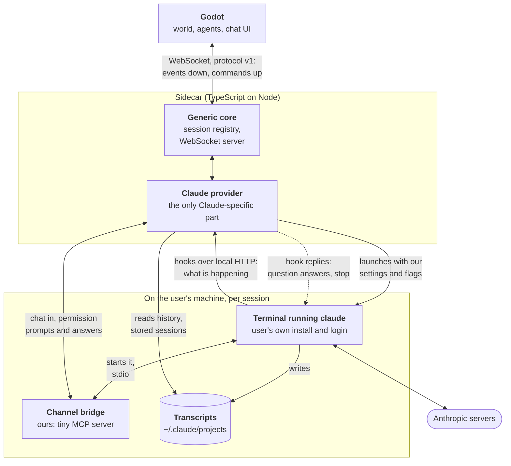

# The Beach: developer notes

Read this first every session. It is the single source of truth for the
design; keep it current and short.

- `NOTES.md` (this file): what the project is, where it's going, how it works.
- `docs/GUIDE.md`: user's guide for built features. Must always match this file.
- `docs/devlog/`: long history, decisions, rejected alternatives, bugs. Look up by feature ID.
- `CLAUDE.md`: working rules. `README.md`: pitch and setup.
- `assets/CREDITS.md`: source and license of every asset.

## Concept

A 3D working environment in Godot 4 that shows AI coding sessions as a
world you walk around in. It is a place to **work**, not a passive monitor:
you create sessions, resume old ones and chat with the orchestrator, all
from inside the world.

**World.** A beach and ocean world. Each session is an **island**: a new
session rises out of the ocean and an ended one sinks. Islands from the same
project cluster into an **archipelago** joined by walkable bridges, and
unrelated projects get their own stretch of ocean. Bridges are for
exploration and feel; a **teleport menu** is for getting work done quickly.
Other biomes (hills, mountains) come later, so region connection is a
general system, not a beach-specific one.

**Agents.** The **orchestrator** sits at the centre of its island (a bigger
logo model at a beach desk or under an umbrella). Walking up to it opens the
chat panel. **Subagents** are small logo-on-a-little-PC models on the sand.
They spawn when the orchestrator spawns them and, when they finish, run
their report back to whoever called them and disappear. They show working,
waiting-on-you or done. An agent that waits on a permission prompt should
visibly draw your attention.

**Downtime.** You spend a lot of time waiting on agents, so the world should
eventually give you something to do: parkour and minigames. These aren't
designed yet (see Known issues and next steps → Deferred ideas).

**Principles (user's).**
- **A pretty interface over the real thing, nothing more.** We touch as
  little of what the AI tool provides as possible: we launch it, watch it
  through its documented extension points and pass the user's own input to
  it. We never modify, bundle or re-implement it, never handle its logins,
  and never rely on undocumented behaviour when a documented way exists.
- **Never harm the user through poor quality.** No vulnerabilities, no
  silent actions on the user's behalf, no data leaving the machine. When
  our side fails, the tool must fall back to its own normal behaviour (e.g.
  the terminal asks the question), never to "allowed". See Architecture →
  Security rules.
- **Free public release** is the goal, so everything must hold up on other
  people's machines, not just the developer's.

**Art direction.** Low-poly. Assets are made by the user or come from CC0 packs
such as Kenney, **never AI-generated**. Kenney packs are the likely source
for terrain and environment, which leaves custom modelling effort for the
logo-on-PC agent models.

## Feature index

Prefixes: **W** world (islands, ocean, bridges, travel, player movement),
**A** agents (orchestrator, subagents, states, placement), **C** chat panel
and in-world UI, **S** sidecar and session management. v1 = part of the
v1 slice.

| ID  | Feature                                   | Status  | Guide section | Main code |
|-----|-------------------------------------------|---------|---------------|-----------|
| W01 | Beach island (v1)                         | planned | n/a           | n/a       |
| W02 | Ocean (v1)                                | planned | n/a           | n/a       |
| W03 | Player movement (v1)                      | planned | n/a           | n/a       |
| W04 | Island rise / sink                        | planned | n/a           | n/a       |
| W05 | Archipelagos (project clustering)         | planned | n/a           | n/a       |
| W06 | Bridges (region connection)               | planned | n/a           | n/a       |
| W07 | Teleport menu                             | planned | n/a           | n/a       |
| A01 | Orchestrator (v1)                         | planned | n/a           | n/a       |
| A02 | Subagents spawn / despawn (v1)            | planned | n/a           | n/a       |
| A03 | Agent state indicators                    | planned | n/a           | n/a       |
| A04 | Procedural agent placement (v1)           | planned | n/a           | n/a       |
| A05 | Permission attention cue                  | planned | n/a           | n/a       |
| C01 | Walk up to chat (v1)                      | planned | n/a           | n/a       |
| C02 | Chat panel, plain text and streaming (v1) | planned | n/a           | n/a       |
| C03 | Markdown rendering                        | planned | n/a           | n/a       |
| C04 | Tool-call log                             | planned | n/a           | n/a       |
| C05 | Permission approve / deny                 | planned | n/a           | n/a       |
| S01 | Sidecar and WebSocket server (v1)         | planned | n/a           | n/a       |
| S02 | Claude provider (v1)                      | planned | n/a           | n/a       |
| S03 | Create session from the world             | planned | n/a           | n/a       |
| S04 | List and resume stored sessions           | planned | n/a           | n/a       |
| S05 | End session                               | planned | n/a           | n/a       |

## When a feature lands

- [ ] Update its `### <ID>` section in Systems (planned intent → how it works),
      including its provider scope.
- [ ] Update its index row: status, guide section, main code.
- [ ] Add or update its `<ID>` section in `docs/GUIDE.md` in plain language,
      and add it to the guide's table of contents.
- [ ] Reread the guide section against this file.
- [ ] Update Architecture / Protocol / Conventions if it touched them.
- [ ] Record any new assets in `assets/CREDITS.md`.
- [ ] Write a dev-log entry and add it to `docs/devlog/README.md`.
- [ ] Update "Current focus".

## Architecture

Overview (GitHub draws this Mermaid block as a diagram). Everything runs on
the user's machine; only Claude Code itself talks to Anthropic.

- **Godot** (GDScript): the world, player movement, island and bridge
  generation, agent models and state visuals, in-world chat UI.
- **Sidecar** (TypeScript on Node, open question 6): runs sessions and
  forwards their activity to Godot as generic events. It owns the session
  registry.
- **Provider**: translates one AI tool's native events into the generic
  vocabulary. Only the **Claude provider** exists. It launches the user's
  own, unmodified `claude` CLI in a terminal window, receives its hook
  events over local HTTP, talks to it through our channel bridge and reads
  and resumes sessions from `~/.claude/projects/*.jsonl`. See S02.
- **One session ID = one island.** It is the core unit in both the sidecar's
  data model and Godot's scene tree.

**Security rules.** Our local entry points (the WebSocket server, the hook
endpoint, the bridge connection) can approve tool use and send messages
into a session, so they are as sensitive as the user's keyboard. Every
feature that touches them follows these rules, and each is tested:
- **Loopback only.** Every server binds to `127.0.0.1`, never `0.0.0.0`.
- **Authenticate every connection.** The sidecar makes random secret
  tokens at start: one for Godot's WebSocket, one per launched session for
  its hooks (sent as a header; hooks support headers from environment
  variables) and for its bridge. Requests without the right token are
  rejected. Loopback alone isn't enough: any local program could connect.
- **Reject browsers.** Web pages can open connections to `localhost`, and
  browsers always send an `Origin` header. Besides requiring the token, the
  WebSocket server rejects requests whose `Origin` isn't what Godot sends
  (check what Godot's client sends when building S01), so a malicious site
  can't drive a session.
- **Nothing is approved without the user.** Permissions, questions and
  messages go to the session only as the direct result of the user's
  action in the world. No auto-approve rules, no permissive permission
  modes chosen for the user, no "allow always" without an explicit choice.
- **Fail safe.** If the sidecar or Godot is down, slow or crashes, the
  session must fall back to Claude Code's own terminal prompts, never to
  allowing. (The spike checks what an unreachable hook does in each case.)
- **No shell strings.** Processes are launched with argument arrays, never
  by building a shell command from text, so a project path or session name
  can't inject commands.
- **Treat all session content as untrusted.** Model output, tool output and
  file content can contain anything: escape it before it becomes BBCode (no
  injected `[url]` or `[img]`), never open links or run anything from it
  without a user click, and never pass it back into the session as if the
  user typed it.
- **Private by default.** Transcripts and events stay on the machine: no
  telemetry, no network calls except those Claude Code makes itself. We
  only read the user's Claude files, never write them, and never edit the
  user's settings (per-session `--settings` instead).
- **Few, pinned dependencies.** Every sidecar dependency is justified,
  version-pinned with a lockfile, and updated deliberately.

**Multi-provider rules.** Only Claude is built, and near-term effort goes into
making it good, including Claude-only features (e.g. model choice, usage,
context window). Adding another tool (Codex, Cursor, ...) must still only need a
new adapter plus, optionally, its own extension UI. Every feature has one of
three **provider scopes**:
- **Core:** every provider must support it (sessions, agents, messages,
  permissions). Generic events; each provider translates into them.
- **Capability:** a generic concept that not every provider has (e.g. model
  choice, token usage, context-window fill). Generic events, gated by a
  capability the provider declares for the session; Godot shows the UI only
  when it's declared. Prefer this over an extension whenever the concept
  plausibly exists elsewhere.
- **Extension:** truly unique to one provider. Namespaced by provider in the
  protocol, and handled in Godot by that provider's own UI module, so that
  removing a provider means deleting its folders and nothing else.

Naming: Claude-specific names appear only in the sidecar's Claude provider
module, the Claude extension namespace of the protocol, and Godot's Claude UI
module. Everything else is named generically. Don't build a second provider;
just don't assume there will only be one. The exact capability and extension
format is in Protocol → Capabilities and Extensions.

**Layout.** The Godot project is the repo root (`project.godot`). Other
top-level folders sit beside it:

| Path | Role |
|------|------|
| `project.godot`, `icon.svg` | Godot project (4.7, GDScript, no .NET). Version pinned in `.godotrc`. |
| `assets/` | Art and audio, plus `CREDITS.md`. |
| `sidecar/` | Sidecar, TypeScript on Node (empty until S01 lands). Has a `.gdignore` so Godot doesn't scan it. |
| `protocol/` | Shared event schema, `events.schema.json` (see Protocol). Has a `.gdignore`. |
| `docs/` | User's guide and dev log. |
| `addons/godot_ai/` | Dev tool, not a feature: third-party editor plugin (godot-ai, MIT) that lets Claude Code drive the Godot editor over MCP. See Running it. Don't edit it by hand; it self-updates and checks its files against a signed manifest. It adds the `_mcp_game_helper` autoload to `project.godot` (game-side screenshots and logs over Godot's debugger channel only; inert in the editor, stripped from exports). |

The Godot folder layout (scenes, scripts) and the sidecar file table get
filled in as the v1 features land.

## Protocol

The contract between Godot and the sidecar, over a local WebSocket. It has
a generic core, capability-gated optional features and provider-namespaced
extensions (see Multi-provider rules), and must not assume a maximum number of agents
per session. The full schema is `protocol/events.schema.json` (JSON Schema,
so the sidecar and tests can validate against it); this section is the
overview. **Version 1.**

**Messages.** One JSON object per WebSocket message, with a `type`:
- Types are `noun.verb`. Events (sidecar → Godot) are past tense
  (`session.created`); commands (Godot → sidecar) are imperative
  (`session.create`).
- Every command has an `id`. The sidecar answers `ok` (with an optional
  `result`) or `error` (`code`, `message`) carrying the same `id`. An `error`
  without `id` is a protocol-level error.
- Every session-scoped event has `session` and `seq`, a per-session counter.
  A gap in `seq` means Godot missed something and sends
  `session.get_snapshot`.

**Connecting.** The sidecar sends `hello` (protocol version, providers), one
`session.snapshot` per live session, then `sync.completed`. Godot refuses a
protocol version it doesn't know. A snapshot is a session's full state
(agents, states, pending permissions, capabilities); after it, only changes
follow. This covers Godot restarting in v1 and attaching to outside
sessions later (open question 5): both are "send a snapshot, then changes".
Chat history isn't in the snapshot; Godot asks for it with
`session.get_history`.

**IDs.** The sidecar makes an opaque `session` ID. The provider's own ID
(e.g. Claude's session UUID) is `native_id`, null until assigned. `origin` is
`app` (started here) or `external` (attached; not in v1). Agents are keyed by
`agent` within their session.

**Agents** form a tree: `role` is `orchestrator` or `subagent`, and `parent`
is the agent that spawned it (null for the orchestrator). Agents stay in the
session after finishing; Godot decides what to show. **States:**

| State | Orchestrator | Subagent | Meaning |
|---|---|---|---|
| `working` | ✓ | ✓ | thinking or running tools |
| `waiting` | ✓ | ✓ | needs the user; `reason` says why (`permission`, `question`, `input`, ...) |
| `idle` | ✓ | | turn finished, the user's move |
| `done` | | ✓ | result returned; may be resumed (back to `working`) |
| `error` | ✓ | ✓ | failed or interrupted |

The orchestrator never becomes `done`: the session ending is `session.ended`.

**Core vocabulary.**

| Sidecar → Godot | Godot → sidecar |
|---|---|
| `hello`, `sync.completed`, `ok`, `error` | `session.create`, `session.resume`, `session.list_stored` |
| `session.snapshot`, `session.created`, `session.ended` | `session.end`, `session.get_snapshot`, `session.get_history` |
| `agent.spawned`, `agent.state_changed` | `message.send` |
| `message.started`, `message.delta`, `message.completed` | `permission.respond` (`allow` / `deny`, optional `note`) |
| `tool.started`, `tool.finished` | |
| `permission.requested`, `permission.resolved` | |

- `session.snapshot` places an island as is; `session.created` plays the rise
  animation.
- Messages stream as `started` → `delta`s → `completed`, whose `text` is the
  full Markdown and replaces the deltas. User messages are events too, so
  text typed elsewhere shows up once attaching exists.
- `permission.resolved` has `by`: `app` or `external` (answered elsewhere,
  once attaching exists).

**Capabilities.** A session declares `capabilities`, keyed by name, each with
its own config object (e.g. `"usage": {}`). A capability's events use its
name as the noun (e.g. `usage.updated`) and are only sent when declared.
Each one is added to the schema and listed here:
- **`questions`**: an agent asks the user clarifying questions, a set of
  1+ items, each with options and optional multi-select (Claude's
  AskUserQuestion). `question.asked` / `question.resolved` (`by`: `app` or
  `external`) and the command `question.answer` (per-item chosen labels or
  typed text, or one free `response` instead). Pending ones are in the
  snapshot's `questions`; the agent is `waiting` with reason `question`.
- **`interrupt`**: the user can stop what the session is doing; the session
  stays open. Command `interrupt.request`. Config
  `{ "immediate": true | false }`: `false` means the stop happens at the
  session's next step (e.g. before its next tool call), not mid-reply, so
  Godot can say "stopping after this step".

**Extensions.** A session lists its `extensions` (e.g. `["claude"]`).
Extension messages are `ext.<provider>.<name>` in either direction, carry
`session`/`seq` or `id` like core messages, and are routed in Godot by
prefix to that provider's UI module. Their payload schemas go in
`protocol/ext/<provider>.schema.json`.

## Systems

### W01 Beach island
*Planned (v1).* A static beach island, one per session. In v1 there is
exactly one. Later islands are created and removed dynamically (W04).

### W02 Ocean
*Planned (v1).* The ocean surrounding the islands. Unrelated projects get
their own area of it (W05).

### W03 Player movement
*Planned (v1).* On-foot movement for walking up to agents. Keep it capable
enough to support parkour later; don't make it so plain that it rules parkour out.

### W04 Island rise / sink
*Planned.* A new session makes an island rise out of the ocean; this doubles
as the "new session" feedback. An ended session makes its island sink, and
the island is then removed.

### W05 Archipelagos
*Planned.* Islands of the same project/repo cluster into an archipelago.
Whether that goes strictly by repo path or allows manual naming and arranging is
open question 2.

### W06 Bridges
*Planned.* Walkable bridges connect islands within an archipelago, for
physical movement and the feel of the world. Build it as a general
"connect regions" system, not beach-specific, so that future biomes (hills,
mountains) plug into it.

### W07 Teleport menu
*Planned.* Instantly jumps to a session's island, so you never have to walk
across the world to reach an orchestrator. Sorting, grouping and whether to
add a minimap are open question 3.

### A01 Orchestrator
*Planned (v1).* A bigger logo model at the centre of its island, at a beach
desk or under an umbrella. It's the main way you interact with a session
(see C01).

### A02 Subagents
*Planned (v1).* Small logo-on-a-little-PC models on the island's sand. They
appear when the orchestrator spawns them. When one finishes (`done`), it
runs to the agent that called it (its `parent`) with a paper on its head,
throws the report to it, and disappears. A resumed subagent (back to
`working`) reappears. Chat is orchestrator-only for now; whether to talk to
subagents directly is open question 4.

### A03 Agent state indicators
*Planned.* A visible state on each agent, from the protocol's state enum
(see Protocol): working, waiting on the user (e.g. a permission prompt),
idle (orchestrator), done (subagent) or error.

### A04 Procedural agent placement
*Planned (v1).* Agents are positioned by a simple algorithm (ring, spiral
or grid with jitter) rather than hardcoded spots, and it handles about 20–30 per
island. Nothing may assume a fixed maximum agent count. Options for larger
counts are in Deferred ideas.

### A05 Permission attention cue
*Planned.* A pending permission prompt is shown on the relevant island
and agent, so a waiting agent visibly draws your attention.

### C01 Walk up to chat
*Planned (v1).* Walking up to an orchestrator opens the chat panel for its
session.

### C02 Chat panel
*Planned (v1: plain text).* A core feature, not an afterthought, because this
is a working environment. It needs streaming responses. v1 renders plain text
wired to the sidecar.

### C03 Markdown rendering
*Planned.* Godot's `RichTextLabel` uses BBCode, not Markdown, so rendering
the model's Markdown well (especially readable code blocks) takes real
translation work. It is **probably the biggest UX risk in the project**, so it
gets prototyped early as a throwaway spike, before its full build.

### C04 Tool-call log
*Planned.* Some form of log of the tool calls the session made, visible from
the chat panel.

### C05 Permission approve / deny
*Planned.* Answer permission requests from inside the world. They are
sent to the sidecar as approve/deny.

### S01 Sidecar and WebSocket server
*Planned (v1).* The sidecar process that hosts the session registry and the
local WebSocket server Godot connects to. It speaks only the generic
protocol.

### S02 Claude provider
*Planned (v1).* Gets a throwaway integration spike first (see Milestones →
M0). The only place Claude-specific names may appear. It drives
the user's own installed `claude` CLI, signed in with their own account
through Anthropic's login. Our code never reads, stores or passes on Claude
credentials, and never modifies or bundles Claude Code.

**Launch.** It opens a terminal window running `claude` with:
- `--settings <json>`: hooks for this session only, so the user's own
  settings files are never edited;
- `--session-id <uuid>`: the ID is known before the session starts
  (becomes `native_id`);
- `--mcp-config` plus `--dangerously-load-development-channels server:<name>`:
  registers our channel. While channels are a research preview, custom
  channels need this flag, and Claude Code asks the user to confirm it in the
  terminal at startup. So the terminal must be visible, at least at launch;
- `--name`: the session's display name.

**Seeing the session: HTTP hooks** posted to the sidecar on localhost.
Planned mapping: `SessionStart` / `SessionEnd` → session created / ended;
`UserPromptSubmit` → user message; `MessageDisplay` → assistant text (it
arrives in batches of completed lines, so chat streams line by line, not
word by word); `PreToolUse` / `PostToolUse` / `PostToolUseFailure` → tool
calls; `SubagentStart` / `SubagentStop` → subagents (`agent_id`,
`agent_type`); `PermissionRequest` → permission requested; `Stop` →
orchestrator idle; `StopFailure` → error. Hooks fired inside a subagent
carry its `agent_id`.

**Talking to the session: a channel.** A channel is an MCP server that
Claude Code itself starts as a subprocess and talks to over stdio, so ours
is a tiny **channel bridge** script shipped with the sidecar: `claude`
starts it, and it connects back to the sidecar over a local connection. It
pushes the user's chat messages into the session, and with permission
relay it receives permission prompts. The terminal prompt and
the world are both live; whichever answers first wins (`by: external` when
it was the terminal).

**Clarifying questions (`questions` capability).** A `PreToolUse` hook
matched to `AskUserQuestion` holds the HTTP request open until the user
answers in the world, then returns `permissionDecision: "allow"` with the
answers in `updatedInput` (documented for answering programmatically). The
tool then runs without the terminal asking. This hook needs a long
`timeout`: on timeout the tool doesn't run and Claude is told the hook
didn't respond.

**Stopping (`interrupt` capability, `immediate: false`).** Any hook can
return `{ "continue": false, "stopReason": ... }`, which stops Claude after
that hook. On `interrupt.request` the sidecar answers the session's next
hook call that way. So the stop lands at the next step (a tool call, a tool
finishing, a subagent starting or stopping), not mid-reply or mid-command.
To test: whether a stop from a hook inside a subagent stops the subagent
only or the whole session.

**Not available on this route:** an immediate stop (Esc) and anything only
the terminal shows (folder trust, MCP consent, the channel confirmation).
Typing into the terminal was considered and rejected for now (see the
dev log, 2026-09-29-claude-cli-route).

### S03 Create session
*Planned.* A "create new session" command from Godot; the sidecar launches
a `claude` terminal (see S02). Attaching to sessions the user started
themselves comes later (open question 5, decided); it uses the same hooks
and channel, which such a session would need to be started with.

### S04 List and resume sessions
*Planned.* Claude Code stores transcripts as JSONL under
`~/.claude/projects/<project-slug>/<session-id>.jsonl`, resumable with
`claude --resume <id>`. Sessions launched from this app are ordinary CLI
sessions in the same store, so they are resumable from a terminal, and old
CLI sessions can be listed and resumed here (launched with `--resume`). The Claude **desktop app** does
not use this store (see Deliberate limitations).

### S05 End session
*Planned.* Ending a session removes it from the registry and sinks its
island (W04).

## Conventions

- **A new feature** first gets its provider scope decided (core, capability
  or extension; see Multi-provider rules), stated in its Systems section. If
  it's unclear, ask the user.
- **A new event type** needs: its scope (core, capability name, or
  extension namespace), a schema entry in `protocol/`, a line in the Protocol
  section, the provider translation in the sidecar, and a Godot handler (in
  the provider's UI module if it's an extension).
- **A new asset** needs a row in `assets/CREDITS.md` (source, author,
  license). CC0 or made by the user only; never AI-generated.
- **Provider-specific code** stays in its provider module (sidecar) or UI
  module (Godot); anything shared is named generically.

### Renaming the project

"The Beach" is a codename. It appears in:
- `project.godot`: `config/name` (also the window title)
- `README.md`: title
- `NOTES.md`: title
- `CLAUDE.md`: codename rule
- `docs/GUIDE.md`: title
- `docs/devlog/`: past entries (historical; leave them)

It must not appear in code identifiers, class names, the protocol or package
names. Add to this list if it ever has to appear anywhere new.

## Running it

Nothing runs yet. Once it does: start the sidecar (Node; commands land
with S01), then open `project.godot` in Godot 4.7.2 and press F5.

**Godot AI (dev tool).** The `addons/godot_ai` editor plugin
([hi-godot/godot-ai](https://github.com/hi-godot/godot-ai), MIT) lets Claude
Code drive the open editor. It needs [uv](https://docs.astral.sh/uv/) (the
client runs a Python bridge through `uvx`). Chain: Claude Code → `godot-ai
attach` (stdio) → local Python server (authenticated HTTP, port 8000) → editor
plugin (authenticated WebSocket, port 9500, loopback only). Per machine:
- Set Editor Settings → Plugins → `godot_ai/mcp_client_scope` to `local`,
  then press **Configure** next to Claude Code in the Godot AI dock. The
  client entry pins versions and machine paths, so it isn't tracked in the repo.
  Without the `claude` CLI on PATH, Configure can only write **user** scope
  (`~/.claude.json` → `mcpServers`); move the `godot-ai` entry by hand into
  `projects["<repo path>"].mcpServers`, which is what local scope is. Recheck
  after plugin updates, since they re-pin the entry.
- Telemetry off: set Editor Settings → Plugins → `godot_ai/telemetry_enabled`
  to off, and the user environment variable `GODOT_AI_DISABLE_TELEMETRY=true`.
  Apps only see a new environment variable after they restart, and Godot
  launched from Godot Hub inherits the Hub's environment, so restart the Hub.
- Update with the dock's **Update** button, never by copying files over it.

## Open questions

1. ~~**Event schema.**~~ *Decided:* version 1 is in Protocol and
   `protocol/events.schema.json`.
2. **Archipelago clustering.** Strictly by repo path, or can projects be
   manually named or arranged?
3. **Teleport menu UX.** Sorted or grouped how (project, recency, custom
   pinning)? Is a minimap still wanted for on-foot travel alongside it?
4. **Subagent chat.** Chat with subagents directly, or keep them read-only
   status for now (orchestrator-only chat, as currently designed)?
5. ~~**Session ownership.**~~ *Decided (user's):* both, eventually. v1 only
   launches sessions from inside the app; attaching to sessions already
   running elsewhere comes later. The event schema must allow for attaching
   (joining a session partway through) even though v1 doesn't use it.
6. ~~**Sidecar language.**~~ *Decided (user's):* TypeScript on Node. Chosen
   while the Agent SDK was the plan (its TypeScript version is the more
   complete one). It still fits the CLI route: channels are MCP servers and
   Anthropic's channel examples use the TypeScript MCP SDK.

## Known issues and next steps

**Current focus:** the Claude CLI integration spike (S02), then the
Markdown → BBCode spike (C03). Both are M0.

### Milestones

**M0 Setup.** Docs and scaffold, event schema, and two throwaway spikes:
- **Claude CLI integration spike (S02).** Everything in S02 is confirmed
  from the docs only. Launch a real `claude` with our hook settings and a
  bare channel, log every hook payload, and check: the launch flags and the
  channel confirmation prompt; which hooks fire and what they carry (IDs,
  subagent `agent_id`, `MessageDisplay` batches); chat into the session
  through the channel; permission relay (world and terminal both live);
  answering `AskUserQuestion` from a `PreToolUse` hook; `continue: false`
  stopping at the next step, and whether inside a subagent it stops the
  subagent or the whole session; **fail-safe behaviour**: what each hook
  does when the sidecar is unreachable or slow (must fall back to the
  terminal, never allow); token headers on hooks. Uses a little of the
  user's subscription.
  Results go in the dev log and update S02 and the schema if needed.
- **Markdown → BBCode spike (C03).**

**M1 v1 slice.** The goal is to prove the Godot ↔ sidecar ↔ `claude` CLI pipeline
end-to-end with the generic vocabulary, even though only the Claude provider
exists.
- One archipelago, one island, one orchestrator (W01, W02, A01).
- Sidecar launches one `claude` CLI session in a terminal, turns its hook
  events into generic events over WebSocket, and relays chat and permission
  answers through a channel (S01, S02).
- Walk up to chat with a plain-text chat panel wired to the sidecar (W03, C01,
  C02).
- Subagents as simple logo-on-PC models with ring or spiral placement,
  appearing and disappearing on spawn and finish events (A02, A04).
- Not in v1: bridges, teleport menu, multiple islands or archipelagos,
  minigames and parkour, Markdown polish, any second provider.

**After v1.** The remaining features in the index. They are not ordered yet.

### Deferred ideas (not features yet)

- **Agent scaling**, only if agent counts become a problem:
  - *Island growth:* the island footprint grows, or subdivides into a
    mini-archipelago, past some agent count.
  - *LOD / culling:* far or long-idle agents collapse into a simple
    stand-in (stacked PCs, a counter badge) and expand when approached or
    clicked. This is the route to "unlimited" agents.
  - *Overflow structure:* a "server rack" building stands for "N more agents
    working" and can be clicked to list them.
- **Other biomes:** hills, mountains, joined by the same bridge system (W06).
- **Minigames and parkour** for downtime. Which ones, where they are and how
  they unlock are all undecided on purpose.

### Watch items

- **Anthropic's terms (public release).** The app is meant for free public
  release (maybe donations later). Per Claude Code's legal and compliance
  docs (checked 2026-09-29): third parties may not offer claude.ai login,
  route requests through Free/Pro/Max credentials, or collect, store or
  intermediate Claude credentials; this doesn't prevent a user signing in
  to the **unmodified** Claude Code binary with their own subscription.
  Hence the CLI route (S02): each user installs and signs in to Claude Code
  themselves; we never bundle, modify or authenticate it. Recheck the terms
  before each release; for certainty, ask Anthropic (the page points to
  their sales contact).
- **Claude branding.** Same page: a product may say in plain text that it
  runs Claude Code, but may not use the Claude Code or Anthropic names or
  logos in its own name or logo, or suggest Anthropic built or endorses it.
  Other use of their logos needs written permission. This affects the "logo
  model" agents (A01, A02) in a public release.
- **Channels are a research preview.** Chat and permission answers from the
  world depend on them (S02). Flags and protocol may change, custom channels
  need `--dangerously-load-development-channels` (confirmed by the user at
  startup), and Team/Enterprise organisations block channels unless an
  admin enables them. Pro/Max users without an organisation can use them.

- Markdown → BBCode rendering (C03) is the biggest UX risk.
- `icon.svg` is Godot's default icon (CC BY 4.0, not CC0). It is a
  placeholder to replace.
- **Godot AI plugin:** its auth doesn't protect against a compromised process
  running as the same user, and on Windows it claims no isolation from other
  local accounts (per its security model). Telemetry is on by default
  upstream; we opt out per machine.

### Deliberate limitations

- **No Claude desktop app integration.** As of research in Sept 2026, the
  desktop app keeps its own session store, doesn't read
  `~/.claude/projects/`, and offers no supported way to register a session or
  launch into a folder from outside. The terminal/JSONL store is the
  integration point.
- **No Agent SDK (not in the near future).** Driving Claude through the
  Agent SDK gives more control (an immediate stop, word-by-word streaming,
  no terminal window), but Anthropic's terms expect SDK apps to use an API key
  (billed per token) rather than the user's subscription. We use the CLI
  route instead (S02). Revisit only if Anthropic confirms subscription use
  is fine for this kind of app, or an API-key option is wanted.
- **Claude is the only provider.** Near-term effort goes into making Claude
  good; the architecture stays open for more providers.
