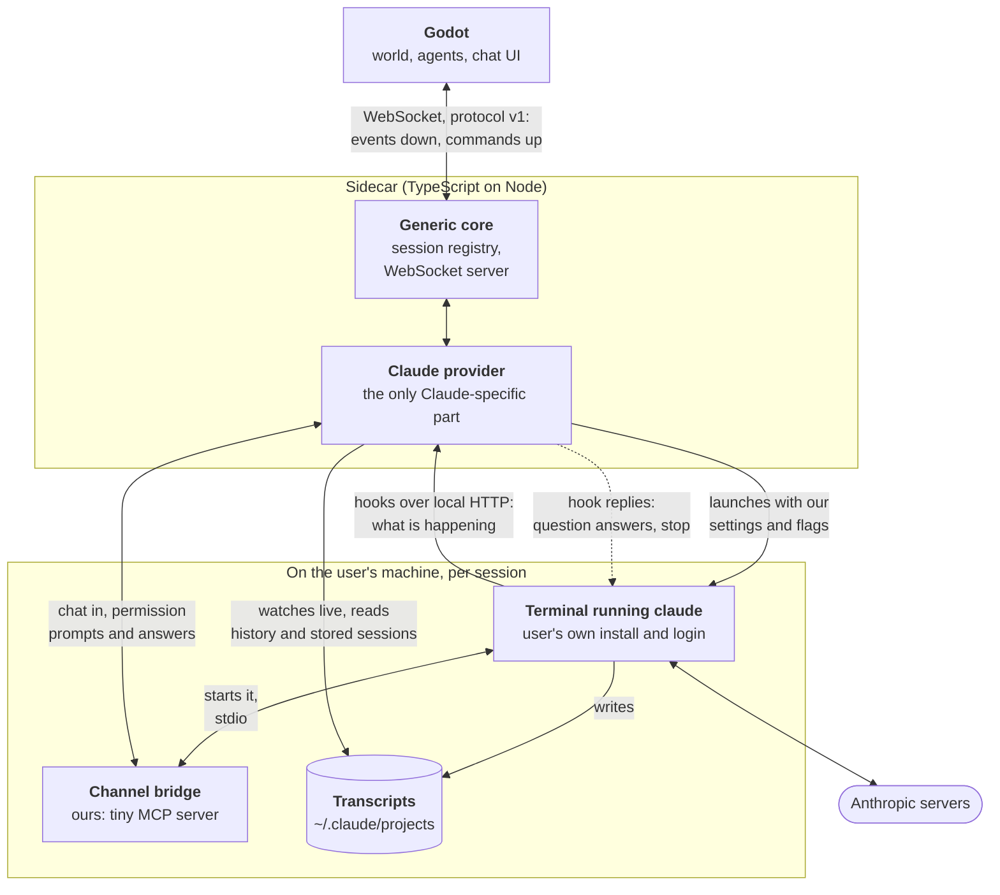

# The Beach: developer notes

Read this first every session. It is the single source of truth for the
design; keep it current and short.

- `NOTES.md` (this file): what the project is, where it's going, how it works.
- `docs/GUIDE.md`: user's guide for built features. Must always match this file.
- `docs/devlog/`: long history, decisions, rejected alternatives, bugs. Look up by feature ID.
- `docs/flows.md`: step-by-step diagrams (create a session, chat, permission,
  question, subagent, stop, failure). Derived from this file; update together.
- `CLAUDE.md`: working rules. `README.md`: pitch and setup.
- `assets/CREDITS.md`: source and license of every asset.

## Concept

A 3D working environment in Godot 4 that shows AI coding sessions as a
world you walk around in. It is a place to **work**, not a passive monitor:
you create sessions, resume old ones and chat with the orchestrator, all
from inside the world.

**World.** A beach and ocean world. Each session is an **island**: a new
session rises out of the ocean and an ended one sinks. Islands from the same
project cluster into an **archipelago** joined by walkable bridges, and
unrelated projects get their own stretch of ocean. Bridges are for
exploration and feel; a **teleport menu** is for getting work done quickly.
Other biomes (hills, mountains) come later, so region connection is a
general system, not a beach-specific one.

**Agents.** The **orchestrator** sits at the centre of its island (a bigger
model at a beach desk or under an umbrella). Walking up to it opens the
chat panel. **Subagents** are small models at little PCs on the sand.
They spawn when the orchestrator spawns them and, when they finish, run
their report back to whoever called them and disappear. They show working,
waiting on you, done or error (A03). An agent waiting on a permission
prompt or a question should visibly draw your attention. The agents'
look was planned as the AI tool's logo; that is open question 7 (branding).

**Terminal and world together.** Each session is a normal `claude` running
in a terminal window, and the world is a second window onto it: you can
chat, answer prompts and questions, or stop it in either place, and switch
at any time (S02).

**Downtime.** You spend a lot of time waiting on agents, so the world should
eventually give you something to do: parkour and minigames. These aren't
designed yet (see Known issues and next steps → Deferred ideas).

**Principles (user's).**
- **A pretty interface over the real thing, nothing more.** We touch as
  little of what the AI tool provides as possible: we launch it, watch it
  through its documented extension points and pass the user's own input to
  it. We never modify, bundle or re-implement it, never handle its logins,
  and never rely on undocumented behaviour when a documented way exists.
- **Never harm the user through poor quality.** No vulnerabilities, no
  silent actions on the user's behalf, no data leaving the machine. When
  our side fails, the tool must fall back to its own normal behaviour (e.g.
  the terminal asks the question), never to "allowed". See Architecture →
  Security rules.
- **Free public release** is the goal, so everything must hold up on other
  people's machines, not just the developer's.
- **Windows, macOS and Linux are all first-class.** Every feature is
  designed for all three from the start; nothing may assume one OS's
  terminal, paths, shell or installed tools. See Architecture → Platforms.

**Art direction.** Low-poly. Assets are made by the user or come from CC0 packs
such as Kenney, **never AI-generated**. Kenney packs are the likely source
for terrain and environment, which leaves custom modelling effort for the
agent models (their look: open question 7).

## Feature index

Prefixes: **W** world (islands, ocean, bridges, travel, player movement),
**A** agents (orchestrator, subagents, states, placement), **C** chat panel
and in-world UI, **S** sidecar and session management. v1 = part of the
v1 slice.

| ID  | Feature                                   | Status  | Guide section | Main code |
|-----|-------------------------------------------|---------|---------------|-----------|
| W01 | Beach island (v1)                         | built   | W01, W02      | `world/island/`, `world/session_islands.gd` |
| W02 | Ocean (v1)                                | built   | W01, W02      | `world/ocean/` |
| W03 | Player movement (v1)                      | built   | W03           | `world/player/` |
| W04 | Island rise / sink                        | planned | n/a           | n/a       |
| W05 | Archipelagos (project clustering)         | planned | n/a           | n/a       |
| W06 | Bridges (region connection)               | planned | n/a           | n/a       |
| W07 | Teleport menu                             | basic built (sessions menu) | S03 | `world/sessions_menu/` |
| W08 | Swimming and seabed                       | planned | n/a           | n/a       |
| W09 | Day/night cycle and weather               | planned | n/a           | n/a       |
| A01 | Orchestrator (v1)                         | placeholder built | C01 | `agents/orchestrator/` |
| A02 | Subagents spawn / despawn (v1)            | placeholder built | A02 | `agents/subagent/`, `agents/island_agents.gd` |
| A03 | Agent state indicators                    | minimal built | A02 | `agents/state_marker.gd` |
| A04 | Procedural agent placement (v1)           | built   | A02           | `agents/agent_placement.gd` |
| A05 | Permission attention cue                  | planned | n/a           | n/a       |
| C01 | Walk up to chat (v1)                      | built   | C01           | `chat/` |
| C02 | Chat panel, plain text and streaming (v1) | built   | C02           | `chat/` |
| C03 | Markdown rendering                        | built   | C03           | `chat/markdown/` |
| C04 | Tool-call log                             | planned | n/a           | n/a       |
| C05 | Permission approve / deny (v1)            | built   | C05           | `chat/pending_card.gd` |
| C06 | Permission mode control                   | planned | n/a           | n/a       |
| C07 | Plan approval                             | planned | n/a           | n/a       |
| S01 | Sidecar and WebSocket server (v1)         | built   | S01           | `sidecar/src/`, `core/sidecar/` |
| S02 | Claude provider (v1)                      | built   | S02           | `sidecar/src/providers/claude/`, `sidecar/src/launch/` |
| S03 | Create session from the world             | quick version built | S03 | `world/sessions_menu/` |
| S04 | List and resume stored sessions           | built   | S03           | `sidecar/src/providers/claude/store.ts`, `world/sessions_menu/` |
| S05 | End session                               | quit warning built | S05 | `world/quit_guard.gd` |

## When a feature lands

- [ ] Update its `### <ID>` section in Systems (planned intent → how it works),
      including its provider scope.
- [ ] Update its index row: status, guide section, main code.
- [ ] Add or update its `<ID>` section in `docs/GUIDE.md` in plain language,
      and add it to the guide's table of contents.
- [ ] Reread the guide section against this file.
- [ ] Update Architecture / Protocol / Conventions if it touched them, and
      `docs/flows.md` if it changed how the pieces talk.
- [ ] Record any new assets in `assets/CREDITS.md`.
- [ ] Write a dev-log entry and add it to `docs/devlog/README.md`.
- [ ] Update "Current focus".

## Architecture

Overview (GitHub draws this Mermaid block as a diagram). Everything runs on
the user's machine; only Claude Code itself talks to Anthropic. Step-by-step
flows are in `docs/flows.md`.



- **Godot** (GDScript): the world, player movement, island and bridge
  generation, agent models and state visuals, in-world chat UI.
- **Sidecar** (TypeScript on Node, open question 6): runs sessions and
  forwards their activity to Godot as generic events. It owns the session
  registry. Shipped as one self-contained executable per platform, so users
  don't need Node; Godot starts it (see Platforms).
- **Provider**: translates one AI tool's native events into the generic
  vocabulary. Only the **Claude provider** exists. It launches the user's
  own, unmodified `claude` CLI in a terminal window, receives its hook
  events over local HTTP, talks to it through our channel bridge, and
  reads its transcript under `~/.claude/projects/` (live, for what hooks
  don't report, and for history and resuming). See S02.
- **One session ID = one island.** It is the core unit in both the sidecar's
  data model and Godot's scene tree.

**Security rules.** Our local entry points (the WebSocket server, the hook
endpoint, the bridge connection) can approve tool use and send messages
into a session, so they are as sensitive as the user's keyboard. Every
feature that touches them follows these rules, and each is tested:
- **Loopback only.** Every server binds to `127.0.0.1`, never `0.0.0.0`.
- **Authenticate every connection.** The sidecar makes random secret
  tokens at start: one for Godot's WebSocket, and per launched session one
  for its hooks (sent as a header) and one for its bridge. Requests
  without the right token are rejected. Loopback alone isn't enough: any
  local program could connect.
- **Reject browsers.** Web pages can open connections to `localhost`, and
  browsers always send an `Origin` header. Godot's WebSocket client never
  sends one (its source, and a live Godot 4.7.2, checked in S01), so the
  WebSocket server refuses any request that has an `Origin` header, even
  with the right token, and any `Host` other than `127.0.0.1:<port>`
  (DNS rebinding). A malicious site can't drive a session.
- **Nothing is approved without the user.** Permissions, questions and
  messages go to the session only as the direct result of the user's
  action in the world. No auto-approve rules, no permissive permission
  modes chosen for the user, no "allow always" without an explicit choice.
- **Fail safe.** If the sidecar or Godot is down, slow or crashes, the
  session must fall back to Claude Code's own terminal prompts, never to
  allowing. (Verified for hanging, erroring and offline hooks: S02.)
- **No shell strings.** Processes are launched with argument arrays, never
  by building a shell command from text, so a project path or session name
  can't inject commands. This includes terminal windows: a terminal is only
  ever given the fixed path of our launcher and the path of a session file,
  never a command line with session data in it (see Platforms). Likewise
  the command hook Claude Code runs (S02): exec form, our executable's
  path and a relay file's, no shell.
- **Clean child environments.** Launched processes get the user's normal
  environment minus the variables Claude Code sets inside its own sessions
  (e.g. `CLAUDECODE`, `CLAUDE_CODE_CHILD_SESSION`, session IDs and tokens),
  which could carry another session's values. Remove a named list of
  those markers plus a few **narrow families** by prefix (user's decision,
  S02), only where every documented variable in the family is one Claude
  Code sets itself: `CLAUDE_CODE_SESSION_`, `CLAUDE_CODE_CHILD_`,
  `CLAUDE_CODE_MESSAGING_`, `CLAUDE_CODE_BRIDGE_` (checked against the
  env-vars docs, 2026-09-29). Never everything starting with `CLAUDE`: user
  configuration such as `CLAUDE_CONFIG_DIR`, `CLAUDE_CODE_EFFORT_LEVEL` and
  `CLAUDE_CODE_SKIP_PROMPT_HISTORY` (transcripts off) must pass through,
  or we'd silently undo the user's choices. (The S02 spike stripped every
  `CLAUDE*` variable; don't copy that.) The same goes for anything a store client
  injects into the game (e.g. Steam's `LD_PRELOAD` overlay hooks and its
  `Steam*` variables). The lists are in `sidecar/src/providers/claude/env.ts`
  and `sidecar/src/launch/env.ts`, with a test that user settings survive.
- **Treat all session content as untrusted.** Model output, tool output and
  file content can contain anything: escape it before it becomes BBCode (no
  injected `[url]` or `[img]`), never open links or run anything from it
  without a user click, and never pass it back into the session as if the
  user typed it.
- **Private by default.** Transcripts and events stay on the machine: no
  telemetry, no network calls except those Claude Code makes itself. We
  only read the user's Claude files, never write them, and never edit the
  user's settings (per-session `--settings` instead). We never save our
  own copy of a session's conversation to disk, so a user who turned
  Claude Code's transcripts off keeps nothing on disk because of us.
- **Few, pinned dependencies.** Every sidecar dependency is justified,
  version-pinned with a lockfile, updated deliberately, and under a license
  that allows redistribution in an MIT project.

**Multi-provider rules.** Only Claude is built, and near-term effort goes into
making it good, including Claude-only features (e.g. model choice, usage,
context window). Adding another tool (Codex, Cursor, ...) must still only need a
new adapter plus, optionally, its own extension UI. Every feature has one of
three **provider scopes**:
- **Core:** every provider must support it (sessions, agents, messages,
  permissions). Generic events; each provider translates into them.
- **Capability:** a generic concept that not every provider has (e.g. model
  choice, token usage, context-window fill). Generic events, gated by a
  capability the provider declares for the session; Godot shows the UI only
  when it's declared. Prefer this over an extension whenever the concept
  plausibly exists elsewhere.
- **Extension:** truly unique to one provider. Namespaced by provider in the
  protocol, and handled in Godot by that provider's own UI module, so that
  removing a provider means deleting its folders and nothing else.

Naming: Claude-specific names appear only in the sidecar's Claude provider
module, the Claude extension namespace of the protocol, and Godot's Claude UI
module. Everything else is named generically. Don't build a second provider;
just don't assume there will only be one. The exact capability and extension
format is in Protocol → Capabilities and Extensions.

**Platforms (user's decision, 2026-09-29).** Windows, macOS and Linux, all
first-class (dev log 2026-09-29-multi-platform). Claude Code itself runs on
all three (macOS 13+, Windows 10 1809+, common Linux distributions), with
the same `~/.claude` layout. What differs, and how we handle it:
- **Terminal windows.** A generic **terminal launcher** in the sidecar
  (not Claude-specific: any CLI provider runs in a terminal) opens the
  user's terminal on a per-OS default, with fallbacks and a setting to pick
  another: Windows Terminal, then the classic console (started through
  `conhost.exe`, so the program gets a real console) on Windows;
  Terminal.app (iTerm2 selectable) on macOS; the first installed of the
  common ones (GNOME Terminal, Konsole, xfce4-terminal, kitty, Alacritty,
  WezTerm, …) on Linux. The terminal runs our **launcher** (a mode of the
  sidecar executable) with only a session file's path; the launcher reads
  the arguments from that file and starts the provider's CLI with an
  argument array in the same terminal. So no terminal ever gets a command
  line built from text, even where the terminal only accepts a script
  (macOS). If no terminal can be opened, the world says so.
  **Tabs, not a window each** (user's decisions, 2026-10-02; dev log
  2026-10-02-terminal-tabs): sessions open as tabs in **one window of
  their own**, never in the user's other terminal windows, where the
  terminal offers a clean way to do it; elsewhere, a window each. Windows
  Terminal: `wt -w agent-sessions new-tab` (`WT_WINDOW`): wt opens the
  window by that name the first time and adds tabs to it after; once
  it's closed, the next session opens it again. The classic console has
  no tabs. macOS and Linux: still a window each; how far tabs can go
  there is open (Open questions).
- **Node runtime.** The sidecar is built into one self-contained
  executable per platform and shipped with each Godot export. The same
  executable runs as the channel bridge (Claude Code starts it by absolute
  path) and as the launcher, so nothing needs Node installed.
- **Starting and stopping.** Godot starts the sidecar with an argument
  array and a pipe; the sidecar exits when that pipe closes, which covers
  Godot quitting or crashing on every OS (Windows has no graceful stop
  signal). Launched `claude` sessions keep running on their own; closing
  the game's window while some run asks first (S05).
- **Finding `claude`.** Apps started from the macOS Dock or a Linux menu
  don't get the user's shell PATH. Look in PATH, then the documented
  install locations (native installer `~/.local/bin`, Homebrew, WinGet,
  apt/dnf, npm global), with a setting to point at it by hand, and a clear
  message when it isn't found. On Windows, start `claude.exe` directly: an
  npm `claude.cmd` wrapper needs a shell, so find the real executable
  behind it instead.
- **Paths.** Build them with the platform's path functions, never by
  joining strings with `/` or `\`. Never decode the transcript folder
  names under `~/.claude/projects` (the encoding loses information, and
  case sensitivity differs by OS): use `transcript_path` from hooks, and
  read a stored session's working directory from inside its transcript.
- **Watching files.** Follow transcripts by polling their size, not with
  OS file-watch events, which behave differently on each platform.
- **Fonts.** Don't rely on system fonts being present; ship the fonts the
  UI needs (the Markdown spike's monospace list is a stand-in). Which
  fonts is open: most good monospace fonts are under the OFL, not CC0, so
  ask before adding one.
- **WSL.** Only native Windows Claude Code in v1 (see Deliberate
  limitations).
- **Testing.** Only Windows is available to test on for now; see Watch
  items → Untested on macOS and Linux.

The game (Godot) follows the same rule:
- **Rendering (user's decision).** Built for **Forward+**, with Godot's
  default drivers: Vulkan on Windows and Linux, Metal on macOS. No
  graphics API is required: when the first choice fails, Godot falls back
  to Direct3D 12 and then to the **Compatibility renderer** (OpenGL 3.3)
  on its own (`fallback_to_d3d12`, `fallback_to_opengl3`, both on by
  default; checked in 4.7.2). The world must stay usable under
  Compatibility: every effect we use needs a plain fallback there (e.g.
  simpler water and lighting), and both renderers get checked. No graphics
  menu: selection is automatic only; for driver trouble, Godot's
  `--rendering-driver` / `--rendering-method` command-line flags are the
  escape hatch (goes in the guide once there's something to run). If the
  game ships on Steam, those become Steam launch options (e.g. "Play
  (OpenGL)") that Steam offers at start (Watch items → Steam).
- **Shaders** are written in Godot's shading language only, never
  API-specific code, so they work under every driver.
- **Input.** Movement uses physical key positions (WASD works on AZERTY
  and other layouts); shortcuts use Godot's Ctrl/Cmd auto-remap so they
  follow each OS's convention.
- **Paths.** `res://` paths must match the file's exact case (Windows
  forgives a wrong case, Linux and exported games don't); settings and
  saves go under `user://`, which Godot maps to each OS's usual place.
- **Display.** HiDPI stays on (`allow_hidpi`, the default); UI scales
  with the screen rather than assuming a size. Linux runs on X11 and
  Wayland.
- **Exports and plugins.** Export presets for Windows, macOS and Linux.
  No GDExtension or native plugin in the game unless it ships builds for
  all three (the Godot AI addon is an editor-only dev tool).

**Layout.** The Godot project is the repo root (`project.godot`). Other
top-level folders sit beside it:

| Path | Role |
|------|------|
| `project.godot`, `icon.svg` | Godot project (4.7, GDScript, no .NET). Version pinned in `.godotrc`. |
| `assets/` | Art and audio, plus `CREDITS.md`. |
| `sidecar/` | Sidecar, TypeScript on Node 22.21.0, built into one executable per platform that also runs as the channel bridge, the terminal launcher and a hook relay (S02). Has a `.gdignore` so Godot doesn't scan it. Files below. |
| `core/`, `tests/` | Godot code (by domain) and headless tests; see the folder table below. |
| `protocol/` | Shared event schema, `events.schema.json` (see Protocol). Has a `.gdignore`. |
| `docs/` | User's guide, flow diagrams (`flows.md`) and dev log. |
| `spikes/` | Throwaway prototypes (M0), each with a dev-log entry, kept as references and deleted once their feature is built. `claude-cli/` (Node, for S02) has a `.gdignore`; `markdown/` (Godot, for C03) is visible to Godot so its demo scene runs. |
| `addons/godot_ai/` | Dev tool, not a feature: third-party editor plugin (godot-ai, MIT) that lets Claude Code drive the Godot editor over MCP. See Running it. Don't edit it by hand; it self-updates and checks its files against a signed manifest. It adds the `_mcp_game_helper` autoload to `project.godot` (game-side screenshots and logs over Godot's debugger channel only; inert in the editor, stripped from exports). |

**Godot folders (user's decision: by domain).** Scenes and scripts for a
thing sit together; a provider's UI lives only under `providers/<id>/`, so
removing a provider means deleting its folders.

| Path | Role |
|------|------|
| `core/` | Generic, provider-neutral code. `core/sidecar/`: the sidecar client (autoload `Sidecar`). `core/sessions/`: `SessionStore`, Godot's copy of every live session, kept up to date from the events. |
| `world/` | The world scene (`world.tscn`, the main scene) and its parts: `island/` (W01), `session_islands.gd` (an island per session), `ocean/` (W02), `player/` (W03), `platform/` (the spawn platform), `sessions_menu/` (the sessions menu: S03, S04, W07). |
| `agents/` | Agent scenes and scripts: `orchestrator/` (A01). |
| `chat/` | Chat scenes and scripts: `ChatController`, walking up to chat (C01); `ChatPanel` and `MessageBubble` (C02). |
| `providers/<id>/` | One provider's own UI module (extensions). |
| `tests/` | Headless test scripts, mirroring the folders above. Not shipped. |

**Sidecar files** (`sidecar/`):

| Path | Role |
|------|------|
| `src/main.ts` | Entry point: picks the executable's mode. |
| `src/serve.ts` | Server mode: handshake, stdin lifetime. |
| `src/server.ts` | WebSocket server and its security checks. |
| `src/registry.ts` | Session registry: state, `seq`, event checks. |
| `src/commands.ts` | Runs commands from Godot. |
| `src/protocol.ts` | Protocol types and schema validation. |
| `src/provider.ts` | The provider interface. |
| `src/launch/` | Generic: terminal launcher, `launch` mode, `relay` mode (command hooks), clean environments. |
| `src/providers/` | One folder per provider. `claude/`: finding `claude` and launching it (`index.ts`), a running session (`session.ts`), the channel bridge, the hook endpoint and translation, the transcript follower (S02), stored sessions (S04). |
| `test/` | `node:test` suites, the fake provider, `dev-fake.ts` and `try-claude.ts`. Not shipped. |
| `scripts/` | Build and packaging. |
| `licenses/` | Node's license text, for the shipped notices. |

## Protocol

The contract between Godot and the sidecar, over a local WebSocket. It has
a generic core, capability-gated optional features and provider-namespaced
extensions (see Multi-provider rules), and must not assume a maximum number of agents
per session. The full schema is `protocol/events.schema.json` (JSON Schema,
so the sidecar and tests can validate against it); this section is the
overview. **Version 1.**

**Messages.** One JSON object per WebSocket message, with a `type`:
- Types are `noun.verb`. Events (sidecar → Godot) are past tense
  (`session.created`); commands (Godot → sidecar) are imperative
  (`session.create`).
- Every command has an `id`. The sidecar answers `ok` (with an optional
  `result`) or `error` (`code`, `message`) carrying the same `id`. An `error`
  without `id` is a protocol-level error. Error codes are listed in the
  schema (`error.code`).
- **Replies come first.** Events a command causes (e.g. `session.created`
  after `session.create`, `session.ended` after `session.end`) are sent
  after its reply, never before.
- Every session-scoped event has `session` and `seq`, a per-session counter.
  A gap in `seq` means Godot missed something and sends
  `session.get_snapshot`.

**Starting.** Godot starts the sidecar with a pipe. The sidecar's stdout
carries exactly one line, `{"type":"ready","protocol":1,"port":…,"token":…}`;
Godot connects to `ws://127.0.0.1:<port>/` with `Authorization: Bearer
<token>`. One client at a time: a new connection replaces the old one
(close code 4000). Messages from Godot are limited to 4 MiB.

**Connecting.** The sidecar sends `hello` (protocol version, providers), one
`session.snapshot` per live session, then `sync.completed`. Godot refuses a
protocol version it doesn't know. A snapshot is a session's full state
(agents, states, pending permissions, capabilities); after it, only changes
follow. This covers Godot restarting in v1 and attaching to outside
sessions later (open question 5): both are "send a snapshot, then changes".
Chat history isn't in the snapshot; Godot asks for it with
`session.get_history`, and again after `session.updated` changes
`native_id` (the session switched conversations), replacing its chat
with the answer. An event whose `seq` is not above the last one Godot
has for that session (e.g. from a snapshot) is stale and ignored.

**IDs.** The sidecar makes an opaque `session` ID. The provider's own ID
(e.g. Claude's session UUID) is `native_id`, null until assigned. `origin` is
`app` (started here) or `external` (attached; not in v1). Agents are keyed by
`agent` within their session.

**Agents** form a tree: `role` is `orchestrator` or `subagent`, and `parent`
is the agent that spawned it (null for the orchestrator). Agents stay in the
session after finishing; Godot decides what to show. **States:**

| State | Orchestrator | Subagent | Meaning |
|---|---|---|---|
| `working` | ✓ | ✓ | thinking or running tools |
| `waiting` | ✓ | ✓ | needs the user; `reason` says why (`permission`, `question`, `input`, ...) |
| `idle` | ✓ | | turn finished, the user's move |
| `done` | | ✓ | result returned; may be resumed (back to `working`) |
| `error` | ✓ | ✓ | failed or interrupted |

The orchestrator never becomes `done`: the session ending is `session.ended`.

**Core vocabulary.**

| Sidecar → Godot | Godot → sidecar |
|---|---|
| `hello`, `sync.completed`, `ok`, `error` | `session.create`, `session.resume`, `session.list_stored` |
| `session.snapshot`, `session.created`, `session.updated`, `session.ended`, `session.notice` | `session.end`, `session.get_snapshot`, `session.get_history` |
| `agent.spawned`, `agent.state_changed` | `message.send` |
| `message.started`, `message.delta`, `message.completed` | `permission.respond` (`allow` / `deny`, optional `note`) |
| `tool.started`, `tool.finished` | |
| `permission.requested`, `permission.resolved` | |

- `session.snapshot` places an island as is; `session.created` plays the rise
  animation.
- `session.updated` carries only the session's own fields that changed
  (for now only `native_id`: the provider started a new conversation in
  the same session and project, e.g. Claude Code's `/clear`; user's
  decision, 2026-10-01). The session and its island stay; the world
  reloads the chat with `session.get_history`, which now holds the new
  conversation's (empty after `/clear`).
- Messages stream as `started` → `delta`s → `completed`, whose `text` is the
  full Markdown and replaces the deltas. User messages are events too, so
  text typed in the terminal shows up in the world.
- `permission.resolved` has `by`: `app` or `external` (answered in the
  terminal).
- `session.notice` tells the user something about a session that isn't an
  agent's state: a `code` (Godot shows its own text for codes it knows)
  and an English fallback `message`. One per code (a new one replaces
  it); the snapshot lists them in `notices`. Codes: `transcripts_off`,
  `hooks_unavailable`, `conversation_cleared` (a new conversation started
  in the session; it remembers nothing of the chat before),
  `conversation_resumed` (the session switched to an earlier
  conversation; the chat is now that conversation's),
  `conversation_moved` (the conversation went on somewhere the world
  can't reach; continue it in the provider's own window). *(Shape
  accepted by the user, 2026-09-29, to be revisited if the world needs
  more.)*

**Capabilities.** A session declares `capabilities`, keyed by name, each with
its own config object (e.g. `"usage": {}`). A capability's events use its
name as the noun (e.g. `usage.updated`) and are only sent when declared.
Each one is added to the schema and listed here:
- **`questions`**: an agent asks the user clarifying questions, a set of
  1+ items, each with options and optional multi-select (Claude's
  AskUserQuestion). `question.asked` / `question.resolved` (`by`: `app` or
  `external`) and the command `question.answer` (per-item chosen labels or
  typed text, or one free `response` instead). A pending question may also
  show in the provider's own interface (the terminal); whichever side
  answers first wins. Pending ones are in the
  snapshot's `questions`; the agent is `waiting` with reason `question`.
- **`interrupt`**: the user can stop what the session is doing; the session
  stays open. Command `interrupt.request`. Config
  `{ "immediate": true | false }`: `false` means the stop happens at the
  session's next step (e.g. before its next tool call), not mid-reply, so
  Godot can say "stopping after this step".

**Extensions.** A session lists its `extensions` (e.g. `["claude"]`).
Extension messages are `ext.<provider>.<name>` in either direction, carry
`session`/`seq` or `id` like core messages, and are routed in Godot by
prefix to that provider's UI module. Their payload schemas go in
`protocol/ext/<provider>.schema.json`.

## Systems

### W01 Beach island
*Built (v1). Scope: core.* A beach island, one per session. Islands come
and go with their sessions (see Islands for sessions below); W04 adds the
rise and sink.

*Decided (user's, 2026-09-30):* a low-poly mesh generated in code, with
an element of randomness so islands differ. Props (Kenney kits) are
decided later.

**How it works.** `IslandGenerator` (`world/island/island_generator.gd`)
turns a seed into a height field; `Island` (`island.gd`, a
`StaticBody3D`) builds its mesh and a matching `ConcavePolygonShape3D`.
The water level is y = 0.
- *Shape.* A flat middle (radius 7 m, 2 m above the water) for the
  orchestrator, sloping down to a shoreline about 30 m out, then to the
  sea floor (-4 m). Perlin noise (`FastNoiseLite`), sampled around a
  circle so the outline closes, moves the shoreline by up to about ±30 %.
  A second Perlin noise adds dunes between the middle and the beach; they
  fade out before the beach so the shoreline stays clean (no holes or
  stray islets).
- *Low-poly look.* A 2 m grid with jittered vertices and alternating
  diagonals, one normal per triangle (flat shading), and one colour per
  triangle by height: seabed, wet sand, sand, grass on dune tops. The
  colours are sRGB (`vertex_color_is_srgb`).
- *Seed.* `island_seed` 0 (the default) picks a new island every run and
  prints its seed; any other value pins it. Later the seed can come from
  the session so its island stays the same.

**Islands for sessions** (user's direction, 2026-09-30; temporary, a
stand-in for W04 and W05 until bridges and travel are designed).
`SessionIslands` (`world/session_islands.gd`) listens to `SessionStore`:
each live session gets a new random island with an orchestrator (A01)
bound to it, and loses it when the session ends. An island only appears
once its session is up (`session.snapshot` or `session.created`), never
while it is still starting. Islands sit on rings around the spawn
platform (six per ring, 180 m apart, each ring turned half a step), and a
new island takes the first free spot. A session you started or resumed
from the sessions menu (S03, S04) takes you to its island, 6 m in front
of the orchestrator (`world.gd` → `teleport`), and so does choosing a
running one there (W07); sessions already running when the world
connects don't move you. When a session ends, whoever stands on its
island is put back on the platform.

### W02 Ocean
*Built (v1). Scope: core.* The ocean surrounding the islands. Unrelated
projects get their own area of it (W05).

*Decided (user's, 2026-09-30):* a flat-shaded low-poly water shader with
gentle waves.

**How it works.** `world/ocean/`: an 800 m plane cut into 4 m cells.
The shader (`ocean.gdshader`) moves the vertices with three sine waves in
world space (about ±0.35 m, 14 m long) and lights each triangle flat from
screen-space derivatives; wave crests are lighter. The plane follows the
camera in whole cells (`ocean.gd`), so the waves don't jump when it
moves. Its edge is hidden by depth fog (`world/world.tscn`) that is
complete at 390 m, in the same colour as the sky's horizon and ground,
so the horizon is seamless. The water is opaque; you don't see the sea
floor. Plain enough for the Compatibility renderer.

### W03 Player movement
*Built (v1). Scope: core.* On-foot movement for walking up to agents. Keep
it capable enough to support parkour later; don't make it so plain that it
rules parkour out.

*Decided (user's, 2026-09-30):* first-person camera. A `CharacterBody3D`
with walk, sprint and jump from the start, plus coyote time and jump
buffering.

**How it works.** `Player` (`world/player/`): a capsule 1.8 m tall with
the camera at 1.6 m (FOV 80). No body is drawn.
- *Controls.* WASD (physical keys, so they sit in the same place on
  AZERTY), Shift to sprint, Space to jump, mouse to look (pitch clamped
  just short of straight up and down). The mouse is captured at start; Esc
  frees it and a click captures it again. The input actions are in
  `project.godot`, written by hand: godot-ai can't bind physical keys (dev
  log 2026-09-30-island-ocean-movement).
- *Feel.* Walk 5 m/s, sprint 8.5 m/s, reached quickly on the ground
  (acceleration 50 m/s²) and slowly in the air (12 m/s²). A jump is
  5.5 m/s up, about 1.5 m high.
- *Coyote time and jump buffering* (`JumpAssist`, `jump_assist.gd`):
  a jump still counts if pressed up to 0.12 s before landing or after
  walking off an edge. Each press and each ledge gives one jump only.
- *Falling in the sea.* The player can wade into the shallows; with the
  feet 1.2 m under the water it's put back at the spawn point, on the
  spawn platform. A placeholder until swimming (W08); for now it is also
  the way back from an island to the platform.

The world scene (`world/world.tscn`, the main scene) puts the spawn
platform, the islands for sessions, ocean, sun, sky, chat, sessions menu
and player together. The **spawn platform** (`world/platform/`, user's
direction, 2026-09-30) is a 12 m wooden square at the world's centre, its
deck 1 m above the water; the player starts on it, 3 m from its centre.
(Its "New session" post was removed for the sessions menu, S03.)
`world.gd` creates the `SessionStore` and connects the parts: the islands
hear of a new session first, so its island exists when the menu's
launcher reports it started.

### W04 Island rise / sink
*Planned.* A new session makes an island rise out of the ocean; this doubles
as the "new session" feedback. An ended session makes its island sink, and
the island is then removed. *Until then* islands simply appear and vanish
(W01 → Islands for sessions).

### W05 Archipelagos
*Planned.* Islands of the same project/repo cluster into an archipelago.
Whether that goes strictly by repo path or allows manual naming and arranging is
open question 2.

*Direction (user's, 2026-09-30; for later, not M1):* both. Archipelagos
(clusters) are defined by the user: creating a session asks which
existing archipelago it joins, or makes a new one. Sessions in the same
repository are grouped into the same archipelago automatically. Details
(how a cluster is named, stored and shown, what counts as the same
repository, whether the automatic choice can be overridden) are decided
when W05 is built, together with S03's proper design.

### W06 Bridges
*Planned.* Walkable bridges connect islands within an archipelago, for
physical movement and the feel of the world. Build it as a general
"connect regions" system, not beach-specific, so that future biomes (hills,
mountains) plug into it.

### W07 Teleport menu
*Planned.* Instantly jumps to a session's island, so you never have to walk
across the world to reach an orchestrator. Sorting, grouping and whether to
add a minimap are open question 3.

*Basic version built (user's decision, 2026-10-01), inside the sessions
menu (S03). Scope: core.* The menu's "Running" list shows every live
session as "title · project · state" (working, waiting for you, stopped
or idle, from the whole session, subagents included: S05 →
`SessionStore.activity`); a click closes the menu and puts you in
front of that session's orchestrator (`world.gd` → `teleport`). The
search box filters it with the rest. A **placeholder** (user's): W07
proper adds the sorting, grouping and maybe a minimap (open question 3)
and gets a real design. *Live check passed (2026-10-01)* with the user
and the real `claude`: two sessions under Running, jumping between them,
and Tab doing nothing while chatting.

*Possible feature, not planned (from Agent Office):* a "go to whoever has
waited longest" shortcut that jumps straight to the agent that has been
waiting longest on a permission or question.

### W08 Swimming and seabed
*Planned (user's request, 2026-09-30).* Swim instead of being put back on
the island when you wade too deep (W03's placeholder), and a seabed worth
seeing: varied depths (shallows, drop-offs, deeper water) rather than one
flat sea floor, which also means the water can't stay opaque everywhere.

### W09 Day/night cycle and weather
*Planned (user's request, 2026-10-01).* The sun moves through a day and
night cycle, and the weather changes (e.g. clouds, rain, wind on the
waves). Not a provider feature: world only. Undesigned: the day's length
(real time or faster), whether weather is random or reacts to anything,
and what night looks like (readable islands and bubbles, lights).

### A01 Orchestrator
*Planned (v1).* A bigger model at the centre of its island, at a beach
desk or under an umbrella (look: open question 7). It's the main way you
interact with a session (see C01).

*Decided (user's, 2026-09-30):* a plain placeholder at a desk until open
question 7 is settled.

*Placeholder built. Scope: core.* `agents/orchestrator/`: a capsule body
and a sphere head behind a desk, all Godot primitives (no art assets),
facing +z. It has a solid collision box and a `ChatZone` (`Area3D`,
radius 2.5 m) that signals when the player walks in or out (C01), and a
`MessageAnchor` above its head where its message bubble floats (C02). It
joins the `orchestrators` group. One is made per session, in the middle of
its island, by `SessionIslands` (W01), with `session_id` set to the
session it belongs to.

### A02 Subagents
*Planned (v1).* Small models at little PCs on the island's sand. They
appear when the orchestrator spawns them. When one finishes (`done`), it
runs to the agent that called it (its `parent`) with a paper on its head,
throws the report to it, and disappears. A resumed subagent (back to
`working`) reappears. Chat is orchestrator-only for now; whether to talk to
subagents directly is open question 4.

*Decided (user's, 2026-09-30), for M1:* the placeholder is a smaller
orchestrator (the same primitives at about 60 % size) at a little box PC.
It pops in at its PC when spawned. When done, it gets up and walks in a
straight line to its parent (the orchestrator, or a parent subagent still
there) with a white paper over its head, and shrinks away on arrival; no
throw and no path-finding yet. A resumed subagent pops back in at its PC.

*Placeholder built. Scope: core* (only the generic agent tree:
`agent.spawned`, `agent.state_changed`, `parent`). `Subagent`
(`agents/subagent/`): a capsule body and sphere head at a little desk
with a monitor, all primitives, facing +z. Only the PC is solid; the
body can be walked through. `IslandAgents` (`agents/island_agents.gd`),
made by `SessionIslands` for each island at its middle, follows the
session's agents in `SessionStore`:
- `working` or `waiting`: the subagent pops in at a free slot (A04), or
  back at its PC if it was leaving.
- `done`: its PC shrinks away, and it walks at 3 m/s in a straight line
  towards its parent, following it if it moves, with a white paper over
  its head, standing on the ground as it goes. The parent is the calling
  subagent if that one is still at its PC, else the orchestrator. It
  shrinks away 1.4 m from it (or after 20 s, wherever it is).
- `error`: it shows the error marker (A03) for `error_linger` (10 s),
  then shrinks away with its PC.
- A resumed subagent gets its old slot back if it is still free.
- Subagents already done or errored when the island appears (a session
  running before the world connected) aren't shown.

### A03 Agent state indicators
*Planned.* A visible state on each agent, from the protocol's state enum
(see Protocol): working, waiting on the user (e.g. a permission prompt),
idle (orchestrator), done (subagent) or error.

*Decided (user's, 2026-09-30):* a minimal version comes into M1 with A02.
A small marker floats over every agent, orchestrator included: working, a
slowly spinning yellow diamond; waiting on you, a bouncing orange "!";
idle and done, nothing; error, a red "×". An errored or interrupted
subagent stays at its PC in red for about 10 s, then shrinks away.

*Minimal version built. Scope: core.* `AgentStateMarker`
(`agents/state_marker.gd`): unshaded boxes, turned to face the camera
around the vertical axis. The orchestrator's sits between its head and
its message bubble (the bubble's anchor moved up to 2.45 m for it);
`IslandAgents` sets it from the orchestrator's state. The marker doesn't
say why an agent waits (`reason`); the chat's status line does, for the
orchestrator.

### A04 Procedural agent placement
*Planned (v1).* Agents are positioned by a simple algorithm (ring, spiral
or grid with jitter) rather than hardcoded spots, and it handles about 20–30 per
island. Nothing may assume a fixed maximum agent count. Options for larger
counts are in Deferred ideas.

*Decided (user's, 2026-09-30):* rings with fixed slots. Rings around the
orchestrator from about 10 m out (outside the chat zone), slots about
3 m apart along each ring, a little jitter, every agent facing the
orchestrator and standing on the sand. More rings as needed, no maximum.
An agent keeps its slot while it's there; a freed slot is reused.

*Built. Scope: core.* `AgentPlacement` (`agents/agent_placement.gd`):
ring *k* has radius 10 + 3*k* m and ⌊2π·r / 3⌋ slots (20, 27, 33, ...),
every other ring turned half a step. Each slot is moved up to 0.4 m in
each direction by a random number seeded from the slot, so a slot is
always in the same place. `IslandAgents` gives a new subagent the first
free slot on land (ground above 0.3 m); slots in the sea are skipped
until the rings are past any shore (1.5 × the island's radius), so
there is still no maximum. A subagent stands at the lower of the ground
heights under it and under its PC, so on a dune it sinks in a little
rather than float.

### A05 Permission attention cue
*Planned.* A pending permission prompt or question is shown on the
relevant island and agent, so a waiting agent visibly draws your attention.

### C01 Walk up to chat
*Planned (v1).* Walking up to an orchestrator opens the chat panel for its
session.

*Decided (user's, 2026-09-30):* walk close, "Press E to chat" appears, E
opens the panel and frees the mouse, Esc closes it.

*Built. Scope: core.* `ChatController` (`chat/`) listens to the chat zone
of every orchestrator the world gives it (`watch`, called for each new
island). While the player is in one, "Press E to chat"
shows at the bottom of the screen. E (`interact`, physical key) opens that
orchestrator's chat panel (C02), frees the mouse and turns the player's controls
off (`Player.controls_enabled`: no walking, jumping, looking, or
click-to-capture). Esc closes it, captures the mouse and gives the controls
back; the controller reads Esc in `_input` and marks it handled, so the
player's own Esc (free the mouse) doesn't also fire. An orchestrator that
leaves the world (its session ended) is forgotten, and its chat closes if
it was open. Checked headless
(zone, prompt, open, no walking while open, close) and in the running game
(the mouse; headless Godot has none).

### C02 Chat panel
*Planned (v1: plain text).* A core feature, not an afterthought, because this
is a working environment. It needs streaming responses. v1 renders plain text
wired to the sidecar.

*Direction (user's, 2026-09-30, revised the same day):* two parts.
- *Latest message, always visible:* a small window flying above each
  orchestrator, always facing you, showing the last message it sent.
- *Full chat panel on interact (C01):* the history and the message box,
  taking up almost all the screen.

This replaces the first direction (the whole panel in the world, popping
out of the agent).

*Decided (user's, 2026-09-30, as recommended):* the bubble streams and
shows the newest 4 lines; it is part of the world (smaller with distance,
hidden by terrain); the full panel is a dark translucent panel with chat
bubbles and a message box.

*Built (v1). Scope: core* (it reads only the generic `SessionStore`).
Message text is untrusted (Security rules): both the bubble and the panel
render it as Markdown (C03), whose converter escapes all of it, so markup
in a message shows as written (tested with an injected `[url]`).
- **Bubble** (`MessageBubble`, `chat/message_bubble.tscn`): a billboard
  `Sprite3D` above the orchestrator's `MessageAnchor`, drawing a
  `SubViewport` with a dark rounded panel and a `RichTextLabel` (font
  40 px at 3.5 mm per pixel: text about 14 cm tall, readable from a few
  metres). It shows the orchestrator's latest reply (role `assistant`,
  from the orchestrator agent; your messages and subagents' aren't
  shown), updated on every delta, rendered with C03's one-label version.
  The label is as wide as its longest line up to 800 px (about 35
  characters), then wraps; only its last 4 wrapped lines show, through a
  clip, with a small "…" above when anything was cut. Hidden until the
  orchestrator has said something. The bubble's bottom edge sits on the
  anchor, so it grows upwards.
- **Full panel** (`ChatPanel`, `chat/chat_panel.tscn`): over the whole
  screen but a 48 px margin. A header (the session's title, else its
  project's name, and "Esc to close"), the session's notices (Godot's own
  text for `transcripts_off`, `hooks_unavailable`, `conversation_cleared`,
  `conversation_resumed` and `conversation_moved`; of the two switch
  notices, only the latest shows), the chat as bubbles
  (yours on the right in blue, the agent's on the left in grey, each
  three quarters of the width, text selectable, both rendered as
  Markdown by C03), a status line and the
  message box. Streaming updates the growing bubble in place and follows
  the end if you were already at the bottom. At most the last 200
  messages are shown (the store keeps up to 2000). Laying out a chat
  builds the newest messages first, for up to 8 ms, then the older ones
  the same way once per frame, each above the rest; the view stays at
  the end, or keeps its distance from the end if you scrolled up
  (rendering Markdown costs tens of milliseconds per long message, C03). Status: "Working…",
  "Waiting for a permission / an answer…: … above or in the terminal"
  (the card above is C05), "Stopped." after an
  error, or a failed send.
- **Sending:** Enter sends (`message.send`), Shift+Enter is a new line;
  the Send button too. The box clears at once; your message appears when
  the session reports it (`message.started`, role `user`). A refused send
  says "Couldn't send: …" and puts the text back if the box is still
  empty.
- **History:** the chat so far isn't in the snapshot, so the controller
  asks for `session.get_history` once per session when its orchestrator
  appears (this also fills the bubble). If that fails (an error, or no
  connection), opening the chat asks again. An older message arriving lays the
  panel out again once, deferred, for the whole batch.

Pending permission prompts and questions show on a card between the
chat and the status line (C05). Not yet: a Stop button (the `interrupt`
capability) and the tool-call log (C04).

### C03 Markdown rendering
*Built. Scope: core* (it renders the generic `message` text). Godot's
`RichTextLabel` uses BBCode, not Markdown, so the chat translates.
Prototyped in the M0 spike (`spikes/markdown/`, dev log
2026-09-29-markdown-spike, kept there as evidence) and ported to
`chat/markdown/` (dev log 2026-10-01-c03-markdown). The user's decisions,
verified in the spike:
- **Converted in Godot by our own GDScript**, from the Markdown the
  protocol already carries. No protocol change, no dependency.
- **A message is a stack of controls.** Consecutive prose blocks share one
  RichTextLabel (selection runs across paragraphs); each **code block is
  its own panel**: read-only, monospace, language label, Copy button,
  syntax colours, horizontal scroll instead of wrapping. Quotes nest.
- **Escaping (Security rules).** Every `[` in message text becomes `[lb]`;
  links are `[url=<index>]` into a table, so no message text sits inside a
  tag. Only http(s)/mailto links are clickable, and only after a
  confirmation showing the full address; images are never loaded. Keep the
  spike's fuzz test when building this.
- **Streaming.** Re-parse the whole text after each line batch; keep
  unchanged parts and update the growing one in place (about 2 ms per
  batch). An unclosed code fence shows as a block marked "writing…".

*Decided (user's, 2026-10-01):* your messages are rendered too, not only
Claude's; and the bubble above the orchestrator renders Markdown as well
(recommended was stripping the marks to plain text).

How it's built:
- `MarkdownParser` (`markdown_parser.gd`): text → blocks (headings,
  paragraphs, nested bullet / numbered / task lists, fenced code, nested
  quotes, GFM tables, rules) and inline Markdown → BBCode, with all the
  escaping. A newline inside a paragraph is a line break (GitHub-comment
  style).
- `MarkdownBBCode` (`markdown_bbcode.gd`): blocks → BBCode. `prose` for
  the panel's text segments; `flat` puts every block in one label for the
  bubble: code as monospace on a dark background without blank lines,
  quotes indented and grey, rules as a short line, headings bold only.
- `MarkdownView` (`markdown_view.gd`): one message as a stack of controls,
  at a given font size (18 in the panel), streaming as above. Code panels
  use a `CodeEdit`; plain mouse wheel over one scrolls the chat, and
  Shift+wheel scrolls the code sideways. Syntax colours are a small
  keyword list for GDScript, Python, JS/TS/JSON and shell.
- **Links.** Hovering shows the address; a click opens the chat panel's
  confirmation ("Open in browser"), and only that opens it
  (`OS.shell_open`). Esc closes the confirmation, not the chat. Bubble
  links are coloured but can't be clicked.
- **History is built lazily** (C02): about 80 ms per typical reply and
  0.7 s for a 25 KB one, mostly RichTextLabel and CodeEdit layout, so a
  long chat is built newest first, a few messages per frame.

Gaps, from the spike: setext headings, indented (4-space) code blocks,
HTML, reference links, footnotes, table column alignment. Tested by
`tests/chat/markdown_test.gd` (the spike's 74 checks; the fuzz test now
covers the bubble's rendering too) and the world test.

### C04 Tool-call log
*Planned.* Some form of log of the tool calls the session made, visible from
the chat panel.

### C05 Permission approve / deny
*Built (v1: pulled into M1 by the user, 2026-09-30, together with the
`questions` capability's UI).* Answer permission requests from inside the
world. They are sent to the sidecar as approve/deny. The sidecar side of
both is built and tested (S02 → Permissions, Clarifying questions); the
Godot UI is below. Scope: core for permissions (`permission.respond`),
the `questions` capability for questions (shown only for sessions that
declare it).

*Decided (user's, 2026-10-01):*
- *Where:* a card in the chat panel between the chat and the message
  box, covering subagents' prompts too (naming the agent). (Not a HUD
  pop-up or a card at the waiting agent; A05 is the in-world cue.)
- *Permission card:* the summary with a Details toggle (raw input as
  plain text), Allow and Deny, an optional note; no keyboard shortcut
  for Allow, so Enter in the chat can never allow by accident.
  "Don't ask again" and mode switches wait for C06.
- *The note goes with a deny only* (user's, at the live check,
  2026-10-01): it is locked until you press Deny, then Send denies with
  it; Allow answers at once and never sends it. This matches Claude
  Code's own prompt, which takes text only on No. (It was first built
  for both answers.)
- *Questions:* **one item at a time** ("Question 1 of 2"; not all items
  on one card, which was my recommendation, nor options only). Options
  are buttons with their descriptions; a click on a single-choice option
  moves straight on to the next item. Multi-select (checkboxes) and the
  per-item "Other…" field need Next. Back returns to an earlier item. No
  "Reply in your own words instead" (a free `response`); "Other…" covers
  typing your own answer. On the last item a click selects and shows Send
  rather than sending at once, so a misclick never answers Claude (my
  pick, confirmed by the user at the live check).
- *Several pending:* one at a time, oldest first, "1 of 3 waiting".

*Built (2026-10-01). Live check passed (2026-10-01)* with the user and
`claude` 2.1.285 (see the end of this section).
`PendingCard` (`chat/pending_card.gd`), the `Pending` node of the chat
panel (C02), between the chat and the status line, hidden when nothing
waits. It reads `SessionStore.pending`: the session's permissions and
questions in the order they arrived (`pending_order`; a snapshot doesn't
say which kind came first, so its permissions count as older than its
questions). The card lays itself out again only when the request on it
changes, so typing and progress aren't lost to other events.
- *Header:* "The orchestrator asks to use Bash:" / "Subagent Explore
  asks:" (the agent's `name`; "A subagent" without one), and "1 of 3
  waiting" when more than one waits.
- *Permission:* the summary, Details (the input as indented JSON, in a
  140 px scroll box), Deny and Allow, and under them the note field and
  Send, both locked until Deny is pressed ("Press Deny to add a note").
  Deny is a toggle: pressed, it unlocks them and focuses the note;
  pressed again, it locks them. Send → `permission.respond` deny, with
  the note if one was typed ("sent as your next message", S02 →
  Permissions). Allow → `permission.respond` allow at once, never with
  the note; a note already typed is kept, locked, in case the answer is
  refused.
- *Question:* "Question 1 of 2" and the item's header, its text, options
  as toggle buttons (single) or checkboxes (multi) with their
  descriptions, "Other…", Back / Next, Send on the last item →
  `question.answer` with one entry per item: the chosen labels in the
  options' order plus your own words for a multi-select, or one or the
  other for a single choice (the sidecar joins a multi-select's with
  ", "). Next and Send stay disabled until the item is answered.
- *Safety:* Allow, Deny and Send have no keyboard focus (`FOCUS_NONE`),
  so no key press can answer; Enter in the note or "Other…" does
  nothing. Text is shown in plain `Label`s and buttons (no BBCode).
- *Sending:* buttons are disabled while an answer is on its way; the
  card moves on when the session reports the request resolved (from
  here or the terminal). A refused answer (e.g. the conversation moved,
  S02) shows "Couldn't answer: …" on the card and enables it again.
- Notes and question progress are kept per session and request while
  the chat is closed, and dropped once the request resolves.
- Status line: "Waiting for a permission: answer it above or in the
  terminal." (and the same for questions).
- Polish left: unticked checkboxes are faint in Godot's default theme;
  Deny's pressed look is only a darker button; no in-world cue yet
  (A05). Not checked under the Compatibility renderer.

*Live check (2026-10-01, the user, `claude` 2.1.285, default mode):*
Details and Allow on a Bash prompt; Deny with a note on a Write
(Claude followed it: Claude Code itself tells Claude, after a deny, that
the user's next message may hold a correction); "Yes" in the terminal
took the card away; a two-item question with an option click moving
on, Back, Other…, checkboxes and Send; a subagent's prompt named the
subagent; `/exit` back to the platform; no Godot errors. Found:
read-only commands (`node --version`, `echo`, `date`) never ask, so a
live check needs commands that change files; subagents have no
AskUserQuestion (Claude Code's choice), so only their permission
prompts reach the card. Then the note was changed to go with a deny
only (above).

### C06 Permission mode control
*Planned (after v1). Scope: capability `permission_modes`* (other tools have
similar approval modes). The user's wish: switch permission modes from the
world. What the CLI route allows (Claude docs, checked 2026-09-29):
- **Choose the mode at launch:** a mode picker when creating or resuming a
  session (`--permission-mode`).
- **Switch while answering a prompt:** "allow, and switch to mode X", like
  the terminal's own "Yes, and switch to auto mode". The `PermissionRequest`
  hook's allow reply carries `updatedPermissions: [{ type: "setMode", mode,
  destination: "session" }]`.
- **Always show the current mode:** every hook carries `permission_mode`,
  so switches made in the terminal (Shift+Tab) show up too.

Not possible: switching at an arbitrary moment with no prompt open (only
Shift+Tab in the terminal; typing keystrokes was rejected). Safety rules:
only on an explicit user choice, `session` destination only (never written
to settings files), current mode always visible with plain descriptions.
Claude Code refuses `setMode` to `bypassPermissions` unless the session was
launched with bypass available, which we never do. Protocol fields are
added when this is built.

### C07 Plan approval
*Planned (after v1). Scope: capability `plans`* (plan modes exist in other
tools too). Approve or reject a plan from the world, as well as in the
terminal. In the terminal, when Claude finishes planning, it shows the plan
and offers: **Yes, and use auto mode** (or "auto-accept edits"), **Yes,
manually approve edits**, and **No, keep planning** (tell Claude what to
change). This runs through Claude's `ExitPlanMode` tool, which Claude Code
treats like `AskUserQuestion` (it needs a person), and hooks receive the
plan's Markdown (`tool_input.plan`). Intended design, the same as for
clarifying questions (S02): the plan shows in both places, the
`PermissionRequest` hook is held, first answer wins. Approve → `allow`
with the input echoed back plus the matching `setMode` (see C06); keep
planning → `deny` with the user's feedback as the message. **Untested:**
needs a short spike before it's built. Rendering the plan depends on C03.

### S01 Sidecar and WebSocket server
*Built (v1). Scope: core.* The sidecar process that hosts the session
registry and the local WebSocket server Godot connects to, and Godot's
client for it. It speaks only the generic protocol; providers plug in
through `sidecar/src/provider.ts`. No provider ships yet (S02 adds Claude),
so on its own it serves an empty world. Dev log 2026-09-29-sidecar-core.

**Sidecar** (`sidecar/src/`, TypeScript on Node 22.21.0, pinned in
`package.json`):
- **Server** (`server.ts`): the Security rules above, all tested: loopback
  only, a new 32-byte token per start (compared in constant time), `Origin`
  refused, `Host` checked, `/` only, 4 MiB message limit.
- **Registry** (`registry.ts`) owns each session's state and `seq`, so a
  snapshot always matches the events sent. Providers report through a
  `SessionHost` (`announce`, `emit`, `end`); every event is checked against
  the schema, the session's declared capabilities and extensions, and its
  state (known agents, pending permissions and questions, `idle` only for
  the orchestrator and `done` only for subagents). Events that don't fit are
  dropped and logged without using up a `seq`, so a provider bug never
  reaches Godot as nonsense or a false gap.
- **Commands** (`commands.ts`): every message from Godot is checked against
  the schema (Ajv) and must be a command. Project paths must be absolute
  existing folders. A session's events are held while a command for it is
  answered, so replies come first. A session exists from `session.create`
  but only appears in snapshots, and accepts commands, once its provider
  announces it (`session_starting` before that); one that never comes up
  still gets `session.ended`. Unexpected provider errors reach Godot as
  `provider_error` without details (those stay in the log).
- **Process** (`serve.ts`, `main.ts`): the startup handshake on stdout,
  logs on stderr (never session content, since Godot may keep them in its
  log files), and exit when stdin closes, which covers Godot quitting or
  crashing on every OS (verified on Windows, including a hard kill of
  Godot). `main.ts` picks the executable's mode; S02 adds the bridge,
  launcher and relay modes.
- **Packaging** (`scripts/`): esbuild bundles to one CommonJS file (Node's
  single-executable feature runs only CommonJS), which is injected into the
  official Node binary for each platform (`win-x64`, `linux-x64`,
  `linux-arm64`, `darwin-x64`, `darwin-arm64`). Other platforms' Node
  binaries are downloaded from nodejs.org, checked against its SHA-256
  list, and cached. `THIRD_PARTY_LICENSES.txt` (bundled packages and Node)
  ships next to the executable. About 86 MB.

**Godot** (`core/sidecar/sidecar_client.gd`, autoload `Sidecar`): starts
the sidecar, reads the handshake in a thread, connects with the token and
raises the inbound buffer to 32 MiB (Godot's default of 64 KiB would drop
a long reply). It tracks `seq` per session: stale events are dropped, and a
gap sends `session.get_snapshot` once. If the connection drops while the
sidecar runs, it reconnects, and every command still waiting for a reply
gets an `error` with code `disconnected` (Godot's own; the command may or
may not have arrived), so nothing waits forever; if the sidecar dies, it
reports failure (`failed` signal). It stops the sidecar by closing the pipe, killing it
only if it hasn't exited after 3 s. stderr is drained continuously so the
sidecar never stalls on a full pipe. On Windows, Godot starts it without a
console window. Which sidecar runs: next to the game executable in exports;
`node sidecar/src/main.ts` in the editor; `-- --sidecar=<path>` or
`-- --sidecar-dev-fake` override it (see Running it).

**Session store** (`core/sessions/session_store.gd`, `SessionStore`,
built with S02): a plain class (no autoload) that the world
creates and `attach`es to the client. It applies every event to its copy
of each session (the protocol's session object, plus the chat so far and a
tool-call log, capped at 2000 messages and 500 calls per session) and emits
fine-grained signals (`session_added` with `created` for the rise
animation, `agent_changed`, `message_changed`, `permissions_changed`,
`questions_changed`, `notices_changed`, `session_changed` with the
fields a `session.updated` changed, ...). Extension messages pass
through untouched (`extension_event`) for the provider's UI module.
`load_history` puts `session.get_history`'s messages before the live ones.
A snapshot (resync) replaces the state but keeps the chat. After a
reconnect, sessions without a snapshot ended meanwhile and are removed;
the client's `sync_started` signal (on `hello`) marks where a reconnect's
snapshots begin. It's the Godot handler for `session.notice`.

Not yet: the sidecar isn't restarted if it dies (sessions it launched keep
running, but the world loses them); export presets that copy the executable
next to the game come with the first export.

### S02 Claude provider
*Built (v1). Scope: core* (a provider; sessions declare the `questions`
and `interrupt` capabilities, no extension yet). Code:
`sidecar/src/providers/claude/` (`index.ts` finds and launches `claude`,
`session.ts` runs one session, `hooks.ts` and `hook-server.ts`, `bridge.ts`
and `bridge-server.ts`, `transcript.ts`) and the generic
`sidecar/src/launch/`. Diagrams: `docs/flows.md`. Dev logs:
2026-09-29-claude-cli-spike, -windows-terminals,
-s02-relay-questions-stop, 2026-10-01-agent-view-clear. The only place
Claude-specific names may appear. It drives the user's own installed
`claude` (minimum 2.1.284), signed in with their own account; our code
never reads, stores or passes on Claude credentials, and never modifies
or bundles Claude Code.

**Launch.** A terminal window opens through the terminal launcher
(Architecture → Platforms) and starts `claude` in the project folder with:
- `--session-id <uuid>` (it becomes `native_id`) and `--name`, or
  `--resume <id>` for a stored session (S04; the id stays the same);
- `--settings <file>`: our hooks for this session only, so the user's own
  settings files are never edited, and `disableAgentView: true`. Agent
  view (Left at an empty prompt, `/bg`, `/fork`) moves the conversation
  into a background session: new `claude` processes with a new session
  id, our settings and MCP config but no channel flag, so the world
  would lose it (user's decision, 2026-10-01; dev log
  2026-10-01-agent-view-clear). Only sessions started from the world
  are affected;
- `--mcp-config` plus `--dangerously-load-development-channels
  server:world-bridge`: our channel. Custom channels need this flag while
  channels are a research preview;
- a **clean environment** (Security rules): inherited session markers make
  `claude` treat itself as nested and stop saving transcripts.

No permission mode is chosen for the user (C06 will let them pick one at
launch); every hook carries `permission_mode`. With the common `auto` mode
Claude Code rarely asks for permission at all.

**Starting up: confirm in the terminal** (user's decision, idea from Agent
Office). Claude Code shows folder trust the first time in a folder, and the
development-channel confirmation **at every launch** (checkpoint 1). Its
bridge only starts after those dialogs, so until it connects we hear
nothing and can't tell why. The `session.create` / `session.resume` reply
carries `notice: confirm_in_terminal` ("Confirm in the Claude Code
terminal to start this session.") for Godot's "starting" placeholder; if
nothing has come up after about two minutes, Godot says "Still starting;
check the terminal" on its own (it knows when it asked). The island is only
created once the session is ready (`session.created`); how the world shows
a session waiting to start is decided when building the game (user's
decision). The session counts as up when the bridge connects, or at its
first hook; it counts as gone if neither happens within 15 min (the user
chose Exit at a dialog).

**Talking to the session: the channel bridge.** A channel is an MCP server
Claude Code starts as a subprocess; ours is the sidecar executable in
`bridge claude` mode (our own few MCP messages, not the SDK; Watch items).
It connects back to the sidecar over loopback with the session's token.
- **Chat:** the world's message is pushed as a channel event wrapped in
  `<channel source="world-bridge" ...>`; Claude treats it as the user's
  and replies normally (no reply tool). The optional `prompt` of
  `session.create` is sent this way once the session is up.
- **Permission relay:** Claude Code sends each permission prompt to the
  bridge (with a five-letter `request_id`) while the terminal shows its
  dialog; a verdict from the world closes that dialog.

**Seeing the session: HTTP hooks** posted to one loopback endpoint per
sidecar (`POST /hook`, a token per session, `Origin` and foreign `Host`
refused, 16 MiB limit), always answered at once with no decision (except
questions and stops, below). Timeouts: 5 s for hooks that only report, 2 s
for `MessageDisplay`, 24 h for the question hook. Translation (Claude Code
2.1.284's payloads, which differ from the docs in places):
- `UserPromptSubmit` → a user message: typed in the terminal, or from the
  world (unwrapped from the channel tag). Two kinds Claude Code injects are
  not user messages (the orchestrator goes back to working): a
  `<task-notification>` when a background task ends (its status ends a
  subagent stopped from the terminal), and a **subagent hand-back**
  `<agent-message from="…">` carrying a subagent's final report. Injected
  prompts reuse the user's `prompt_id`, so it names a message only once.
- `MessageDisplay` → assistant text in batches of whole lines (`delta`
  holds only the new text; the final batch completes the message).
- `PreToolUse` / `PostToolUse` / `PostToolUseFailure` → tool calls, with a
  one-line summary ("Run: npm install", paths relative to the project);
  inputs over 64 KiB aren't forwarded. A call that is never run gets no
  hook of its own (denied, stopped, or a question answered with free
  text), so the sidecar closes it as `denied`.
- `SubagentStart` / `SubagentStop` → subagents. `SubagentStart` doesn't
  name the parent: it's the agent whose `Agent` tool call came just
  before (paired by agent type, oldest first). Subagents run in the
  background by default, so the orchestrator is often `idle` while they
  work. Claude Code's **internal helper agents** fire hooks with no
  `SubagentStart`: anything from an agent never seen starting is ignored.
- `Notification`: `elicitation_dialog`, `elicitation_url_dialog` and
  `agent_needs_input` → `waiting` (reason `input`) until it moves again
  (from the docs; not yet seen live). `permission_prompt` and
  `idle_prompt` add nothing.
- `Stop` → orchestrator `idle` (completing any reply cut short);
  `StopFailure` → `error` with the error type.
- `SessionStart` → a `/clear` or `/resume` (see Following the
  conversation). It can't be an HTTP hook, so it's a **command hook in
  exec form** (`command` plus `args`: spawned directly, no shell; Security
  rules → No shell strings) running our own executable in **`relay`
  mode** (`<sidecar> relay <relay file>`; `src/launch/relay.ts`). The
  relay file, in the session's private run folder, holds the hook URL
  and token, so neither is on a command line. The relay reads the hook's
  stdin JSON, posts it to `POST /hook` with the token, and always exits
  0 within 2 s, printing nothing (a SessionStart hook's stdout would
  become Claude's context); Claude Code's own timeout for it is 5 s.
  Matcher `^(clear|resume)$`: our own launch (`startup`) and compaction
  don't run it.
- Not registered: `SessionEnd` (it also fires for `/clear` while `claude`
  keeps running). A session ends when its bridge's connection closes
  (Claude Code exited).

**Filling the gaps: the transcript.** Esc and a "No" in the terminal fire
no hook, but Claude Code writes them to the transcript within the second.
The sidecar follows the `transcript_path` the hooks name, read-only, from
its end, every 250 ms (moving to the new file after `/clear`): a tool
result with `toolUseResult: "User rejected tool use"` resolves that call's
prompt as denied (by external), and `[Request interrupted by user]` (Esc,
or after a "No") leaves the orchestrator idle, its running calls closed as
interrupted. A `continued-in` entry (Claude Code 2.1.285) means the
conversation went on in another session (see Following the
conversation). The line format isn't a documented interface (Watch
items), so it's used for status only; without it, the fallback is the
next hook or message.

**Following the conversation** (user's decisions, 2026-10-01). Hooks
carry the conversation's `session_id`. A hook with a different one
(our settings, so our token) is one of two things
(`ClaudeSession.ownConversation`):
- **`/clear`**: a new conversation in the same process and folder, same
  bridge. The world follows it on the same island (same project, so the
  island still houses related work): `native_id` switches, the world
  gets `session.updated` and the `conversation_cleared` notice, and the
  old id becomes a stored, resumable session (S04). The world's chat
  window clears (user's decision, live check 2026-10-01; before that
  the old chat stayed): the session's history starts empty, and the
  notice says the earlier conversation can be brought back with
  `/resume`.
- **`/resume`** (an earlier conversation in the same process and
  folder; user's decision, M1 review, 2026-10-01): followed the same
  way, but the world's chat becomes the resumed conversation's: the
  sidecar reads its transcript (`readHistory`), makes that the session's
  history, and sends the `conversation_resumed` notice instead. Godot
  reloads the history on every `native_id` change and replaces its chat
  with it: after `/clear` an empty chat, after `/resume` the resumed
  conversation's. If two islands end up naming the same
  conversation (one session resumes another's), each island still talks
  to its own terminal; only the stale `native_id` label differs.
- **How the sidecar hears of it: `SessionStart`** (user's decision,
  2026-10-01, after a transcript check took `/clear` for `/resume`; dev
  log 2026-10-01-m1-review). Claude Code fires it right after `/clear`
  (`source: "clear"`, in the background) and on `/resume` inside a
  session (`source: "resume"`; the switch waits for it, hence the short
  timeouts), with the new `session_id` and `transcript_path` (hooks
  reference, checked 2026-10-01). Through the relay (Seeing the session)
  the world switches **at once**, before any new message: on `resume`
  the history becomes the whole transcript's chat; on `clear` it empties.
  The same checks as below apply (our token, a UUID, a transcript in the
  same folder, not moved); a `SessionStart` naming the followed id (our
  own `--resume`) or arriving before the session is up changes nothing.
- **Fallback:** if the relay failed, the new conversation's first hook
  (a prompt) still switches, as before. It's a resume if the transcript
  holds a reply from Claude (an assistant entry); `/clear`'s new
  transcript has none yet. The prompt that woke a resumed conversation
  is left out of its history (it arrives live).
- **Slash commands aren't chat.** Claude Code writes commands run in the
  terminal into the transcript as user entries (`<command-name>/clear
  </command-name>`, not always `isMeta`, after an `isMeta`
  `<local-command-caveat>`, followed by their `<local-command-stdout>`).
  `readHistory` and S04's listing skip them.
- **A moved conversation**: the followed transcript has a `continued-in`
  (written before the new session starts, so the sidecar reads the
  transcript first). The world can't reach it (no channel), so it gets
  the `conversation_moved` notice, the moved conversation's hooks are
  ignored and the terminal handles everything; `message.send`,
  `permission.respond` and `interrupt.request` answer `provider_error`
  ("This conversation moved to another Claude Code session; continue it
  in the terminal."). With agent view off this shouldn't happen; it's
  the safety net.

A hook with an id that isn't a UUID, or whose transcript is in another
folder than the first hook's, is ignored (and logged). Hooks without a
`session_id` count as the followed conversation. Whenever the bridge
isn't connected, `message.send` and `permission.respond` say so ("The
world can't reach this conversation right now ...; use the terminal.")
instead of losing the message.

**Permissions** (C05's sidecar side). The relayed prompt names no tool
call or agent, so the sidecar ties it to the open call of that tool whose
input the relay's preview shows (else the newest without a prompt),
waiting up to 300 ms for its `PreToolUse` (it arrives on the other
connection about 100 ms earlier). The world gets `permission.requested`
(id = `request_id`) with the right agent, summary and input, and the agent
is `waiting` (reason `permission`). `permission.respond` sends the verdict
down the bridge. Resolved: in the world (`by: app`); "Yes" in the
terminal through the call's `PostToolUse`; "No" through the transcript
(`by: external`); and, as a fallback, when the agent's turn ends or the
user types next. A `note` follows the verdict as the user's next chat
message (user's decision; the world sends one only with a deny, C05;
the protocol still accepts a note with `allow`, an unused feature the
world removed, left as is by the user's choice in the M1 review): it arrives before Claude's next step, and
Claude follows it (checkpoint 2). If that ever changes: hold
`PermissionRequest` for plain prompts too and put the note in the deny's
`message`.

**Clarifying questions (`questions` capability).** `PermissionRequest` is
registered for `AskUserQuestion` only and held open while **the terminal
shows the question too**; whichever side answers first wins (spike run 3;
holding `PreToolUse` instead hid it from the terminal, rejected). The
question's id is its `tool_use_id`. Answered in the world: the held hook
returns `allow` with `answers` keyed by question text (a multi-select's
labels joined with ", "), or, for a free reply, a deny carrying the
user's words, which Claude reads as the answer. Answered in the terminal:
its `PostToolUse` arrives and the sidecar releases the held hook
(`by: external`). If Claude Code drops the held hook, or the turn ends,
the question resolves by external.

**Stopping (`interrupt` capability, `immediate: false`).** A stop answers
the next `PreToolUse` of each agent busy when it was asked with
`continue: false` **and** a deny (`continue: false` alone still let the
call run). The stop lands before the next tool call, not mid-reply or
mid-command; the terminal shows "The user stopped this from the app."
No hook follows, so the sidecar sets the states: the orchestrator `idle`,
a subagent `error` with reason `interrupted` (user's decision). Calls
issued in the same batch as the stopped one still arrive, so a stopped
agent's calls are stopped too until a new turn; the user's next turn is
never caught. Pending prompts are denied and held questions declined when
the stop is asked, or they'd block it (user's decision, for now; it never
allows anything). A stop with nothing running does nothing.

**Session notices.** `transcripts_off`: no file at `transcript_path` a
second after the first reply (with `CLAUDE_CODE_SKIP_PROMPT_HISTORY`, hooks
still name a path but nothing is written). `hooks_unavailable`: a world
message sent while the orchestrator is idle brings no hook within 10 s
(most likely the user's `allowedHttpHookUrls`, which makes hooks vanish
with no error; chat still works). `conversation_cleared`,
`conversation_resumed` and `conversation_moved`: see Following the
conversation.

**When transcripts are off (user's decision: Claude Code's setting is the
only control).** We offer no setting of our own and never force saving
back on (e.g. never `CLAUDE_CODE_FORCE_SESSION_PERSISTENCE`);
`cleanupPeriodDays` only shortens how long they're kept. **The world shows
only a short disclaimer** (user's decision), the `transcripts_off`
notice. For development, what's limited:
- **Esc and a terminal "No"** aren't seen until the next hook or message;
  the world labels such states as possibly out of date rather than
  guessing. A world answer to a prompt the terminal already closed is
  dropped by Claude Code, harmlessly.
- **Chat history** is only what the sidecar saw (as always for a session
  started here), and it's lost if the sidecar restarts.
- **Resuming** isn't possible, and the session isn't listed (S04).
- **Attaching** (later) shows nothing from before we joined.

**History.** `session.get_history` returns the completed messages the
sidecar saw through the hooks since launch (for a resumed session, first
what the transcript held), in memory only, at most 5000.

**Fail-safe (verified).** With the hook endpoint hanging, erroring or
offline, Claude Code fell back to its own terminal prompts every time and
nothing was allowed; hooks resume when it comes back.

**Terminal-only on this route.** No documented way exists to do these
from outside, so they stay in the terminal. Typing keystrokes into the
terminal was considered and rejected (dev log 2026-09-29-claude-cli-route).
- An immediate stop (the world's stop lands at the next step; Esc in the
  terminal is immediate).
- Prompts only the terminal shows: folder trust, MCP server consent, the
  development-channel confirmation.
- Built-in slash commands, session-changing ones (`/model`, `/compact`,
  `/clear`, `/permissions`, ...) and screens (`/context`, `/usage`, ...).
  Model, effort, name and permission mode can be chosen at launch
  instead. World messages starting with `/` reach Claude as plain text.
  `/clear` and `/resume` typed in the terminal are followed (Following the
  conversation).
- Off in the terminal too, for sessions started from the world: agent
  view (Left at an empty prompt does nothing), `/bg` (not recognised) and
  `/fork` (see Launch).
- Switching permission mode with no prompt open (C06 covers switching at
  launch and while answering a prompt).
- Ending the session: `session.end` answers `not_supported` (S05: not
  from the world until Claude Code offers a clean way; Watch items →
  Ending a session from the game); `/exit` in the terminal ends it.

**Known gaps.**
- **`/fork <prompt>` untested** with agent view off (`/fork` alone
  asks for arguments). If it still moves the conversation, the
  `conversation_moved` path covers it (Following the conversation).
  Watch for it, and for other ways Claude Code may add to move a
  conversation.
- A moved conversation stays out of reach: the world can't follow it
  (no channel in the new processes), only say so. The session ends when
  the original `claude` exits.
- A subagent's final report isn't sent to the world (no protocol field;
  A02's "throws the report" could use it).
- Parallel spawns of the same agent type may pair with the wrong task.
- Not yet seen live: questions and permission prompts from subagents,
  and the `Notification` waiting cases.

**Verified.** The spike (three runs); checkpoint 1 (launch, chat, `/exit`,
startup dialogs; two Windows terminal bugs fixed); checkpoint 2 with the
user (permissions in both places, a note, all three question kinds, the
stop and its terminal wording, Esc before and during a reply, a terminal
"No", history, `/exit`); and `claude -p` probes, which need no channel
(hook translation with real payloads, the stop's batch behaviour,
transcripts off, `allowedHttpHookUrls`, `--resume`, `disableAgentView`
in `--settings`). `claude -p --resume` probes (2.1.285, 2026-10-01): Claude Code ran the
`SessionStart` exec-form hook from an absolute path with spaces (node
from source, and the packaged executable), the relay reached the hook
endpoint, `startup` didn't run it, and Claude saw no added context.
Live with the user, 2026-10-01 (Claude Code 2.1.285):
with agent view off, Left, `/bg` and `/fork` started no background
session and no new process; `/clear` started a new transcript in the
same process with no new bridge connection, the world got
`session.updated` and the notice, and a world message after it reached
the new conversation and was answered.

### S03 Create session
*Planned.* A "create new session" command from Godot; the sidecar launches
a `claude` terminal (see S02). Attaching to sessions the user started
themselves comes later (open question 5, decided); it uses the same hooks
and channel, which such a session would need to be started with.

*Quick version built (user's direction, 2026-09-30: "a quick create
session feature that we can design better later"). Scope: core.* First a
"New session" post on the spawn platform (M1); since 2026-10-01 the
**sessions menu** (user's decisions, dev log 2026-10-01-sessions-menu):
one menu, opened from anywhere, to start a session (S03), resume a stored
one (S04) and go to a running one (W07). Rejected: keeping the post and
giving it the menu, or a second post for resuming. The post is removed.
The menu is a **placeholder** (user's): it only has to work, and gets a
proper design later, like all UI.

`SessionsMenu` (`world/sessions_menu/`, a `CanvasLayer`):
- **Opening.** Tab (input action `sessions_menu`, the physical Tab key)
  opens it anywhere while you have the controls, so not while chatting.
  It frees the mouse and pauses the player. Tab or Esc closes it. While
  no session runs and nothing is starting, "Press Tab for sessions"
  shows at the bottom of the screen.
- **Layout.** A centred panel: "Sessions", a search box (focused on
  opening), then "+ New session…", "Running" (W07) and "Resume" (S04).
  The search filters Running and Resume by title and project, like
  Claude Code's own `/resume` list (user's choice).
- **New session…** opens the **system's folder picker** on every
  platform (user's decision, 2026-10-01, reversing M1's choice of
  Godot's own): File Explorer's on Windows, the open panel on macOS, the
  desktop portal's on Linux (X11 and Wayland), all through Godot's
  cross-platform `DisplayServer.file_dialog_show`, starting in
  the home folder, then the last folder chosen. Where the system has
  none (`FEATURE_NATIVE_DIALOG_FILE` off, e.g. Linux without the desktop
  portal, or headless), Godot's own `FileDialog`, drawn inside the game
  window, is used instead. Cancelling either returns to the menu. The
  chosen folder goes to `session.create` with the first provider from
  `hello` (only one exists; choosing one is for S03 proper).
- **A picker hidden behind the game can't trap you** (user's decision).
  On Windows, alt-tab or a click on the game can cover the system's
  picker (Watch items → Native folder picker on Windows), and Godot can
  neither raise nor close it. macOS and Linux tie the picker to the game
  window, but the safety net is the same everywhere: while it is open
  the menu stays up with a note ("Choose the project folder in the
  window that opened. Can't see it? It may be behind the game: switch to
  it, or press Cancel.") and a Cancel button; Cancel, Esc or Tab close
  the menu and give the controls back, and whatever the lost picker
  answers later is ignored, so nothing starts on its own.
- **Starting** (`SessionLauncher`, `session_launcher.gd`, for both new
  and resumed sessions, one at a time). A notice at the top centre of
  the screen (it replaced the post's sign; my choice) says how it goes:
  "Starting…", then the reply's notice (Godot's own text for
  `confirm_in_terminal`: "Confirm in the terminal to start this
  session."), "Still starting; check the terminal." after 2 minutes,
  "Couldn't start a session: …" / "Couldn't resume the session: …" for
  a refused command, "The session didn't start." if it ends before
  coming up, "A session is already starting.", or the sidecar's failure.
  Once the session is up, its island appears (W01 → Islands for
  sessions) and the player is taken there.

*Live check passed (2026-10-01)* with the user and the real `claude`:
Tab and Esc, the system's picker and its Cancel, the picker hidden
behind the game (menu Cancel gives the controls back; a folder picked
later starts nothing), starting a session and landing at its island with
the controls, `/exit` back to the platform.

Still to design: the menu itself, recent folders, naming, choosing a
provider, starting several at once, and where archipelagos are chosen
(W05).

### S04 List and resume sessions
*Planned (after v1).* Claude Code stores transcripts as JSONL under
`~/.claude/projects/<project-slug>/<session-id>.jsonl`, resumable with
`claude --resume <id>`. Sessions launched from this app are ordinary CLI
sessions in the same store, so they are resumable from a terminal, and old
CLI sessions can be listed and resumed here (launched with `--resume`).
The Claude desktop app's own sessions also write transcripts there; whether
they should be listed and resumed here is to check when building S04 (see
Deliberate limitations). Sessions run with transcripts off leave nothing to
list or resume (S02 → When transcripts are off), and Claude Code deletes
transcripts after `cleanupPeriodDays` (30 by default), so the list only
reaches that far back.
*Built. Scope: core* (`session.list_stored`, `session.resume`). The
world side is the sessions menu's "Resume" list (S03; user's decisions,
2026-10-01): stored sessions from every provider the sidecar announced,
newest first, as "title · project · how long ago" ("Untitled session"
without a title), asked for each time the menu opens, filtered by the
search box. A click resumes it through the same launcher and notices as
a new session; once up, you're taken to its island and its chat holds
the conversation so far. A **placeholder**, like the rest of the menu.
*Live check passed (2026-10-01)* with the user and the real `claude`:
the ended session listed under Resume and found by search, resumed with
`claude --resume`, its earlier messages in the chat, and Claude
remembering them; then listed under Running, not Resume.

The sidecar side, built with S02: `providers/claude/store.ts` lists
`<CLAUDE_CONFIG_DIR or ~/.claude>/projects/*/<uuid>.jsonl`, newest first
(at most 200), reading only each file's first and last 64 KiB: project
from `cwd`, title from the newest `custom-title` (our `--name`, or a
`/rename`) else the first user message, `updated_at` from the file time.
Transcripts record where a session was started (`entrypoint`: `cli`,
`sdk-cli`, `claude-vscode`, `claude-desktop`); only `cli` ones are listed
for now (user's decision, 2026-09-29); VS Code and desktop sessions are
possible later. Sessions running here are
left out and can't be resumed twice. `session.resume` launches `claude
--resume <id>` in the session's project folder with our hooks and channel
(refused with a readable error if the session or its folder is gone), and
its chat so far is read from the transcript: user messages (typed, or from
the world: those are stored with `isMeta`, so they're recognised by our
channel tag) and the text of Claude's replies; tool calls, thinking,
subagents and injected context are left out. Also: `session.create`'s
optional `prompt` is now sent as world chat once the session is up.
Probed with two `claude -p` runs (2.1.284): `--resume <id>` keeps the
session id (our `native_id`) and writes on in the same transcript, the
resumed session remembers the earlier turns, and the history reader reads
all four messages back. `claude -p` sessions are stored as `sdk-cli`, so
they aren't listed.

### S05 End session
*Planned.* Ending a session removes it from the registry and sinks its
island (W04). Claude Code offers no documented way to close a session from
outside, so until S05 decides how, `session.end` gets `not_supported` for
Claude sessions (user's decision, S02); `/exit` in the terminal still ends
a session and sinks its island (its channel bridge closes).

*Decided (user's, 2026-10-01): sessions aren't ended from the game for
now.* Claude Code has no documented way to end an interactive session
from outside (checked 2026-10-01): a hook's `"continue": false` only
stops the turn, `SessionEnd` only reports an exit, and a channel can't
close the session or send slash commands. Every way left is at the
process level. Probed on Windows (`claude` 2.1.287): a Ctrl+C console
event (`GenerateConsoleCtrlEvent`, a signal, not a keystroke) ended an
idle `claude` cleanly, `SessionEnd` hook included; busy, untested. But
Node can only kill a process on Windows, so it needs a native helper
(PowerShell compiling `kernel32` calls looks like malware; a small C
helper adds a build step), and macOS and Linux would use signals,
untested. Options rejected: closing the terminal, a kill, a helper. The
user's rule if it comes back: always the least abrupt way that doesn't
make the player close the terminal, and nothing that injects keystrokes.
Kept as a watch item (Watch items → Ending a session from the game).

*Built: the quit warning (user's decision, 2026-10-01). Scope: core.*
Quitting doesn't end sessions either: they keep running in their
terminals, out of the world's reach. So `QuitGuard`
(`world/quit_guard.gd`) turns off Godot's automatic quit and, when the
window is closed (its close button, Alt+F4, Cmd+Q) while sessions run,
asks first: "N sessions are still running:", each as "title · project ·
what it's doing" (kept up to date while the dialog is open), then
"Quitting won't end them: they keep running in their terminals, and the
game can't reach them any more. To end one, type /exit in its
terminal." Buttons: Quit, and Back to the game (or Esc), which gives the
mouse and controls back as they were. With no session running it quits
at once. A **placeholder**, like all UI. "What it's doing" is the
session's `SessionStore.activity`, subagents included: waiting for you
if any agent waits, else working if any works (so an idle orchestrator
waiting on its subagents' reports counts as working), else stopped or
idle (the user had seen such sessions shown as idle). The Running list
(W07) uses it too. *Live check passed (2026-10-02)* with the user and
the real `claude`: "working" while a subagent works, the dialog with the
session and the `/exit` hint, following its state, Back to the game and
Esc, Quit leaving the terminal running, and closing at once with no
session.

**Known issue: a session from before a restart can be resumed twice**
(seen live, 2026-10-02). After the game restarts, sessions still running
in their terminals are listed under Resume, since the new sidecar doesn't
know them, and resuming one opens a new terminal resuming the same
conversation while the old `claude` still runs. *To fix with attaching
to running sessions* (user's decision; Open questions → 5): a session
still running should be attached to, not resumed.

## Conventions

- **A new feature** first gets its provider scope decided (core, capability
  or extension; see Multi-provider rules), stated in its Systems section. If
  it's unclear, ask the user.
- **A new event type** needs: its scope (core, capability name, or
  extension namespace), a schema entry in `protocol/`, a line in the Protocol
  section, the provider translation in the sidecar, and a Godot handler (in
  the provider's UI module if it's an extension).
- **A new asset** needs a row in `assets/CREDITS.md` (source, author,
  license). CC0 or made by the user only; never AI-generated.
- **Provider-specific code** stays in its provider module (sidecar) or UI
  module (Godot); anything shared is named generically.
- **Privacy in git.** The repo will be public. Never commit secrets,
  session logs, tokens or machine-specific paths; spike logs and run files
  are git-ignored for that reason. Commit author emails are the user's
  normal address, public by choice (dev log 2026-09-29-privacy-check).
- **License.** The project is MIT (`LICENSE`). Third-party parts keep their
  own licenses: `addons/godot_ai/` (MIT, its own `LICENSE`) and the assets in
  `assets/CREDITS.md`. Don't add code or dependencies whose license forbids
  redistribution in an MIT project.

### Renaming the project

"The Beach" is a codename. It appears in:
- `project.godot`: `config/name` (also the window title)
- `README.md`: title
- `NOTES.md`: title
- `CLAUDE.md`: codename rule
- `docs/GUIDE.md`: title
- `docs/devlog/`: past entries (historical; leave them)

It must not appear in code identifiers, class names, the protocol or package
names. Add to this list if it ever has to appear anywhere new.

## Running it

Needs Node **22.21.0** (pinned; packaging refuses any other version) and
Godot 4.7.2. Open the project in Godot and press F5 (or `godot --path .`)
for the world: you start on the spawn platform; Tab opens the sessions
menu, which starts a session in a folder you pick or resumes a stored
one, and you're taken to its island to chat with its orchestrator (S03,
S04, W01–W03, A01, C01, C02). That runs the
real `claude`; to try the world without it, start Godot with
`-- --sidecar-dev-fake` (e.g. `godot --path . -- --sidecar-dev-fake`, or
the editor's Project Settings → Editor → Run → Main Run Args), and chat
drives the fake provider as below. Its sessions still need an existing
folder, but it doesn't touch it.

In `sidecar/`:
- `npm ci` once, then `npm test` (all suites) and `npm run typecheck`.
- `npm run dev:fake`: the sidecar with a scripted fake provider, for
  building the world without Claude. Chat drives it: a message containing
  `permission`, `question`, `agents [n]`, `notice` or `clear` acts out
  that part of a session (a prompt to answer, a two-item question: one
  choice, then several; n background subagents, a notice, a new
  conversation like `/clear`); anything else is echoed back. A stop from the world ends what's
  running. It also lists three stored sessions to resume (S04), each
  coming back with a two-message chat; a running one isn't listed.
  `test/dev-fake.test.ts` plays every scenario.
- `npm run try:claude -- <empty folder>`: the sidecar with the real Claude
  provider, driven like Godot would. It opens a terminal with `claude`
  (confirm the development channel there), prints every event with the
  time since launch, and sends each typed line as world chat. Lines
  starting with `/` act like the world's buttons: `/allow` and `/deny` (a
  permission; the latest unless an id is given; text after it is sent as
  a note), `/answer <label>` (a
  question; `A|B` for multi-select), `/reply <text>` (free answer),
  `/stop`, `/history`. Use a neutrally named folder: Claude once guessed
  this repo's path from a test folder's name and wrote there.
- `npm run build`: the bundle, `dist/sidecar.cjs`. To run the process tests
  against it or a packaged executable, set `SIDECAR_CMD` to a JSON array,
  e.g. `SIDECAR_CMD='["dist/win-x64/sidecar.exe"]' node --test test/process.test.ts`.
- `npm run package` (this platform) or `npm run package -- --target
  linux-x64` (downloads that platform's Node once): `dist/<target>/`.
  macOS executables must be signed on a Mac before they run
  (`codesign --sign -`; see Watch items → Code signing).

In Godot, the `Sidecar` autoload starts the sidecar from source (`node`
must be on PATH). Godot's command line after `--` can change that:
`--sidecar-dev-fake` (the fake provider) or `--sidecar=<path>` (a packaged
executable). Headless smoke test, from the repo root:

```
godot --headless --path . --script res://tests/core/sidecar_client_test.gd
godot --headless --path . --script res://tests/core/sidecar_client_test.gd -- --sidecar-dev-fake
godot --headless --path . --script res://tests/core/session_store_test.gd -- --sidecar-dev-fake
godot --headless --path . --script res://tests/world/world_test.gd
godot --headless --path . --script res://tests/world/world_test.gd -- --sidecar-dev-fake
godot --headless --path . --script res://tests/chat/markdown_test.gd
```

The Markdown test (C03) checks escaping and links (with a fuzz test),
emphasis, blocks and lists, and that streaming a sample line by line
ends like a full render.

The world test checks the island generator and jump assist, then runs the world scene with real physics (landing on the
platform, walking, jumping, the sea respawn), the sessions menu (the
hint, Tab and Esc, Godot's picker opening and cancelling back to the
menu; the system's picker through a stand-in: the waiting note,
cancelling, Esc while it is lost and its late answer ignored, a refused
folder), islands for sessions applied to the store by hand (one
per session, apart, the bubble streaming and rendering Markdown, the teleport, the chat
panel (Markdown, a link's confirmation, a long chat built newest first),
a refused send, the C05 card for a permission and a subagent's two-item
question, the session ending under you), and walking up to chat (A01,
C01, C02, C05). With `--sidecar-dev-fake` it also starts a session
through the menu's launcher (choosing a folder in the picker is replaced
by calling `SessionLauncher.create`, which it calls), chats with it,
answers a permission prompt and a question on the card, then lists,
searches and resumes a stored session (S04) and goes to a running one
from the menu (W07). It can't check looks or the mouse: for those, run the game, under both
renderers (`--rendering-method gl_compatibility` for Compatibility).

**Live-check checklist (dev tool).** `godot --path . -- --checklist`
(add it to `--sidecar-dev-fake` if wanted; F1 hides and shows it) shows
`tests/live/checklist.txt`
in the top-left corner over everything, and reloads it within half a
second when the file changes. Write the current live check's steps
there; replace them for the next one. `world.gd` adds the overlay
(`tests/live/checklist.tscn`) only with that flag.

**Godot AI (dev tool).** The `addons/godot_ai` editor plugin
([hi-godot/godot-ai](https://github.com/hi-godot/godot-ai), MIT) lets Claude
Code drive the open editor. It needs [uv](https://docs.astral.sh/uv/) (the
client runs a Python bridge through `uvx`). Chain: Claude Code → `godot-ai
attach` (stdio) → local Python server (authenticated HTTP, port 8000) → editor
plugin (authenticated WebSocket, port 9500, loopback only). Per machine:
- Set Editor Settings → Plugins → `godot_ai/mcp_client_scope` to `local`,
  then press **Configure** next to Claude Code in the Godot AI dock. The
  client entry pins versions and machine paths, so it isn't tracked in the repo.
  Without the `claude` CLI on PATH, Configure can only write **user** scope
  (`~/.claude.json` → `mcpServers`); move the `godot-ai` entry by hand into
  `projects["<repo path>"].mcpServers`, which is what local scope is. Recheck
  after plugin updates, since they re-pin the entry.
- Telemetry off: set Editor Settings → Plugins → `godot_ai/telemetry_enabled`
  to off, and the user environment variable `GODOT_AI_DISABLE_TELEMETRY=true`.
  Apps only see a new environment variable after they restart, and Godot
  launched from Godot Hub inherits the Hub's environment, so restart the Hub.
- Update with the dock's **Update** button, never by copying files over it.
- Port clash: the server's HTTP port (default 8000) is often taken on
  Windows by Docker or WSL. Change Editor Settings → Plugins → `godot_ai`
  → Http Port (or the dock's port picker), and the `--port` in the client
  entry to match (Configure rewrites it); restart Claude Code to reconnect.

## Open questions

1. ~~**Event schema.**~~ *Decided:* version 1 is in Protocol and
   `protocol/events.schema.json`.
2. ~~**Archipelago clustering.**~~ *Mostly decided (user's, 2026-09-30),
   recorded in W05:* user-defined clusters chosen when creating a session,
   plus automatic grouping of sessions from the same repository. Details
   come with W05.
3. **Teleport menu UX.** Sorted or grouped how (project, recency, custom
   pinning)? Is a minimap still wanted for on-foot travel alongside it?
   *Partly answered (user's, 2026-10-01):* travel lives in the one
   sessions menu (Tab), which lists running sessions to jump to (W07's
   basic version). Sorting, grouping and the minimap are still open.
4. **Subagent chat.** Chat with subagents directly, or keep them read-only
   status for now (orchestrator-only chat, as currently designed)?
5. ~~**Session ownership.**~~ *Decided (user's):* both, eventually. v1 only
   launches sessions from inside the app; attaching to sessions already
   running elsewhere comes later. The event schema must allow for attaching
   (joining a session partway through) even though v1 doesn't use it.
   *Note for attaching (user's, 2026-10-01):* `/clear` and `/resume` must
   be followed in attached sessions too. Today everything that follows a
   session (the HTTP hooks, the `SessionStart` relay and its relay file
   with the token, `disableAgentView`) comes from the `--settings` file
   we pass at launch (S02), and the channel from our launch flags. A
   session started elsewhere has none of these, so attaching must give
   it the same hooks, the relay included, and test both switches there.
   *Also (user's, 2026-10-02):* sessions the game started before a
   restart are still running but listed under Resume, and resuming one
   runs the conversation twice (S05 → Known issue). Attaching should
   cover them.
6. ~~**Sidecar language.**~~ *Decided (user's):* TypeScript on Node. Chosen
   while the Agent SDK was the plan (its TypeScript version is the more
   complete one). It still fits the CLI route: channels are MCP servers and
   Anthropic's channel examples use the TypeScript MCP SDK.
7. **Agent look and branding.** The agents were planned as "logo" models
   (the AI tool's logo on a little PC). Anthropic's terms don't allow using
   their logos in a product without permission (Watch items → Claude
   branding), so a public release needs an original look. Decide before
   modelling the agents (A01, A02).
8. ~~**The M1 world's feel**~~ *Mostly decided (user's, 2026-09-30),
   recorded in W01, W02, W03, A01, C01 and C02:* first-person camera
   (not the third person I recommended); movement, ocean, placeholder
   orchestrator and "Press E to chat" as recommended; the island
   generated with some randomness (noise). The chat's details were decided
   with C02 (a bubble in the world, a near-full-screen panel). Still open:
   the props (Kenney Pirate, Nature and Furniture kits were the
   suggestion).
9. **Terminal tabs on macOS and Linux.** The rule (user's, 2026-10-02):
   tabs in one window of the sessions' own where it's clean, else a
   window each (Architecture → Terminal windows). From what I know, to
   check on those systems (only Windows is testable): Terminal.app can
   only open a tab by faking Cmd+T (keystrokes: ruled out). iTerm2's
   AppleScript can add a tab to a window it made, if the sidecar
   remembers that window (lost when the game restarts), and macOS asks
   once to let the game control iTerm. GNOME Terminal `--tab`,
   xfce4-terminal `--tab` and Konsole `--new-tab` add to the window last
   used, which may be the user's own. kitty (remote control) and WezTerm
   (`cli spawn`) can target a window if told which. My recommendation: a
   window each there until someone can test.

## Known issues and next steps

**Current focus:** the "many sessions" milestone (user's choice,
2026-10-01). **Next: W05 (archipelagos)**, designed with the user
first. **On branch `terminal-tabs` (2026-10-02):** sessions open as tabs
in one Windows Terminal window of their own (Architecture → Terminal
windows); live check next. Done and **merged to `main` (2026-10-02)**, reviewed by the user:
the **sessions menu** (Tab anywhere: new session, jump to a running one,
resume a stored one; S03, S04, W07; live check passed 2026-10-01) and
S05: ending sessions from the game is shelved as a watch item (no clean
way in Claude Code); built instead: the **quit warning** and
session-wide activity in the Running list (live check passed
2026-10-02; resuming a session still running from before a restart runs
it twice: a known issue, for attaching). Both are **placeholders**, like
all UI for now (user's): they must be properly designed later. After W05:
A05 (attention cue) and W07 proper, each designed with the user first. Before that: C03 Markdown rendering (chosen by the user as the
first feature after v1, 2026-10-01) is **built on branch `c03-markdown`**
and was **live-checked with the user and the real `claude` (2026-10-01)**, and **merged to `main` (2026-10-01)**. What
comes after it isn't chosen yet (Milestones → After v1); the
recommendation was "many sessions" next (S04's world side, S05, W05,
A05, W07). M1 is done and **merged to `main` (2026-10-01)**. M1 in short: S01 and S02 were merged first. On branch `m1-world`: W01–W03, A01 (placeholder), C01, C02 and a quick S03 are
built: start a session from the spawn platform's post, get taken to its
island, and chat with its orchestrator (bubble above its head, full panel
on E). **Live check passed (2026-09-30)** with the user and the real
`claude` 2.1.284: the picker (after switching to Godot's own), confirming
in the terminal, the island and teleport, chat both ways with streaming,
the bubble, a permission waiting in the terminal, and `/exit` taking you
back to the platform. **Subagents (A02, A04) and minimal state markers
(A03) are built** (2026-09-30), checked headless (by hand and with the
fake provider) and in screenshots under both renderers. **Live check
with the real `claude` (2026-09-30):** two parallel subagents appear,
work and both walk back and go (after a fix: a walk could stall short
of its end until the 20 s give-up). It also found that pressing Left in
the terminal moved the conversation to a new session and cut the world
off. **Fixed (2026-10-01, live-checked with the user):** that was Claude
Code's agent view, now off for world sessions, and `/clear` is followed
on the same island (S02 → Launch, Following the conversation; dev log
2026-10-01-agent-view-clear). The last M1 feature, answering
permission prompts and questions in the world (C05 and the `questions`
capability's UI), is **built (2026-10-01)**, design decided with the
user, and **live-checked with the user and the real `claude` 2.1.285
(2026-10-01)**; after the check the note goes with a deny only, like
Claude Code's prompt (C05). M1 reviewed (below). `/clear` and `/resume`
now reach the world at once through the `SessionStart` hook (S02 →
Following the conversation), **live-checked with the user
(2026-10-01)**; after the check `/clear` also clears the world's chat
window (re-checked live). Merged to `main` 2026-10-01.
Still open: props (open question 8), and the
proper designs for starting sessions (S03) and travel (W06, W07).
**All UI is a placeholder** (user's, 2026-10-01): the chat panel,
bubble, C05 card, prompts, the sessions menu (Tab) with its hint and
notice, and the checklist overlay only have to work for now; the whole
UI is to be designed properly later. The sessions menu especially (the
user's explicit note): it must be properly designed later.

*M1 review (2026-10-01).* Nothing blocking. Fixed: a failed history fetch
is retried on opening the chat, and replies lost with a dropped
connection come back as errors (the C05 card stayed disabled). Then `/resume`
in the terminal, live-checked: it was taken for `/clear`. A transcript
check fixed `/resume` but broke `/clear` (re-check); the user chose the
`SessionStart` hook instead, now built and live-checked (S02 → Following
the conversation). Open: the bubble re-wraps the whole
reply on each streamed batch (fine at today's lengths); C05 polish
(faint checkboxes, Deny's pressed look, Compatibility renderer).

*Handoff (2026-09-30).* The sidecar side of v1 is done: the Claude
provider (S02), S04's list and resume, the scripted `dev:fake` for
building the world without `claude`, and Godot's `SessionStore`, the data
layer the world and chat panel will read. 139 `node:test` checks and 3
Godot headless tests. `try:claude` drives a real session like the world
would (NOTES → Running it). Parts can be checked against a real `claude`
without the user through `claude -p` (dev log
2026-09-29-s02-relay-questions-stop).

**Checkpoint 1 passed (2026-09-29)** with `npm run try:claude -- <empty
folder>` from `sidecar/`: a Windows Terminal tab opened with `claude`, a
world message reached Claude and it replied, `/exit` ended the session,
and the transcript was written under `~/.claude/projects/` with our
session ID (so no session markers were inherited). Startup prompts are in
S02 → Starting up. It first failed on two Windows terminal bugs, now fixed
(dev log 2026-09-29-windows-terminals).

**Checkpoint 2 passed (2026-09-29)**, a live run with the user at the
terminal (Claude Code 2.1.284, Windows, the session in default permission
mode, since the user's usual `auto` mode asks for nothing): a prompt
reached the world 0.2 s after its tool call and was allowed there (the
terminal dialog closed); a deny with a note stopped Claude before its next
command; single-choice, multi-select and free-text answers from the world
all reached Claude; a stop from the world denied the next call and nothing
ran after it; Esc during a reply and "No" in the terminal reached the
world through the transcript; history was complete; `/exit` ended the
session. One gap found and fixed: a question answered with free text left
its tool call open (Claude Code sends no hook for it). Re-checked in a
second session: the stop (the terminal shows "The user stopped this from
the app."), Esc before any output and mid-reply (after 23 streamed
batches; the partial message is completed), and "No" on a dialog.

**Next:** see Current focus.

### Milestones

**M0 Setup.** Docs and scaffold, event schema, and two throwaway spikes:
- **Claude CLI integration spike (S02).** *Done 2026-09-29, three runs
  against a real `claude`: launch, hooks, channel chat, permission relay,
  questions in both places, stopping, Esc and "No" via the transcript, and
  fail-safe behaviour. Results in S02 and the dev log
  (2026-09-29-claude-cli-spike); code in `spikes/claude-cli/`.*
- **Markdown → BBCode spike (C03).** *Done 2026-09-29: parser and view in
  GDScript, safe escaping (fuzz-tested), code-block panels, streaming by
  line batches. Results in C03 and the dev log (2026-09-29-markdown-spike);
  code in `spikes/markdown/`.*

**M1 v1 slice.** *Done, merged to `main` 2026-10-01.* The goal is to prove the Godot ↔ sidecar ↔ `claude` CLI pipeline
end-to-end with the generic vocabulary, even though only the Claude provider
exists.
- One archipelago, one island, one orchestrator (W01, W02, A01).
- Sidecar launches one `claude` CLI session in a terminal, turns its hook
  events into generic events over WebSocket, and relays chat and permission
  answers through a channel (S01, S02). Built for all three platforms
  (terminal launcher, packaged sidecar, Godot starting it), tested on
  Windows.
- Walk up to chat with a plain-text chat panel wired to the sidecar (W03, C01,
  C02).
- Subagents as simple placeholder models with ring or spiral placement,
  appearing and disappearing on spawn and finish events (A02, A04).
- Permission prompts and questions answered in the world (C05 and the
  `questions` capability's UI; added to M1 by the user, 2026-09-30).
  They can still be answered in the terminal too.
- Not in v1: bridges, teleport menu, multiple islands or archipelagos,
  minigames and parkour, Markdown polish, any second provider.

**After v1.** The remaining features in the index. They are not ordered yet.

### Deferred ideas (not features yet)

- **Token usage and cost** (a `usage` capability). Recipe from Agent Office:
  every assistant entry in the transcript records the API's token usage and
  model, subagent transcripts sit next to it, and Claude Code appends its
  own cost total when a session ends, which is the figure to trust. Read
  only, like the rest of the transcript (S02). Not available when
  transcripts are off.
- **Agent scaling**, only if agent counts become a problem:
  - *Island growth:* the island footprint grows, or subdivides into a
    mini-archipelago, past some agent count.
  - *LOD / culling:* far or long-idle agents collapse into a simple
    stand-in (stacked PCs, a counter badge) and expand when approached or
    clicked. This is the route to "unlimited" agents.
  - *Overflow structure:* a "server rack" building stands for "N more agents
    working" and can be clicked to list them.
- **Other biomes:** hills, mountains, joined by the same bridge system (W06).
- **Minigames and parkour** for downtime. Which ones, where they are and how
  they unlock are all undecided on purpose.
- **Commands from the world** (probably a capability). Skills and custom
  commands could be sent through as requests, since Claude can run most
  skills itself (not guaranteed; skills marked user-only won't run that
  way; untested). Built-ins with a launch-time equivalent could be offered
  at session creation or resume. Other built-ins stay terminal-only (S02),
  and the world should say so instead of sending them to Claude as text.
- **External music app support** (user's idea, 2026-10-01). Show what
  the user's music app (YouTube Music, Spotify, ...) is playing and
  control it from the game: volume, pause, skip. Not a provider feature
  (not core / capability / extension). Undesigned; to check when it
  comes up: each OS's media-session interface (Windows media controls,
  macOS Now Playing, Linux MPRIS) versus each app's own API, and the
  Principles (no data leaving the machine, no logins handled by us).

### Watch items

- **Ending a session from the game** (S05). Not built: Claude Code has
  no clean way to end an interactive session from outside (S05 has what
  was checked and probed). Build it if Claude Code ever offers one (a
  documented command, hook output or channel message that ends the
  session). The user's rule: the least abrupt way that doesn't make the
  player close the terminal, and nothing that injects keystrokes. The
  quit dialog would then offer to end the running sessions, warning only
  if some are working (user's wish, 2026-10-01).

- **Anthropic's terms (public release).** The app is meant for free public
  release (maybe donations later). Per Claude Code's legal and compliance
  docs (checked 2026-09-29): third parties may not offer claude.ai login,
  route requests through Free/Pro/Max credentials, or collect, store or
  intermediate Claude credentials; this doesn't prevent a user signing in
  to the **unmodified** Claude Code binary with their own subscription.
  Hence the CLI route (S02): each user installs and signs in to Claude Code
  themselves; we never bundle, modify or authenticate it. Recheck the terms
  before each release; for certainty, ask Anthropic (the page points to
  their sales contact).
- **Claude branding.** Same page: a product may say in plain text that it
  runs Claude Code, but may not use the Claude Code or Anthropic names or
  logos in its own name or logo, or suggest Anthropic built or endorses it.
  Other use of their logos needs written permission. This affects the "logo
  model" agents (A01, A02) in a public release.
- **Hook URL allowlists.** If a user's or organisation's settings define
  `allowedHttpHookUrls`, our HTTP hooks only run if their URL is on it. The
  sidecar should detect missing hook events and explain this.
- **Own MCP code in the bridge.** *Decided (user's, S02):* the channel
  bridge speaks the few MCP messages it needs itself instead of using the
  official MCP SDK, which pulls in 94 packages, including a web server we
  don't use. **Re-evaluate** (user's instruction) whenever the bridge's MCP
  handling grows: if we keep adding to it, switch to the SDK rather than
  re-implement what Anthropic already maintains.
  *MCP's 2026-07-28 revision* drops the `initialize` handshake and lets a
  server send notifications only inside a request or a client-opened
  subscription, which is how channel messages would have to travel. The
  bridge speaks the older handshake, exactly like the official SDK (1.31.0,
  up to 2025-11-25), and Claude Code 2.1.284 falls back to it. Recheck on
  Claude Code updates: if it stops accepting older servers, or channels
  move to subscriptions, adopt the SDK once it supports the new revision.
- **Transcript format.** Esc and terminal "No" are only visible in the
  transcript, whose line format isn't a documented interface. It is used
  for status only, parsed defensively, and re-checked on Claude Code
  updates; if it changes, the world falls back to inferring from the next
  event.
- **Channels are a research preview.** Chat and permission answers from the
  world depend on them (S02). Flags and protocol may change, custom channels
  need `--dangerously-load-development-channels` (confirmed by the user at
  startup), and Team/Enterprise organisations block channels unless an
  admin enables them. Pro/Max users without an organisation can use them.
- **A deny with a message from the channel.** The channel's verdict has
  no message, so a deny's note follows as the user's next chat message
  (S02 → Permissions). *Decided (user's, 2026-10-01):* if Claude Code
  ever lets a channel (or another route we use) send a deny with a
  message, drop this workaround and use theirs. Check the channels
  reference on each Claude Code update.
- **Agent view and background sessions.** *Decided (user's, 2026-10-01):*
  agent view stays off for world sessions (S02 → Launch). Background
  sessions keep our settings and MCP config (so, most likely, our hooks
  and the `SessionStart` relay), but not the development-channel flag,
  so the world could at best watch them (and maybe answer permissions by
  holding `PermissionRequest` for every tool), never chat: no hook can
  send a new user message. Revisit if Claude Code passes channel flags
  to background sessions, or adds another documented way to send them
  input. Check on each Claude Code update.
- **Markdown → BBCode rendering (C03)** was the biggest UX risk. The
  spike shows it works; what's left is the cost of rendering long
  histories at once (see C03).
- **Compatibility renderer and sun shadows.** Under Compatibility (Godot
  4.7.2, Windows, AMD Radeon, OpenGL 3.3), any directional-light shadow
  washes the island out to pure white, in every shadow mode and even with
  the sun at 0.3 energy; Forward+ is fine. The world turns sun shadows
  off under Compatibility (`world/world.gd`). Recheck on Godot updates and
  on other GPUs; if it's a Godot bug, report it and remove the fallback
  once fixed.
- **Depth pre-pass off.** Under Forward+ (Godot 4.7.2, Vulkan, AMD
  Radeon), an island placed away from the world's origin showed large
  black, striped triangles: the depth pre-pass and the colour pass
  computed slightly different depths, so the colour pass skipped those
  pixels. Not lighting (it stayed with the sun and shadows off), and
  gone with the pre-pass off, so `project.godot` sets
  `rendering/driver/depth_prepass/enable=false` for every GPU (other
  vendors couldn't be tested; islands will move with W04 anyway). The cost
  is some overdraw, small for this low-poly world. Recheck on Godot
  updates; if it's a Godot bug, report it and turn the pre-pass back on
  once fixed (dev log 2026-09-30-chat-panel-session-islands).
- **Untested on macOS and Linux.** Everything verified so far (S02, C03)
  ran on Windows 11 only, and only Windows is available to test on. The
  launch flow (terminal launcher, finding `claude`, the channel
  confirmation) must be checked on a real Mac and a Linux desktop before a
  release claims them; until then, say so in the README.
- **Code signing (public release).** macOS blocks apps that aren't signed
  and notarized (Gatekeeper), which needs an Apple Developer account (99
  USD a year); unsigned Windows apps get a SmartScreen warning. Both apply
  to the Godot export and the sidecar executable, and matter most for
  itch.io's browser downloads. Decide before the first public release.
  The sidecar is a Node binary with our script injected, which breaks
  Node's own signature (Windows: "signature seems corrupted"; macOS: won't
  run until re-signed, which needs a Mac). Release builds should strip it
  and sign with ours (S01).
- **Large chat histories.** `session.get_history` answers in one message;
  Godot's client accepts up to 32 MiB (S01). A very long session could
  exceed that; paging the history is the fix if it happens.
- **Steam (likely, not certain).** The user plans to ship on Steam
  (depots per OS, updates through SteamPipe; the bundled sidecar ships as
  ordinary game files). Things to check before relying on it:
  - *Linux sandboxing:* native Linux games may run inside the Steam Linux
    Runtime container, and Flatpak installs of Steam are sandboxed; either
    may stop the game from seeing or starting the user's terminal and
    `claude`. Needs a test; if it does, the Linux build is offered on
    itch.io only.
  - *Environment:* Steam's variables and overlay hooks must not reach the
    launched terminal and `claude` (Security rules → Clean child
    environments).
  - *Proton:* Steam must not run the Windows build through Proton on
    Linux (it would try to start Windows programs); ship the native Linux
    build.
  - *AI disclosure:* Steam's content survey asks about AI, including
    live-generated content shown in the game; Claude's replies probably
    count, and the answer must describe our safeguards.
  - *Signing:* games installed by Steam don't trigger SmartScreen; check
    Valve's current macOS signing and notarization requirements (see Code
    signing).
  - *Steam features* (achievements, overlay) are optional; they'd need a
    GDExtension with builds for all three platforms (e.g. GodotSteam).
  - *Testing:* nothing Steam-specific is needed while building. Valve
    reviews the build and store page before release (it launches, matches
    the page), and Steam Deck Verified is optional. The risks above are
    tested by installing a build from a private Steam branch on each OS,
    which needs a Steamworks account (one-time fee per app); the Linux
    runtime part can be tried earlier, since that runtime is free.
- **itch.io (certain).** The game will be offered on itch.io, uploaded
  per OS with itch's `butler` tool (patch updates; the itch app updates
  players automatically). Nothing itch-specific is needed to build for
  it, but browser downloads differ from Steam installs:
  - *Signing matters more:* downloaded files carry the browser's
    "from the internet" mark, so unsigned Windows builds get SmartScreen's
    warning and un-notarized macOS builds are blocked by Gatekeeper until
    the user allows them in System Settings (see Code signing).
  - *Executable permissions:* macOS and Linux builds, including the
    sidecar executable, must keep their executable flag. `butler` and the
    itch app keep it; a zip unpacked by hand may not, so the game should
    check the sidecar's flag at start and restore it or explain.
  - *Linux:* a plain download runs outside Steam's sandboxing, so itch.io
    is the fallback home for the Linux build if Steam's sandboxing blocks
    launching the terminal and `claude`.
- **Native folder picker on Windows** (S03). Godot 4.7.2 shows the
  system's picker from a hidden helper window created with no owner
  (`platform/windows/display_server_windows.cpp`, `_thread_fd_monitor`:
  `CreateWindowExW(..., nullptr /* parent */, ...)`; the same in master,
  checked 2026-10-01). So Windows doesn't keep the picker above the
  game: alt-tab or a click on the game covers it. It still has its own
  taskbar button and Alt+Tab entry. Nothing in GDScript can fix it
  (`WINDOW_FLAG_NO_FOCUS` would make the game always-on-top, worse), so
  the menu's Cancel is the safety net. **Known upstream:** Godot issue
  #104670 ("Native FileDialog isn't transient"; a maintainer describes
  this exact symptom on Windows), fixed by the open pull request #114512
  (by bruvzg, not merged as of 2026-10-01): on Windows the picker is
  then shown owned by the window named in the call, which stays blocked
  under it, and our call already names the game window. When a Godot
  release includes it, update and re-check: the picker should stay in
  front (the menu's Cancel may then be unclickable while it's open,
  which is fine). Keep the Cancel safety net until then.
  macOS and Linux don't have this bug, per the same source: macOS shows
  the picker as a sheet attached to the game window
  (`beginSheetModalForWindow`), and on Linux the portal is given the
  game window as the picker's parent (the X11 window id, or the exported
  Wayland handle). Not yet seen live (Watch items → Untested on macOS
  and Linux).
- **Export presets (when we make them):** leave out `tests/`, including
  the live-check checklist overlay (`tests/live/`); `world.gd` only loads
  it with `--checklist`, but it shouldn't ship (user's, M1 review).
- **`icon.svg`** is Godot's default icon (CC BY 4.0, not CC0). It is a
  placeholder to replace.
- **Before making the repo public:** re-run the history scan for secrets,
  personal data and machine paths (dev log 2026-09-29-privacy-check).
- **Godot AI plugin:** its auth doesn't protect against a compromised process
  running as the same user, and on Windows it claims no isolation from other
  local accounts (per its security model). Telemetry is on by default
  upstream; we opt out per machine.

### Deliberate limitations

- **No Claude desktop app integration.** The desktop app runs its own
  sessions with its own session list, and offers no supported way for us to
  launch into it or watch its sessions. It does interoperate with the CLI
  (docs, checked 2026-09-29): `/resume` in the desktop app picks up CLI
  sessions, including ones this app launched, and `/desktop` in a terminal
  moves a CLI session into the desktop app and exits the CLI (which ends
  our link to it). Its sessions also write transcripts under
  `~/.claude/projects/`. The CLI and that store are our integration point.
- **No Agent SDK (not in the near future).** Driving Claude through the
  Agent SDK gives more control (an immediate stop, word-by-word streaming,
  no terminal window), but Anthropic's terms expect SDK apps to use an API key
  (billed per token) rather than the user's subscription. We use the CLI
  route instead (S02). Revisit only if Anthropic confirms subscription use
  is fine for this kind of app, or an API-key option is wanted.
- **Claude is the only provider.** Near-term effort goes into making Claude
  good; the architecture stays open for more providers.
- **No WSL in v1 (user's decision).** On Windows, only a native Windows
  `claude` is supported. Claude Code inside WSL keeps its transcripts,
  hooks and channel bridge on the Linux side of the WSL boundary, which is
  a separate project. If no native `claude` is found, the world says that
  native Windows Claude Code is required. Revisit after v1.
