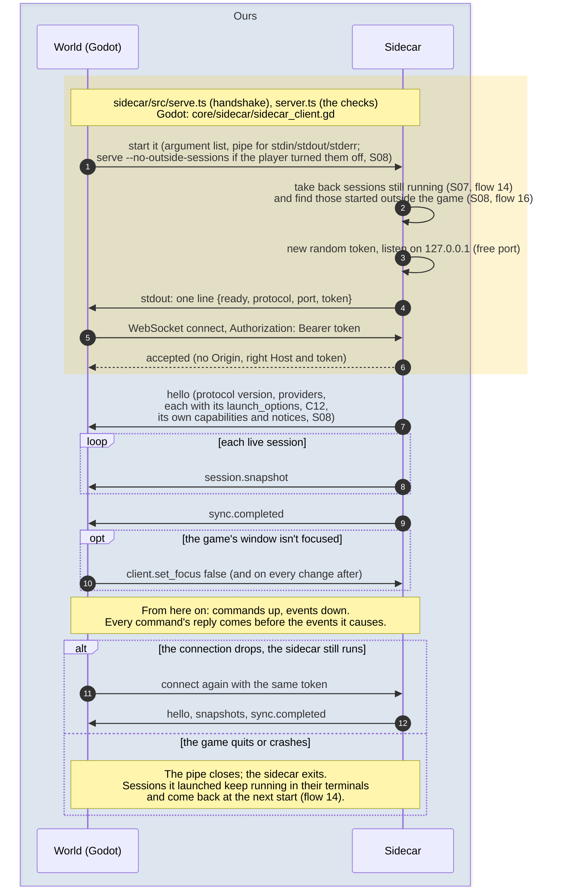

# 0. Starting up

[All diagrams](../../flows.md)

> **Status:** Built (S01, S07, S08). NOTES.md → S01, S07, S08, Protocol and Architecture → Security rules.

Until the first `sync.completed` (or a failure, or 30 s) the world is
covered (`world/loading_cover.gd`), so islands of sessions taken back
are standing from the first frame (S07). They wait for that
`sync.completed`, then come back as they were, from the game's
`islands.json` (W12, [flow 14](14-reattach-after-restart.md)).

A connection without the token, with an `Origin` header (any web page), or
with the wrong `Host` is refused before it starts. Events whose `seq` a
snapshot already covered are ignored; a gap in `seq` makes the world ask
for `session.get_snapshot`.
