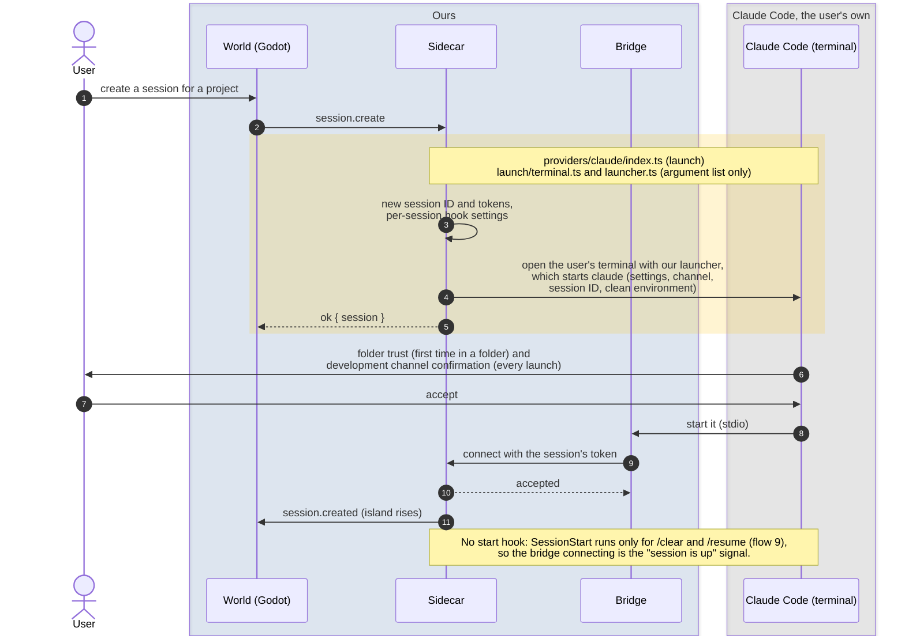

# 1. Create a session

[All diagrams](../../flows.md)

> **Status:** Built (S02; the world's side is S03's quick version). NOTES.md → S02 → Launch and Starting up, S03.

Ending: `/exit` in the terminal (or `session.end` from the world) →
Claude Code exits and its bridge's connection closes → `session.ended`
(its orchestrator and agents go; the island sinks once the player has
left it, NOTES.md → W04). Not the `SessionEnd` hook: it also fires for `/clear`,
when `claude` keeps running ([flow 9](09-clear-or-resume.md)).

Our settings file also turns Claude Code's agent view off
(`disableAgentView`), so Left at an empty prompt, `/bg` and `/fork` can't
move the conversation into a background session the world can't reach
(NOTES.md → S02 → Launch).

Which terminal opens depends on the OS and the user's setting; the
terminal is only given our launcher and a session file, and the launcher
starts `claude` with an argument list (NOTES.md → Architecture →
Platforms). Before any of this, Godot has started the sidecar ([flow 0](00-starting-up.md)).
`ok { session }` always comes before `session.created`; until the session
is up, commands for it get `session_starting`.

In the world for now (S03's quick version): the user picks the folder
from the sessions menu (hold Tab, click the ring's +, New session…), whose notice at the top of the screen shows
the reply's `notice` until `session.created`; then the session's island
rises out of the sea and the player is taken there once it's up (W04). A session that never comes up gets
`session.ended` and the notice says so: at once if the launcher exits
first (Claude Code quit at a startup dialog, or its terminal was closed;
the launcher writes its process id next to the session file and the
sidecar checks it every second), else after 15 minutes. The menu can also
stop waiting without telling the sidecar (NOTES.md → S02 → Starting up,
S03, W01 → Islands for sessions). The session's `project` in `session.created` (and in
snapshots) carries `repo`, its git repository, worked out by the sidecar
from the folder's `.git`; the world puts the island in that repository's
cluster, or in the cluster chosen in the menu, which it noted against the
session id from `ok { session }` (NOTES.md → W05).
