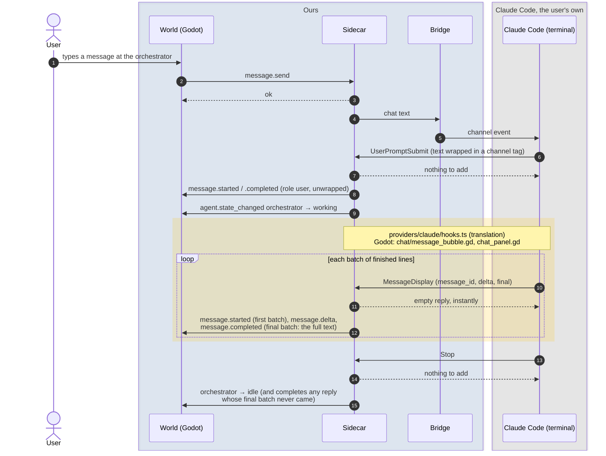

# 2. A chat turn

[All diagrams](../../flows.md)

> **Status:** Built (S02, C02; tool calls in between: C04). NOTES.md → S02, C02.

A message typed in the terminal arrives the same way, as plain text
without the channel tag. A `<task-notification>` or subagent hand-back
prompt is not a user message (see [flow 5](05-subagent.md)). Tool calls in between are
`tool.started` / `tool.finished` ([flow 5](05-subagent.md) shows them); the world files
each under the latest message, folded into one line (C04).

**Titles** (NOTES.md → S02 → Titles). While the session has no name, the
first user message's line names it: a `session.updated` (title) along
with its `message.completed`. Claude Code's own title (`ai-title`) and a
`/rename` (`custom-title`) come as transcript lines the sidecar follows;
each change of the title shown is another `session.updated` (title).
