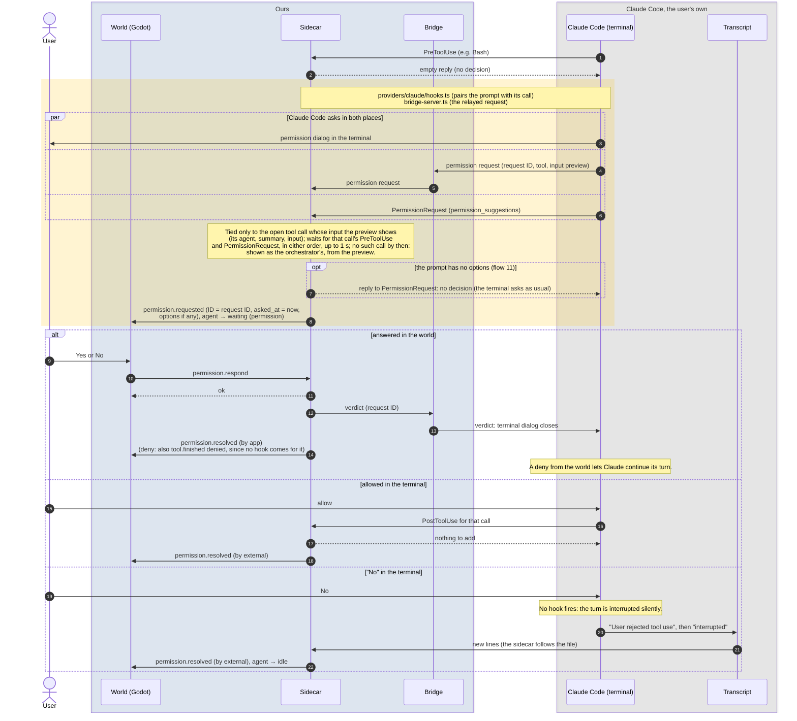

# 3. A permission prompt

[All diagrams](../../flows.md)

> **Status:** Built (S02, C05). NOTES.md → S02, C05.

In the world, "Yes or No" and "picks options or types an answer"
([flow 4](04-clarifying-question.md)) happen on the card in the chat panel (NOTES.md → C05): one
request at a time, oldest first; it moves on when `permission.resolved`
or `question.resolved` arrives, whichever side answered.

Picking one of the prompt's other options goes through its held hook
instead ([flow 11](11-prompt-options.md)). If a prompt still has a held hook when its call ends
(`tool.finished`), the hook is let go with nothing to add.

The "No" line names the call's `tool_use_id`, so the sidecar resolves that
exact prompt and closes the call as `denied`. When transcripts are off, a
terminal "No" is only noticed when the orchestrator's turn ends or the user
sends the next message: its prompts resolve as deny, by external. A
subagent's prompt resolves when that subagent stops.
