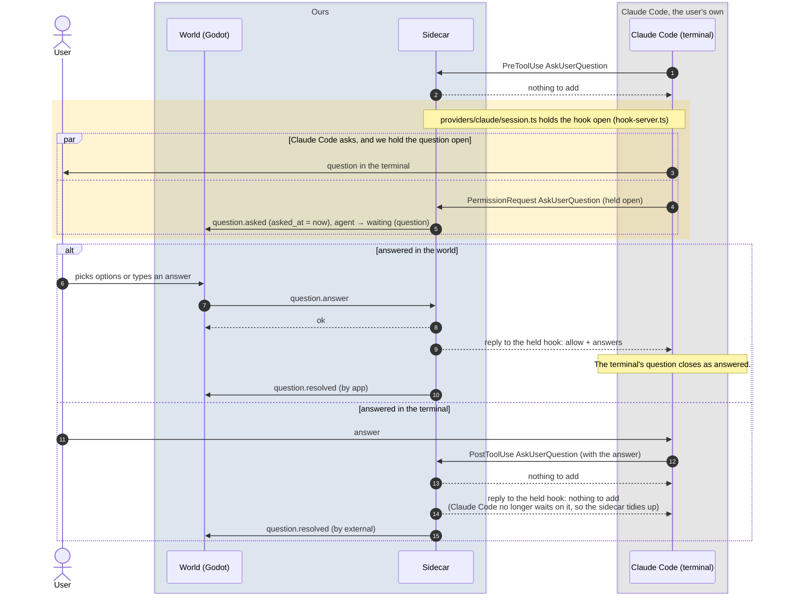

# 4. A clarifying question

[All diagrams](../../flows.md)

> **Status:** Built (S02, C05). NOTES.md → S02, C05.

A free-text `response` from the world is sent as a deny carrying the
user's words. If Claude Code drops the held hook (it timed out, or
`claude` exited), or the turn ends with the question open (Esc), the
question resolves by external.
