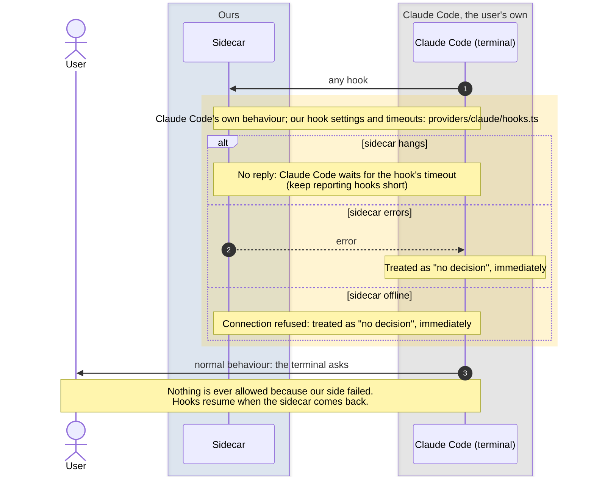

# 7. When our side fails

[All diagrams](../../flows.md)

> **Status:** Built and verified for hanging, erroring and offline hooks (S02). NOTES.md → Architecture → Security rules → Fail safe.

If the user's settings only allow other hook URLs (`allowedHttpHookUrls`),
no hook ever arrives and nothing reports an error. The sidecar notices when
a world message sent while the orchestrator is idle brings no hook within
10 s, and sends `session.notice` (`hooks_unavailable`); chat still works
through the bridge.
