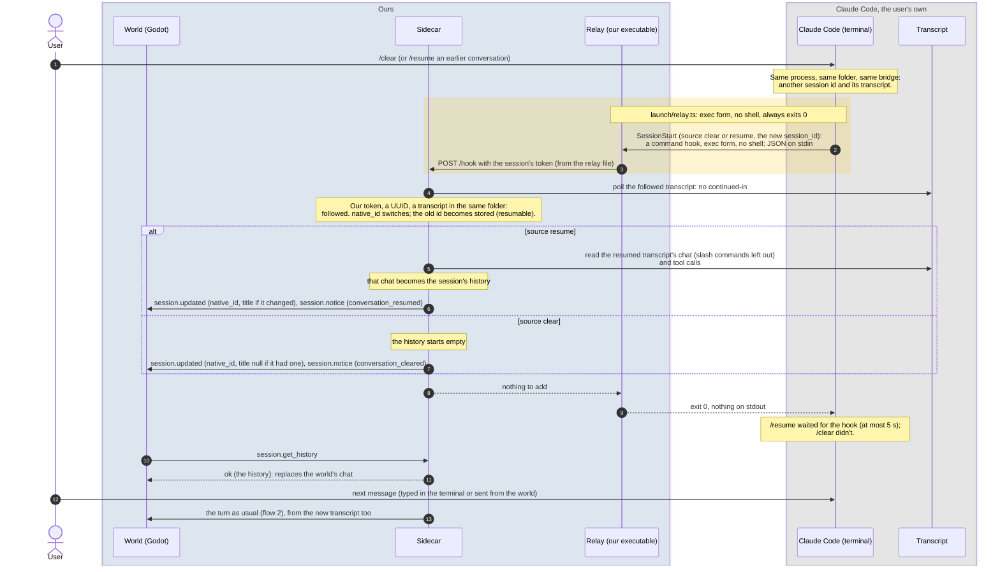

# 9. /clear or /resume: another conversation in the session

[All diagrams](../../flows.md)

> **Status:** Built (S02). NOTES.md → S02 → Following the conversation.

The island stays. After `/clear` the world's chat window clears, and
the notice says the earlier conversation can be brought back with
`/resume`; after `/resume` the chat becomes the
resumed conversation's (NOTES.md → S02 → Following the conversation).

**If the relay fails** (it always exits 0, so Claude Code carries on),
the world learns of the switch at the new conversation's first hook
instead: a `UserPromptSubmit` with the new `session_id` goes through the
same checks, and it counts as `/resume` if the new transcript holds a
reply from Claude, else `/clear`.

**A moved conversation.** If the followed transcript gets a
`continued-in` entry instead (the conversation went on in another
session, which agent view used to do), the sidecar sends
`session.notice` (`conversation_moved`) and ignores the new session's
hooks: the terminal handles everything. From then on `message.send`,
`permission.respond` and `interrupt.request` get `error`
(`provider_error`, "This conversation moved to another Claude Code
session; continue it in the terminal."). Separately, whenever the bridge
isn't connected, `message.send` and `permission.respond` get
`provider_error` saying the world can't reach the conversation right
now, rather than losing the message.
