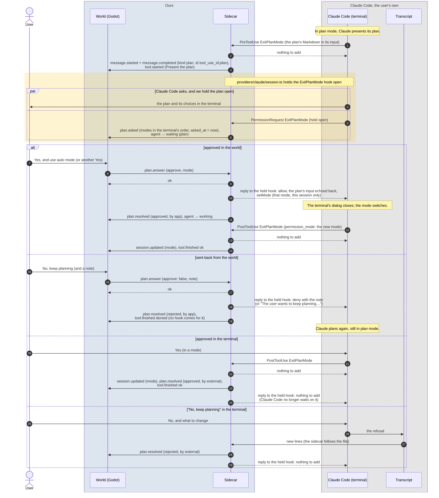

# 10. A plan to approve (C07)

[All diagrams](../../flows.md)

> **Status:** Built (C07, S02). NOTES.md → S02 → Permission modes and plans, C07.

Plans have no channel relay, so the held hook is the only way to answer
one from the world (NOTES.md → S02 → Permission modes and plans). The
plan's message stays in the chat whatever the answer; the card in the
chat panel (NOTES.md → C07) goes when `plan.resolved` arrives, whichever
side answered. A terminal "No" is also caught by the turn ending (for
example with transcripts off). If Claude Code drops the held hook
(`claude` exited), the plan resolves as rejected, by external. A stop
from the world sends held plans back.
