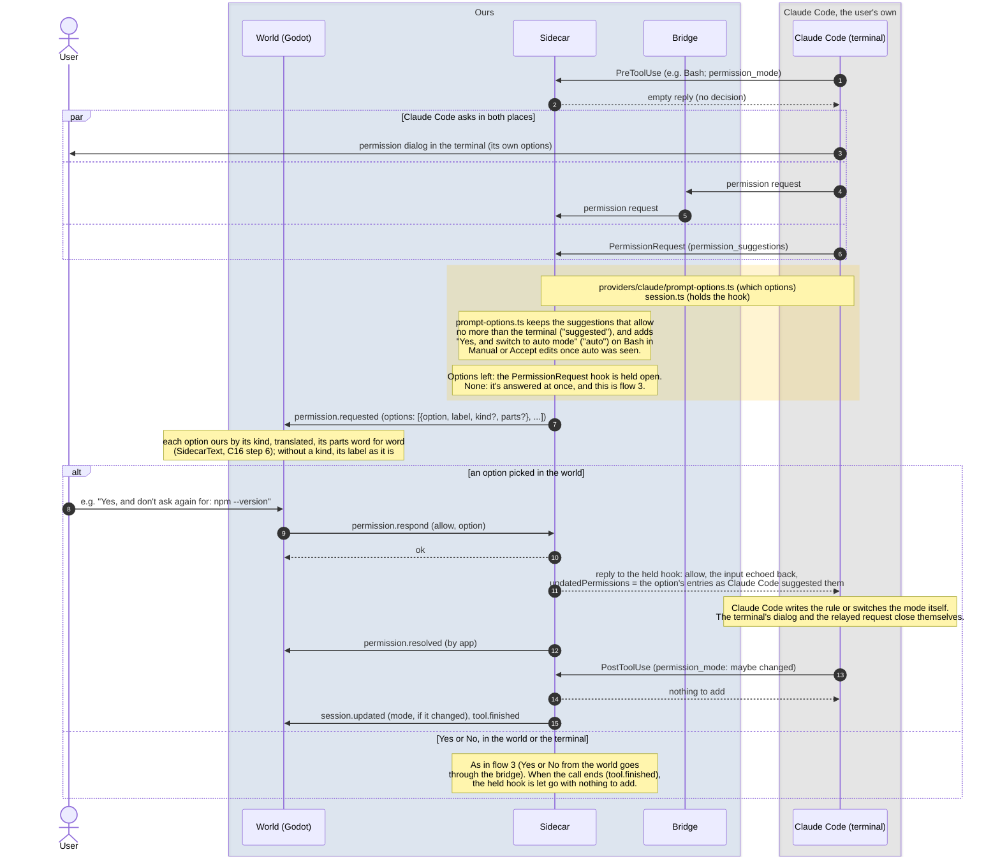

# 11. A prompt's other options (C05, C06)

[All diagrams](../../flows.md)

> **Status:** Built (C05, C06). NOTES.md → S02 → Prompt options.

The terminal's prompts offer more than Yes and No ("Yes, and don't ask
again for: npm test \*", "Yes, and switch to auto mode", ...). The world
offers the ones it can (NOTES.md → S02 → Prompt options).

If the held hook is gone (Claude Code stopped waiting on it) or the
option isn't one of the prompt's, an answer with an option gets `error`
(`provider_error`, "This prompt can't be answered that way right
now. Answer Yes or No, or answer in the terminal."). A prompt already
shown without options (its hook came after the 1 s wait) keeps none.
