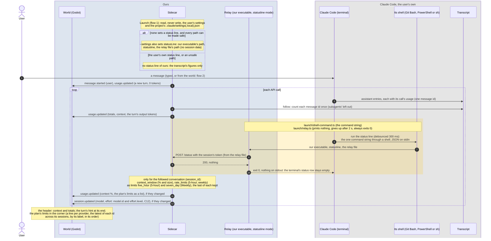

# 12. Token usage: the transcript and the status line relay

[All diagrams](../../flows.md)

> **Status:** Built (C08, S02). NOTES.md → C08 Token usage.

**History.** `session.get_history` gives each user message its turn's
output tokens (`turn_tokens`), and the snapshot has the session's
`usage`, so a reopened chat or a reconnect shows the same figures. A
resumed conversation is counted from its transcript (flow 8, flow 9);
`/clear` starts the counts over and keeps the plan's limits.

**If the relay fails** (it always exits 0, prints nothing and gives up
after 2 s), Claude Code carries on and the world keeps the transcript's
figures and the last status line figures it had. A limit whose reset
time has passed is hidden in the world.

**The one exception to "No shell strings"** (NOTES.md → Security
rules): Claude Code runs a status line only through a shell. The
command string holds only our own fixed paths and the mode word, as
unquoted short paths on Windows (the same in Git Bash and PowerShell)
and POSIX single quotes elsewhere. It goes as soon as Claude Code can
run a status line without a shell (NOTES.md → Watch items).

**Model and effort** (C12): the same status line input carries
`model.id` and `effort.level`; the sidecar sends them as `session.updated`
for the chat header. Without our status line, the model comes from
`SessionStart` and `PostModelSwitch`, the effort from the orchestrator's
hooks (NOTES.md → S02 → Model, effort and mode at launch).
