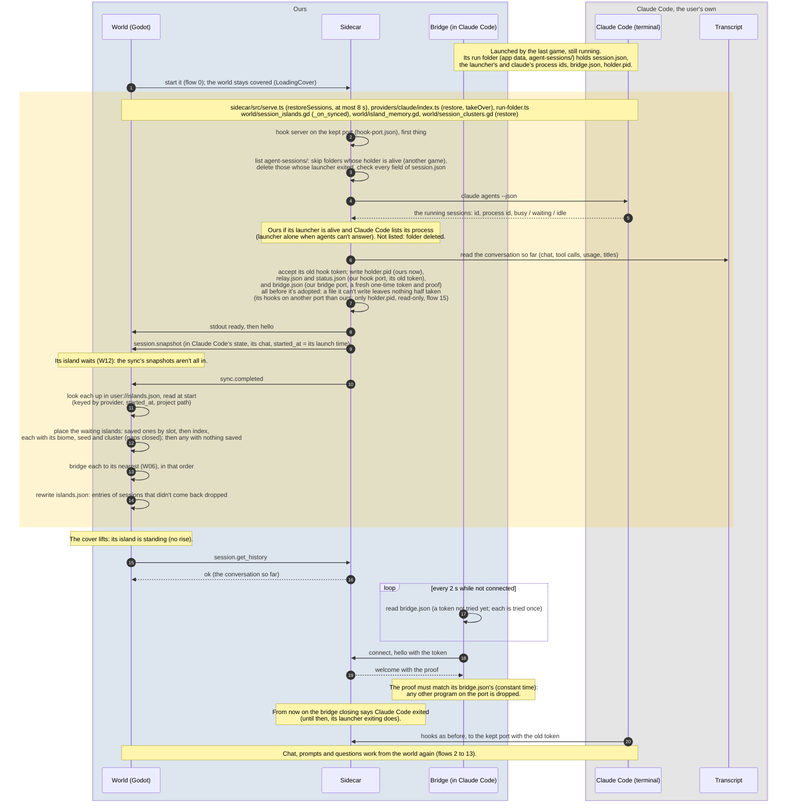

# 14. Coming back after a restart

[All diagrams](../../flows.md)

> **Status:** Built (S07, W12). NOTES.md → S07 Reattach to running
> sessions, W12 Islands kept across restarts.

**The session's state** comes from `claude agents --json` (busy is
working, waiting is waiting for input, idle) until its next hook says
otherwise. A prompt or question open at the restart stays in the
terminal: its held hook died with the old sidecar, and Claude Code fell
back to its own dialog.

**`/clear` or `/resume` while the game was closed:** Claude Code lists
the session under its new id, which the world follows, and the run
folder's record is rewritten with it.

**The kept port taken** (another program got it while the game was
closed): the sidecar listens on another port, the session comes back
anyway, read-only, with the `reattached_read_only` notice: none of
its hooks, relays or bridge is taken, and it's seen from its transcript
and `claude agents` (flow 15).

**Its island (W12):** the game keeps each island's biome, seed, cluster
and spot in `user://islands.json`, written as islands are placed and
sessions end. A missing or damaged file, or a session with no entry,
gives a new island as before. A session found after the restore wait
arrives after `sync.completed`, when its entry was already dropped:
it comes back as a new island (NOTES.md → W12, Open points).

**When nothing comes back:** a folder whose session ended is deleted,
one that can't be read is left alone, and a restore that fails or takes
longer than 8 s never stops the start (the world shows what's there; a
session found later arrives on its own as a `session.snapshot`).
The cover lifts on the first `sync.completed`, the sidecar failing, or
after 30 s.
