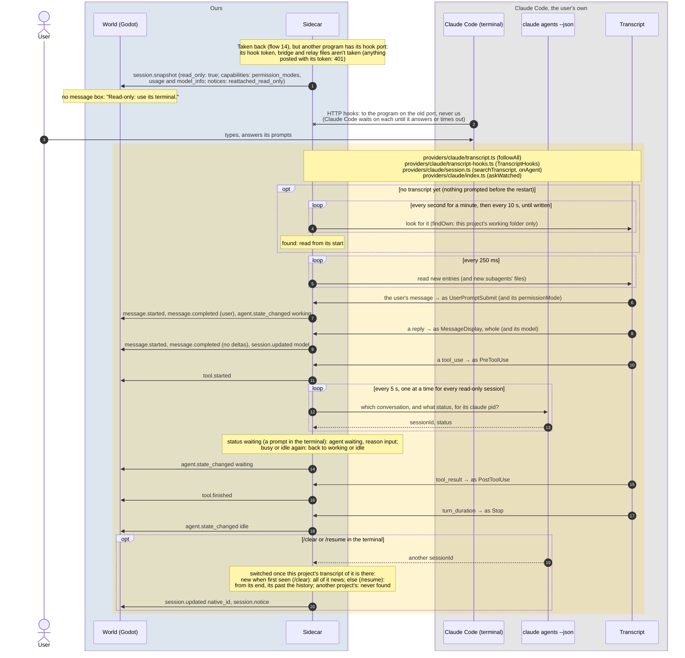

# 15. A session back with its hook port taken (read-only)

[All diagrams](../../flows.md)

> **Status:** Built (S07). NOTES.md → S07 → If the old port is taken.

**Shown, a moment late, from the transcript:** your messages, its
replies (whole, not streamed), tool calls and subagents (each from its
own file under `<session>/subagents/`, tied to its Agent call by its
`.meta.json`), the turn's end (Claude Code's `turn_duration` entry), Esc
and a terminal "No", the permission mode (its `permission-mode` entries
and each prompt's `permissionMode`), the model (each reply's), and token
usage and context (no percent or account limits: those need the status
line). A session busy at the restart stays working until then. One with
no transcript yet at the restart has it looked for (every second for a
minute, then every 10 s; only a file with this project's working folder)
until Claude Code writes it, and read from its start.

**Shown from `claude agents --json`** (every 5 s, one call for all
read-only sessions, only while there are any): waiting on the user in
the terminal, and `/clear` and `/resume`. With agent view off, neither.

**Not from the world:** chat (`message.send` gets `not_supported`),
answers to prompts, questions and plans, and the stop
(`interrupt.request` gets `not_supported`). Subagents already running at
the restart aren't shown. Ending the session with `/exit` and resuming
it from the world gives it everything again.

**The program on the old port** gets the session's hooks, token and tool
input included, and could answer them (NOTES.md → Security rules → Known
gap). The world takes nothing from it: the session's token isn't
accepted on our port, and its relays and bridge are left pointing where
they were.
