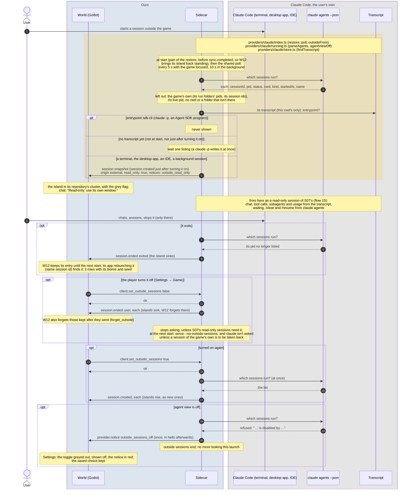

# 16. Sessions started outside the game (read-only)

[All diagrams](../../flows.md)

> **Status:** Built (S08). NOTES.md → S08, Protocol → Provider capabilities and notices, C10.

**Which sessions:** every live one Claude Code lists except `claude -p`
runs and Agent SDK programs: terminals, the Claude desktop app, IDEs,
and background sessions still working or blocked. Not finished
background sessions. A session held by a second copy of the game is
shown read-only here too.

**Not from the world:** chat, answers to prompts, questions and plans,
and the stop, as in flow 15. Nothing of the session is written by
the sidecar: no run folder, no hook token (the game's `islands.json`
keeps its island, W12).
