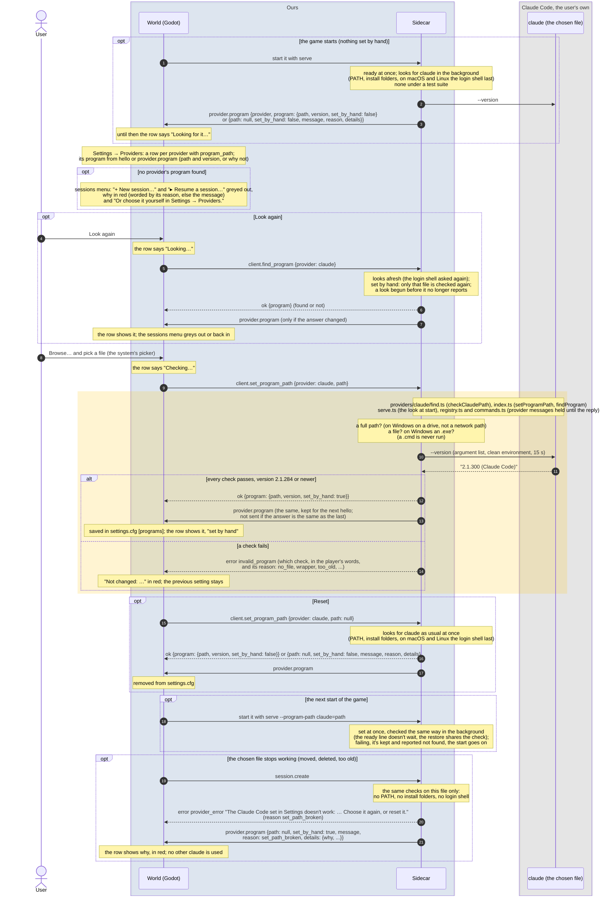

# 17. Choosing Claude Code by hand

[All diagrams](../../flows.md)

> **Status:** Built (S02, C10, S03, C16). Godot words each reason
> (`core/sidecar/sidecar_text.gd`, NOTES.md → C16 → How the codes work). NOTES.md → S02 → The program set by hand, Protocol → Provider capabilities and notices → `program_path`, C10, Architecture → Platforms → Finding `claude`.

**When the sidecar looks.** At start, in the background; each time it
needs `claude` (a launch or resume, asking which sessions run for the
stored list, S07's restore and S08's poll); right after a path is set
or cleared; and on Look again. Looks that come while one runs share
its answer, so `--version` runs once at start. What it finds is not
saved, only a path set by hand.

**Sessions already running** keep the `claude` they were started with;
the choice is for sessions started or resumed after it.
