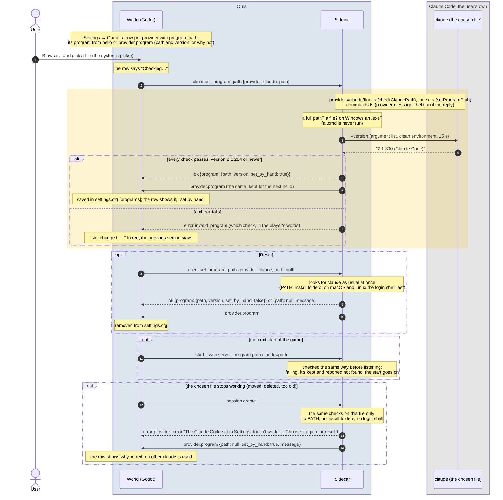

# 17. Choosing Claude Code by hand

[All diagrams](../../flows.md)

> **Status:** Built (S02, C10). NOTES.md → S02 → The program set by hand, Protocol → Provider capabilities and notices → `program_path`, C10, Architecture → Platforms → Finding `claude`.

**When the sidecar looks.** Each time it needs `claude` (a launch or
resume, asking which sessions run for the stored list, S07's restore and
S08's poll) and right after a path is set or cleared. With nothing set,
nothing at start runs `claude` unless the sidecar already asks it
something then (outside sessions on, sessions to take back), so the row
may say "Not looked for yet" until the first session starts.

**Sessions already running** keep the `claude` they were started with;
the choice is for sessions started or resumed after it.
