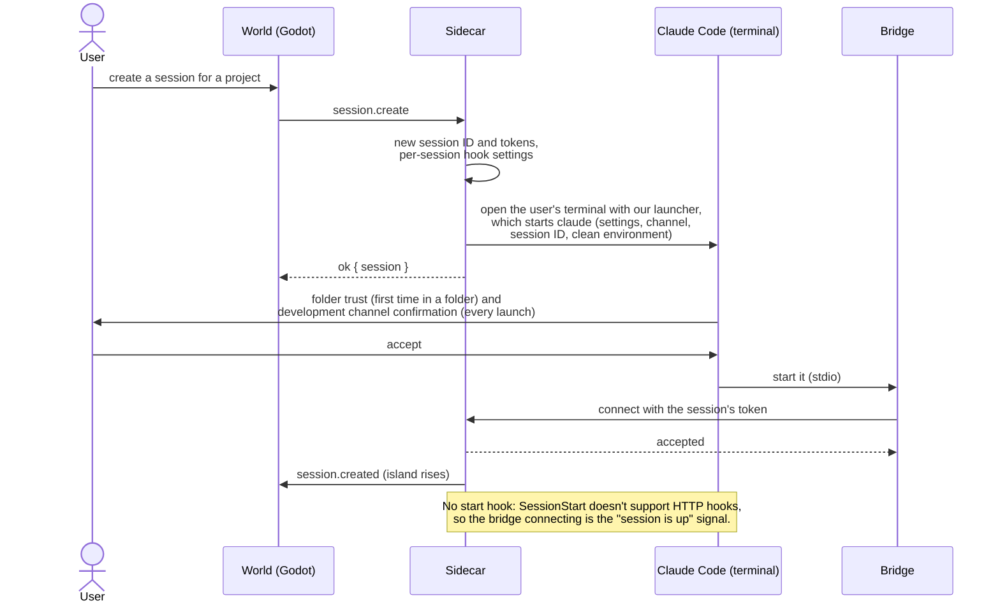
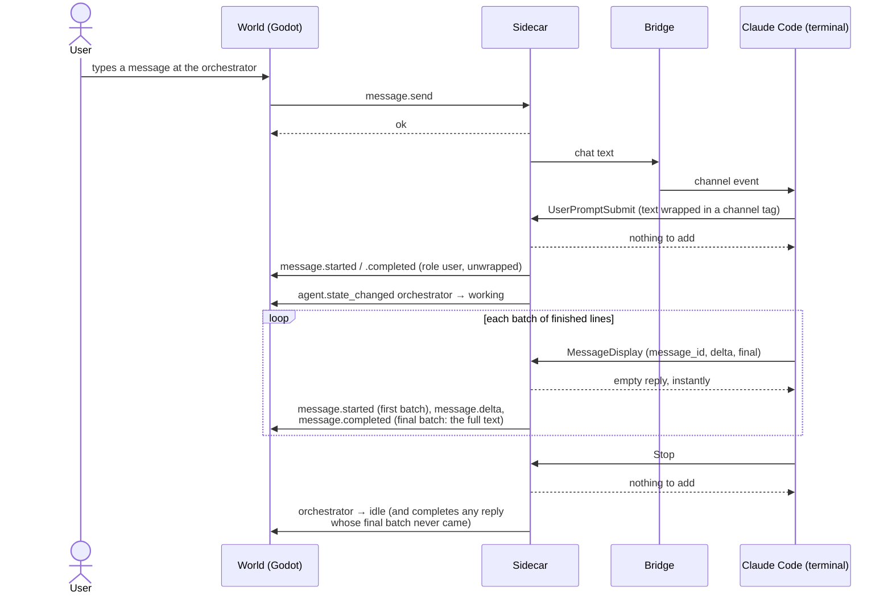
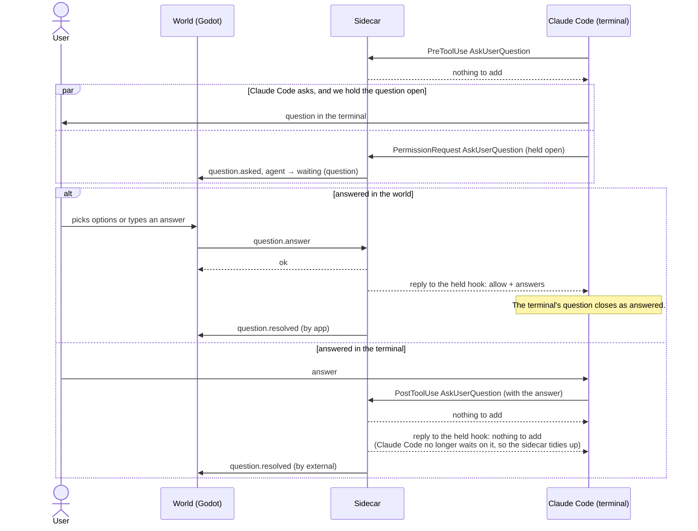
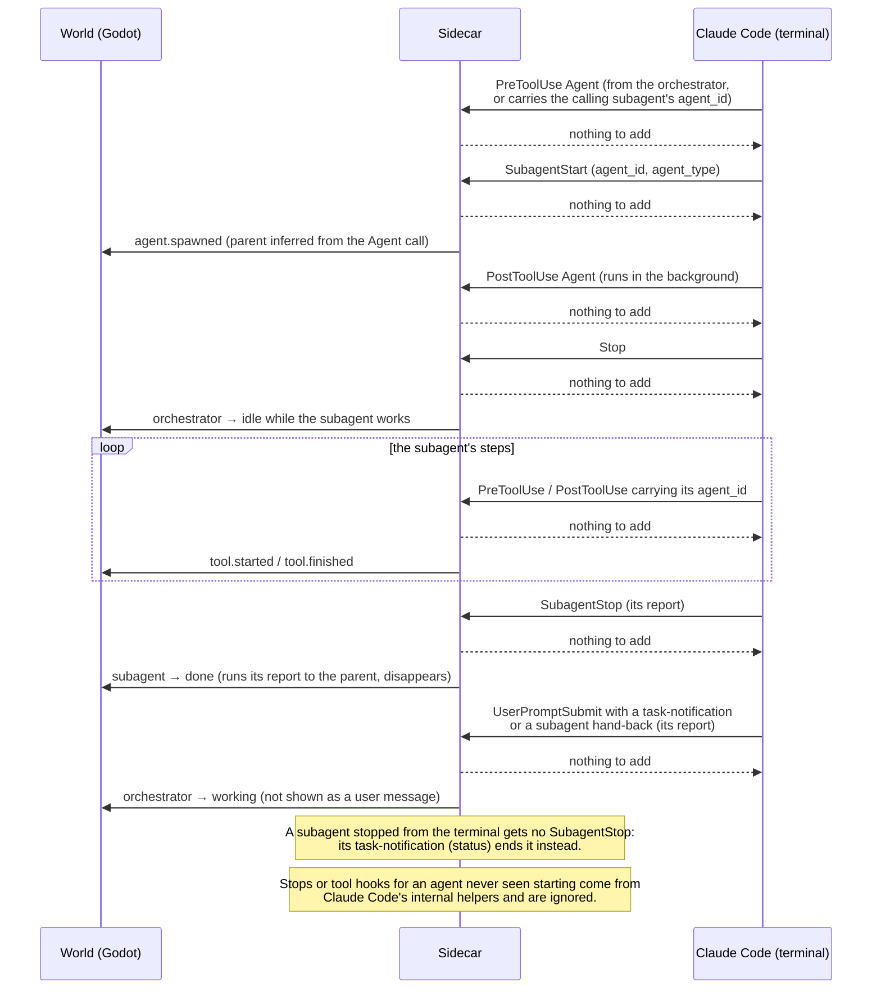
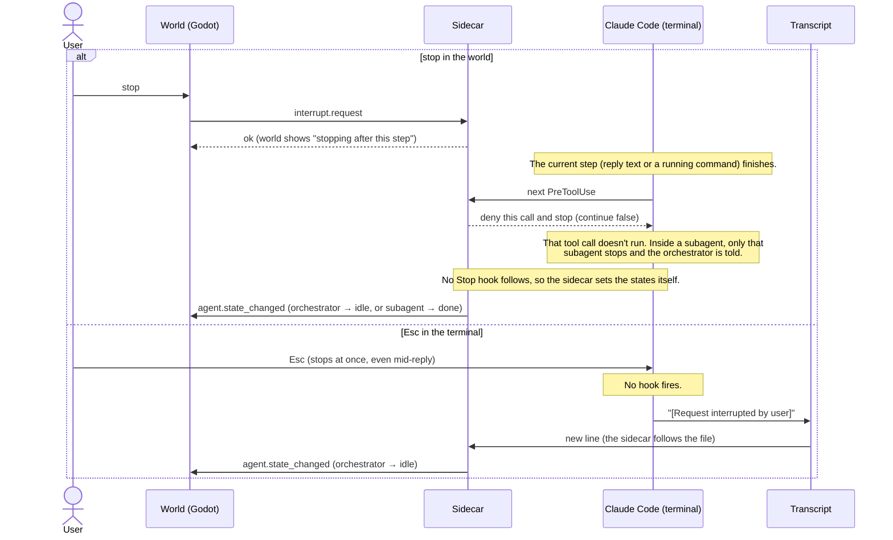
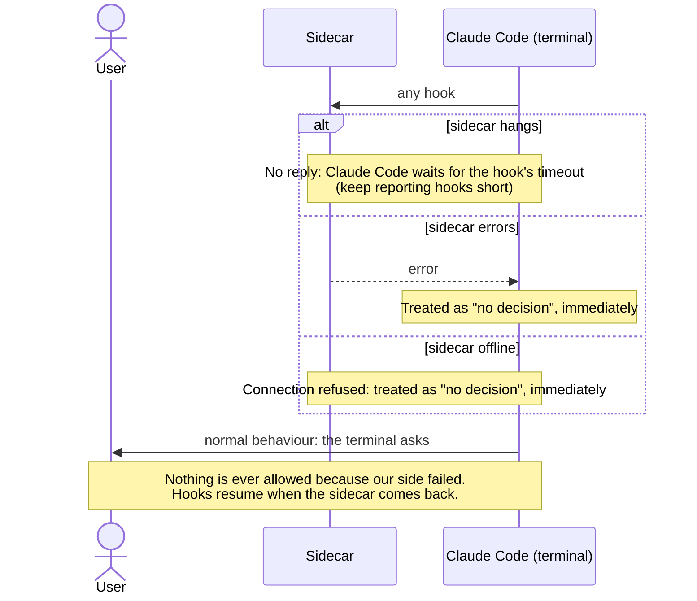

# Flows

Step-by-step diagrams of how the pieces talk to each other, for the Claude
provider on the CLI route. They show the behaviour verified by the M0
integration spike (dev log 2026-09-29-claude-cli-spike). NOTES.md stays
the source of truth: when S02 or the Protocol section changes, update the
matching flow here in the same branch.

GitHub draws the Mermaid blocks as diagrams. Arrows between World and
Sidecar are protocol messages (NOTES.md → Protocol); arrows from Claude
Code are hooks (HTTP, with the session's token); Bridge is our channel
bridge (NOTES.md → S02).

The terminal and the world are two windows onto the same session: you can
switch between them at any point, and whichever answers first wins.
Transcript is Claude Code's session file, which the sidecar follows
read-only for the things no hook reports (NOTES.md → S02). If the user
turned transcripts off in Claude Code, the Transcript steps don't happen
and the world waits for the next hook instead (NOTES.md → S02 → When
transcripts are off).

**How to read these.** Time runs top to bottom; each arrow is one message.
- **Solid arrow:** a message. **Dashed arrow:** the reply to an earlier
  request.
- **Requests always get a reply, and every reply is drawn**, even when it
  says nothing. Two kinds of requests: hooks (Claude Code asks the sidecar
  "anything to add?"; the usual answer is "nothing to add") and commands
  from the world (answered `ok` or `error`).
- **Announcements get no reply:** "this happened" messages, such as protocol
  events to the world, chat or verdicts passed along through the bridge,
  and new lines in the transcript.
- Boxes are notes, or group steps: `loop` repeats, `alt` / `else` are
  alternatives, `par` / `and` happen at the same time.

- [0. Starting up](#0-starting-up)
- [1. Create a session](#1-create-a-session)
- [2. A chat turn](#2-a-chat-turn)
- [3. A permission prompt](#3-a-permission-prompt)
- [4. A clarifying question](#4-a-clarifying-question)
- [5. A subagent](#5-a-subagent)
- [6. Stopping](#6-stopping)
- [7. When our side fails](#7-when-our-side-fails)

## 0. Starting up

```mermaid
sequenceDiagram
    participant World as World (Godot)
    participant Sidecar

    World->>Sidecar: start it (argument list, pipe for stdin/stdout/stderr)
    Sidecar->>Sidecar: new random token, listen on 127.0.0.1 (free port)
    Sidecar->>World: stdout: one line {ready, protocol, port, token}
    World->>Sidecar: WebSocket connect, Authorization: Bearer token
    Sidecar-->>World: accepted (no Origin, right Host and token)
    Sidecar->>World: hello (protocol version, providers)
    loop each live session
        Sidecar->>World: session.snapshot
    end
    Sidecar->>World: sync.completed
    Note over World,Sidecar: From here on: commands up, events down.<br/>Every command's reply comes before the events it causes.
    alt the connection drops, the sidecar still runs
        World->>Sidecar: connect again with the same token
        Sidecar->>World: hello, snapshots, sync.completed
    else the game quits or crashes
        Note over World,Sidecar: The pipe closes; the sidecar exits.<br/>Sessions it launched keep running in their terminals.
    end
```

A connection without the token, with an `Origin` header (any web page), or
with the wrong `Host` is refused before it starts. Events whose `seq` a
snapshot already covered are ignored; a gap in `seq` makes the world ask
for `session.get_snapshot`.

## 1. Create a session



Ending: `/exit` in the terminal (or `session.end` from the world) →
Claude Code exits and its bridge's connection closes → `session.ended`
(island sinks). Not the `SessionEnd` hook: it also fires for `/clear`,
when `claude` keeps running.

Which terminal opens depends on the OS and the user's setting; the
terminal is only given our launcher and a session file, and the launcher
starts `claude` with an argument list (NOTES.md → Architecture →
Platforms). Before any of this, Godot has started the sidecar (flow 0).
`ok { session }` always comes before `session.created`; until the session
is up, commands for it get `session_starting`.

## 2. A chat turn



A message typed in the terminal arrives the same way, as plain text
without the channel tag. A `<task-notification>` or subagent hand-back
prompt is not a user message (see flow 5). Tool calls in between are
`tool.started` / `tool.finished` (flow 5 shows them).

## 3. A permission prompt

```mermaid
sequenceDiagram
    actor User
    participant World as World (Godot)
    participant Sidecar
    participant Bridge
    participant Claude as Claude Code (terminal)
    participant Log as Transcript

    Claude->>Sidecar: PreToolUse (e.g. Bash)
    Sidecar-->>Claude: empty reply (no decision)
    par Claude Code asks in both places
        Claude->>User: permission dialog in the terminal
    and
        Claude->>Bridge: permission request (request ID, tool, input preview)
        Bridge->>Sidecar: permission request
    end
    Note over Sidecar: Tied to the open tool call whose input the preview shows<br/>(its agent, summary, input); waits up to 300 ms for its PreToolUse.
    Sidecar->>World: permission.requested (ID = request ID),<br/>agent → waiting (permission)
    alt answered in the world
        User->>World: allow or deny
        World->>Sidecar: permission.respond
        Sidecar-->>World: ok
        Sidecar->>Bridge: verdict (request ID)
        Bridge->>Claude: verdict: terminal dialog closes
        Sidecar->>World: permission.resolved (by app)<br/>(deny: also tool.finished denied, since no hook comes for it)
        Note over Claude: A deny from the world lets Claude continue its turn.
    else allowed in the terminal
        User->>Claude: allow
        Claude->>Sidecar: PostToolUse for that call
        Sidecar-->>Claude: nothing to add
        Sidecar->>World: permission.resolved (by external)
    else "No" in the terminal
        User->>Claude: No
        Note over Claude: No hook fires: the turn is interrupted silently.
        Claude->>Log: "User rejected tool use", then "interrupted"
        Log->>Sidecar: new lines (the sidecar follows the file)
        Sidecar->>World: permission.resolved (by external), agent → idle
    end
```

Until the transcript follower is built (and when transcripts are off), a
terminal "No" is noticed when the orchestrator's turn ends or the user
sends the next message: its prompts resolve as deny, by external. A
subagent's prompt resolves when that subagent stops.

## 4. A clarifying question



## 5. A subagent



## 6. Stopping



## 7. When our side fails


